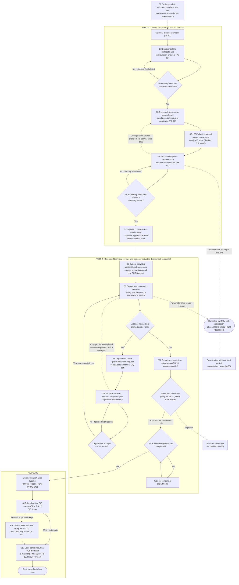
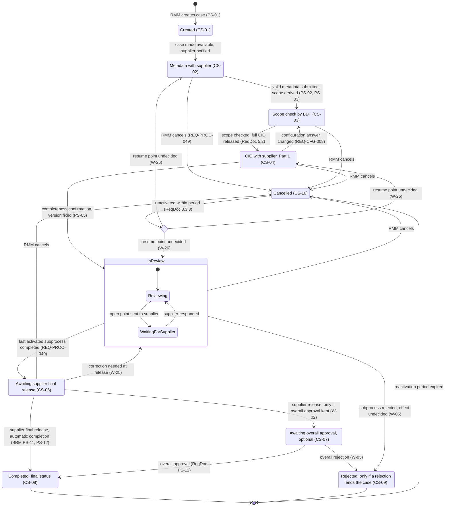

# 01 — Expected Workflow & Status Model (BDF CIQ MVP)

> **Superseded in part by the client call of 9 Oct 2026** (`context/decisions/2026-10-09-client-call.md`). There is no RMM scope check or scope release: the supplier answers the metadata questions and sections open or close live. RMM reviews in Part 2 in parallel with the departments and completes like them. The ending is the requirements-matrix ending only: there is no overall approval and no overall approver. Where this document says otherwise, the decisions file wins.

> Discovery analysis for the first clarification call with BDF's consultant (2026-10-06). Nothing is being built yet. Prepared 2026-10-05 from all seven raw dumps in `context/raw/`, with spot checks on the original files (PDF layout extraction, Excel fills and file metadata).

**How to read this file**

- A plain statement is **STATED** in a client document and carries a citation.
- Text marked **(inferred)** is our reasoning, not a client statement.
- `W-xx` = open workflow decision BDF must make (register in §9). `D-xx` = disagreement between sources (§3.2). `E-xx` = edge case or exception path (§3.3).
- Citation codes follow `context/00-glossary.md`. **ReqDoc** = requirements PDF. **BRM** = business requirements matrix. **FLM** = field-level matrix: `FLM rNN` is sheet 'CIQ new version' row NN, `FLM changelog rNN` is sheet 'Notes & change log', `Feldkatalog rNN` is the old German sheet. **KB** = Knowledge Baseline. **CIA** = functional screening (with Kissflow's answers). **VQ** = non-functional screening (with Kissflow's answers). **IKW** = industry sample (not BDF's).

---

## 0. Source facts that shape the workflow

| Source | What it is | Facts that matter for the workflow |
|---|---|---|
| **ReqDoc** | "Requirements specification (business level)", Version 2, status "Business process (MVP phase)", 16 Sep 2026, owner Alexander Pevzner (Technical Product Owner) [ReqDoc p.1] | The page header still reads "Requirements Document v1.4" and the PDF title is "CIQ_Requirements_Document_v1_Two_Phase_Process" [ReqDoc p.1, metadata], so the version labels are inconsistent. It calls "the process diagram" authoritative for structure and sequence [ReqDoc p.2 §2], but that diagram is not in the shared files (0 embedded images on all 14 pages) [ReqDoc p.1–14]. It defers detailed requirements to "the CIQ requirements matrix" [ReqDoc p.1 §1]. Undecided items "are not resolved by assumption" [ReqDoc p.2 §2]. §3.3 goes from its heading straight to §3.3.2, so there is no §3.3.1 "Synchronisation" text [ReqDoc p.5]. |
| **BRM** | 51 requirements with acceptance criteria. Column H is "MVP recommendation". | 48 are marked MVP (green) and 3 are "MVP partial scope" (REQ-PROC-021, -022, -024). None is Post-MVP [BRM col H; BRM Legend r4–r6]. The workbook was created 15 Sep 2026, one day before the ReqDoc [file metadata]. The legend points to a sheet "Open points" that does not exist, and no cell uses the legend's yellow marking [BRM Legend r7; verified in file]. Column I "Open question / comment" is empty in every row. The requirement text of REQ-CFG-008, REQ-CFG-009, REQ-PROC-020 and REQ-PROC-024 has a light-orange fill that the legend does not explain (inferred: recently added or changed). From PS-06 onward the BRM numbers steps differently from the ReqDoc (§2.2). |
| **FLM v0.6** | Field-level matrix, last modified 2 Oct 2026 by "Pevzner, Alexander" [file metadata]. This is the newest BDF-authored artefact. | The 'CIQ new version' sheet covers only Process Start, Meta Data, Manufacturing process (Annex 2), Annex 1 and Annex 4 [FLM r2–r55]. Annex 3 is called "outside test scope" [FLM r41; FLM changelog r140]. (inferred) This sheet may define the content scope of the MVP test. It cites REQ IDs that do not exist in the BRM (REQ-PROC-003, -104, -106; REQ-CFG-102, -103, -105; REQ-ADR-003; REQ-CTL-012) [FLM r3–r5, r8, r16; Feldkatalog r24, r27, r49]. The old sheet's column header is "Ref. v3.1 (REQ-ID)" [Feldkatalog r1]. One ID even changed meaning: REQ-PROC-033 is "INCI auto-fill" in [Feldkatalog r56] but "communication history" in the BRM. (inferred) An earlier matrix v3.1 exists, so FLM REQ references are not reliable for traceability. |
| **KB** | "Knowledge Baseline & Gap Sheet" | The workbook was created 5 Oct 2026 14:32:24 UTC by "openpyxl", within about 0.1 s of the last save of CIA, BRM and VQ [file metadata]. Its legend says defaults were "proposed by the build team" [KB ReadMe r21], and every customer-answer column is empty. (inferred) This is not a BDF-authored statement. It is used here only to cross-reference open points (OP-xx are BDF's numbers, NEW-xx were added in the KB). |
| **CIA / VQ** | BDF screening questionnaires (functional and non-functional), June 2026, containing **Kissflow's submitted answers** | These show BDF's Must-Haves: Teamcenter trigger [CIA #1], subprocess approvals [CIA #11], B-Flow storage [CIA #12, #15], final approval with a consolidated final document [CIA #14] and status transfer to Teamcenter [CIA #18]. They also show what Kissflow has already claimed. |
| **IKW** | IKW 2019 supplier questionnaire, explicitly "not Beiersdorf" | Industry reference only. It recommends reconfirming the questionnaire "e.g. in two year intervals" [IKW p.2]. |

---

## 1. The process in one paragraph (business audience)

Today Beiersdorf exchanges the Cosmetic Ingredient Questionnaire (CIQ) with each raw-material supplier as a document, and Raw Material Management (RMM) relays every question, reminder and document between the departments and the supplier [ReqDoc p.1 §1]. In the target process, RMM opens one CIQ case per raw material and supplier and names the supplier contact [BRM REQ-PROC-001]. The supplier first answers only basic data and a few configuration questions, above all the origin of the components. From these answers a business-maintained rule set generates the case-specific questionnaire, marking every chapter, annex and evidence document as mandatory, optional or not applicable [ReqDoc p.9 §5.1–5.2; BRM REQ-PROC-009, -010]. Beiersdorf then sees that scope and can extend it if needed before the full questionnaire is released [ReqDoc p.10 §5.2]. The supplier fills it in as structured data, uploads evidence at the exact question it belongs to, and confirms that its submission is complete. This completeness confirmation is explicitly not a Beiersdorf approval. It fixes the submitted version and closes Part 1 [ReqDoc p.4 §3.1.5; BRM REQ-PROC-014, -016]. Part 2 opens review tasks only for the departments the case actually concerns, and they work in parallel [ReqDoc p.4 §3.2.1; BRM REQ-PROC-017, -018]. Each department asks the supplier directly for clarifications or extra documents. Every request is pinned to the exact field or file and tracked as an open point until the department accepts the answer [BRM REQ-PROC-029, -034, -035]. Safety and Regulatory record their assessment in the internal RMES evaluation sheet, which suppliers never see [ReqDoc p.4–5 §3.2.3]. When every involved department has completed its review, the supplier gets one single request to give the final release of the CIQ, which locks it. The case then completes automatically, and a final PDF is filed and sent to RMM [BRM REQ-PROC-040, -042, -043, -045, -046]. The requirements document ends differently: with a Beiersdorf approve/reject per review track, an overall CIQ approval by a role not yet named, and filing in B-Flow with status feedback to the preceding system [ReqDoc p.3 PS-11–PS-13; p.5 §3.3.2–3.3.3]. How the process ends is therefore the first thing to settle with BDF (W-02).

---

## 2. Actors, step numbering and swimlane step table

### 2.1 Actors (lanes)

| Lane | Who | Stated responsibilities |
|---|---|---|
| **RMM** | Raw Material Management | Starts the case [ReqDoc p.3 §3.1.1; BRM REQ-PROC-001]. Cancels it [BRM REQ-PROC-049]. May complete a case manually in exceptional cases [BRM REQ-PROC-045]. Receives the final PDF [BRM REQ-PROC-046]. Identifies bottlenecks and blocking reasons from dashboards [BRM REQ-CTL-006; ReqDoc p.14 REQ-RMES-018]. Today RMM is the single intermediary for every question and document; in the target, questions go directly between department and supplier [ReqDoc p.1 §1]. Leads K2.3 and co-owns K1 [ReqDoc p.6 §4.1]. Its own target subprocess is still open [ReqDoc p.5 §3.2.5]. |
| **Supplier** | Named supplier contact(s) | The primary contact e-mail receives access and the task notification; the optional second e-mail receives notifications [FLM r4–r5]. Several contacts can work in parallel, and the supplier distributes tasks internally itself [BRM REQ-CTL-001]. The supplier enters metadata, completes the CIQ, confirms completeness, answers queries and gives the final release [BRM rows PS-02…PS-11]. |
| **System** | — | Scope derivation, task creation, validations, notifications, freeze, auto-completion and PDF [BRM REQ-PROC-009, -017, -040, -043, -045, -046]. |
| **BDF departments** | Regulatory, Safety, QM, Microbiology and Sustainability as internal roles [BRM REQ-CFG-004]. Customs/Trade Compliance (K7) and Legal/IP (K8, K8.1) also own sections [ReqDoc p.9 §4.3]. | They review their own sections, raise queries, decide on answers and complete their subprocess [BRM PS-06…PS-10]. Safety and Regulatory document in RMES [ReqDoc p.4–5 §3.2.3]. No subprocess is described for Customs or Legal, and K8 is "Read only for Legal" [ReqDoc p.8 K8; KB OpenPoints NEW-11]. |
| **Authorised BDF role** | Not named | Approves or rejects a subprocess [ReqDoc p.3 PS-11]. Gives the Final Safety and Final Regulatory approval [ReqDoc p.14 REQ-RMES-013]. |
| **Overall approver** | "Responsible role to be decided" | Gives the overall CIQ approval [ReqDoc p.3 PS-12]. |
| **Business Administrator** | — | Maintains the template, rule set and section responsibility [BRM REQ-CFG-001, -003, -006] and the RMES criteria [ReqDoc p.13 REQ-RMES-002]. |
| **System Administrator / Business Owner** | — | Owns the role and authorisation model [BRM REQ-CFG-004]. |
| **Auditor** | — | Reconstructs who assessed what, when, and against which source and rule-set version [BRM REQ-CTL-009; ReqDoc p.14 REQ-RMES-016]. |

### 2.2 Step-ID crosswalk (the two documents number steps differently)

| Business step | ReqDoc §2.1 ID | BRM col B ID | BRM phase label (col A) |
|---|---|---|---|
| Configuration & administration | — | PS-00 | P0 Configuration & administration |
| Start CIQ | PS-01 | PS-01 | P1 Start CIQ |
| Enter metadata | PS-02 | PS-02 | P2 Enter meta data |
| Configure CIQ (scope derivation) | PS-03 | PS-03 | P3 Configure CIQ template |
| BDF scope check before release | — (text only, §5.2) | — (REQ-CFG-007 sits in PS-03) | — |
| Complete CIQ and upload documents | PS-04 | PS-04 | P4 Complete CIQ and upload documents |
| Supplier Approval / completeness confirmation | PS-05 | PS-05 | P5 Confirm CIQ is completed (end of part 1) |
| Activate review subprocesses | PS-06 | inside PS-05 (REQ-PROC-017) | — |
| Perform technical review | PS-07 | PS-06 | P6 Review subprocesses, data and documents |
| Raise query / document request / additional part | PS-08 | PS-07 | P7 Queries, additional documents and CIQ parts |
| Supplier answers | PS-08 | PS-08 | P8 Answer questions and upload documents |
| Review supplier answer | PS-08 | PS-09 | P9 Review of the supplier's answer |
| Document review results (RMES) | PS-09 | inside PS-06 (REQ-PROC-021, -022, -024) | P6 |
| Decide review complete / complete subprocess | PS-10 | PS-10 | P10 Complete subprocess |
| Approve or reject subprocess | PS-11 | — (closest: REQ-RMES-013 in ReqDoc §7.3) | — |
| Synchronisation and single supplier notification | — (§3.2.1, §3.3 heading) | inside PS-10 (REQ-PROC-040) | P10 |
| Supplier final CIQ release and freeze | — | PS-11 | P11 CIQ release by the supplier |
| Overall CIQ approval | PS-12 | — (closest: REQ-RMES-014) | — |
| Completion, final document, filing, status feedback | PS-13 | PS-12 | P12 Complete CIQ |
| Cancellation (and reactivation) | — (§3.3.3) | PS-12 (REQ-PROC-049; no reactivation) | P12 |
| Cross-cutting (tasks, status, audit, notifications, access) | §3 intro, §3.4 | "all" | CC Cross-cutting |

> **Warning (inferred):** "PS-11" is a Beiersdorf approve/reject in the ReqDoc but the **supplier's** final release in the BRM. "PS-12" is a Beiersdorf overall approval in the ReqDoc but **automatic completion** in the BRM. Always name the document together with the ID when talking to BDF. Below, steps carry our own neutral IDs (S0–S17, X1–X4).

### 2.3 Swimlane step table — Part 1: collect supplier data and documents

| Step | IDs (ReqDoc / BRM) | Actor | Trigger / entry criteria | What happens | System rules & validations | Output / exit criteria | Notifications | Linked REQs |
|---|---|---|---|---|---|---|---|---|
| **S0 Setup** | — / PS-00 | Business Administrator; System Admin / Business Owner | Before go-live, and whenever template, rules or responsibilities change (inferred) | Maintain sections, questions, help texts, answer options, mandatory fields and mandatory evidence without IT [BRM REQ-CFG-001]. Field types include repeatable tables and an upload per question [BRM REQ-CFG-002]. The control table is a versioned rule set with nested if-then logic; every rule is tied to SF-01…SF-12 and to the sections and evidence it triggers [BRM REQ-CFG-003]. Define internal and supplier roles, with read and edit rights per process area and section [BRM REQ-CFG-004]. Map each section to a lead and co-reviewing departments [BRM REQ-CFG-006]. Maintain RMES criteria for Parts A–D [ReqDoc p.13 REQ-RMES-002]. | A case already started keeps its template version [BRM REQ-CFG-001] and the rule-set version used for its derivation [BRM REQ-CFG-003]. Criterion changes leave historical evaluations unchanged [ReqDoc p.13 REQ-RMES-002]. Limits and rule-set version stay reproducible [ReqDoc p.13 REQ-RMES-008]. | Published template and rule-set version | — | REQ-CFG-001…004, -006; REQ-RMES-002, -008; CIA #4, #19 |
| **S1 Start CIQ** | PS-01 / PS-01 | RMM | "Business decision to initiate an IRMA CIQ case" [ReqDoc p.2 PS-01]. The trigger is currently outside the target system [ReqDoc p.3 §3.1.1]. A Teamcenter trigger is a BDF Must-Have in screening [CIA #1], but integrations are out of scope for 2026 [ReqDoc p.2 §1.1]. | RMM creates the case with supplier, raw-material trade name, supplier contact and responsible BDF owner, and makes it available to the supplier [BRM REQ-PROC-001]. Fields: trade name (RMM may pre-fill), supplier name, contact e-mail (pre-filled from supplier master data) and an optional second e-mail [FLM r2–r5]. | Missing mandatory fields block creation. The case gets a unique ID, and creation is audit-trailed with user and timestamp [BRM REQ-PROC-001]. E-mail format is validated [FLM r4–r5]. | "CIQ case started" [ReqDoc PS-01]; supplier access granted [BRM REQ-PROC-004] | The supplier contact receives a notification with a task [BRM REQ-PROC-004]. The second e-mail, if filled, is an extra recipient [FLM r5]. | REQ-PROC-001, -004 |
| **S2 Enter metadata** | PS-02 / PS-02 | Supplier | "CIQ case made available to the supplier" [ReqDoc p.2 PS-02] | The supplier sees and edits only the basic data and configuration questions of its own case [BRM REQ-PROC-004]. This step is "deliberately limited to the information needed for configuration" [ReqDoc p.3 §3.1.2]. However, the FLM "Meta Data" block also holds DUNS, manufacturer, production site, the composition fields (INCI/IUPAC, CAS, EC, additive, function, concentration range), source of origin with specification, part, country of origin, feedstock, natural-origin index and the content % fields [FLM r7–r35] (W-37). | Submission is blocked while any mandatory field is incomplete or invalid, and each blocking field is named with section and field name [BRM REQ-PROC-005]. Data is stored as structured, searchable data [BRM REQ-PROC-006]. "Conditional mandatory" means mandatory if visible [FLM r18–r31]. Format checks include: DUNS 9 digits [FLM r7]; CAS check digit, validated only if filled [FLM r11]; concentration 0–100 % with min ≤ max [FLM r15]. | "Required metadata and structural data entered" [ReqDoc PS-02]; metadata submitted | Not specified | REQ-PROC-004…007 |
| **S3 Configure CIQ** | PS-03 / PS-03 | System | "Required metadata submitted" [ReqDoc p.2 PS-03] | Evaluate the metadata against the controlled rule set and derive each chapter, annex and evidence item as mandatory, optional or not applicable [ReqDoc p.4 §3.1.3; BRM REQ-PROC-009, -010]. The draft table also maps answers to a "Reviewing department" [ReqDoc p.11–12 §5.4]. (inferred) The same derivation therefore already decides which subprocesses are activated in S6. | The same metadata and rule-set version give the same result, and the rule-set version is logged on the case. Parts that are not applicable are not presented to the supplier but are kept internally with the rule justification [BRM REQ-PROC-009]. Each section shows the triggering rule and answer [BRM REQ-PROC-010]. | "Case-specific CIQ scope and required documents determined" [ReqDoc PS-03] | Not specified (inferred: notify the scope reviewer, S3b) | REQ-PROC-009, -010; REQ-CFG-003 |
| **S3b Scope check & release** | — (ReqDoc §5.2 text) / inside PS-03 (REQ-CFG-007) | "The department", not named (W-07) | Scope derived | "The department sees the derived scope and can extend or reduce it during the IRMA process where necessary. Only then is the full questionnaire released to the supplier." [ReqDoc p.10 §5.2] The BRM lets authorised departments **extend** the scope [BRM REQ-CFG-007]. | An extension needs a justification and is marked and audit-trailed as a manual override [BRM REQ-CFG-007]. Reducing scope appears only in the ReqDoc. | "Configured CIQ released to the supplier", which is the trigger of PS-04 [ReqDoc p.2 PS-04] | Not specified (inferred: supplier task for the full CIQ) | REQ-CFG-007 |
| **S4 Complete CIQ & upload** | PS-04 / PS-04 | Supplier (one or several contacts) | "Configured CIQ released to the supplier" [ReqDoc PS-04] | The supplier completes the released sections and uploads evidence at the relevant question or section [ReqDoc p.4 §3.1.4]. There is an overview of all uploads by chapter [BRM REQ-PROC-011]. Several contacts work in parallel, and the supplier assigns its own tasks [BRM REQ-CTL-001]. If a configuration answer changes, the scope is re-derived (X4) [BRM REQ-CFG-008]. | Answers are structured data, not attachments only. Mandatory fields and evidence are validated. A "not applicable" answer is blocked without a justification where the rule requires one [ReqDoc p.4 §3.1.4]. Each upload stays linked to its question [BRM REQ-PROC-011]. Field-level conditions apply, e.g. pesticide analysis "Yes → upload mandatory, No → reason mandatory" [FLM r45–r47]. User and timestamp are kept per answer and document [BRM REQ-CTL-001]. | "Required structured answers and evidence entered" [ReqDoc PS-04] | Not specified | REQ-PROC-011, -012; REQ-CTL-001; REQ-CFG-008, -009 |
| **S5 Supplier Approval / completeness confirmation** | PS-05 / PS-05 | Supplier | "Configured CIQ data and required supporting documents are complete and formal mandatory checks are passed" [ReqDoc p.3 PS-05] | The supplier confirms the CIQ as complete "from the supplier's point of view" [BRM REQ-PROC-014], confirming submission and responsibility for the information [ReqDoc p.4 §3.1.5]. | Blocked until every mandatory field and evidence item has a value or a written justification. Blocking items are listed. "N.A." or an empty entry without justification is rejected (test case SF-12/K5.1). Justifications are visible to reviewers [BRM REQ-PROC-012]. The confirmation is recorded with name, e-mail and timestamp, and the UI must say it is the completeness confirmation and not the final release [BRM REQ-PROC-014]. Answers and document versions are fixed as the review version [BRM REQ-PROC-016; ReqDoc §3.1.5]. No RMES review is released while mandatory evidence is missing [ReqDoc p.13 REQ-RMES-001]. | "Supplier confirms submission; Part 1 completed; submitted version fixed for internal review; Part 2 triggered" [ReqDoc p.3 PS-05] | Triggers the S6 notifications [BRM REQ-PROC-017] | REQ-PROC-012, -014, -015, -016, -017; REQ-RMES-001 |

### 2.4 Swimlane step table — Part 2: Beiersdorf technical review

| Step | IDs (ReqDoc / BRM) | Actor | Trigger / entry criteria | What happens | System rules & validations | Output / exit criteria | Notifications | Linked REQs |
|---|---|---|---|---|---|---|---|---|
| **S6 Activate subprocesses** | PS-06 / inside PS-05 | System | "Supplier Approval recorded" [ReqDoc p.3 PS-06] | Activate only the review subprocesses that apply to the case, based on case scope and controlled assignment rules [ReqDoc p.4 §3.2.1]. Create review tasks [BRM REQ-PROC-017], distributed by the configured section responsibility (lead and co-reviewers) [BRM REQ-CFG-006]. Create exactly one RMES record with CIQ version and timestamp [BRM REQ-PROC-021; ReqDoc p.13 REQ-RMES-001]. Derive the applicable RMES criteria [ReqDoc p.13 REQ-RMES-004]. | Departments that are not affected get no task [BRM REQ-PROC-017]. The synchronisation point waits only for activated subprocesses [ReqDoc §3.2.1]. Every action is a task with exactly one named responsible person or role [BRM REQ-CTL-003]. | "Applicable Beiersdorf technical-review subprocesses activated dynamically; Part 2 started" [ReqDoc PS-06] | Responsible departments are notified [BRM REQ-PROC-017]. The assigned reviewer is notified when an RMES task arrives [ReqDoc p.14 REQ-RMES-019]. | REQ-PROC-017, -021; REQ-CFG-006; REQ-RMES-001, -003, -004 |
| **S7 Technical review** | PS-07 / PS-06 | Responsible BDF department (reviewer) | "Review task assigned" [ReqDoc p.3 PS-07] | Review the data and evidence assigned to the subprocess [ReqDoc p.4 §3.2.2]. Reviewers read all case content but edit only their own area [BRM REQ-PROC-019]. Safety and Regulatory evaluate RMES criteria (availability, plausibility or listed status, plus comment) [ReqDoc p.13 REQ-RMES-006], check quantitative limits [REQ-RMES-008] and record findings [REQ-RMES-009]. An internal-only discussion area is linked to case, section or finding [BRM REQ-PROC-020]. AI-supported document review is partial MVP scope [BRM REQ-PROC-024]. | Subprocesses run independently and in parallel [BRM REQ-PROC-018]. Assessments refer to the version fixed in PS-05 [BRM REQ-PROC-016] and to the evaluated source and its version [ReqDoc p.13 REQ-RMES-005]. A negative, implausible or N.A. result, or an applicability override, needs a rationale [REQ-RMES-007]. AI suggestions are marked, carry a source and can be confirmed or discarded [BRM REQ-PROC-024]. Internal content is never visible to the supplier [BRM REQ-CTL-002; ReqDoc p.14 REQ-RMES-015]. | "Technical findings and preliminary review result documented" [ReqDoc PS-07] | — | REQ-PROC-016, -018, -019, -020, -024; REQ-RMES-004…009, -015 |
| **S8 Raise query / request / additional part** | PS-08 / PS-07 | Responsible BDF department | "Reviewer identifies an open question, inconsistency or missing document" [ReqDoc p.3 PS-08] | Create a query permanently tied to a chapter or annex, a field or table row, a document with its version, or an internal finding [BRM REQ-PROC-029]. Request an additional document [ReqDoc p.12 §6.2]. Activate an additional CIQ part, at any time in the process [BRM REQ-ADR-002]. Create the query or request directly from an RMES finding [ReqDoc p.13 REQ-RMES-010]. Details in §6. | A request cannot be sent without an object reference [BRM REQ-PROC-029] or without a responsible person and an internal due date [BRM REQ-ADR-001]. It must carry a business justification [ReqDoc §6.2]. | Open point with status "open" [BRM REQ-PROC-034]; one supplier task per request [BRM REQ-PROC-030] | The responsible supplier contact is notified [REQ-RMES-019]. Automated notifications are configurable [BRM REQ-ADR-001]. | REQ-PROC-029, -030; REQ-ADR-001, -002; REQ-RMES-010 |
| **S9 Supplier answers** | PS-08 / PS-08 | Supplier | Supplier task received [BRM REQ-PROC-030] | Answer, upload the requested document, complete the activated part, or justify why it cannot be provided [BRM REQ-PROC-032; ReqDoc §6.2]. | The reference is shown as a jump target [BRM REQ-PROC-029]. The full chronological history is kept at the object [BRM REQ-PROC-033]. Data changes in Part 2 are audit-trailed and shown to the affected departments [BRM REQ-PROC-031]. | All three response variants are visible to the requesting department [BRM REQ-PROC-032] | Responsible persons are notified of the answer or resubmission [BRM REQ-CTL-010; REQ-RMES-019] | REQ-PROC-031, -032, -033 |
| **S10 Review the answer** | PS-08 / PS-09 | Responsible BDF department only | Supplier response received | Accept: set the open point to "closed". Not accepted: it stays "open" or "in progress" and goes back to the supplier with a justification [BRM REQ-PROC-034; ReqDoc §6.2]. The loop repeats any number of times [BRM REQ-PROC-035]. | Only the responsible department sets the status, unless a documented reassignment exists [BRM REQ-PROC-034; REQ-RMES-011]. Every status change logs person, timestamp, result and the reviewed evidence version [BRM REQ-PROC-034]. Closure logs the decision maker and the accepted evidence version [REQ-RMES-011]. | Open point closed, or back with the supplier | Not specified for a returned answer (inferred: supplier task reopened plus notification) | REQ-PROC-034, -035; REQ-RMES-011 |
| **S11 Document review results** | PS-09 / inside PS-06 | Responsible department; RMES for Safety and Regulatory | "No further query is required" [ReqDoc p.3 PS-09] | Document the review result in RMES where it applies. Documentation in other BDF systems is outside the core process [ReqDoc PS-09; p.5 §3.2.3]. RMES is a structured internal documentation instrument, not a supplier questionnaire and not an approval step [BRM REQ-PROC-021]. Relevant CIQ data is pre-populated with a source reference, using a mapping set still to be agreed [BRM REQ-PROC-022]. QM's subprocess is open [ReqDoc §3.2.4]. RMM documents in Teamcenter today and its target is open [ReqDoc §3.2.5]. Sustainability documents in a separate questionnaire [ReqDoc §3.2.6]. | RMES is invisible to suppliers [BRM REQ-PROC-021; REQ-RMES-015]. Every applicable criterion needs a final result before the department can approve [REQ-RMES-006]. | "Review result documented in RMES where applicable" [ReqDoc PS-09] | — | REQ-PROC-021, -022 (both MVP partial scope); REQ-RMES-002, -005…009 |
| **S12 Complete subprocess** | PS-10 / PS-10 | Responsible department | "Review results documented" [ReqDoc p.3 PS-10] and all open points closed [BRM REQ-PROC-036] | The department explicitly completes its subprocess, confirming that all assigned data and attachments were reviewed and no query is open. This is not a raw-material approval [BRM REQ-PROC-038]. Safety and Regulatory complete independently [BRM REQ-PROC-039]. | Completion is refused while any open point (query, document request, subsequently activated part or finding) is not "closed", and every blocker is listed with type, section, status and responsible person [BRM REQ-PROC-036]. A negative criterion result without a comment blocks completion. Completing for another department needs an auditable delegation [BRM REQ-PROC-039]. | "Subprocess ready for approval or rejection" [ReqDoc PS-10]. Completion recorded with department, person and timestamp [BRM REQ-PROC-038]. | No supplier notification per completed subprocess [BRM REQ-PROC-040] | REQ-PROC-036, -038, -039, -040 |
| **S13 Approve or reject subprocess** | PS-11 / — | "Authorised Beiersdorf role" [ReqDoc PS-11] | "Subprocess review complete" [ReqDoc p.3 PS-11] | Record approval or rejection [ReqDoc p.4 §3.2.2]. For Safety and Regulatory this is an independent Final Safety approval and Final Regulatory approval, each Approved or Rejected [ReqDoc p.14 REQ-RMES-013]. The BRM has no such step (D-02). | Person, timestamp, result and the required rationale are audit-trailed [ReqDoc §3.2.2]. A rejection reason is mandatory, and neither role may approve for the other without an auditable delegation [REQ-RMES-013]. A Regulatory reviewer cannot issue the Safety approval [REQ-RMES-003]. A blocking finding prevents the department approval [REQ-RMES-009], as does any applicable criterion without a final result [REQ-RMES-006]. | "Final subprocess result recorded" [ReqDoc PS-11] | Responsible persons are notified of a "decision"; recipients not specified [BRM REQ-CTL-010] | REQ-RMES-003, -006, -009, -013; CIA #11 |
| **S14 Synchronisation** | — (ReqDoc §3.2.1, §3.3 heading) / inside PS-10 (REQ-PROC-040) | System | Each subprocess completion | Wait only for the subprocesses activated for this case [ReqDoc §3.2.1]. After the last one completes, send the supplier exactly one notification asking for the final release [BRM REQ-PROC-040]. | The supplier gets no message for individual completions, and the notification contains no internal assessments, findings or comments [BRM REQ-PROC-040]. | All activated subprocesses complete | One supplier notification [BRM REQ-PROC-040] | REQ-PROC-040 |

### 2.5 Swimlane step table — Closure and exception paths

| Step | IDs (ReqDoc / BRM) | Actor | Trigger / entry criteria | What happens | System rules & validations | Output / exit criteria | Notifications | Linked REQs |
|---|---|---|---|---|---|---|---|---|
| **S15 Supplier final release** | — / PS-11 | Supplier | All activated subprocesses completed [BRM REQ-PROC-042] | The supplier confirms that "the information given in the CIQ and the evidence submitted are correct and complete" [BRM REQ-PROC-042]. | The release task reaches the supplier only after all activated subprocesses are complete. The release is recorded with name, role, e-mail and timestamp [BRM REQ-PROC-042]. The CIQ is then frozen: all fields and uploads of this version are locked, and change attempts are rejected and logged [BRM REQ-PROC-043]. No metadata change is possible after the release [BRM REQ-PROC-007]. | Released, frozen CIQ version | Triggers S17 | REQ-PROC-007, -042, -043 |
| **S16 Overall CIQ approval** | PS-12 / — | "Responsible role to be decided" [ReqDoc p.3 PS-12] | "Required subprocess results available" [ReqDoc PS-12] | Overall approval or rejection is recorded [ReqDoc PS-12]. The gate must use the final subprocess results and all blocking open items, and the effect of a rejected subprocess is still open [ReqDoc p.5 §3.3.2]. BDF's screening also asks for "approval of the entire process" [CIA #14]. | Possible only when both required RMES approvals are Approved and no blocking finding or supplier request is open. The system names every blocking item when approval is attempted [ReqDoc p.14 REQ-RMES-014]. Open requests prevent overall approval and show as blocking in the case dashboard [ReqDoc p.12 §6.2]. | "Overall approval or rejection recorded" [ReqDoc PS-12] | Not specified | REQ-RMES-014; CIA #14 |
| **S17 Completion, final document, filing** | PS-13 / PS-12 | System ("System / responsible role according to the final operating model" [ReqDoc PS-13]) | ReqDoc: "Overall CIQ decision recorded" [ReqDoc PS-13]. BRM: supplier release recorded [BRM REQ-PROC-045]. | **BRM:** the case completes automatically and shows its final status in all dashboards. A final PDF is generated, versioned immutably, filed at the case and e-mailed to the responsible RMM owner [BRM REQ-PROC-045, -046]. **ReqDoc:** a final document package is generated and versioned unchangeably, filed in B-Flow, status is fed back to the preceding system, and the case is closed in the dashboards [ReqDoc p.5 §3.3.3]. The RMES evaluation record is exported for filing [ReqDoc p.14 REQ-RMES-020]. | No automatic completion without the PS-11 release. Completion logs the triggering event and timestamp [BRM REQ-PROC-045]. The PDF holds the released CIQ status, the evidence list, the PS-05, PS-10 and PS-11 confirmations and the case ID; its content still has to be confirmed by the business [BRM REQ-PROC-046]. The RMES export respects the supplier/internal split [REQ-RMES-020]. Teamcenter, B-Flow and SAP MDG integration is out of scope for 2026 [ReqDoc p.2 §1.1; KB OpenPoints OP-13]. Kissflow's own screening answer says retention schedules and legal hold are not managed natively [VQ 'Archiving and retention']. | Case closed with its final status [ReqDoc §3.3.3; BRM REQ-PROC-045] | PDF e-mailed to the RMM owner [BRM REQ-PROC-046] | REQ-PROC-045, -046; REQ-RMES-020; CIA #7, #12, #14, #15, #18 |
| **X1 Cancel** | — (ReqDoc §3.3.3) / PS-12 (REQ-PROC-049) | RMM | The raw material is no longer relevant [ReqDoc p.5 §3.3.3; BRM REQ-PROC-049] | Cancel with a justification. All open tasks end, including the supplier's [BRM REQ-PROC-049]. | Justification, person and timestamp are documented, and the case is identifiable as cancelled [BRM REQ-PROC-049]. | Cancelled | Not specified (W-26) | REQ-PROC-049 |
| **X2 Reactivate** | — (ReqDoc §3.3.3) / — | Not stated | Within a defined period ("assumption: 1 year, to be confirmed") [ReqDoc §3.3.3] | Not specified | Not specified | Reactivated | Not specified | none (KB OpenPoints NEW-15) |
| **X3 Manual completion** | — / PS-12 (REQ-PROC-045) | RMM | "Exceptional cases (e.g. cancellation)" [BRM REQ-PROC-045] | RMM triggers the completion manually [BRM REQ-PROC-045]. | Not specified (inferred: justification and audit, as for cancellation) | Completed | Not specified | REQ-PROC-045 |
| **X4 Data or scope change while the case runs** | ReqDoc §3.1.5, §5.2 / PS-02 (REQ-PROC-007), PS-03 (REQ-CFG-008, -009), PS-07 (REQ-PROC-031) | Supplier, then System, then departments | The supplier changes metadata, a configuration answer or other data | Re-derive the scope, show a difference list of sections and display added parts [BRM REQ-CFG-008]. Data of removed sections stays in the history and becomes active again if the change is reverted [BRM REQ-CFG-009]. A metadata change after PS-05 is allowed, audit-trailed, and triggers a scope-impact check [BRM REQ-PROC-007]. Part 2 changes are audit-trailed and shown to the departments whose assessment uses that source [BRM REQ-PROC-031]. A completed RMES criterion that is hit is flagged "impacted" and either reopened or explicitly confirmed as unaffected [REQ-RMES-012]. A resubmission creates a new review version and never overwrites silently [ReqDoc p.4 §3.1.5]. Historical data can be restored where required [BRM REQ-PROC-016]. | Nothing is discarded silently [ReqDoc p.10 §5.2]. A previously approved result is never silently kept after its source changes [REQ-RMES-012]. No change is possible after PS-11 [BRM REQ-PROC-007, -043]. | Updated scope or version; affected reviews reopened (details W-09 to W-11) | Affected departments are notified [BRM REQ-CFG-008, REQ-PROC-031]; the reviewer is notified of a resubmission [REQ-RMES-019] | REQ-PROC-007, -016, -031; REQ-CFG-008, -009; REQ-RMES-012 |

**Cross-cutting rules that apply to every step:**

- Every action a person must perform is a task with exactly one responsible person or role, showing the case reference, process step, processing status and due date, and appearing in that person's dashboard [BRM REQ-CTL-003; ReqDoc p.3 §3].
- Named task ownership, due dates, reminders and escalation [ReqDoc p.5 §3.4].
- Role-based access and strict separation of supplier and internal content [BRM REQ-CTL-002; ReqDoc p.5 §3.4]. Internal review comments and assessments are not visible to supplier users [ReqDoc p.3 §3].
- An immutable audit trail covers submission, review, query, answer, release, rejection and reopening [BRM REQ-CTL-009; ReqDoc p.6 §3.4].
- Notifications go out for a new task, query, answer, resubmission or decision, and every notification event is logged on the case [BRM REQ-CTL-010].
- Status is visible at section, subprocess and overall level [BRM REQ-CTL-006]. Answers and documents are versioned, and every review result can be traced back to its source [ReqDoc p.6 §3.4].

---

## 3. Reconciled "most likely MVP" happy path

### 3.1 The path

**Reconciliation rule used:**

- **Sequence and ending follow the BRM.** Every BRM requirement is flagged MVP or MVP partial and has a testable acceptance criterion [BRM col F, col H]. The ReqDoc defers detail to "the CIQ requirements matrix" [ReqDoc p.1 §1], leaves the overall approver "to be decided" [ReqDoc p.3 PS-12], and its PS-13 integrations are out of scope for 2026 [ReqDoc p.2 §1.1].
- **Where the BRM is silent, we take the ReqDoc:** the BDF scope check before release [ReqDoc p.10 §5.2], Approved/Rejected decisions for Safety and Regulatory [ReqDoc p.14 REQ-RMES-013], and reactivation of cancelled cases [ReqDoc p.5 §3.3.3].
- **Caveat:** the ReqDoc is one day newer than the BRM [file metadata] and points to an authoritative diagram we have not seen [ReqDoc p.2 §2]. This reconciliation stays provisional until W-01 and W-02 are answered.

| # | Happy-path step | Actor | Stated basis |
|---|---|---|---|
| H0 | The business admin has published the template, rule set, section owners and roles | Business Admin | [BRM REQ-CFG-001…006] |
| H1 | RMM creates the case manually; the supplier contact gets access and a metadata task (no Teamcenter trigger in the MVP, D-08) | RMM | [BRM REQ-PROC-001, -004; ReqDoc p.3 §3.1.1] |
| H2 | The supplier submits basic data and configuration answers; submission is blocked until they are complete and valid | Supplier | [BRM REQ-PROC-005] |
| H3 | The system derives the scope (mandatory, optional or N.A., with the rule shown) and logs the rule-set version | System | [BRM REQ-PROC-009, -010] |
| H4 | Beiersdorf checks the derived scope and releases the full CIQ; any extension needs a justification. (inferred) In the happy path the derived scope is accepted unchanged. | BDF (assignee W-07) | [ReqDoc p.10 §5.2; BRM REQ-CFG-007] |
| H5 | The supplier completes the CIQ as structured data, uploads evidence at question level, and justifies anything it cannot provide | Supplier | [ReqDoc p.4 §3.1.4; BRM REQ-PROC-011, -012] |
| H6 | The supplier gives the completeness confirmation (PS-05). Review version v1 is fixed and Part 1 ends. | Supplier | [BRM REQ-PROC-014, -016; ReqDoc p.3 PS-05] |
| H7 | The system activates only the applicable department reviews, creates the tasks and one RMES record, and notifies the departments | System | [ReqDoc p.4 §3.2.1; BRM REQ-PROC-017, -021] |
| H8 | Departments review in parallel; Safety and Regulatory record RMES criteria and findings | Departments | [BRM REQ-PROC-018; ReqDoc p.13 REQ-RMES-006, -009] |
| H9 | Where needed: query, document request or additional part, then the supplier answers, then the department accepts and closes. This loop repeats until no open point remains. | Department ⇄ Supplier | [BRM REQ-PROC-029…035] |
| H10 | Each department completes its subprocess with no open point left. Safety and Regulatory also record Final Safety and Final Regulatory approval = **Approved** (D-02). | Departments / authorised role | [BRM REQ-PROC-036, -038, -039; ReqDoc p.14 REQ-RMES-013] |
| H11 | After the last activated subprocess, the supplier receives exactly one notification asking for the final release | System | [BRM REQ-PROC-040] |
| H12 | The supplier gives the final release, and the CIQ is frozen | Supplier | [BRM REQ-PROC-042, -043] |
| H13 | The case completes automatically. The final PDF is filed at the case and e-mailed to RMM, and the final status shows in all dashboards. B-Flow filing and Teamcenter feedback stay outside the MVP (manual) (W-28). An overall BDF approval is **not** in this path; (inferred) it should be built as a switchable gate between H12 and H13 (W-02, W-03). | System | [BRM REQ-PROC-045, -046; ReqDoc p.2 §1.1] |

### 3.2 Where the sources disagree — what we followed, and the decision BDF must make

| D | Topic | ReqDoc says | BRM (and other sources) say | Followed in happy path | Decision |
|---|---|---|---|---|---|
| D-01 | End of process | Approve/reject subprocess (PS-11), then overall approval by a role to be decided (PS-12), then final package, B-Flow and status feedback (PS-13) [ReqDoc p.3; p.5 §3.3.2–3.3.3] | Supplier final release (PS-11), then automatic completion and PDF to RMM (PS-12) [BRM REQ-PROC-042…046]. Three confirmations, none of them a BDF raw-material approval [BRM REQ-PROC-015]. | BRM; overall approval kept as an optional gate | W-02, W-03 |
| D-02 | Department outcome | "Approve or reject subprocess" by an authorised role [ReqDoc PS-11]. Final Safety and Final Regulatory approval, Approved or Rejected [ReqDoc p.14 REQ-RMES-013]. | "The completion is not a business approval of the raw material" [BRM REQ-PROC-038]; there is no reject path | Both: completion for all departments, plus Approved/Rejected for Safety and Regulatory only | W-04, W-05 |
| D-03 | What blocks | Findings are classified "at least as blocking or non-blocking", and a blocking finding prevents department and overall approval [ReqDoc p.13 REQ-RMES-009]. "Open blocking requests" prevent subprocess completion [ReqDoc p.4 §3.2.2]. | Every open point blocks subprocess completion: "A distinction between blocking and non-blocking open points is not envisaged" [BRM REQ-PROC-036] | BRM (everything blocks) | W-06 |
| D-04 | Scope adjustment | The department can "extend or reduce" the scope **before** release [ReqDoc p.10 §5.2] | Extend only, with a justification; no timing stated [BRM REQ-CFG-007] | ReqDoc timing plus the BRM rule (extend with justification) | W-07 |
| D-05 | Where activation sits | Separate step PS-06 [ReqDoc p.3] | Inside PS-05 (REQ-PROC-017); "the distribution of tasks in PS-06" [BRM REQ-CFG-006] | Same substance; only the naming differs | — |
| D-06 | Where RMES documentation sits | PS-09, after the loop [ReqDoc p.3] | Part of the PS-06 review [BRM REQ-PROC-021, -022, -024] | BRM: documentation is continuous, and completion needs a final result for every criterion [ReqDoc p.13 REQ-RMES-006] | W-34 |
| D-07 | Final output | Final document package, B-Flow and status feedback to the preceding system [ReqDoc p.5 §3.3.3]. BDF screening asks for a final document that "should consolidate the results of all subprocesses" [CIA #14]. | PDF to RMM, filed at the case, containing the released CIQ, evidence list, three confirmations and ID; content still to be confirmed [BRM REQ-PROC-046] | BRM for the MVP | W-28 |
| D-08 | Case trigger | Outside the target system [ReqDoc p.3 §3.1.1]; integrations out of scope for 2026 [ReqDoc p.2 §1.1] | Manual creation [BRM REQ-PROC-001]; but a Teamcenter trigger is a Must Have [CIA #1] | Manual | W-27 |
| D-09 | Name of PS-05 | "Supplier Approval" [ReqDoc p.1 §1; PS-05] | "Confirmation of completeness", and the UI must be unambiguous [BRM REQ-PROC-014, -015] | BRM wording | W-29 |
| D-10 | Reactivation | A cancelled case can be reactivated within a defined period (assumption: 1 year) [ReqDoc p.5 §3.3.3] | Not covered [BRM REQ-PROC-049] | ReqDoc | W-26 |
| D-11 | Stage-1 content | Only what configuration needs [ReqDoc p.3 §3.1.2]; [BRM REQ-PROC-004] agrees | The FLM "Meta Data" block includes composition and Annex 1 content fields [FLM r7–r35] | FLM, provisionally (it is the newest BDF file, and PS-02 says "metadata and structural data" [ReqDoc p.2]) | W-37 |
| D-12 | Section ownership | K2.3 has RMM as lead [ReqDoc p.6 §4.1] but sits under Regulatory in the summary [ReqDoc p.9 §4.3]. K5.3 is Safety [ReqDoc p.7] but QM/Microbiology in the summary [ReqDoc p.9]. A1 is Safety and Sustainability [ReqDoc p.8] but Sustainability in the summary [ReqDoc p.9]. | FLM field "Approval": Annex 1 fields → Regulatory, Annex 4 → Safety, metadata → RMM [FLM r2–r55 col M] | None; make it configuration [BRM REQ-CFG-006] | W-16 |
| D-13 | Review versions | A resubmission creates a new review version [ReqDoc p.4 §3.1.5]. One RMES per submitted CIQ version, with every version retained [ReqDoc p.13–14 REQ-RMES-001, -016]. | Every Part 2 assessment refers to the PS-05 version [BRM REQ-PROC-016]. Exactly one RMES per confirmed CIQ [BRM REQ-PROC-021]. | (inferred) One review cycle per PS-05, with answer- and document-level versions inside it | W-09, W-38 |
| D-14 | Due date visibility | "Every request must contain ... a due date" [ReqDoc p.12 §6.2] | "An internal due date (remains flexible)" [BRM REQ-ADR-001], yet the supplier sees the due date [BRM REQ-PROC-030] | Due date shown to the supplier [BRM REQ-PROC-030], provisionally | W-23 |
| D-15 | Microbiology | "QM / Microbiology" treated as one group [ReqDoc p.9 §4.3] | Microbiology is a separate internal role [BRM REQ-CFG-004]; K5.1 owner is Microbiology [ReqDoc p.6] | Treat it as a separately configurable department; no assumption | W-15 |
| D-16 | Annex 10 trigger | "Always" [ReqDoc p.8 A10] | FLM: waste/side stream, CCU and chemical recycling trigger "no annexes" [FLM r24, r28, r30]. The old catalogue activates A10 through a K6.1 checkbox [Feldkatalog r49]. | None; this is rule-set content | W-36 |

### 3.3 Edge cases and exception paths

| E | Situation | Stated behaviour | Still open |
|---|---|---|---|
| E-01 | Metadata incomplete or invalid | Submission blocked; every blocking field named [BRM REQ-PROC-005] | — |
| E-02 | Configuration answer changed before PS-05 | Re-derivation, difference list, affected departments notified, added parts shown, removed data kept [BRM REQ-CFG-008, -009] | Does the BDF scope check restart? (W-07) |
| E-03 | Configuration answer changed after PS-05 | Allowed, audited, scope-impact check [BRM REQ-PROC-007]; departments using the source informed [BRM REQ-PROC-031] | Back to Part 1, or additional parts in Part 2? (W-11) |
| E-04 | Configuration change reverted | Answers of the removed section become active again [BRM REQ-CFG-009] | — |
| E-05 | Supplier cannot provide a mandatory item | A written justification makes it non-blocking for PS-05 and visible to reviewers [BRM REQ-PROC-012; ReqDoc p.4 §3.1.4] | Must a department explicitly accept it? (W-39) |
| E-06 | Supplier wants to send its own documents instead of the CIQ | A separate process "will be specified and implemented" [ReqDoc p.4 §3.1.4] | In the MVP? (W-31) |
| E-07 | Answer to a query not accepted | Returned with a justification; context and history kept [BRM REQ-PROC-034, -035] | — |
| E-08 | Supplier justifies not delivering a requested document | The department accepts or rejects; a rejection gets a short explanation [BRM REQ-PROC-032; ReqDoc p.12 §6.2] | — |
| E-09 | Additional annex activated during the review | Editable by the supplier, marked as subsequently activated, blocks the requesting subprocess [BRM REQ-ADR-002] | — |
| E-10 | Supplier change hits a review already completed | Criterion flagged "impacted", then reopened or confirmed as unaffected [ReqDoc p.13 REQ-RMES-012]; departments informed [BRM REQ-PROC-031] | Does the subprocess or approval reopen? For all departments? (W-10) |
| E-11 | Reviewer absent, or one department acts for another | Auditable delegation [BRM REQ-PROC-039; ReqDoc p.14 REQ-RMES-013]; documented reassignment of open points [BRM REQ-PROC-034; REQ-RMES-011] | Who delegates or reassigns? (W-17) |
| E-12 | A department is not concerned by the case | No task [BRM REQ-PROC-017]; synchronisation does not wait for it [ReqDoc p.4 §3.2.1] | — |
| E-13 | A subprocess is rejected | "The effect of a rejected subprocess on the overall CIQ case also remains open" [ReqDoc p.5 §3.3.2] | W-05 |
| E-14 | Task or open point overdue | Reminders and escalation configurable [ReqDoc p.14 REQ-RMES-019; p.5 §3.4]; "overdue" shown in the dashboard [REQ-RMES-018] | Defaults (W-23) |
| E-15 | Supplier silent, or does not give the final release | Not specified; RMM manual completion exists for exceptional cases [BRM REQ-PROC-045] | W-24, W-25 |
| E-16 | Change attempted after the final release | Rejected and logged [BRM REQ-PROC-043] | Change handling after closure (W-33) |
| E-17 | Raw material no longer relevant | Cancellation [BRM REQ-PROC-049]; reactivation within a period [ReqDoc p.5 §3.3.3] | W-26 |
| E-18 | Template or rules changed while cases run | Running cases keep their template and rule-set versions [BRM REQ-CFG-001, -003] | Which version applies on re-derivation (W-11) |
| E-19 | Several supplier users at the same time | No data loss; user and timestamp per answer [BRM REQ-CTL-001] | Who receives tasks (W-18) |
| E-20 | RMES criterion not applicable, or overridden | The reason is mandatory, and N.A. criteria stay visible internally [ReqDoc p.13 REQ-RMES-004, -007] | — |
| E-21 | Limit values change after a decision | The limit and rule-set version used stay reproducible [ReqDoc p.13 REQ-RMES-008] | — |
| E-22 | Regulatory tries to give the Safety approval | Blocked [ReqDoc p.13 REQ-RMES-003] | — |
| E-23 | Supplier tries to see RMES or internal notes | Blocked; tested with a supplier role [ReqDoc p.14 REQ-RMES-015; BRM REQ-CTL-002] | — |
| E-24 | Shared section (K2.2, K6.14, K6.17) | "Requires a rule on whether both roles approve or one takes the lead (OP-18)" [ReqDoc p.9 §4.3] | W-12 |
| E-25 | The same supplier certificate (GMP/ISO) is needed in many cases | "reuse across cases to be examined (OP-17)" [ReqDoc p.7 K6.12] | W-32 |
| E-26 | Case closed exceptionally | RMM can trigger completion manually [BRM REQ-PROC-045] | How this differs from cancellation (W-26) |

---

## 4. Status model

None of the documents gives a complete status catalogue. The tables below put the stated status fragments together and propose names for the gaps (**marked inferred**). Constraint: there must be no processing status without a task, and no task without a responsible person [BRM REQ-CTL-003].

### 4.1 Case-level statuses

| Code | Case status (proposed name, inferred) | Entered when | Owner task (REQ-CTL-003) | Left when | Stated basis |
|---|---|---|---|---|---|
| CS-01 | Created | RMM saves the case with its mandatory data | RMM | The case is made available to the supplier (the same moment, per the BRM) | [BRM REQ-PROC-001]; "CIQ case started" [ReqDoc PS-01] |
| CS-02 | Metadata with supplier | The supplier gets access and the metadata task | Supplier contact | Valid metadata submitted | [BRM REQ-PROC-004, -005] |
| CS-03 | Scope check (BDF) | Scope derived from the metadata | BDF scope reviewer (TBD, W-07) | Full CIQ released | [ReqDoc p.10 §5.2; BRM REQ-PROC-009] |
| CS-04 | CIQ with supplier (Part 1) | Full CIQ released | Supplier contact(s) | Completeness confirmation (or back to CS-03 when a configuration answer changes) | [ReqDoc PS-04; BRM REQ-CFG-008] |
| CS-05 | In Beiersdorf review (Part 2) | Completeness confirmation recorded | Each activated department, plus the supplier for its open points | The last activated subprocess completes | [ReqDoc PS-05, PS-06; BRM REQ-PROC-017] |
| CS-06 | Awaiting supplier final release | The last activated subprocess completes | Supplier | Release recorded | [BRM REQ-PROC-040, -042] |
| CS-07 | Awaiting overall approval (**only if kept**, W-02) | Release recorded, or all results available | Overall approver (TBD) | Decision recorded | [ReqDoc PS-12; REQ-RMES-014] |
| CS-08 | Completed (final status) | Release recorded and automatic completion (BRM), or overall decision and closure (ReqDoc), or RMM manual completion | — (final) | — | [BRM REQ-PROC-045; ReqDoc p.5 §3.3.3] |
| CS-09 | Rejected (**only if a rejection ends the case**, W-05) | Overall or subprocess rejection | — (final) | — | "Overall approval or rejection recorded" [ReqDoc PS-12] |
| CS-10 | Cancelled | RMM cancels with a justification | — (all tasks ended) | Reactivation within the period, or the period expires | [BRM REQ-PROC-049; ReqDoc p.5 §3.3.3] |

**Overlay flags (inferred; these are indicators, not statuses):** *Overdue* [ReqDoc p.14 REQ-RMES-018 "overdue"; p.5 §3.4]. *Blocked / open points* ("shown as blocking in the case dashboard") [ReqDoc p.12 §6.2; BRM REQ-PROC-036]. *Waiting for supplier* and *Reopened* [REQ-RMES-018]. *Scope changed* (difference list pending) [BRM REQ-CFG-008].

**Final status values:** the case is "closed in the dashboards with its final status" [ReqDoc p.5 §3.3.3], and automatic completion "sets the final status" [BRM REQ-PROC-045]. The values themselves (e.g. completed, approved, rejected) are never listed (W-03, W-22).

### 4.2 Part 1 / Part 2 / Closure states

| Part | States (inferred) | Starts | Ends | Basis |
|---|---|---|---|---|
| Part 1 — collect supplier data and documents | not started → active → completed | Case start (PS-01) | Supplier Approval / completeness confirmation, "the formal transition gate" | [ReqDoc p.1 §1; p.2 §2; BRM PS-05 label "end of part 1"] |
| Part 2 — technical review | not started → active → completed | Supplier Approval recorded (PS-06) | (inferred) The last activated subprocess has completed (or been decided) | [ReqDoc p.3 PS-06; p.4 §3.2.1; BRM REQ-PROC-040] |
| Closure | awaiting release → (awaiting overall approval) → closed | Part 2 completed | Case closed | [BRM REQ-PROC-042, -045; ReqDoc p.5 §3.3] |

- Part 2 "begins only after Supplier Approval" [ReqDoc p.1 §1]. The BDF scope check (CS-03) is a Beiersdorf activity **inside Part 1** [ReqDoc p.10 §5.2].
- Reopening Part 1 after PS-05 is not described. Inside Part 2, additional parts are handled as open points [BRM REQ-ADR-002] (W-11).

### 4.3 Section-level statuses

**(a) Scope classification per case** (stated): Mandatory, Optional or Not applicable, with the triggering rule and answer visible [BRM REQ-PROC-010]. A section can reach scope in one of four ways, and these must stay distinguishable [ReqDoc p.12 §6.1]:

| Origin of a section in scope | Marker | Basis |
|---|---|---|
| Derived by a rule | Rule ID + configuration answer | [BRM REQ-PROC-010] |
| Manual extension at the scope check | "manual override", with justification | [BRM REQ-CFG-007] |
| Activated during the review | "subsequently activated" | [BRM REQ-ADR-002] |
| Removed by re-derivation | Data kept in history; reactivated on revert | [BRM REQ-CFG-009] |

**(b) Processing status per section.** The five values are stated [BRM REQ-CTL-006]; their meanings are **inferred** (W-21):

| Status (stated) | Part | Proposed meaning (inferred) | Set by (inferred) |
|---|---|---|---|
| open | 1 | Released to the supplier, no answer yet | System |
| in progress | 1 → 2 | Supplier is filling it in (Part 1), or the reviewer is reviewing it (Part 2) | System on first edit; reviewer when picking it up |
| with the supplier | 2 | At least one open point on this section is waiting for the supplier | System, from the open-point status |
| reviewed | 2 | The responsible reviewer(s) have finished, and no open point remains on the section | Responsible department |
| completed | 2 | The owning subprocess is completed (PS-10) | System, on subprocess completion |

Also needed (inferred): a Part 1 completeness indicator per section (all mandatory items filled or justified), which drives the PS-05 check [BRM REQ-PROC-012].

**(c) Section flags:** *Impacted* (source changed after review) [ReqDoc p.13 REQ-RMES-012]. *Shared section* with a lead and co-reviewer [BRM REQ-CFG-006; ReqDoc p.9 §4.3].

### 4.4 Subprocess (department review track) statuses

| Status | Meaning (inferred unless cited) | Entered when | Basis |
|---|---|---|---|
| Not activated | Not applicable for this case; no task; ignored by synchronisation | At derivation or activation | [BRM REQ-PROC-017; ReqDoc p.4 §3.2.1] |
| Unassigned | A task exists for the department, but no named reviewer yet | At activation | [ReqDoc p.14 REQ-RMES-018 "unassigned"] |
| Open (in review) | A reviewer is assigned and working | On assignment | [REQ-RMES-018 "open"; ReqDoc PS-07] |
| Waiting for supplier | At least one of its open points is with the supplier | When a query is sent | [REQ-RMES-018 "waiting for supplier"] |
| Overdue (overlay) | A task or open point is past its due date | When the due date passes | [REQ-RMES-018 "overdue"; REQ-RMES-019] |
| Completed / ready for decision | The department has completed its review, with no open point | On completion | [BRM REQ-PROC-038; ReqDoc PS-10 "ready for approval or rejection"] |
| Approved / Rejected | Department decision (Safety and Regulatory as stated; others W-04) | On decision | [ReqDoc PS-11; REQ-RMES-013; REQ-RMES-018 "approved, rejected"] |
| Reopened | A completed or approved result is reopened by a source change or a new additional part | On change | [REQ-RMES-012; REQ-RMES-018 "reopened"; BRM REQ-ADR-002] |

- The REQ-RMES-018 state list is stated **for Safety and Regulatory** ("RMES progress separately for Safety and Regulatory"). In its acceptance criterion, RMM must be able to identify "the department, criterion and blocking reason without opening each task" [ReqDoc p.14 REQ-RMES-018].
- (inferred) Use the same state set for every department so that dashboards stay consistent [BRM REQ-CTL-006; CIA #9, #23].
- Not yet defined for other departments: QM [ReqDoc §3.2.4], RMM [ReqDoc §3.2.5] and Sustainability, which uses a "separate questionnaire" [ReqDoc §3.2.6] (W-13).

### 4.5 Open-point statuses (queries, document requests, additional parts, findings)

The four types are stated: query, document request, subsequently activated CIQ part, and finding [BRM REQ-PROC-034, -036].

| Status (stated) | Stated meaning | Proposed meaning and traffic light (inferred) |
|---|---|---|
| open | Initial status. An answer that is not accepted may also return to "open". | **Red:** with the supplier, waiting for an answer |
| in progress | Not defined. An answer that is not accepted may also stay "in progress". | **Amber:** the supplier has answered and the department is reviewing |
| closed | "The department confirms that the supplier's answer, the document supplied subsequently or the completed additional part has been reviewed and accepted" | **Green** |

All statuses are "shown in colour (traffic light) in the user interface and in the dashboard" [BRM REQ-PROC-034]. W-20 asks BDF to confirm the meaning of "in progress" and whether a supplier answer changes the status automatically.

Rules:

- The status is set exclusively by the responsible department, unless a documented reassignment exists [BRM REQ-PROC-034].
- Every change logs person, timestamp, result and evidence version [BRM REQ-PROC-034].
- An answer that is not accepted goes back to the supplier with a justification [BRM REQ-PROC-034; ReqDoc p.12 §6.2], and the loop can repeat without losing history [BRM REQ-PROC-035].
- Every open point that is not closed blocks completion of its subprocess [BRM REQ-PROC-036]. Open requests also block overall approval [ReqDoc p.12 §6.2]. Findings are classified as blocking or non-blocking [ReqDoc p.13 REQ-RMES-009], which conflicts with REQ-PROC-036 (D-03).

Finding lifecycle (inferred from "findings before publication" [REQ-RMES-015] and query-from-finding [REQ-RMES-010]): **internal draft → published as a supplier query or request → closed**.

Supplier-side task (inferred): **to do → submitted → (returned → to do) → done** when the open point is closed.

### 4.6 RMES criteria and findings (Safety and Regulatory)

| Object | States | Basis |
|---|---|---|
| Criterion applicability | Applicable, or Not applicable (by rule, or by reviewer override with a mandatory reason); N.A. criteria stay visible internally | [ReqDoc p.13 REQ-RMES-004, -007] |
| Criterion result | No result yet, or a result recorded (availability, plausibility or listed status, plus comment, reviewer and timestamp). Without a final result the department approval is blocked. | [REQ-RMES-006] |
| Criterion after a source change | Impacted, then reopened or confirmed as having no impact | [REQ-RMES-012] |
| Finding | Blocking or non-blocking; linked to criterion, source and department | [REQ-RMES-009] |
| Department approval | Final Safety approval and Final Regulatory approval: Approved or Rejected, with decision maker, timestamp and a mandatory rejection reason | [REQ-RMES-013] |
| RMES record | One per submitted CIQ version, with every version retained immutably (vs. "exactly one" per confirmed CIQ) | [REQ-RMES-001, -016; BRM REQ-PROC-021] (W-38) |

### 4.7 Cancellation and reactivation

| Aspect | Stated | Still open (W-26) |
|---|---|---|
| Reason | Raw material "no longer relevant" [ReqDoc p.5 §3.3.3; BRM REQ-PROC-049] | Other reasons, e.g. supplier refuses or a duplicate case? |
| Who | RMM [BRM REQ-PROC-049 col G] | Can a department request it? |
| Requirements | Justification, person and timestamp; case identifiable as cancelled [BRM REQ-PROC-049] | — |
| Effect on tasks | "Ends all open tasks, including those at the supplier" [BRM REQ-PROC-049] | Is the supplier notified? Can it still see its data? |
| Allowed from | Not stated | Also after completion? |
| Reactivation | "Within a defined period (assumption: 1 year, to be confirmed)" [ReqDoc p.5 §3.3.3; KB OpenPoints NEW-15] | Who reactivates, where the case resumes, which tasks are restored, how versions are handled, and what happens after expiry |
| Manual completion | RMM may complete manually "in exceptional cases (e.g. cancellation)" [BRM REQ-PROC-045] | How "cancelled" differs from "manually completed" |

### 4.8 State-transition list (from → to | trigger | who | source)

**Case**

1. — → Created | case saved with all mandatory data | RMM | [BRM REQ-PROC-001]
2. Created → Metadata with supplier | case made available, supplier notified | System | [BRM REQ-PROC-001, -004]
3. Metadata with supplier → Metadata with supplier | submission rejected, blocking fields listed | System | [BRM REQ-PROC-005]
4. Metadata with supplier → Scope check | valid metadata submitted and rules evaluated | Supplier, then System | [ReqDoc PS-03; BRM REQ-PROC-009]
5. Scope check → CIQ with supplier | scope confirmed or extended (with justification), full CIQ released | BDF department (TBD) | [ReqDoc p.10 §5.2; BRM REQ-CFG-007]
6. CIQ with supplier → Scope check (or direct re-derivation) | configuration answer changed | Supplier, then System | [BRM REQ-CFG-008] (W-07)
7. CIQ with supplier → In Beiersdorf review | completeness confirmation, with every mandatory item filled or justified | Supplier | [ReqDoc PS-05; BRM REQ-PROC-012, -014]
8. In review ⇄ (waiting-for-supplier flag on/off) | open point sent / answered or closed | Department / Supplier | [BRM REQ-PROC-030, -034]
9. In review → Awaiting supplier final release | last activated subprocess completed | System | [BRM REQ-PROC-040, -042]
10. Awaiting release → Completed | release recorded, then automatic completion and PDF | Supplier, then System | [BRM REQ-PROC-042, -045, -046]
11. Awaiting release → Awaiting overall approval | only if an overall approval is kept | Supplier | (W-02)
12. Awaiting overall approval → Completed / Rejected | overall decision | Overall approver (TBD) | [ReqDoc PS-12, PS-13]
13. Awaiting release → In review | supplier correction at release (not specified) | Supplier | (W-25)
14. In review → Rejected (?) | subprocess rejected | Authorised role | [ReqDoc p.5 §3.3.2] (W-05)
15. Any active status → Cancelled | cancellation with justification; all tasks end | RMM | [BRM REQ-PROC-049]
16. Cancelled → previous active status | reactivation within the period | not stated | [ReqDoc p.5 §3.3.3] (W-26)
17. Any active status → Completed | manual completion in exceptional cases | RMM | [BRM REQ-PROC-045]

**Subprocess**

1. Not activated → Unassigned | Supplier Approval recorded and subprocess applicable | System | [ReqDoc PS-06; BRM REQ-PROC-017]
2. Unassigned → Open | named reviewer assigned | Team lead or System (TBD) | [REQ-RMES-018; BRM REQ-CTL-003] (W-17)
3. Open → Waiting for supplier | query, request or additional part sent | Reviewer | [BRM REQ-PROC-030]
4. Waiting for supplier → Open | all its open points answered or closed | System | (inferred)
5. Open → Completed | completion with no open point and every criterion final | Department | [BRM REQ-PROC-036, -038, -039; REQ-RMES-006]
6. Completed → Approved / Rejected | department decision (Safety, Regulatory) | Authorised role | [ReqDoc PS-11; REQ-RMES-013]
7. Completed / Approved → Reopened | supplier change hits a used source, or a new additional part is activated | System flags, department decides | [REQ-RMES-012; BRM REQ-ADR-002] (W-10)
8. Reopened → Open | reviewer resumes | Reviewer | (inferred)
9. Not activated → Unassigned during Part 2 | re-derivation makes the department applicable | System | (inferred; W-11)
10. Any → overdue flag | due date passed | System | [REQ-RMES-018, -019]

**Section (processing, Part 2)**

1. open → in progress | reviewer starts | Reviewer | (inferred)
2. in progress → with the supplier | open point on the section sent | Reviewer | (inferred from BRM REQ-CTL-006)
3. with the supplier → in progress | answer received | Supplier | (inferred)
4. in progress → reviewed | reviewer finished, no open point | Reviewer | (inferred)
5. reviewed → completed | owning subprocess completed | System | (inferred)
6. reviewed / completed → in progress (impacted) | supplier changed the source | System | [REQ-RMES-012]
7. Mandatory / Optional ↔ Not applicable | re-derivation | System | [BRM REQ-CFG-008, -009]
8. Not applicable → Mandatory | manual extension or subsequent activation | Department | [BRM REQ-CFG-007, REQ-ADR-002]

**Open point**

1. — → open | query, request or additional part sent with reference, responsible person, due date and justification | Department | [BRM REQ-PROC-029, REQ-ADR-001; ReqDoc p.12 §6.2]
2. open → in progress | not defined | Department | [BRM REQ-PROC-034] (W-20)
3. open / in progress → closed | answer accepted | Responsible department | [BRM REQ-PROC-034; REQ-RMES-011]
4. in progress → open (returned) | answer rejected with justification | Responsible department | [BRM REQ-PROC-034, -035]
5. open / in progress → ended | case cancelled | RMM | [BRM REQ-PROC-049]
6. finding (internal) → open point | reviewer publishes it as a query or request | Reviewer | [REQ-RMES-010, -015]

### 4.9 How the overall status is derived (proposal, inferred)

REQ-CTL-006 requires the overall status to be "derived traceably from the section and subprocess statuses" [BRM REQ-CTL-006]. Proposal:

- **Overall status = case status (CS-xx) + roll-up indicators.** The indicators are: the number of activated subprocesses in each state, the number of open points per traffic-light colour, any overdue items, and a list of blocking reasons (department, section or criterion, open point, responsible person), as REQ-RMES-018 asks.
- **Part 2 is complete** when every activated subprocess is Completed or Approved, none is Rejected (W-05), and no open point is left unclosed [BRM REQ-PROC-036; REQ-RMES-014].
- **A section is completed** when its owning subprocess is completed. For a shared section, both departments or only the lead (W-12).

---

## 5. Supplier and department confirmations vs Beiersdorf approvals

The documents use "approval", "confirmation", "release" and "completion" for **five different events**. The BRM requires the three confirmations to be separated "both in business and technical terms" and says "none of the confirmations is presented as a Beiersdorf raw material approval" [BRM REQ-PROC-015].

| | **C1 Completeness confirmation** | **C2 Subprocess completion** | **C3 Supplier final release** | **A1 Department decision** | **A2 Overall CIQ approval** |
|---|---|---|---|---|---|
| ReqDoc name / ID | "Supplier Approval", PS-05 [ReqDoc p.1 §1; p.3] | "Decide whether subprocess review is complete", PS-10 [ReqDoc p.3] | — (not in the ReqDoc) | "Approve or reject subprocess", PS-11 [ReqDoc p.3]; Final Safety / Final Regulatory approval [ReqDoc p.14 REQ-RMES-013] | "Overall CIQ approval", PS-12 [ReqDoc p.3] |
| BRM name / ID | "Confirmation of completeness", PS-05 [BRM REQ-PROC-014] | "Completion of the subprocess by the department", PS-10 [BRM REQ-PROC-038] | "Final CIQ release by the supplier", PS-11 [BRM REQ-PROC-042] | — (not in the BRM) | — (closest: automatic completion, BRM PS-12 [BRM REQ-PROC-045]) |
| Who | Supplier | Responsible BDF department; Safety and Regulatory separately [BRM REQ-PROC-039] | Supplier | Authorised BDF role; Safety only for Safety, Regulatory only for Regulatory [ReqDoc p.13 REQ-RMES-003] | "Responsible role to be decided" [ReqDoc PS-12] |
| Precondition | All mandatory fields and evidence filled or justified; formal checks passed [ReqDoc PS-05; BRM REQ-PROC-012] | No open point left [BRM REQ-PROC-036]; negative criteria commented [BRM REQ-PROC-039] | All activated subprocesses completed [BRM REQ-PROC-042] | Subprocess review complete [ReqDoc PS-11]; every criterion has a final result [REQ-RMES-006]; no blocking finding [REQ-RMES-009] | Both RMES approvals Approved, and no blocking finding or supplier request open [ReqDoc p.14 REQ-RMES-014] |
| What it means | "From the supplier's point of view, the requested data and documents have been provided" [BRM REQ-PROC-014]; confirms submission and responsibility [ReqDoc p.4 §3.1.5] | All data and attachments assigned to the department have been reviewed and no query is open [BRM REQ-PROC-038] | The information in the CIQ and the evidence submitted "are correct and complete" [BRM REQ-PROC-042] | "Final subprocess result" [ReqDoc PS-11]; (inferred) the department's specialist verdict | Overall approval or rejection of the CIQ [ReqDoc PS-12]; whether this is the raw-material approval is not stated (W-03) |
| Explicitly NOT | "Does not constitute a Beiersdorf technical or business approval of the raw material" [ReqDoc p.1 §1]; not the final release [BRM REQ-PROC-014] | "Not a business approval of the raw material" [BRM REQ-PROC-038] | Not a BDF raw-material approval [BRM REQ-PROC-015] | — | — |
| Effect | Part 1 ends, the review version is fixed and Part 2 starts with review tasks [ReqDoc PS-05; BRM REQ-PROC-016, -017] | "Ready for approval or rejection" [ReqDoc PS-10]; counts toward synchronisation, and the last one triggers the release request [BRM REQ-PROC-040] | CIQ frozen [BRM REQ-PROC-043]; automatic completion and PDF [BRM REQ-PROC-045, -046] | Input to the overall approval gate [REQ-RMES-014]; effect of a rejection open [ReqDoc p.5 §3.3.2] | Final package, filing, status feedback and closure [ReqDoc PS-13] |
| Data recorded | Name, e-mail, timestamp [BRM REQ-PROC-014]; date, name, e-mail [BRM REQ-PROC-015] | Department, person, timestamp [BRM REQ-PROC-038]; date, name, e-mail [BRM REQ-PROC-015] | Name, role, e-mail, timestamp [BRM REQ-PROC-042] | Approved/Rejected, decision maker, timestamp, mandatory rejection reason [REQ-RMES-013]; result and required rationale [ReqDoc p.4 §3.2.2] | "Recorded" [ReqDoc PS-12]; nothing more specified |
| Supplier sees it? | Yes (the supplier gives it) | No message per completion [BRM REQ-PROC-040] | Yes (the supplier gives it) | Approval rationales are hidden from the supplier [REQ-RMES-015] | Not specified |
| In the final PDF? | Yes [BRM REQ-PROC-046] | Yes [BRM REQ-PROC-046] | Yes [BRM REQ-PROC-046] | Not listed (inferred: internal, via the RMES export [REQ-RMES-020]) | Not listed |

**In plain English**

- **C1:** "We, the supplier, have sent you everything." This starts the Beiersdorf review.
- **C2:** "We, the department, have finished checking our part, and nothing is open." It says nothing about whether the material is good.
- **C3:** "We, the supplier, confirm that the final, reviewed CIQ is correct." This locks the CIQ.
- **A1:** "Safety (or Regulatory) approves or rejects from its specialist view." This is in the ReqDoc only.
- **A2:** "Beiersdorf approves or rejects the CIQ as a whole." This is in the ReqDoc only, and the role is still to be decided.

**Why this matters (inferred):**

- Under the BRM model the app records **no Beiersdorf approval at all**. The ReqDoc records one but does not say who gives it.
- The scope statement promises an end-to-end process "to the approved final document" [ReqDoc p.2 §1.1], and the final step feeds "status feedback to the preceding system" [ReqDoc p.5 §3.3.3]. The legally relevant raw-material decision may therefore live in Teamcenter or IRMA (W-03).
- Kissflow's screening answer already promised "multi-stage final approval workflows" with consolidation into a final document [CIA #14]. Our messaging must stay consistent with whichever model BDF chooses.

**Two more meanings of the word "approval" (risk of confusion, inferred):**

- The FLM column "Approval" names RMM, Regulatory or Safety per field [FLM r1 col M, r2–r55]. Most likely this is the accountable reviewing department per field, not an extra step (W-16).
- The old catalogue has a supplier "Verification" sign-off block with "Digital signature" [Feldkatalog r10–r15]. This is probably the paper predecessor of C1 and C3 (W-30).

**UI and document wording obligations (stated):**

- C1 must be labelled as the completeness confirmation, not the final release [BRM REQ-PROC-014].
- The UI and the closing document must call C2 "completion of the review", not a raw-material approval [BRM REQ-PROC-038].
- All three confirmations must be distinguishable by type, date, name and e-mail, in the case and in the closing document [BRM REQ-PROC-015].

---

## 6. The clarification loop and additional-document requests

### 6.1 Request types

| Type | Purpose | Basis |
|---|---|---|
| Query | A question about an answer, field, table row, document or finding | [BRM REQ-PROC-029] |
| Additional-document request | E.g. "a further batch analysis, an updated certificate or a supplementary justification" | [ReqDoc p.12 §6.1] |
| Activation of an additional CIQ part | Releases a further template part (e.g. an annex) to the supplier; "marked as subsequently activated"; possible "throughout the entire process" | [BRM REQ-ADR-002; ReqDoc p.12 §6.2] |
| Query from a finding | An RMES finding turned into a supplier query or request "without duplicating context" | [ReqDoc p.13 REQ-RMES-009, -010] |

### 6.2 Mandatory content of every request

- **Object reference:** chapter or annex, field or table row, document with version, or finding. The request cannot be sent without it [BRM REQ-PROC-029], and it is assigned to the triggering section [ReqDoc p.12 §6.2].
- **Business justification** [ReqDoc §6.2; BRM REQ-PROC-030].
- **Responsible person** (BDF) [BRM REQ-ADR-001; ReqDoc §6.2].
- **Due date:** "an internal due date (remains flexible)" [BRM REQ-ADR-001], but the supplier also sees it [BRM REQ-PROC-030] (W-23).
- When created from a finding: the affected criterion, the responsible supplier contact and the complete conversation history [ReqDoc p.13 REQ-RMES-010].

### 6.3 The loop step by step

1. **Raise** (BRM PS-07): the reviewer creates the request, and an open point is created with status "open" [BRM REQ-PROC-034].
2. **Deliver:** the system creates a separate, trackable supplier task. In the supplier dashboard it shows the reference as a jump target, the justification, the responsible person and the due date [BRM REQ-PROC-029, -030; ReqDoc §6.2]. The supplier contact is notified [ReqDoc p.14 REQ-RMES-019].
3. **Wait:** the requesting department keeps responsibility while it waits for the supplier [ReqDoc p.4 §3.2.2]. The subprocess shows "waiting for supplier" [REQ-RMES-018].
4. **Respond** (BRM PS-08): the supplier answers, uploads, completes the part, or justifies non-delivery [BRM REQ-PROC-032; ReqDoc §6.2]. Data changes are audit-trailed and shown to the affected departments [BRM REQ-PROC-031].
5. **Notify:** the reviewer is told that an answer or resubmission has arrived [BRM REQ-CTL-010; REQ-RMES-019].
6. **Decide** (BRM PS-09):
   - **Accept:** status "closed", recording decision maker, timestamp and the accepted evidence version [BRM REQ-PROC-034; REQ-RMES-011].
   - **Reject:** the point stays open or in progress and returns to the supplier with "a short explanation" [BRM REQ-PROC-034; ReqDoc §6.2; REQ-RMES-011].
7. **Repeat** until no query remains open [BRM REQ-PROC-035]. The full history of request, answers, document versions and decisions can be viewed chronologically at the object [BRM REQ-PROC-033].
8. **Gate:** the subprocess can only complete when all its open points are closed [BRM REQ-PROC-036]. An activated additional part blocks the requesting subprocess until it has been dealt with [BRM REQ-ADR-002]. Open requests also block overall approval and show as blocking in the case dashboard [ReqDoc p.12 §6.2].

### 6.4 Rules

- Only the department responsible for the item may accept or reject the response or change its status, unless it has been formally reassigned [BRM REQ-PROC-034; REQ-RMES-011].
- The supplier sees only "explicitly issued questions, requests and permitted attachments". Internal comments, findings before publication and approval rationales stay hidden [REQ-RMES-015; BRM REQ-CTL-002].
- Internal alignment happens in a separate internal communication area that the supplier never sees [BRM REQ-PROC-020].
- A request is "a deliberate business decision in an individual case", not a gap in the rule set. The system must keep requests clearly distinguishable from the scope derived by the configuration table [ReqDoc p.12 §6.1].
- Due-date reminders and escalation recipients are configurable, and every notification event is logged [REQ-RMES-019; BRM REQ-CTL-010].
- Business change: today every question passes through RMM. In the target, questions are exchanged "directly between the responsible department and the supplier" [ReqDoc p.1 §1].

### 6.5 Loop edge cases

- **Supplier cannot deliver:** it justifies the non-delivery, and the department closes the point or rejects the justification [BRM REQ-PROC-032; ReqDoc §6.2].
- **Many rounds:** context and history are never lost [BRM REQ-PROC-035].
- **An answer changes data another department has already completed:** that department is informed [BRM REQ-PROC-031], and impacted criteria are reopened or confirmed as having no impact [REQ-RMES-012]. Whether the subprocess reopens is W-10.
- **Two departments ask the supplier the same thing:** not addressed (inferred risk of duplicate supplier tasks; W-19).
- **Query on a shared section:** who owns the status is W-12.
- **Request after the department has completed:** REQ-ADR-002 allows activation "at any time". Whether that reopens the completion is W-10.
- **Supplier misses the due date:** reminders and escalation are configurable [REQ-RMES-019], but there are no defaults [KB OpenPoints NEW-16] (W-23, W-24).
- **Case cancelled with open requests:** every task ends, including the supplier's [BRM REQ-PROC-049].
- **Request while the supplier is still in Part 1:** "throughout the entire process" [BRM REQ-ADR-002] suggests it is allowed (W-19).
- **Wrong or absent supplier person:** the supplier reassigns internally [BRM REQ-CTL-001] (W-18).

---

## 7. Configuration-driven scope derivation

### 7.1 Flow

1. **Stage 1 form.** The supplier receives only "the basic data section with the configuration questions" [ReqDoc p.9 §5.2; BRM REQ-PROC-004].
2. **Submit.** The mandatory check runs, and blocking fields are listed [BRM REQ-PROC-005].
3. **Evaluate.** The system checks the answers against the configuration table. This is a controlled, versioned, business-maintained rule set that can express nested if-then rules or decision trees, and every rule is tied to SF-01…SF-12 and to the sections and evidence it triggers [ReqDoc p.9 §5.2; BRM REQ-CFG-003]. Core rule: "the questionnaire is not selected, it is generated from the supplier answers" [ReqDoc p.9 §5.1].
4. **Classify.** Every chapter, annex and evidence item becomes mandatory, optional or not applicable. The triggering rule and answer are shown per section, the rule-set version is logged, and the result is reproducible [BRM REQ-PROC-009, -010; ReqDoc p.10 §5.2].
5. **Hide what is not applicable.** N.A. parts are not shown to the supplier but are kept internally with the rule justification. Example: for origin "mineral", A3 and the palm/RSPO part of A1 are hidden [BRM REQ-PROC-009].
6. **Department adjustment.** "The department sees the derived scope and can extend or reduce it." An extension needs a justification and is marked as a manual override [ReqDoc p.10 §5.2; BRM REQ-CFG-007] (W-07).
7. **Release.** "Only then is the full questionnaire released to the supplier" [ReqDoc p.10 §5.2]. Inside released sections, field-level conditions drive visibility and mandatory status, written as "Controlled by" / "Controls", with "mandatory if visible" [FLM r16–r55]. Some answers inside the questionnaire activate further parts; the old K6.1 checkbox activates Annex 10, for example [Feldkatalog r49, r54]. (inferred) Derivation therefore also continues during PS-04, not only at PS-03.
8. **Review routing.** Responsibility follows the configurable mapping from section to lead and co-reviewer [BRM REQ-CFG-006]. The draft table also names a reviewing department per origin type [ReqDoc p.11–12 §5.4]. The applicable subprocesses are activated at PS-05/06 [BRM REQ-PROC-017].
9. **RMES applicability.** RMES criteria are derived from the material characteristics, composition, target markets and rules, and a reviewer can override with a mandatory reason [ReqDoc p.13 REQ-RMES-004].
10. **Re-derivation on change.** The scope is derived again, a difference list is shown, the affected departments are notified and added parts are displayed [BRM REQ-CFG-008]. Data of removed sections stays in the history and becomes active again on revert [BRM REQ-CFG-009], and is "not discarded silently" [ReqDoc p.10 §5.2]. After PS-05 a change triggers a scope-impact check [BRM REQ-PROC-007]. After PS-11 no change is possible [BRM REQ-PROC-007].
11. **Version pinning.** Running cases keep their template version [BRM REQ-CFG-001] and the rule-set version used for their derivation [BRM REQ-CFG-003]. The limit values and rule-set version used for an RMES decision stay reproducible [ReqDoc p.13 REQ-RMES-008].

**Observation (inferred):** the output model includes "optional" [BRM REQ-PROC-010], but every rule listed in the documents makes sections **mandatory** [ReqDoc p.10–12 §5.3–5.4; KB ConfigRules]. No rule anywhere produces "optional" (W-36).

### 7.2 Re-derivation behaviour by timing

| When the configuration answer changes | Stated behaviour | Still open |
|---|---|---|
| Before the metadata is submitted | (inferred) normal editing | — |
| After metadata submission, during the scope check | Re-derive [BRM REQ-CFG-008] | Does the scope check restart? (W-07) |
| Part 1, after release, before PS-05 | Re-derive, show the difference list, notify affected departments, display added parts, keep removed data [BRM REQ-CFG-008, -009] | (inferred) The PS-05 completeness check must evaluate the new scope |
| Part 2, after PS-05 | Allowed, audited, scope-impact check [BRM REQ-PROC-007]. Departments using the source are informed [BRM REQ-PROC-031]. Impacted criteria are reopened or confirmed as unaffected [REQ-RMES-012]. A new review version is created [ReqDoc p.4 §3.1.5]. | New mandatory sections: back to Part 1, or additional parts in Part 2? A newly applicable department activated mid-review? A removed section that has open points or a finished review? Which rule-set version? (W-11) |
| After the final release (PS-11) | No change possible; attempts are rejected and logged [BRM REQ-PROC-007, -043] | How later changes are handled (W-33) |

### 7.3 Known rule conflicts that affect the flow

Details belong in the configuration analysis; these are listed only because they change which path a case takes.

- **SF-01, one origin or several?** The new matrix uses a radio button, so one origin [FLM r16–r31]. The CIQ itself says "more than one answer is possible" [FLM changelog r35], the old catalogue allows multiple selection [Feldkatalog r31–r38], and K2.3 asks for origin "per component" [ReqDoc p.6 K2.3] (W-35).
- **Origin table vs individual triggers.** The origin table makes A3 mandatory for vegetable origin while its own trigger is SF-06, and makes A11/A12 mandatory for most origins while their trigger is SF-11. A1 ("Vegetable origin") also appears for mineral, petrochemical and polymer [ReqDoc p.8, p.11–12 §5.4; KB OpenPoints NEW-07]. The FLM likewise activates Annex 1 for Bio Mass, Mineral, Petrochemical and Polymer [FLM r45].
- **A2 trigger unclear** [ReqDoc p.8 A2 "OP-03"; KB OpenPoints OP-03]. It is currently shown for all origins [FLM changelog r129].
- **A10** is "Always" [ReqDoc p.8], yet waste, CCU and chemical recycling trigger no annexes [FLM r24, r28, r30].
- **Overlapping questions.** SF-07 overlaps SF-01 mineral/petrochemical, and SF-03 overlaps SF-01 polymer [KB ConfigQuestions SF-07; KB ConfigRules R-14, R-15].
- **SF-12** lists K5.3, but the challenge test has no chapter number of its own [ReqDoc p.11 SF-12; p.6 K5.2; KB OpenPoints NEW-08].
- **SF-02** (additional production sites) [ReqDoc p.10] conflicts with "Only one production site ... FLD-GEN-006/-007 ... are dropped" [FLM changelog r25].
- **Rules for waste/side stream, CCU and chemical recycling** are "to be defined" [ReqDoc p.11–12 §5.4; OP-19].
- **K6.4 and K6.8** have no defined trigger [KB Sections K6.4; KB OpenPoints NEW-10].
- **Draft status.** The configuration question list is a draft for the departments to complete [ReqDoc p.10 §5.3, OP-19], and the §5.4 table is "not a complete or business-approved rule set" [ReqDoc p.11].
- **Combination logic is undefined:** OR-union, exclusions, or rules that yield "optional" [KB ConfigRules R-xx] (W-36).

---

## 8. Diagrams

### 8.1 Reconciled happy path with loops (flowchart)

Solid lines are the reconciled MVP path. Dotted lines are loops, exceptions or undecided options.

### 8.2 Case status (state diagram)

Not drawn, to keep the diagram readable: RMM manual completion from any active status [BRM REQ-PROC-045], and the overlay flags (overdue, blocked, reopened).

---

## 9. Open workflow decisions (W-01 … W-41)

| ID | Decision needed | Severity | Question for BDF (business wording) |
|---|---|---|---|
| W-01 | Which document leads; missing artefacts | critical | Where the requirements document and the MVP requirements matrix differ, which one is binding for the MVP test? Could you share the process diagram the document calls authoritative, the open-points list (OP-xx) and the earlier requirements matrix (v3.1)? |
| W-02 | How the process ends | critical | The requirements document ends with a Beiersdorf overall approval, while the MVP matrix ends with the supplier's final release and automatic closure. Which ending should the MVP show? If both are needed, does Beiersdorf approve before or after the supplier's final release? |
| W-03 | Overall approver and the meaning of approval | critical | Who gives the overall CIQ approval, and is it the Beiersdorf approval of the raw material? Or is the raw material approved elsewhere (e.g. Teamcenter/IRMA) based on the CIQ result? Which final status values should a case end with? |
| W-04 | Department outcome model; four-eyes | high | When a department finishes its review, is marking it "complete" enough, or must an authorised person also record Approved/Rejected? For all departments or only Safety and Regulatory? May the reviewer and the approver be the same person? |
| W-05 | Effect of a rejected subprocess | critical | If one department rejects (e.g. Safety finds a limit exceeded), what happens to the case? Do the other reviews continue, is the CIQ rejected as a whole, can the supplier correct and resubmit within the same case, and what is the supplier told? |
| W-06 | Blocking vs non-blocking open points | high | The matrix says every open point blocks a department's completion, while the RMES chapter allows "non-blocking" findings. Can a department finish while a minor point is still open (e.g. a certificate renewal due next month)? |
| W-07 | Scope check gate before release | high | After the system has generated the questionnaire scope, must someone at Beiersdorf check and release it before the supplier sees the full CIQ? Who (RMM or each department), within what time, and may they also remove sections or only add them? |
| W-08 | Supplier edit rights in Part 2 | critical | After the supplier's completeness confirmation, can the supplier still change any answer on its own initiative, or only the items Beiersdorf asks about? Up to which step? |
| W-09 | Review versions and resubmission | high | What creates a new "review version": each answered query or replaced document, or only a formal resubmission of the whole CIQ by the supplier? Who may restore an earlier value? |
| W-10 | Reopening completed reviews | high | If the supplier changes data that a department has already completed or approved (e.g. the composition changes after Safety has finished), does that review reopen automatically, or can the department confirm "no impact"? Does this apply to all departments or only Safety and Regulatory? |
| W-11 | Re-derivation during Part 2 | high | If a configuration answer changes during the review, new sections and even new departments may become relevant. Does the case go back to the supplier for a new completeness confirmation, or are the new sections handled as additional requests within the review? Which rule-set version applies, the case's original one or the latest? |
| W-12 | Shared sections (OP-18) | high | For the shared sections (K2.2 Safety + QM, K6.14 Regulatory + Safety, K6.17 Regulatory + Sustainability), do both departments review and sign off, or does the lead decide while the other only comments? |
| W-13 | Which review tracks are in the MVP | critical | Which department review tracks must the MVP contain? Do Customs (K7) and Legal (K8) get a review task or only read access? Is Sustainability's separate questionnaire inside or outside the CIQ tool? Must the supplier's final release wait for all of them? |
| W-14 | RMM's role in Part 2 | medium | Will RMM have its own review track in the new tool (today it documents in Teamcenter), or will it only start, monitor and close cases? Who checks the supplier's metadata and the origin data (K2.3)? |
| W-15 | Microbiology vs QM | medium | Is Microbiology a separate team with its own review task and sign-off, or part of QM's review? Who owns K5.3 (antimicrobial treatment)? |
| W-16 | Assignment per section or per field | high | Is review responsibility assigned per section or per individual field? For example, the field matrix gives the Annex 1 pesticide and palm-oil fields to Regulatory, while the requirements document gives Annex 1 to Sustainability/Safety. Which is correct? |
| W-17 | Internal assignment and delegation | medium | When a review task arrives in a department, is it assigned to a named reviewer automatically (e.g. by material group or supplier) or by a team lead? How do substitution during absence and formal delegation work? |
| W-18 | Supplier-side users and task routing | high | On the supplier side, who receives the tasks: only the main contact, who forwards them internally, or can Beiersdorf address a specific supplier person per question? Who at the supplier may give the completeness confirmation and the final release? |
| W-19 | Who may raise requests, and when | medium | May any department ask the supplier about any section, or only about its own? May RMM ask on behalf of a department? Can questions already be sent while the supplier is still filling in Part 1? How are duplicate questions from two departments avoided? |
| W-20 | Meaning of open-point statuses | medium | For a query's status (open / in progress / closed), what does "in progress" mean: the supplier working on it, or Beiersdorf reviewing the answer? Should the status change automatically when the supplier answers? |
| W-21 | Meaning of section statuses | medium | Please confirm what each section status means (open, in progress, with the supplier, reviewed, completed) and how they roll up to the overall case status. |
| W-22 | Case status list and supplier view | medium | Is there an agreed list of case statuses for dashboards, the final PDF and later Teamcenter feedback? What should the supplier see while Beiersdorf is reviewing? |
| W-23 | Due dates, reminders, escalation | medium | Is the due date of a question shown to the supplier or internal only? What default deadlines, reminders and escalation contacts apply to supplier tasks and to internal review tasks? |
| W-24 | Unresponsive supplier | medium | What should happen if a supplier stops responding at metadata, at completion, on a question, or at the final release? Escalation to RMM, automatic cancellation after a period, or manual closure by RMM? |
| W-25 | Supplier disagrees at final release | high | At the final release, may the supplier decline or correct something? If data changes at that point, must the affected departments review again before the case can close? |
| W-26 | Cancellation and reactivation | medium | Who may cancel and reactivate a case, from which statuses (also after completion?), is the supplier informed, and does a reactivated case resume where it stopped? Is the 1-year reactivation window confirmed, and what happens after it? |
| W-27 | Case start and case types (IRMA/RMT) | high | What do IRMA and RMT stand for, and do both follow this CIQ workflow? For the MVP, is manual case creation by RMM enough, with the Teamcenter trigger coming later? |
| W-28 | Final document, recipients, filing | high | What must the final PDF contain, and who receives it (RMM only, or the supplier too)? For the MVP, are filing in B-Flow and status feedback to Teamcenter done manually, or expected to be automated? |
| W-29 | Names of the three confirmations | low | Which labels should suppliers and staff see for the three confirmations? "Supplier Approval" could be mistaken for a Beiersdorf approval. |
| W-30 | Legal form of the release | medium | Does the final release need an electronic signature, like the signature block of the paper CIQ, or is a logged confirmation with name, role, e-mail and time enough? |
| W-31 | Own-document suppliers | medium | For suppliers who send their own documents instead of filling in the CIQ, is that separate process part of the MVP, and do those cases go through the same Part 2 review? |
| W-32 | Supplier-level reuse; site approval | medium | Should supplier-level information (GMP/ISO certificates, production sites, contacts) be kept once per supplier and reused across CIQ cases? Is the production-site approval process (a Must Have in your screening) part of this application or separate? |
| W-33 | Changes after closure; re-qualification (inferred) | medium | Once a CIQ is closed and frozen, how are later changes handled: a new case, a copy of the previous one, or a periodic re-confirmation (the IKW template suggests about every two years)? |
| W-34 | RMES, pre-fill and AI in the MVP | high | RMES, the CIQ-to-RMES pre-fill and AI document review are "MVP partial scope". What exactly must the MVP demonstrate for each, and which of the 20 RMES requirements are in the MVP test? |
| W-35 | One origin or several (SF-01) | high | Can one raw material have several origin types (e.g. vegetable and petrochemical components)? If yes, is the questionnaire the combination of everything each origin triggers, and is origin asked per component? |
| W-36 | Rule conflicts; owner of the configuration table | high | The origin table and the individual trigger questions contradict each other in places (e.g. Annexes 3, 10, 11 and 12, and Annex 1 for mineral). Which one wins, can a rule make a section "optional", and who at Beiersdorf signs off the binding configuration table, and by when? |
| W-37 | Content of the first supplier step | high | Which fields does the supplier complete in the first step: only the configuration questions, or also the full composition (INCI, CAS, concentrations) as in the field matrix's "Meta Data" block? |
| W-38 | RMES record per version | medium | When the supplier submits a new version, do Safety and Regulatory start a new RMES, or continue the existing one with only the affected criteria reopened? |
| W-39 | Justifications given at PS-05 | medium | When a supplier justifies a missing mandatory item at submission, must the responsible department explicitly accept or reject that justification, like an open point, or is it information only? |
| W-40 | MVP test scope | high | The field matrix mentions a "test scope". Is the "CIQ new version" sheet (case start, metadata, Annexes 1, 2 and 4) the content the MVP will be tested on, and which test materials or scenarios will Beiersdorf use? |
| W-41 | Missing notifications; language | low | Besides the notifications already listed, should the supplier be informed about scope changes, returned answers, cancellation and successful closure? In which languages do suppliers and staff need the app and its e-mails? |
