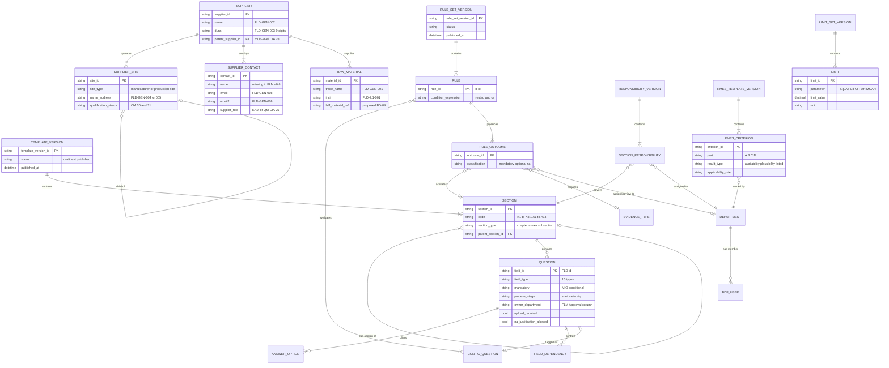
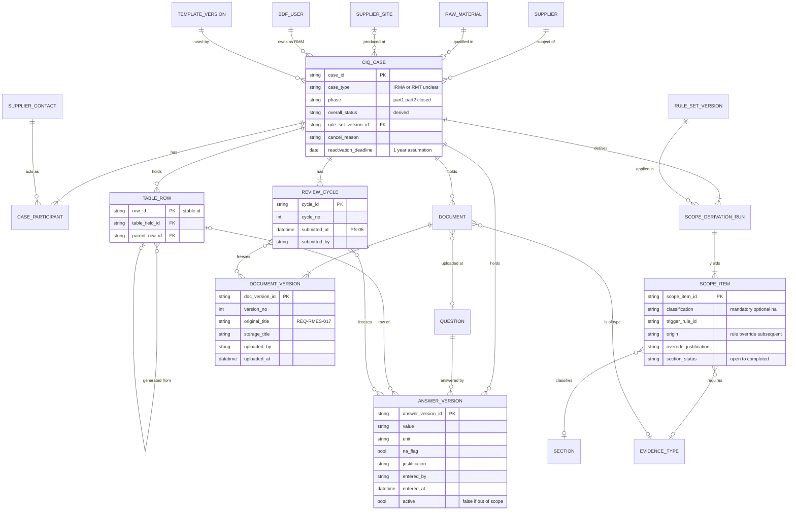
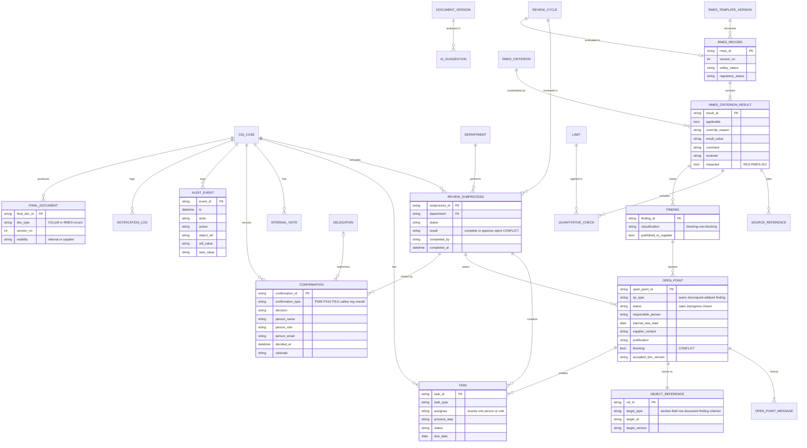

# 02 - Modules and conceptual data model (BDF CIQ digitalisation)

Discovery analysis only. Nothing is being built. Prepared 2026-10-05 for the first clarification call with BDF's consultant.

---

## 0. How to read this document

### 0.1 Sources and citation codes

| Code | File (in `Refrences_Shared_By_Client/`, dumped to `context/raw/`) | Nature |
|---|---|---|
| **ReqDoc** | `CIQ Business process requirements MVP_ v2.0.pdf` (14 pages, owner Alexander Pevzner, Technical Product Owner, dated 16 Sep 2026) | Main business requirements. Cited as `[ReqDoc p.X §Y]` |
| **BRM** | `CIQ_Business_Requirements_Matrix_MVP.xlsx` (51 REQs, created 2026-09-15 per file metadata) | Requirements with acceptance criteria and an MVP flag. Cited as `[BRM REQ-ID]` (Excel row in brackets where useful) |
| **FLM** | `CIQ_Field_Level_Requirements_Matrix_v0.6_EN.xlsx` (created 2026-09-18, last modified 2026-10-02 by A. Pevzner per file metadata) | Field-level spec. Sheets: `'CIQ new version'`, `changelog` (= 'Notes & change log'), `Feldkatalog` (old German field catalogue) |
| **KB** | `CIQ_Knowledge_Baseline.xlsx` | Gap sheet. Its "Proposed - to confirm" status reads "proposed by the build team" [KB ReadMe r21], so **it was probably written by a vendor or build team, not by BDF**. All "Customer answer" columns are empty |
| **CIA** | `CIA_requirements_catalog_FULL_EN_complete_09062026.xlsx` | BDF functional screening catalogue (34 items) **with Kissflow's own answers already submitted**. Cited as `[CIA #n]` |
| **VQ** | `Vendor_Initial_Screening_Questionnaire_CIQ.xlsx` | BDF non-functional screening **with Kissflow's own answers already submitted**. Cited as `[VQ 'Sub-area']` |
| **IKW** | `Sample taken from internet so not Beiserdorf_Lieferantenfragebogen.pdf` | 2019 industry-standard questionnaire. **This is NOT Beiersdorf's questionnaire.** We use it only as a reference for typical CIQ content |

### 0.2 Tags

- A plain statement with a citation is **STATED** in the documents.
- **(inferred)** marks our own reasoning. Confirm it before relying on it.
- **CONFLICT** means two or more documents (or two passages) disagree.
- **GAP** means the documents say nothing, or point to an artefact that was not shared.
- Open-question IDs (`M-xx` for modules and data, `U-xx` for users and access) are the same as in the structured question list returned with this analysis.

### 0.3 MVP status labels

| Label | Meaning | Basis |
|---|---|---|
| **MVP** | BRM column H = "MVP" | [BRM Legend r4] "Required for the MVP scope" |
| **MVP partial** | BRM column H = "MVP partial scope" (yellow fill FFE699) | [BRM Legend r5] "Partly in the MVP; the exact scope still has to be defined" |
| **post-MVP** | Explicitly deferred or out of scope | [ReqDoc p.2 §1.1] (integrations out of scope 2026); [FLM 'CIQ new version' r3] (Teamcenter auto-fill "post-MVP") |
| **unclear** | Not covered by the BRM, or the sources conflict | - |

Caveats:
- BRM column H is titled "MVP **recommendation**" [BRM r1]. The KB lists "MVP scope" as an open point [KB OpenPoints NEW-05].
- **No BRM requirement is marked Post-MVP.**
- ReqDoc §7 says all RMES requirements are "Must requirements ... unless the MVP decision explicitly records a deferral" [ReqDoc p.12 §7].

---

## 1. Facts that drive how the solution splits into modules

1. **The process has two parts with one gate.** In Part 1 the supplier collects data and documents. "Supplier Approval" closes Part 1, and Part 2 is BDF's technical review. Supplier Approval "does not constitute a Beiersdorf technical or business approval" [ReqDoc p.1 §1; p.2 §2].
2. **The questionnaire is generated, not selected.** Its scope is derived from supplier metadata by a business-maintained rule set [ReqDoc p.9 §5.1; BRM REQ-PROC-009; BRM REQ-CFG-003].
3. **The review runs as dynamic, parallel department subprocesses.** "The synchronisation point waits only for subprocesses activated for the concrete case" [ReqDoc p.4 §3.2.1; BRM REQ-PROC-018].
4. **RMES is the internal Safety/Regulatory evaluation record.** It is structured data, not an attached file, and it is never visible to the supplier [ReqDoc p.4-5 §3.2.3; ReqDoc p.12-14 §7; BRM REQ-PROC-021].
5. **Integrations conflict between documents.** Integrations are out of scope for 2026 [ReqDoc p.2 §1.1], but CIA lists Teamcenter, B-Flow and SAP integration as "Must Have" [CIA #1, #12, #15, #18, #32].
6. **CONFLICT on how the process ends.** The PDF has BDF approvals plus an overall approval (PS-11/PS-12). The BRM has department *completion* plus a supplier *final release* (PS-10/PS-11/PS-12). See §2.
7. **FLM v0.6 covers only part of the questionnaire:** Process Start, Meta Data, Annex 2 (manufacturing process), and Annex 1 and Annex 4 in part. It marks Annex 3 as "outside test scope" [FLM 'CIQ new version' r41]. **(inferred)** A defined MVP "test scope" exists, and FLM v0.6 may describe it.
8. **The requirement IDs are not traceable.** FLM and Feldkatalog cite IDs that are absent from the BRM: REQ-PROC-003, REQ-PROC-104, REQ-PROC-106, REQ-CFG-102, REQ-CFG-103, REQ-CFG-105, REQ-CTL-012 and REQ-ADR-003 [FLM 'CIQ new version' r3, r4, r5, r8, r16; Feldkatalog r24, r27, r49]. Feldkatalog column L is headed "Ref. v3.1 (REQ-ID)" [Feldkatalog r1]. **(inferred)** An earlier requirements catalogue, v3.1, exists and was not shared. The BRM numbering also has gaps: REQ-CFG-005; REQ-PROC-002/003/008/013/023/025-028/037/041/044/047/048; REQ-CTL-004/005/007/008.
9. **The ReqDoc's version labels disagree.** The cover says "Version 2" and the running header says "Requirements Document v1.4" [ReqDoc p.1]. The PDF title metadata is "CIQ_Requirements_Document_v1_Two_Phase_Process". Section 3.3.1 is missing: the numbering jumps from §3.3 to §3.3.2 [ReqDoc p.5].
10. **GAP: the process diagram was not shared.** The ReqDoc calls it "authoritative for the structure and sequence" [ReqDoc p.2 §2], and the PDF contains no images.

---

## 2. Process-step crosswalk (PDF vs BRM)

The two documents number the steps differently after PS-06. Modules and roles below are anchored to this table.

| PDF step [ReqDoc p.2-3 §2.1] | Role (PDF) | BRM step [BRM col A/B] | Role (BRM col G) | Alignment |
|---|---|---|---|---|
| - | - | **PS-00** P0 Configuration & administration | Business Administrator; System Administrator / Business Owner | Only in the BRM |
| PS-01 Start CIQ | RMM | PS-01 P1 Start CIQ | RMM | Aligned |
| PS-02 Enter metadata | Supplier | PS-02 P2 Enter meta data | RMM / System / Supplier | Aligned |
| PS-03 Configure CIQ | System (config rules) | PS-03 P3 Configure CIQ template | System / Business Admin; Authorised BDF department | Aligned |
| PS-04 Complete CIQ and upload | Supplier | PS-04 P4 Complete CIQ and upload | Supplier | Aligned |
| PS-05 Supplier Approval and submission | Supplier | PS-05 P5 Confirm CIQ is completed (end of part 1) | Supplier / System | Same gate, different name: "Supplier Approval" vs "completeness confirmation" |
| PS-06 Activate review subprocesses | System | PS-06 P6 Review subprocesses, data and documents | System / departments; Safety / Regulatory | The BRM PS-06 also covers the review itself (REQ-PROC-018 to -024) |
| PS-07 Perform technical review | Responsible department | PS-07 P7 Queries, additional documents and CIQ parts | Responsible BDF department | Numbers shifted |
| PS-08 Clarification / additional-document loop | Department + supplier | PS-08 P8 Answer questions and upload documents | Supplier | Numbers shifted |
| PS-09 Document technical-review results (RMES) | Responsible department | PS-09 P9 Review of the supplier's answer | Responsible BDF department | Numbers shifted |
| PS-10 Decide whether subprocess review is complete | Responsible department | PS-10 P10 Complete subprocess | Responsible BDF department; Safety / Regulatory | Roughly aligned |
| **PS-11 Approve or reject subprocess** | Authorised Beiersdorf role | **PS-11 P11 CIQ release by the supplier** | Supplier | **CONFLICT**: BDF approval vs supplier release |
| **PS-12 Overall CIQ approval** | "Responsible role to be decided" | **PS-12 P12 Complete CIQ** (automatic after supplier release; PDF to RMM; cancellation) | RMM; System | **CONFLICT** |
| PS-13 Generate final documents, file (B-Flow), status feedback, close | System / role per final operating model | (no PS-13; PDF and closure sit in PS-12, REQ-PROC-045/046) | - | Only in the PDF |

More evidence that the two describe different end-of-process models:
- **The BRM model** has three confirmations: supplier completeness (PS-05), department subprocess completion (PS-10) and supplier final release (PS-11). "None of the confirmations is presented as a Beiersdorf raw material approval" [BRM REQ-PROC-015]. Completion "is not a business approval of the raw material" [BRM REQ-PROC-038].
- **The PDF model** has "Approve or reject subprocess" (PS-11) and "Overall CIQ approval" (PS-12) [ReqDoc p.3]. It also has a separate "Final Safety approval and Final Regulatory approval, each with Approved/Rejected" [ReqDoc p.14 REQ-RMES-013] and "Overall case approval must be possible only when both required RMES approvals are Approved" [ReqDoc p.14 REQ-RMES-014].
- **(inferred)** One possible reading: the BRM is a simplified MVP model in which BDF only completes its documentation, and the actual raw-material approval happens elsewhere (for example in IRMA or Teamcenter). We must not assume this. See **M-01**.

---

## 3. Module map (overview)

| ID | Module | One-line purpose | MVP status | Core BRM IDs | Core other IDs |
|---|---|---|---|---|---|
| MOD-01 | Case management (CIQ project lifecycle) | One case per supplier x raw material, from start to closure | MVP | REQ-PROC-001, -045, REQ-CTL-006 | CIA #1 |
| MOD-02 | Supplier portal and supplier task inbox | External access to own cases, tasks and confirmations | MVP | REQ-PROC-004, -030, REQ-CTL-001 | CIA #6, #26, #34 |
| MOD-03 | Task management (cross-cutting) | Every action is a task with exactly one owner and a due date | MVP | REQ-CTL-003 | ReqDoc §3, §3.4 |
| MOD-04 | Questionnaire template builder | Business-maintained sections, questions, field types, help texts, versions | MVP | REQ-CFG-001, -002 | CIA #4, #5 |
| MOD-05 | Configuration rule engine | Versioned SF-01..12 rule set with nested conditions | MVP | REQ-CFG-003 | ReqDoc §5 |
| MOD-06 | Scope derivation and manual override | Derives mandatory, optional and N/A scope; override; re-derivation | MVP | REQ-PROC-009, -010, REQ-CFG-007, -008, -009, REQ-ADR-002 | ReqDoc §5.2 |
| MOD-07 | CIQ data capture and completeness validation | Supplier form runtime: structured answers, validations, justifications | MVP | REQ-PROC-005, -006, -007, -012 | - |
| MOD-08 | Evidence and document management | Context-linked, versioned uploads; overview by chapter | MVP (B-Flow filing post-MVP) | REQ-PROC-011, -016 | CIA #8, #12; REQ-RMES-017 |
| MOD-09 | Review subprocesses per department | Dynamic, parallel department review with completion or approval | MVP | REQ-PROC-017, -018, -019, -036, -038, -039, -040, REQ-CFG-006 | CIA #3, #11 |
| MOD-10 | Query, open-point and additional-document management | Object-referenced queries, traffic lights, full history | MVP | REQ-PROC-029 to -036, REQ-ADR-001, -002 | REQ-RMES-010, -011; CIA #10 |
| MOD-11 | RMES internal evaluation | Parts A-D criteria, findings, limit checks, separate Safety/Regulatory decisions | **MVP partial** | REQ-PROC-021, -022 | REQ-RMES-001 to -020 |
| MOD-12 | Internal communication area | BDF-only notes linked to case, section or finding | MVP | REQ-PROC-020 | - |
| MOD-13 | Approvals and confirmations | Supplier confirmations, department completions or approvals, overall decision | MVP (model in **CONFLICT**) | REQ-PROC-014, -015, -038, -039, -042 | REQ-RMES-013, -014; CIA #11, #14 |
| MOD-14 | Versioning, freezing and audit trail | Review-version snapshots, freeze, immutable audit | MVP | REQ-PROC-016, -043, REQ-CTL-009 | REQ-RMES-016 |
| MOD-15 | Notifications, reminders and escalation | Event notifications, reminders, escalation, notification log | MVP | REQ-CTL-010, REQ-PROC-040 | REQ-RMES-019; CIA #16, #17 |
| MOD-16 | Dashboards and reporting | Supplier, workload, status-control and RMES-progress views | MVP | REQ-CTL-006, REQ-PROC-034 | REQ-RMES-018; CIA #9, #13, #21-23 |
| MOD-17 | Final document generation and filing | Immutable final PDF; RMES export; filing | MVP (filing to B-Flow post-MVP) | REQ-PROC-046 | REQ-RMES-020; CIA #7, #14, #15 |
| MOD-18 | Cancellation and reactivation | Cancel with justification; reactivate within a set period | Cancel = MVP; reactivation = unclear | REQ-PROC-049 | ReqDoc §3.3.3 |
| MOD-19 | Supplier and contact master data | Supplier, site and contact records; supplier-side roles (KAM, QM) | unclear | REQ-PROC-001 (implicit) | CIA #24-29 |
| MOD-20 | Production-site qualification and approval | Separate process for new production sites | unclear (not in MVP docs) | - | CIA #30, #31 |
| MOD-21 | Integrations (Teamcenter, B-Flow, SAP MDG, SSO) | Start trigger, document filing, status feedback, master data | post-MVP (SSO unclear) | - | ReqDoc §1.1; CIA #1, #12, #15, #18, #20, #32, #33 |
| MOD-22 | AI-supported document review | Suggestions on supplier evidence, with sources, confirmed or discarded | **MVP partial** | REQ-PROC-024 | ReqDoc §3.2.3 |
| MOD-23 | Reference and limit data | BDF limit values (Annex 14, A9, heavy metals), controlled lists | unclear | - | REQ-RMES-008; Feldkatalog r27-29 |
| MOD-24 | Administration (roles, permissions, section responsibility, delegation) | Role model, read/edit per area and section, lead and co-reviewers, delegation | MVP | REQ-CFG-004, -006, REQ-CTL-002 | CIA #19, #20, #25-27 |
| MOD-25 | Own-document supplier process | For suppliers who send their own documents instead of filling in the CIQ | unclear ("separate process") | - | ReqDoc §3.1.4; KB NEW-12 |

---

## 4. Module details

### MOD-01 - Case management (CIQ project lifecycle)

**Purpose.** The case is the container for one CIQ: one supplier x one raw material. It runs from start to closure, carries the overall status and links every other object.

**Key capabilities (stated)**
- **Creation.** An authorised RMM user creates the case manually. Mandatory: supplier, raw material (trade name), supplier contact and responsible BDF owner. The case gets a unique ID and the creation is audit-trailed. Missing mandatory fields block creation [BRM REQ-PROC-001].
- **Trigger.** RMM makes a business decision to "initiate an IRMA CIQ case". "The trigger is currently outside the target system" [ReqDoc p.3 §3.1.1]. CIA asks for start "via Tool and via external system as well (Team Center)" for the processes "IRMA, RMT" [CIA #1, Must Have].
- **Process-start fields:** Trade name, Supplier (name), Contact person e-mail (pre-filled from supplier master data) and Contact person e-mail 2. All carry Approval = RMM [FLM 'CIQ new version' r2-r5].
- **Two-part lifecycle.** Part 1 runs until Supplier Approval, then Part 2 runs until closure [ReqDoc p.2 §2].
- **Status.** Shown at section, subprocess and project level. The overall status is "derived traceably from the section and subprocess statuses" [BRM REQ-CTL-006].
- **Versions.** The case logs the rule-set version used [BRM REQ-PROC-009] and keeps the template version valid at its start [BRM REQ-CFG-001].
- **Resubmission.** "A later resubmission creates a new review version and does not silently overwrite the version previously assessed" [ReqDoc p.4 §3.1.5].
- **Completion.** The case completes automatically once the supplier release (PS-11) is recorded. RMM can trigger completion manually "in exceptional cases (e.g. cancellation)" [BRM REQ-PROC-045].
- **Search.** Cases can be found by metadata such as DUNS, INCI or type of origin [BRM REQ-PROC-006].
- **Cancellation and reactivation:** see MOD-18.

**Design implications (inferred)**
- A case has 1..n **review cycles** (submission versions). RMES records and department reviews belong to a cycle, not only to the case.
- A **case type** attribute may be needed: CIA #1 names two processes, "IRMA" and "RMT". Neither acronym is defined in any document.
- "No longer relevant for the project" [ReqDoc p.5 §3.3.3] suggests that a case is tied to a BDF development project. The project reference is not specified.

**Linked IDs:** REQ-PROC-001, REQ-PROC-006, REQ-PROC-045, REQ-CTL-006; CIA #1, #13.
**MVP status:** MVP.
**Open questions:** M-01, M-19, M-26, U-09.

---

### MOD-02 - Supplier portal and supplier task inbox

**Purpose.** External, authenticated access for supplier contacts. They see only their own cases, tasks, released questionnaire parts, issued queries and their own confirmations.

**Key capabilities (stated)**
- **Staged release.** At case start the named supplier contact gets access and a metadata task. At first, only basic data and configuration questions are visible and editable. "Further chapters, annexes and internal content are neither visible nor editable" [BRM REQ-PROC-004].
- **Own cases only.** "The supplier sees only their own cases" [BRM REQ-CTL-006].
- **Task per request.** Each query, document request or additional CIQ part appears as a separate trackable task with reference, justification, responsible person and due date [BRM REQ-PROC-030; ReqDoc p.12 §6.2].
- **Jump target.** A query takes the supplier straight to the affected place, for example "K2.1, component 3, field CAS number" [BRM REQ-PROC-029].
- **Several supplier contacts** can work in parallel without data loss, with user and timestamp per answer and per document. "The assignment of tasks on the supplier side takes place exclusively on the supplier's side" [BRM REQ-CTL-001; CIA #6].
- **Supplier confirmations:** completeness confirmation at PS-05 and final release at PS-11 [BRM REQ-PROC-014; BRM REQ-PROC-042].
- **No internal content ever:** no internal comments, assessments or findings [BRM REQ-CTL-002]. Only "explicitly issued questions, requests and permitted attachments" [ReqDoc p.14 REQ-RMES-015].
- **Supplier guidance.** "User guide / explainer video to be provided by the vendor, FAQs" [CIA #34, Must Have].

**What Kissflow has already stated:** a "dedicated External Portal specifically designed for suppliers" with per-supplier role structures [CIA #26]; embedded help tooltips, guides and videos [CIA #34]; permissions per section or stage [CIA #6].

**Design implications (inferred)**
- Suppliers need a coordinator function to hand sections to colleagues, because task assignment happens on the supplier side.
- Parallel editing "without data loss" requires a locking or merge strategy at section or field level.
- CIA #34 says "to be provided by the vendor". That makes supplier guidance content a Kissflow deliverable, not only a platform feature.

**Linked IDs:** REQ-PROC-004, -029, -030, -014, -042, REQ-CTL-001, -002, -006; REQ-RMES-015; CIA #6, #26, #34.
**MVP status:** MVP.
**Open questions:** U-04, U-10, U-11, U-15.

---

### MOD-03 - Task management (cross-cutting)

**Purpose.** Every human action becomes a task with exactly one owner. This drives work queues, overdue logic and dashboards.

**Key capabilities (stated)**
- "Every action that a person has to perform is represented as an assigned task and is visible to the authorised role" [ReqDoc p.3 §3].
- Each task has "exactly one named responsible person or responsible role". It shows the project reference, process step, processing status and due date, and appears in the owner's dashboard. "No processing status to which no task is assigned and no task without a responsible person" [BRM REQ-CTL-003].
- Tasks have named ownership, due dates, reminders and escalation [ReqDoc p.5 §3.4].
- A request keeps a responsible person and an "internal due date (remains flexible)" [BRM REQ-ADR-001].
- Cancellation "ends all open tasks, including those at the supplier" [BRM REQ-PROC-049].

**Design implications (inferred)**
- Task types we can derive: enter metadata, confirm scope (department), complete CIQ, answer query, upload document, complete additional part, review section, review response, complete or approve subprocess, overall approval, final release.
- A task assigned to a role pool, as REQ-CTL-003 allows, needs claim/assign logic before it counts as having a named owner.

**Linked IDs:** REQ-CTL-003, REQ-ADR-001, REQ-PROC-049; CIA #22.
**MVP status:** MVP.
**Open questions:** U-07, M-25.

---

### MOD-04 - Questionnaire template builder

**Purpose.** Lets BDF business administrators maintain the CIQ structure (sections, questions, options, rules per field, help texts) without IT, with versioning.

**Key capabilities (stated)**
- **Maintenance.** Create, change, deactivate and version sections, questions, help texts, answer options, mandatory fields and mandatory evidence "without development effort". "Changes must not retroactively alter cases already in progress." Acceptance criterion: add a Turkey REACH section in the test environment and publish it without an IT ticket [BRM REQ-CFG-001; CIA #4].
- **Field types (BRM):** text, yes/no, single and multiple choice, number with or without unit, date, repeatable tables of any length, and file upload per question [BRM REQ-CFG-002].
- **Field types (FLM list):** Text, Number, Number (decimal), Number+Unit, Text/Number, Yes/No, Checkbox, Checkbox+Number, Radio button, Single-select, Multi-select, Dropdown, Date, Table (repeatable), File upload [FLM 'CIQ new version' data validation E2:E56].
- **Field metadata columns:** Field ID, Field/Column, Field Type, Mandatory, Validation/Format, Dependent, Controlled by, Controls, Auto-Fill/Default, Upload Required, Approval [FLM 'CIQ new version' r1].
  - Mandatory takes the values Mandatory, Optional or Conditional mandatory [FLM changelog r10].
  - "Controlled by" is always written as `<Field ID> = <value>` [FLM changelog r11].
  - The old catalogue also had "Begründung b. N/A" (justification if N/A) and "Bemerkung / OP" (remark / open point) [Feldkatalog r1].
- **Validations already specified:**
  - DUNS: 9 digits [FLM r7].
  - CAS format with check digit, validated only if filled [FLM r11].
  - E-mail format [FLM r4].
  - Percentage 0-100 % with min <= max [FLM r15].
  - Decimal 0-1 with at most 2 decimals [FLM r33].
  - Number > 0 in mm²/s [FLM r55].
  - Cross-field consistency of FLD-A1-104 against FLD-2.1-007 [FLM r35].
- **Conditional chains**, for example FLD-A1-204 -> FLD-A1-206 -> FLD-A1-207 -> FLD-A1-208 [FLM r48-r51]. Another pattern: "Yes -> upload mandatory, No -> reason mandatory" [FLM r45].
- **Cross-section pre-fill and auto-fill:**
  - FLD-A2-101 is pre-filled from FLD-2.1-001 and stays editable [FLM r37].
  - Annex 1 table rows are auto-generated from the K2.1 components, with INCI auto-filled [Feldkatalog r56, r61].
  - Country of origin is auto-filled into Annex 1 [FLM r19].
- **Uploads attached to a field**, for example the certificate at FLD-A1-208 and the analytical data at FLD-A4-103 [FLM r51, r55].
- **Options of one field share one ID** [FLM changelog r12].
- **Structure:** 8 main chapters and 14 annexes in the 2026 edition [ReqDoc p.1 §1]. The chapter and annex list is in [ReqDoc p.6-9 §4.1-4.2]. Sub-sections exist, for example "A1 section 5" [ReqDoc p.10 SF-08]. Some sections nest: K6.16 -> K6.16.1 and K8 -> K8.1 [ReqDoc p.7-8].
- **Text modules.** No-code text modules and digital documents for supplier confirmations and document generation [CIA #5].
- **GAP:** the questions inside most sections are not specified [KB OpenPoints NEW-01]. The KB has one placeholder row per section [KB QI Q-005 ... Q-118].

**Design implications (inferred)**
- The FLM places the K2.1 fields (INCI, CAS, EC, function, concentration) and the Annex 1 fields (FLD-A1-102..104) in the "Meta Data" stage [FLM r10-r35]. A field's **process stage** is therefore independent of its **section**, and the template must model both.
- The FLM 'Approval' column appears to be an owner or reviewer per field. That means **section ownership can also be set per field**, which affects how review tasks are cut.
- The template needs at least draft, test and published states, because the acceptance criterion mentions a test environment.

**Linked IDs:** REQ-CFG-001, REQ-CFG-002; CIA #4, #5.
**MVP status:** MVP.
**Open questions:** M-21, M-28, M-30, U-16.

---

### MOD-05 - Configuration rule engine

**Purpose.** Holds the business-maintained, versioned rule set that turns configuration answers into case scope, required evidence and review departments.

**Key capabilities (stated)**
- **The control table is a rule set:** versioned, traceable and maintained by the business. It supports "nested if-then conditions or decision trees". Every rule is assigned to a configuration question (SF-01 to SF-12) and to the sections and evidence it triggers. A change creates a new rule-set version, and existing cases keep their version. Acceptance criterion: SF-01 plant-based **AND** SF-08 palm-based reproducibly returns "A1 section 5 plus RSPO evidence" [BRM REQ-CFG-003].
- **Draft list of 12 configuration questions (SF-01..SF-12).** It "has to be completed and confirmed by the business departments (OP-19)" [ReqDoc p.10-11 §5.3].
- **Example table** with the columns Annex 2 mandatory, RSPO relevant, Mandatory annexes, Additional mandatory evidence and Reviewing department. "Structural illustration ... not a complete or business-approved rule set" [ReqDoc p.11-12 §5.4].
- **Rules also drive reviewer activation** ("Reviewing department" column) [ReqDoc p.11 §5.4]. Subprocess activation uses "controlled assignment rules" [ReqDoc p.4 §3.2.1].
- **Reproducible:** same metadata plus same rule-set version gives the same result, and the version is logged on the case [BRM REQ-PROC-009].
- **Rule inventory (KB, likely vendor-drafted):** R-00 to R-120. R-00 "Always: K1, K5.2, K6.1, A10" [KB ConfigRules r2]. R-01 is a proposed "always" set [KB ConfigRules r3]. Combination and exclusion rules are missing [KB ConfigRules r30].
- **Activation from inside the questionnaire (old catalogue).** A K6.1 checkbox, "See BDF REACH questionnaire (Annex 10)", activates Annex 10 as an additional CIQ part ("KERNREGEL", core rule) [Feldkatalog r49]. The derived system state is FLD-6.1-009, "with rule justification" [Feldkatalog r54]. Ticking "attached" on a toxicity endpoint makes the upload mandatory [Feldkatalog r41].
- **Second rule domain: RMES applicability.** RMES criteria are derived "from the raw-material characteristics, supplied composition, target markets and configuration rules" [ReqDoc p.13 REQ-RMES-004].

**CONFLICTS and GAPS in the rule content**
- The origin table makes A3, A11 and A12 mandatory for vegetable origin, and A11/A12 for all origins. This contradicts the SF-06 and SF-11 triggers. A1 and A7 also appear for mineral [KB OpenPoints NEW-07; ReqDoc p.11 §5.4].
- A10 is "Always" [ReqDoc p.8 A10] but is activated by a K6.1 checkbox [Feldkatalog r49].
- SF-12 lists K5.1 and K5.3, but K5.3 is antimicrobial treatment, and the challenge test has no chapter number [ReqDoc p.11; KB OpenPoints NEW-08].
- Overlaps: SF-07 vs SF-01 Mineral/Petrochemical, and SF-03 vs SF-01 Polymer [KB ConfigQuestions SF-01, SF-07].
- Palm (SF-08) is captured as FLD-A1-204 **inside Annex 1**, not as a metadata configuration question [FLM r48; FLM changelog r123]. The rule therefore depends on an answer given after release.
- Rules for waste/side stream, CCU and chemical recycling are undefined [ReqDoc p.11-12; KB OpenPoints OP-19].
- What triggers A2 is unclear (OP-03) [ReqDoc p.8 A2]. The FLM shows A2 for all origins, while the CIQ triggers it only for Bio Mass [FLM changelog r129].
- No trigger is defined for K6.8 Halal [KB OpenPoints NEW-10].

**What Kissflow has already stated:** "natively supports complex if-then logic and conditional routing ... activate, skip, or block specific process steps" [CIA #2].

**Design implications (inferred)**
- Inputs can have several values: several origins, several components, several markets. We need confirmed union/OR semantics, plus precedence rules for when a rule makes a section mandatory and another makes it optional or N/A.
- Rules that business users maintain and nest as decision trees need a decision-table editor, an evaluator, a version-publish workflow and a way to test rules before publishing. This is a **significant build item** and a likely area where the two vendors will be compared.

**Linked IDs:** REQ-CFG-003, REQ-PROC-009; REQ-RMES-004; CIA #2.
**MVP status:** MVP.
**Open questions:** M-03, M-04, M-23.

---

### MOD-06 - Scope derivation and manual override

**Purpose.** Runs the rule engine on a case, shows the derived scope to BDF, allows justified overrides, releases the questionnaire and handles re-derivation without losing data.

**Key capabilities (stated)**
- **The sequence:**
  1. The supplier first receives "the basic data section with the configuration questions only".
  2. When it is submitted, the system evaluates the answers.
  3. The system determines mandatory, optional and not-applicable sections and the required evidence.
  4. "The department sees the derived scope and can **extend or reduce** it during the IRMA process where necessary."
  5. "Only then is the full questionnaire released."
  6. If a configuration answer changes, the scope is derived again, and data "is not discarded silently".

  [ReqDoc p.9-10 §5.2]
- **N/A handling.** Not-applicable parts are not presented to the supplier but stay documented internally with the triggering rule as justification [BRM REQ-PROC-009].
- **Classification.** Each chapter, annex and piece of evidence is classified as mandatory, optional or N/A. The triggering rule and answer are visible per section [BRM REQ-PROC-010].
- **Manual override.** Authorised departments can **extend** the scope with a mandatory justification. The override is marked and auditable [BRM REQ-CFG-007]. **CONFLICT:** the BRM says "extend" only, while ReqDoc says "extend or reduce".
- **Re-derivation.** A metadata change triggers re-derivation, a list of section differences and a notification to the affected departments [BRM REQ-CFG-008]. A metadata change after PS-05 triggers the scope-impact check [BRM REQ-PROC-007].
- **Data retention.** Answers of removed sections stay visible in history and become active again if the change is reverted [BRM REQ-CFG-009]. Whether to hide, archive or delete is open [KB OpenPoints NEW-14].
- **Subsequent activation.** Additional CIQ parts can be activated at any time. They are marked as "subsequently activated" and block the requesting subprocess [BRM REQ-ADR-002]. They must stay distinguishable from rule-derived scope [ReqDoc p.12 §6.1].
- **Metadata check.** Submission is blocked while mandatory metadata is missing, and every blocking field is listed [BRM REQ-PROC-005].

**Design implications (inferred)**
- There is a **hold point inside Part 1**: the department reviews the scope before release. This is a BDF task that the PS table does not list. Who performs it (RMM or each department?) and its time limit are unknown.
- REQ-CFG-008 and REQ-CFG-009 have light-orange fill on the requirement text. That meaning is not in the legend, so they may have been added or changed recently.

**Linked IDs:** REQ-PROC-005, -007, -009, -010, REQ-CFG-007, -008, -009, REQ-ADR-002.
**MVP status:** MVP.
**Open questions:** M-10, M-11.

---

### MOD-07 - CIQ data capture and completeness validation (supplier form runtime)

**Purpose.** Captures supplier answers as structured, searchable data and enforces completeness before each supplier confirmation.

**Key capabilities (stated)**
- The supplier completes the released sections and uploads evidence at the relevant question. "Answers are captured as structured data, not solely as attachments." Mandatory fields and mandatory evidence are validated. An N/A justification is enforced where the rule requires one [ReqDoc p.4 §3.1.4].
- **Completeness gate before PS-05.** If something cannot be provided, a written justification removes the blocking state. Justifications are visible to reviewers. "A 'not applicable' or empty entry without justification text is rejected" (example: waiving the micro test, SF-12/K5.1) [BRM REQ-PROC-012].
- **Structured, analysable data.** The K2.1 composition can be analysed per component (INCI, CAS, EC, function, concentration) without opening a document [BRM REQ-PROC-006].
- **Metadata stays changeable** "up to the last process step permitted by the business". Every change is audited, and the data is locked after the PS-11 release [BRM REQ-PROC-007].
- **Limit-related inputs.** K2.2 limits are checked against BDF values, and deviations need a justification [ReqDoc p.6 K2.2]. The old catalogue says "Confirmed = true only if value <= limit", with the limits As 0.5, Cd 0.1 and Cr 5.0 mg/kg [Feldkatalog r27-r29].
- **Attribution.** User and timestamp are recorded per answer and per document [BRM REQ-CTL-001].

**Design implications (inferred)**
- Long questionnaires need save-as-draft, a validation summary that lists blocking fields "with section and field name" [BRM REQ-PROC-005, -012], and per-section progress.
- The component table can have any number of rows. Bulk entry or import from Excel may matter to suppliers. This is not stated.

**Linked IDs:** REQ-PROC-005, -006, -007, -012, REQ-CTL-001.
**MVP status:** MVP.
**Open questions:** M-04, M-13, M-29.

---

### MOD-08 - Evidence and document management

**Purpose.** Handles the documents a supplier uploads against specific questions or sections: versioning, an overview, traceability to reviews, and later filing.

**Key capabilities (stated)**
- **Context-linked upload.** Upload happens at the triggering question or section and stays permanently linked there. There is also "an overview of all uploaded documents structured by chapter". Example: a batch certificate at K2.2 opens directly from the department's review view [BRM REQ-PROC-011; CIA #8].
- **The mandatory evidence list is case-specific.** K1 is a checklist whose "scope ... follows from the configuration table" [ReqDoc p.6 K1].
- **Versioning.** Submitted documents are versioned and fixed at PS-05 as the review version. A resubmission creates a new version rather than overwriting [ReqDoc p.4 §3.1.5; ReqDoc p.6 §3.4; BRM REQ-PROC-016].
- **Queries on a document** name the file name and version [BRM REQ-PROC-029].
- **Reference register.** The original title and version of every evaluated source is kept, plus the "technical storage title". Both are searchable [ReqDoc p.14 REQ-RMES-017].
- **B-Flow.** "Storage of uploaded and generated documents in the B-Flow document management system ... automatically and process-related. Manually upload, rename the documents must be possible" [CIA #12, Must Have]. Integration is out of scope for 2026 [ReqDoc p.2 §1.1].
- **Evidence catalogue** D-01..D-20 [KB Evidence r2-r22]. Examples from BDF documents: batch analyses of at least 2 batches [ReqDoc p.6 K2.2; Feldkatalog r26]; a signed UK REACH declaration [ReqDoc p.8 A11]; BSE/TSE certificate and entry 419 confirmation [FLM r17]; PDF format for the pesticide analysis [FLM r46].
- **Supplier-level documents** such as GMP/ISO (K6.12) may be reused across cases (OP-17) [ReqDoc p.7 K6.12].
- **Lock.** Documents are locked after the final release [BRM REQ-PROC-043].
- REQ-CFG-004's acceptance text mentions "only PDF documents from supplier", which suggests **access rules at document level**. See U-03.

**Design implications (inferred)**
- Certificates need a validity or expiry date. The KB asks "Validity / max age?" for the SDS [KB Evidence D-01] and proposes "File + expiry date" for ISO certificates [KB QI Q-072]. This would drive expiry reminders and is not stated by BDF.

**Linked IDs:** REQ-PROC-011, -016, -043; REQ-RMES-005, -017; CIA #8, #12, #15.
**MVP status:** MVP. B-Flow filing is post-MVP per the ReqDoc but a CIA Must Have.
**Open questions:** M-08, M-12, M-27.

---

### MOD-09 - Review subprocesses per department (dynamic, parallel)

**Purpose.** Activates the department reviews that apply to the case, runs them independently, gates their completion and synchronises them before the end of the process.

**Key capabilities (stated)**
- **Activation.** Subprocesses are activated dynamically from the case scope and "controlled assignment rules". They "may run in parallel", and the synchronisation waits only for those activated [ReqDoc p.4 §3.2.1].
- **Exactly the affected departments** receive a task and a notification, and unaffected departments receive nothing [BRM REQ-PROC-017]. The subprocesses are independent and parallel [BRM REQ-PROC-018].
- **Scope per department.** Each department receives its assigned data, evidence and sections. "All internal roles must be able to read all project content; only their own business area is editable" [BRM REQ-PROC-019].
- **Section responsibility** is configurable and versioned, with a lead department and co-reviewers (example: K2.2 has Safety as lead and QM as co-reviewer) [BRM REQ-CFG-006].
- **The common pattern for PS-07 to PS-11:** review, query, the supplier answers, re-review, loop until done, document results, completion or approval "through an authorised Beiersdorf role" [ReqDoc p.4 §3.2.2].
- **Completion.** Explicit and "not a business approval of the raw material" [BRM REQ-PROC-038]. Blocked by any open point [BRM REQ-PROC-036].
- **Safety and Regulatory complete separately.** A negative criterion needs a mandatory comment, and completing on the other's behalf needs an auditable delegation [BRM REQ-PROC-039].
- **One supplier notification** after the last subprocess completes [BRM REQ-PROC-040].
- **Subprocesses described:**
  - RMES (Regulatory and Safety) [ReqDoc p.4-5 §3.2.3].
  - QM: "boundary, entry criteria, decision model and ownership are open" [ReqDoc p.5 §3.2.4].
  - RMM: Teamcenter today, target "still open" [ReqDoc p.5 §3.2.5].
  - Sustainability: findings documented "in a separate questionnaire" [ReqDoc p.5 §3.2.6].
- **Not described:** Microbiology, Customs and Legal own sections but have no subprocess [KB OpenPoints NEW-11, NEW-13].
- **Shared sections** (K6.14, K6.17, K2.2) need a rule: "whether both roles approve or one takes the lead (OP-18)" [ReqDoc p.9 §4.3].

**What Kissflow has already stated:** flexible assignment of subprocesses to roles, departments or individuals, synchronised via SSO [CIA #3]; approvals restricted to authorised BDF personnel [CIA #11].

**Design implications (inferred)**
- The number of subprocesses varies per case, from 1 to 7 or more departments. Fixed parallel branches will not fit, so this needs a **dynamic child-instance pattern**.
- Subprocesses are tied to a review cycle. A resubmission or a reopening (REQ-RMES-012) reopens the subprocesses concerned.

**Linked IDs:** REQ-PROC-017, -018, -019, -036, -038, -039, -040, REQ-CFG-006; CIA #3, #9, #11.
**MVP status:** MVP. Which subprocesses are in the MVP is open [KB OpenPoints NEW-05].
**Open questions:** M-01, M-02, M-05, M-06, M-09, M-17.

---

### MOD-10 - Query, open-point and additional-document management

**Purpose.** Holds BDF-supplier clarifications that point at a specific object, managed as open points with status, owner, due date and full history.

**Key capabilities (stated)**
- **A query must reference an object:** a chapter or annex, a field or table row, a document including version, or an internal finding. The reference becomes a jump target, and a query cannot be sent without it [BRM REQ-PROC-029].
- **One supplier task per request** [BRM REQ-PROC-030].
- **Required on every request:** a responsible person and an internal due date [BRM REQ-ADR-001], plus a business justification [ReqDoc p.12 §6.2]. The supplier contact is also named: "responsible supplier contact" [ReqDoc p.13 REQ-RMES-010].
- **Additional CIQ part** activation is supported [BRM REQ-ADR-002].
- **Supplier response:** an answer, a document, completion of the activated part, or a justified non-delivery [BRM REQ-PROC-032; ReqDoc p.12 §6.2].
- **Full chronological history** at the object [BRM REQ-PROC-033].
- **Status** is "open", "in progress" or "closed", shown as a traffic light. It is set "exclusively by the responsible department, unless a documented reassignment has taken place". "Closed" means accepted; a rejection returns the item with a justification [BRM REQ-PROC-034; ReqDoc p.12 §6.2]. Closure records the decision, the decision maker, a timestamp and the accepted evidence version [ReqDoc p.13 REQ-RMES-011].
- **The loop repeats** any number of times without losing context [BRM REQ-PROC-035].
- **Blocking:** "All open points ... prevent the completion ... A distinction between blocking and non-blocking open points is not envisaged" [BRM REQ-PROC-036]. **CONFLICT** with "classify them at least as blocking or non-blocking" [ReqDoc p.13 REQ-RMES-009] and with "Open blocking requests prevent completion" [ReqDoc p.4 §3.2.2].
- **Open requests prevent overall approval** and show as blocking in the case dashboard [ReqDoc p.12 §6.2].
- **Query from a finding** without duplicating context [ReqDoc p.13 REQ-RMES-010].
- **Supplier changes during Part 2** are audited and reported to the departments that use the changed source [BRM REQ-PROC-031].

**What Kissflow has already stated:** contextual comments, tags and Q&A "directly within the specific process or form context" [CIA #10].

**Design implications (inferred)**
- The object reference must be polymorphic and version-aware.
- References to table rows need **stable row IDs**. A row index breaks when rows are re-ordered or deleted.
- Generic comment threads will not meet REQ-PROC-034, which requires owner-only status changes with an evidence version. **An open-point entity is needed.**

**Linked IDs:** REQ-PROC-029, -030, -031, -032, -033, -034, -035, -036, REQ-ADR-001, -002; REQ-RMES-010, -011; CIA #10.
**MVP status:** MVP.
**Open questions:** M-05, U-04.

---

### MOD-11 - RMES internal evaluation (Raw Material Evaluation Sheet)

**Purpose.** The structured internal record in which Safety and Regulatory document their scope, evidence, findings, conclusions and decisions. "Not a separate review process and not a supplier questionnaire" [ReqDoc p.5 §3.2.3].

**Key capabilities (stated, ReqDoc §7 unless marked)**
- **Controlled start.** One RMES review per submitted CIQ version, created only once the entry criteria are met, with the CIQ version and a timestamp [REQ-RMES-001; BRM REQ-PROC-021].
- **Structured template.** Parts A, B, C and D as configurable criteria. An admin can add, deactivate, reorder and version criteria without changing historical evaluations [REQ-RMES-002].
- **Role-based assignment.** Safety criteria and the Safety approval go to Safety, Regulatory criteria and the Regulatory approval go to Regulatory. Suppliers cannot view anything [REQ-RMES-003].
- **Applicability.** Rule-derived, with a reviewer override that requires a reason. N/A criteria stay visible with the rule or the reason [REQ-RMES-004].
- **Source traceability** in both directions (from criterion to source and back) [REQ-RMES-005].
- **Criterion result:** availability, plausibility or listed status, plus comment, reviewer and timestamp. The department approval is blocked until every applicable criterion has a final result [REQ-RMES-006]. A rationale is mandatory for negative, implausible or N/A results and for overrides [REQ-RMES-007].
- **Quantitative checks:** reported value, unit, applicable limit and result, reproducible against the rule-set version [REQ-RMES-008].
- **Findings.** Linked to criterion, source and department, and classified as blocking or non-blocking [REQ-RMES-009]. Query from a finding [REQ-RMES-010]. Response review by the owning department [REQ-RMES-011].
- **Reopening.** A supplier change to a source used by a completed criterion flags it as impacted and requires a reopening or an explicit "no impact" confirmation [REQ-RMES-012].
- **Decisions.** Separate final Safety and Regulatory approvals [REQ-RMES-013], and an approval gate [REQ-RMES-014].
- **Visibility and history.** Hidden from suppliers [REQ-RMES-015]. Immutable version history [REQ-RMES-016]. Reference register [REQ-RMES-017].
- **Dashboards** per Safety and Regulatory with the states unassigned, open, waiting for supplier, overdue, reopened, approved and rejected [REQ-RMES-018].
- **Notifications** [REQ-RMES-019] and **export** [REQ-RMES-020].
- **Pre-population.** CIQ data is pre-filled into RMES with a source reference, using a mapping set agreed with the business [BRM REQ-PROC-022].
- **Target:** reuse CIQ data and "automate manual data transfers ... as far as technically and functionally feasible" [ReqDoc p.5 §3.2.3].

**GAP:** the RMES template (the content of Parts A-D) was not shared. There is no criterion list.

**Linked IDs:** REQ-PROC-021, -022; REQ-RMES-001 to -020.
**MVP status:** **MVP partial.** REQ-PROC-021 and -022 are flagged "MVP partial scope" [BRM r27-r28]. ReqDoc §7 treats RMES as Must unless a deferral is recorded.
**Open questions:** M-07, M-01, M-05.

---

### MOD-12 - Internal communication area

**Purpose.** A BDF-only space for case-related questions, assessments and alignment between departments, separate from the supplier dialogue.

**Key capabilities (stated)**
- Internal-only and "separated from the supplier dialogue". Linked to a case, section or finding, visible only to authorised BDF roles and "never to the supplier" [BRM REQ-PROC-020]. The wording is "should provide", and the requirement text has orange fill.
- "Internal review comments and assessments are not visible to supplier users" [ReqDoc p.3 §3].

**Design implications (inferred):** @mentions across departments. Keep these notes separate from RMES criterion comments so that confidentiality rules do not collide.

**Linked IDs:** REQ-PROC-020; CIA #10.
**MVP status:** MVP.
**Open questions:** U-03.

---

### MOD-13 - Approvals and confirmations

**Purpose.** Records every formal sign-off with its business meaning. Keeps supplier confirmations, department completions or approvals and the overall decision clearly separate.

**Key capabilities (stated)**
- **BRM model:**
  - The three confirmation types (PS-05, PS-10, PS-11) are each documented with date, name and e-mail and are distinguishable "in the CIQ project and in the closing document" [BRM REQ-PROC-015].
  - PS-05 is recorded with name, e-mail and timestamp. "The user interface states unambiguously that this is the completeness confirmation" [BRM REQ-PROC-014].
  - PS-11 is recorded with name, role, e-mail and timestamp, and is delivered only after all subprocesses are complete [BRM REQ-PROC-042].
  - Safety and Regulatory complete separately [BRM REQ-PROC-039].
- **PDF model:**
  - Subprocess "approve or reject" by an "authorised Beiersdorf role" (PS-11) [ReqDoc p.3].
  - Overall CIQ approval (PS-12) by a role "to be decided" [ReqDoc p.3].
  - "The final approval gate must use the final subprocess results and all blocking open items. The effect of a rejected subprocess on the overall CIQ case also remains open" [ReqDoc p.5 §3.3.2].
  - Separate Final Safety and Final Regulatory approvals, with a mandatory rejection reason [ReqDoc p.14 REQ-RMES-013], and an approval gate [REQ-RMES-014].
- **Common to both:** "Person, timestamp, result and required rationale are audit-trailed" [ReqDoc p.4 §3.2.2]. Delegation must be auditable [REQ-RMES-013; BRM REQ-PROC-039].
- **CIA:** subprocess approval only by BDF responsible persons [CIA #11]. "Approval of the entire process and generation of the final document" [CIA #14, Must Have].
- **Signature:** the old catalogue has an empty "Digital signature" row in the Verification block (yellow = open) [Feldkatalog r15]. A11 contains a "signed declaration by the supplier" [ReqDoc p.8 A11].

**CONFLICT:** see §2. This is the single most important design question.

**Linked IDs:** REQ-PROC-014, -015, -038, -039, -042; REQ-RMES-013, -014; CIA #11, #14.
**MVP status:** MVP, but the model is in conflict.
**Open questions:** M-01, M-06, M-24, U-02.

---

### MOD-14 - Versioning, freezing and audit trail

**Purpose.** Guarantees that every assessment can be reproduced against the exact data, document, template, rule-set and limit versions used.

**Key capabilities (stated)**
- "Versioning of submitted answers and documents; traceability from review result to source answer or document version; audit trail for submission, review, query, response, approval, rejection and reopening" [ReqDoc p.6 §3.4].
- **Review version.** Fixed at PS-05. "In the event of changes in the second part ... it should be possible to restore the historical data where required" [BRM REQ-PROC-016].
- **Freeze** at the final release. Change attempts are rejected and logged [BRM REQ-PROC-043].
- **Immutable audit trail.** "An auditor can reconstruct who assessed what, when and on which source version" [BRM REQ-CTL-009; ReqDoc p.14 REQ-RMES-016].
- **Change audit.** Metadata changes and Part 2 changes are audited and shown to the departments affected [BRM REQ-PROC-007, -031].
- **Configuration versioning:** template [REQ-CFG-001], rule set [REQ-CFG-003], section responsibility [REQ-CFG-006], RMES criteria [REQ-RMES-002] and limits [REQ-RMES-008].

**What Kissflow has already stated:** audit trails "are unalterable even by platform admins" [VQ 'Audit trail and timestamps']. Kissflow "does not natively manage configurable records retention policies" [VQ 'Archiving and retention'].

**Design implications (inferred)**
- Field-level answer versioning, review-cycle snapshots and the ability to "restore historical data" need explicit data design. The platform's native field history granularity must be checked against REQ-PROC-016 and REQ-RMES-012.

**Linked IDs:** REQ-PROC-007, -016, -031, -043, REQ-CTL-009, REQ-CFG-001, -003, -006; REQ-RMES-002, -008, -016.
**MVP status:** MVP.
**Open questions:** M-27, M-29, M-30.

---

### MOD-15 - Notifications, reminders and escalation

**Key capabilities (stated)**
- Responsible persons are notified of a new task, query, answer, resubmission or decision. "Every notification event is logged at the CIQ project" [BRM REQ-CTL-010].
- **Specific events:**
  - The supplier is notified at case start [BRM REQ-PROC-004].
  - Departments are notified when Part 2 starts [BRM REQ-PROC-017].
  - Affected departments are notified on re-derivation [BRM REQ-CFG-008] and on supplier changes in Part 2 [BRM REQ-PROC-031].
  - The supplier gets **exactly one** notification after the last subprocess completes, with no internal content [BRM REQ-PROC-040].
  - The final PDF is e-mailed to the RMM owner [BRM REQ-PROC-046].
  - The RMES reviewer is notified on a new task or resubmission, and the supplier contact when a query is issued [ReqDoc p.14 REQ-RMES-019].
- **Reminders and escalation:** "Due-date reminders and escalation recipients must be configurable" [ReqDoc p.14 REQ-RMES-019; ReqDoc p.5 §3.4]. "Automated notifications can be configured" [BRM REQ-ADR-001]. The defaults are not defined [KB OpenPoints NEW-16].
- **Second e-mail:** "Contact person e-mail 2" acts as an "Additional recipient of notifications (if filled)" [FLM r5].
- **CIA:** flexible triggers on status changes and events, and e-mails to different recipients [CIA #16, #17].

**Linked IDs:** REQ-CTL-010, REQ-PROC-004, -017, -031, -040, -046, REQ-CFG-008, REQ-ADR-001; REQ-RMES-019; CIA #16, #17.
**MVP status:** MVP.
**Open questions:** M-25.

---

### MOD-16 - Dashboards and reporting

**Key capabilities (stated)**
- "Task and status transparency for all parties through a dashboard" [ReqDoc p.2 §1.1].
- **Status levels.** Status is shown per section (open, in progress, with the supplier, reviewed, completed), per subprocess and for the overall project, with traceable roll-up. Role-appropriate content. "RMM identifies bottlenecks without opening individual cases; the supplier sees only their own cases" [BRM REQ-CTL-006].
- **Task list.** Each task appears in the responsible person's dashboard [BRM REQ-CTL-003].
- **Open points.** Traffic lights in lists and dashboards [BRM REQ-PROC-034]. Open points shown as an obstacle to completion [BRM REQ-PROC-036]. Blocking requests shown in the case dashboard [ReqDoc p.12 §6.2].
- **RMES progress,** separately for Safety and Regulatory, so that RMM can see "department, criterion and blocking reason without opening each task" [ReqDoc p.14 REQ-RMES-018].
- **CIA dashboards:** Supplier Projects Dashboard [CIA #21], Workload Dashboard [CIA #22], Status Control Dashboard [CIA #23], overall status [CIA #13] and subprocess status [CIA #9]. All Must Have.
- **Final status** shown in all dashboards [BRM REQ-PROC-045].
- **Analysis.** Composition data can be analysed per component [BRM REQ-PROC-006]. BI export via the Snowflake add-on, SFTP or REST was claimed [VQ 'Export / BI'].

**Linked IDs:** REQ-CTL-003, -006, REQ-PROC-006, -034, -036, -045; REQ-RMES-018; CIA #9, #13, #21, #22, #23.
**MVP status:** MVP.
**Open questions:** U-15, U-01.

---

### MOD-17 - Final document generation and filing

**Key capabilities (stated)**
- **BRM:** right after the supplier release, the system generates a final PDF summary automatically, versions it immutably, files it at the CIQ project and e-mails it to the responsible RMM owner. Content: "the released CIQ status, the evidence list, the confirmations from PS-05, PS-10 and PS-11 as well as the CIQ project ID". "The content of the PDF still has to be confirmed by the business" [BRM REQ-PROC-046].
- **PDF:** after the overall decision, the system generates "the defined final document package", versions it "in an unchangeable form", files it in B-Flow and gives status feedback to the preceding system [ReqDoc p.5 §3.3.3].
- **RMES export:** a readable, versioned internal record covering Parts A-D, applicability, results, comments, references, findings and approvals, respecting the visibility split [ReqDoc p.14 REQ-RMES-020].
- **Wording:** the closing document must call completions "completion of the review, not raw material approval" [BRM REQ-PROC-038].
- **CIA:** PDF generation [CIA #7]. The final document "should consolidate the results of all subprocesses" [CIA #14]. Storage in B-Flow [CIA #15].

**What Kissflow has already stated:** "PDF template management where structure or format can be defined" [CIA #7]. The PDF can be "emailed to relevant suppliers" [CIA #5].

**Linked IDs:** REQ-PROC-046, -038, -015; REQ-RMES-020; CIA #5, #7, #14, #15.
**MVP status:** MVP. Filing to B-Flow is post-MVP.
**Open questions:** M-14, M-08.

---

### MOD-18 - Cancellation and reactivation

**Key capabilities (stated)**
- **Cancel** when the raw material is no longer relevant. A justification is required, all open tasks end (including the supplier's), and person and timestamp are documented [BRM REQ-PROC-049; ReqDoc p.5 §3.3.3].
- **Reactivation** "within a defined period (assumption: 1 year, to be confirmed)" [ReqDoc p.5 §3.3.3; KB OpenPoints NEW-15]. **GAP:** no BRM requirement covers reactivation.
- **Manual completion** by RMM "in exceptional cases (e.g. cancellation)" [BRM REQ-PROC-045].

**Design implications (inferred):** other terminal paths are not described: the supplier does not respond, the supplier refuses, the raw material is rejected, or the supplier withdraws the material.

**Linked IDs:** REQ-PROC-049, -045.
**MVP status:** Cancellation is MVP. Reactivation is unclear.
**Open questions:** M-15.

---

### MOD-19 - Supplier and contact master data (multi-level)

**Key capabilities (stated)**
- **CIA items:**
  - Central supplier contact database [CIA #24, Nice to Have].
  - No-code supplier roles "such as Key Account Manager or QM" [CIA #25, Nice to Have].
  - Role structure per supplier [CIA #26, Must Have].
  - Person-to-role assignment, separately for BDF and suppliers [CIA #27, Must Have].
  - Multi-level structures, "main supplier and production sites" [CIA #28, Nice to Have].
  - Flexible extension of these structures [CIA #29, Nice to Have].
- **Case creation** needs a supplier and a contact [BRM REQ-PROC-001]. The contact e-mail is pre-filled from supplier master data [FLM r4]. Supplier name auto-fill from Teamcenter is "post-MVP, REQ-PROC-104" [FLM r3]. DUNS, manufacturer and production site have "Auto-fill from master data (possible)" [FLM r7-r9].
- **One production site only** ("aligned with business departments"), which drops FLD-GEN-006 and -007 [FLM changelog r25]. **CONFLICT** with SF-02, "Are there additional production sites?" [ReqDoc p.10 §5.3], and with the old note "Mehrere Standorte je CIQ-Projekt möglich" (several sites per CIQ project possible) [Feldkatalog r7].
- **Address and name gaps.** The supplier address is no longer captured [FLM changelog r17]. There is no field for the contact person's name [FLM changelog r20]. The DUNS label previously carried "(name and address)" as a copy error [FLM changelog r24].
- **Supplier-level data** such as GMP/ISO (K6.12) may be reused across cases (OP-17) [ReqDoc p.7].
- **Manufacturer vs supplier.** Industry practice separates manufacturer, production site and supplier "if not identical with manufacturer" [IKW p.3]. **(inferred)** The BDF FLM keeps Manufacturer (FLD-GEN-004) and Production site (FLD-GEN-005) as free-text fields, not linked entities.

**MVP status:** unclear. A minimal supplier and contact record is implied by REQ-PROC-001. The full master database is Nice to Have.
**Open questions:** M-12, M-20, U-04, U-14.

---

### MOD-20 - Production-site qualification and approval (adjacent process)

**Stated:** "Configuration of the process for qualifying new production sites" [CIA #30, Nice to Have]. "Approval process for production sites" [CIA #31, **Must Have**]. Neither the ReqDoc nor the BRM mentions it.

**(inferred)** This is a separate workflow that shares the supplier and site master data. It may not belong to the CIQ MVP at all.

**MVP status:** unclear.
**Open questions:** M-20.

---

### MOD-21 - Integrations

**Key capabilities (stated)**
- **Out of scope for 2026:** "Integration with Teamcenter, B-Flow, SAP MDG and other relevant systems - the scope per target system is still open (OP-13)" [ReqDoc p.2 §1.1].
- **The PDF process still needs it:** PS-13 files to B-Flow and gives status feedback to the preceding system [ReqDoc p.5 §3.3.3]. Today RMM documents its results in Teamcenter [ReqDoc p.5 §3.2.5].
- **CIA Must Haves:** start via Teamcenter [#1], B-Flow storage [#12, #15], final status to Teamcenter via API [#18], API to TC, B-Flow and SAP [#32], low-code API configuration [#33], SSO for BDF [#20].
- **Teamcenter master-data auto-fill** is post-MVP [FLM r3].

**What Kissflow has already stated:** REST and webhooks for the TC trigger [CIA #1], push to B-Flow [CIA #12, #15], outbound status API [CIA #18], SAML SSO with Okta, OneLogin and Azure AD [CIA #20; VQ 'Authentication / SSO'], connectors for M365, Power BI and SAP S/4 HANA, and REST/middleware for MDG [VQ 'Relevant systems'].

**MVP status:** post-MVP for the business integrations. SSO is unclear. **(inferred)** BDF users will probably expect SSO even in an MVP test.
**Open questions:** M-08.

---

### MOD-22 - AI-supported document review

**Key capabilities (stated)**
- "Desired capability to assist Safety and Regulatory in analysing supplier-provided evidence and identifying relevant information, inconsistencies or missing content." Output must remain reviewable and "must not replace the accountable assessment" [ReqDoc p.5 §3.2.3].
- "AI suggestions are marked as such, carry a source reference and can be confirmed or discarded by the reviewer" [BRM REQ-PROC-024]. The requirement text has orange fill.

**What Kissflow has already stated:** "AI assistance for each module ... governed by the admins ... analytics, contextual search and Smart OCR ... can integrate with NLP engines" [VQ 'Analytics / AI'].

**MVP status:** **MVP partial** [BRM r29].
**Open questions:** M-22.

---

### MOD-23 - Reference and limit data

**Key capabilities (stated)**
- **Where limits live:**
  - K2.2 limits are "checked against the Beiersdorf values in Annex 14" [ReqDoc p.6 K2.2], yet Annex 14 was "moved into the main document" [ReqDoc p.9 A14].
  - A9 "contains binding Beiersdorf limits and a reference method" [ReqDoc p.8 A9].
  - Heavy metals in the old catalogue: As <= 0.5, Cd <= 0.1 and Cr <= 5.0 mg/kg [Feldkatalog r27-r29].
  - Limits and the rule-set version must stay reproducible [ReqDoc p.13 REQ-RMES-008].
  - Where the values live and who maintains them is open [KB OpenPoints NEW-06].
- **Controlled lists already visible:**
  - Plant/animal "Part" list of 20 values [FLM r18].
  - RSPO models [FLM r49].
  - Manufacturing process types [FLM r38-r42].
  - Markets for SF-11: China, USA, Canada, UK, Turkey "and others" [ReqDoc p.11].
  - Chemical inventories per country, Y/N/E [ReqDoc p.9 A13].
  - The MOAH unit is not defined [FLM r53].

**MVP status:** unclear. It is needed if the limit checks are in the MVP.
**Open questions:** M-13.

---

### MOD-24 - Administration (roles, permissions, section responsibility, delegation)

**Key capabilities (stated)**
- **Roles.** Internal roles (RMM, Regulatory, Safety, QM, Microbiology, Sustainability, business administrator) and supplier roles can be defined separately. Read and edit rights are assignable independently "per process area and questionnaire section" [BRM REQ-CFG-004]. The separation is enforced consistently [BRM REQ-CTL-002].
- **Section responsibility.** Configurable and versioned, with lead and co-reviewing departments [BRM REQ-CFG-006].
- **CIA items:** no-code authorisation (Read/Write/Customize) per process area, separately for BDF and suppliers [CIA #19]; SSO [CIA #20]; role configuration and assignment [CIA #25-#27].
- **Delegation and reassignment:**
  - "Auditable delegation" [ReqDoc p.14 REQ-RMES-013; BRM REQ-PROC-039].
  - "Formally reassigned" [ReqDoc p.13 REQ-RMES-011].
  - "Documented reassignment" [BRM REQ-PROC-034].
- **Owner of notification configuration:** Business Administrator [BRM REQ-CTL-010, col G].

**Linked IDs:** REQ-CFG-004, -006, REQ-CTL-002; REQ-RMES-003, -011, -013; CIA #19, #20, #25, #26, #27.
**MVP status:** MVP.
**Open questions:** U-03, U-05, U-08, U-16.

---

### MOD-25 - Own-document supplier process

**Stated:** "There are a number of suppliers who upload their own documents instead of completing the CIQ questionnaire. A separate process will be specified and implemented for these suppliers" [ReqDoc p.4 §3.1.4; KB OpenPoints NEW-12]. The industry questionnaire is "especially helpful in cases where the suppliers' own documentation does not adequately cover the needs" [IKW p.2] (context only).

**MVP status:** unclear.
**Open questions:** M-16.

---

## 5. Conceptual data model

The model is vendor-neutral. Entities marked "(inferred)" have no explicit source but are needed to satisfy stated requirements.

### 5.1 Entity catalogue

#### A. Master data

| Entity | Key attributes | Relationships | Versioned or immutable | Source |
|---|---|---|---|---|
| **Supplier** | supplier_id; name (mandatory, free text); DUNS (9-digit, mandatory, "key search field"); address (dropped, confirmation pending); master-data source (Teamcenter, post-MVP); parent supplier (multi-level) | 1..n Sites, 1..n Contacts, 1..n Raw materials, 1..n Cases | Change history (inferred) | [FLM r3, r7; FLM changelog r17, r24; KB ConfigQuestions BD-01; CIA #28] |
| **Supplier site** (manufacturer / production site / organisational unit) | site type; name and address; city and country; parent site; qualification or approval status; GMP/ISO certificates with validity (proposed) | n..1 Supplier; 0..n Cases | Status history (inferred) | [FLM r8-r9; Feldkatalog r7-r9; CIA #28-#31; ReqDoc p.7 K6.12; KB QI Q-072] |
| **Supplier contact** | name (field missing in the new FLM); e-mail (mandatory); second e-mail; phone/fax; supplier-side role (KAM, QM ...); portal account; active flag | n..1 Supplier; n..m Cases via Case participant | - | [FLM r4-r5; FLM changelog r20, r23; Feldkatalog r12-r14; CIA #25-#27] |
| **Raw material** | trade name (mandatory); INCI/IUPAC; BDF material number / IRMA reference (proposed); supplier | n..1 Supplier; 1..n Cases | - | [FLM r2, r10; KB ConfigQuestions BD-03..BD-05] |
| **Department** | code (RMM, REG, SAF, QM, MICRO, SUST, CUSTOMS, LEGAL) | 1..n BDF users; responsibilities | - | [BRM REQ-CFG-004; ReqDoc p.9 §4.3] |
| **BDF user / role assignment** | user; department; roles; SSO identity; delegate | n..m Departments | - | [CIA #20, #27; BRM REQ-CFG-004] |

#### B. Configuration (all versioned; a published version is immutable)

| Entity | Key attributes | Relationships | Versioning | Source |
|---|---|---|---|---|
| **Template version** | version no.; status (draft / test / published / deactivated); published by/at | 1..n Sections; used by n Cases | Immutable once published. Running cases keep their version | [BRM REQ-CFG-001] |
| **Section** | code (K1..K8.1, A1..A14, sub-section such as "A1 section 5"); type (chapter / annex / sub-section); title; parent section; order; help text; active | n..1 Template version; self-reference parent; 1..n Questions | Inside the template version | [ReqDoc p.6-9 §4.1-4.2; ReqDoc p.10 SF-08] |
| **Question / field** | field ID (FLD-...); label; field type (15 types); mandatory (M / O / Conditional); validation; unit; process stage (Process start / Meta data / CIQ); controlled-by condition; auto-fill source; upload required; N/A allowed with justification; owner ("Approval"); visible to supplier; help text; config-question flag (SF-xx) | n..1 Section; 0..n Answer options; 0..n Dependencies; 0..n Table columns (if Table) | Inside the template version | [FLM r1, E2:E56 validation; FLM changelog r10-r12; Feldkatalog r1; KB QI col I, L] |
| **Answer option** | value; order; shared field ID | n..1 Question | Inside the template version | [FLM changelog r12; FLM r16-r31, r38-r42] |
| **Field dependency** | controlling field; operator/value; effect (show / mandatory / pre-fill) | n..1 Question (controller), n..1 Question (dependent) | Inside the template version | [FLM changelog r11] |
| **Configuration question** | SF-01..SF-12; linked question; answer type | 1..1 Question; n..m Rules | Inside the rule-set version | [ReqDoc p.10-11 §5.3; BRM REQ-CFG-003] |
| **Rule-set version** | version no.; status; published by/at; change note | 1..n Rules; used by n Scope derivation runs | Immutable once published. Cases keep the version used | [BRM REQ-CFG-003; BRM REQ-PROC-009] |
| **Rule** | rule ID (R-xx); condition expression (nested AND/OR / decision tree); justification text; precedence | n..m Configuration questions; 1..n Rule outcomes | Inside the rule-set version | [BRM REQ-CFG-003; KB ConfigRules r1-r30] |
| **Rule outcome** | target (Section / Evidence type / Department); classification (mandatory / optional / N/A) | n..1 Rule | Inside the rule-set version | [ReqDoc p.11 §5.4; BRM REQ-PROC-010] |
| **Evidence type** | D-xx; name (SDS, CoA, specification, batch analyses x2, RSPO certificate, BSE/TSE ...); default section; reviewing department; validity rule | 0..n Rule outcomes; 0..n Documents | Inside the template or rule set | [KB Evidence D-01..D-20; ReqDoc p.6 K1] |
| **Section-responsibility version / Section responsibility** | section; department; role (lead / co-reviewer / informed / read-only) | n..1 Section, n..1 Department | Versioned. Cases keep the version used (inferred) | [BRM REQ-CFG-006; ReqDoc p.6 K5.2 "to be informed"; ReqDoc p.8 K8 "Read only"] |
| **RMES template version / RMES criterion** | part (A/B/C/D); text; result type (availability / plausibility / listed status); owning department (Safety / Regulatory); applicability rule; order; active | 1..n Criterion results | Versioned without changing historical evaluations | [ReqDoc p.13 REQ-RMES-002..004, -006] |
| **RMES pre-fill mapping** | CIQ question -> RMES criterion/field; transformation | - | Versioned (inferred) | [BRM REQ-PROC-022] |
| **Limit-set version / Limit** | parameter or substance; limit value; unit; comparator; reference method; source | 0..n Quantitative checks | Versioned and reproducible | [ReqDoc p.13 REQ-RMES-008; ReqDoc p.8 A9; Feldkatalog r27-r29] |
| **Notification rule** | event; recipients (role, person, supplier contact, e-mail 2); reminder offsets; escalation recipients; template | - | Versioned (inferred) | [ReqDoc p.14 REQ-RMES-019; BRM REQ-ADR-001; CIA #16-#17] |
| **Text module** | key; text; language (inferred); use (confirmation / declaration / PDF) | - | Versioned (inferred) | [CIA #5] |

#### C. Case, scope, answers, evidence

| Entity | Key attributes | Relationships | Versioning | Source |
|---|---|---|---|---|
| **CIQ case** | case_id (unique); case type (IRMA / RMT?); supplier; raw material; production site; primary supplier contact; responsible BDF owner (RMM); template version; rule-set version; responsibility version; phase (Part 1 / Part 2); overall status; cancellation (reason, by, at); reactivation deadline; completion trigger (auto / manual); closed at; final status | Hub entity | Status history in the audit trail | [BRM REQ-PROC-001, -009, -045, -049; BRM REQ-CTL-006; ReqDoc p.5 §3.3.3; CIA #1] |
| **Case participant** | supplier contact; case; role on case; assigned sections or tasks (assigned on the supplier side) | n..1 Case, n..1 Contact | - | [BRM REQ-CTL-001; BRM REQ-PROC-004] |
| **Review cycle (submission version)** | cycle no.; submitted at/by (PS-05); frozen answer and document versions; status | n..1 Case; 1..n Subprocesses; 0..1 RMES record | **Immutable snapshot** | [ReqDoc p.4 §3.1.5; BRM REQ-PROC-016] |
| **Scope derivation run** | run at; trigger (initial / config change / revert); rule-set version; input snapshot; difference vs previous run | n..1 Case; 1..n Scope items | Immutable | [BRM REQ-PROC-009; BRM REQ-CFG-008] |
| **Scope item** | target (section or evidence type); classification (M / O / N/A); triggering rule and answer; origin (rule / manual override / subsequent activation); override justification, by, at; released at; section status (open / in progress / with supplier / reviewed / completed); active flag | n..1 Run (or Case); n..1 Section / Evidence type | History kept (REQ-CFG-009) | [BRM REQ-PROC-009, -010; BRM REQ-CFG-007, -009; BRM REQ-ADR-002; BRM REQ-CTL-006] |
| **Table row** (component, Annex 1 feedstock row, A10 substance, A13 country, K4.1 endpoint, K2.2 byproduct) | stable row ID; table question; parent row (for derived rows); created by | n..1 Case; 0..n Answer versions | Versioned (inferred) | [BRM REQ-CFG-002; Feldkatalog r24, r61; ReqDoc p.8 A10; ReqDoc p.9 A13] |
| **Answer version** | case; question; table row; value (typed); unit; N/A flag; justification; source (supplier / pre-fill / auto-fill / master data); entered by, at; version no.; active / out-of-scope flag | n..1 Case, n..1 Question, 0..1 Table row | **Append-only versions**; frozen per review cycle | [BRM REQ-PROC-006, -007, -012, -016; BRM REQ-CTL-001; BRM REQ-CFG-009] |
| **Document** | case; context (question / section / table row / open point); evidence type; original title; status | n..1 Case; 1..n Document versions | - | [BRM REQ-PROC-011; ReqDoc p.14 REQ-RMES-017] |
| **Document version** | file; version no.; uploaded by, at; technical storage title; B-Flow ID (post-MVP); validity date (proposed) | n..1 Document | **Immutable** | [ReqDoc p.6 §3.4; BRM REQ-PROC-016; CIA #12] |

#### D. Review, clarification, RMES, decisions

| Entity | Key attributes | Relationships | Versioning | Source |
|---|---|---|---|---|
| **Review subprocess** | case; review cycle; department; activation reason (rule / assignment); status; completion by, at; result (complete, or approve/reject - **CONFLICT**); rationale; delegation | n..1 Case, n..1 Department; 1..n Tasks; 0..n Open points | Status history | [ReqDoc p.4 §3.2.1-3.2.2; BRM REQ-PROC-017, -018, -038, -039] |
| **Task** | type; process step; assignee (exactly one person or role); case; subprocess; open point; status; due date; reminder and escalation state | n..1 Case; 0..1 Subprocess; 0..1 Open point | Status history | [BRM REQ-CTL-003; ReqDoc p.5 §3.4] |
| **Open point** (query / document request / additional CIQ part / finding-driven request) | type; object reference (target type, ID, version); justification; responsible BDF person; internal due date; addressed supplier contact; owning department; status (open / in progress / closed) and traffic light; blocking flag (**CONFLICT**); activated section; outcome (accepted / rejected / non-delivery justified); accepted evidence version; reassignment | n..1 Subprocess; 0..1 Finding; 1..n Messages; 1..n Tasks | Status changes audited | [BRM REQ-PROC-029, -030, -034, -036; BRM REQ-ADR-001, -002; ReqDoc p.12 §6.2; ReqDoc p.13 REQ-RMES-010, -011] |
| **Open-point message (history)** | author; side (BDF / supplier); kind (request / answer / upload / decision / rejection reason / reassignment); text; document version; timestamp | n..1 Open point | **Append-only** | [BRM REQ-PROC-033, -035] |
| **Internal note** | case; linked object (section / finding); author; text; timestamp | n..1 Case | Append-only (inferred) | [BRM REQ-PROC-020] |
| **RMES record** | case; review cycle (CIQ version); RMES template version; version no.; created at; Safety status; Regulatory status | 1..1 per review cycle; 1..n Criterion results | **Every version retained, immutable** | [ReqDoc p.13 REQ-RMES-001; BRM REQ-PROC-021; ReqDoc p.14 REQ-RMES-016] |
| **RMES criterion result** | criterion; applicable (derived) and override with reason; result value; comment; reviewer; timestamp; pre-filled value and source; impacted flag; final flag | n..1 RMES record; n..1 Criterion; 1..n Source references; 0..n Findings; 0..n Quantitative checks | Versioned | [REQ-RMES-004..007, -012; BRM REQ-PROC-022] |
| **Source reference** | target (answer version or document version); role (assessed / evidence) | n..1 Criterion result or Finding | Immutable | [REQ-RMES-005] |
| **Quantitative check** | parameter; reported value; unit; limit (limit version); result; deviation justification | n..1 Criterion result (or Answer); n..1 Limit | Immutable once final | [REQ-RMES-008; Feldkatalog r27-r29 "Ja (bei Abweichung)"] |
| **Finding** | criterion; source; department; blocking / non-blocking; status; published (issued to the supplier) flag | n..1 Criterion result; 0..n Open points | Versioned | [REQ-RMES-009, -010, -015] |
| **AI suggestion** | document version; text; source passage; status (proposed / confirmed / discarded); confirmed by, at | n..1 Document version; 0..1 Criterion result | Immutable plus decision | [BRM REQ-PROC-024] |
| **Confirmation / approval** | type (PS-05 supplier completeness; PS-10 department completion; PS-11 supplier final release; Final Safety approval; Final Regulatory approval; PS-12 overall approval; cancellation); decision; name; role; e-mail; timestamp; rationale (mandatory on rejection); on behalf of (delegation); review cycle | n..1 Case; 0..1 Subprocess | **Immutable** | [BRM REQ-PROC-014, -015, -038, -039, -042, -049; ReqDoc p.14 REQ-RMES-013] |
| **Delegation / reassignment** | from; to; scope (department / approval type / case / open point); period; reason; created by | 0..n Confirmations / Open points | Immutable record | [REQ-RMES-011, -013; BRM REQ-PROC-034, -039] |

#### E. Cross-cutting

| Entity | Key attributes | Source |
|---|---|---|
| **Audit event** | timestamp; actor; actor type (BDF / supplier / system); case; object type, ID, version; action (create, submit, change, override, query, answer, release, approve, reject, reopen, cancel, rejected change attempt); old/new value; reason. **Append-only, immutable** | [BRM REQ-CTL-009; BRM REQ-PROC-001, -007, -031, -043; ReqDoc p.6 §3.4; VQ 'Audit trail and timestamps'] |
| **Notification log** | case; event; recipient; channel; sent at; template. **Append-only** | [BRM REQ-CTL-010; ReqDoc p.14 REQ-RMES-019] |
| **Final document** | case; type (CIQ final PDF / RMES evaluation record / final package); version; generated at; file; filed to (case / B-Flow); sent to; visibility (internal / supplier). **Immutable** | [BRM REQ-PROC-046; ReqDoc p.5 §3.3.3; ReqDoc p.14 REQ-RMES-020] |

### 5.2 Key cardinalities

| Relationship | Cardinality | Basis |
|---|---|---|
| Supplier - Supplier site | 1 : 0..n (hierarchical) | [CIA #28] (Nice). The FLM limits a case to one production site [FLM changelog r25] |
| Supplier - Contact | 1 : 1..n | [BRM REQ-CTL-001; CIA #24] |
| Supplier - Case | 1 : 0..n | (inferred); the Supplier Projects Dashboard [CIA #21] implies several cases per supplier |
| Raw material - Case | 1 : 1..n | (inferred): reactivation or a later CIQ for the same material |
| Case - Contact (participant) | n : m | [BRM REQ-CTL-001] |
| Case - Template version / Rule-set version | n : 1 each | [BRM REQ-CFG-001, -003; BRM REQ-PROC-009] |
| Case - Review cycle | 1 : 1..n | [ReqDoc p.4 §3.1.5] |
| Review cycle - RMES record | 1 : 0..1 ("exactly one" per confirmed CIQ version) | [BRM REQ-PROC-021; ReqDoc p.13 REQ-RMES-001] |
| Case - Scope item | 1 : n (one per section or evidence type per derivation) | [BRM REQ-PROC-010] |
| Case - Component row | 1 : 1..n ("any number"; "mind. 1" = at least 1) | [ReqDoc p.6 K2.1; Feldkatalog r24] |
| Component row - Annex 1 row | 1 : 1 (auto-generated) | [Feldkatalog r61] |
| Component (substance) - A10 instance | 1 : 1 (inferred from "per substance, not per raw material") | [ReqDoc p.8 A10] |
| Question - Answer version (per case, per row) | 1 : 0..n | [BRM REQ-PROC-016; BRM REQ-CFG-009] |
| Question/Section - Document | 1 : 0..n; Document - Version 1 : 1..n | [BRM REQ-PROC-011; ReqDoc p.6 §3.4] |
| Case/Cycle - Review subprocess | 1 : 1..n (one per activated department) | [ReqDoc p.4 §3.2.1] |
| Subprocess - Open point | 1 : 0..n | [BRM REQ-PROC-036] |
| Open point - Message | 1 : 1..n | [BRM REQ-PROC-033] |
| Finding - Open point | 1 : 0..n | [ReqDoc p.13 REQ-RMES-010] |
| RMES record - Criterion result | 1 : n (all criteria, N/A included) | [ReqDoc p.13 REQ-RMES-004] |
| Case - Confirmation | 1 : n (at least PS-05, PS-10 per department, PS-11; or the approval types) | [BRM REQ-PROC-015] |
| Task - Assignee | n : exactly 1 (person or role) | [BRM REQ-CTL-003] |

### 5.3 Versioning and immutability rules

| Object | Rule | Source |
|---|---|---|
| Template, rule set, section responsibility, RMES criteria, limits | New version on change; running cases keep the version they started or derived with | [BRM REQ-CFG-001, -003, -006; ReqDoc p.13 REQ-RMES-002, -008] |
| Answers and documents | Versioned; frozen at PS-05 as the review version; resubmission creates a new version; history restorable | [ReqDoc p.4 §3.1.5; BRM REQ-PROC-016] |
| Out-of-scope answers | Kept, visible in history, reactivated on revert | [BRM REQ-CFG-009] |
| Whole case after PS-11 | Frozen; change attempts rejected and logged | [BRM REQ-PROC-043; BRM REQ-PROC-007] |
| RMES record | Every version, result, reference, finding, query, response and decision retained immutably | [ReqDoc p.14 REQ-RMES-016] |
| Confirmations, approvals, audit events, notification log, final PDF | Immutable / append-only | [BRM REQ-CTL-009, -010; BRM REQ-PROC-046] |
| Previously approved results | "Never silently retained after their source version changes" | [ReqDoc p.13 REQ-RMES-012] |

### 5.4 Entity-relationship diagrams (Mermaid)

The diagrams are split into three views for readability. Entity names are the same across views.

**View A - Master data and configuration**

**View B - Case, scope, answers and evidence**

**View C - Review, clarification, RMES, decisions and cross-cutting**

### 5.5 Data-model observations and risks

1. **Component level vs raw-material level (high impact).**
   - The FLM puts per-component fields (INCI, CAS, EC, function, concentration, source of origin) in the Meta Data stage [FLM r10-r35]. Unlike the old catalogue, it no longer shows the "Table (repeatable)" component row [Feldkatalog r24].
   - SF-01 is "origin type **per component**" [ReqDoc p.6 K2.3], but the FLM models it as a single Radio button [FLM r16]. The changelog itself flags that the CIQ allows more than one answer [FLM changelog r35].
   - **(inferred)** If configuration happens per component, the scope must be the union across components, and A10 instances exist per substance [ReqDoc p.8 A10]. See **M-04**.
2. **The FLM 'Approval' column has no definition.**
   - In the new version it is "RMM" for every metadata and A2 field and "Regulatory" for the Annex 1 fields [FLM r2-r51]. Yet ReqDoc assigns A1 to "Safety and Sustainability" and A2 to "Regulatory, Safety (lead)" [ReqDoc p.8], and the old catalogue said A1 = "Sustainability / Safety" [Feldkatalog r56-r61].
   - The old catalogue also used "Supplier" in the same column [Feldkatalog r5-r7, r31].
   - **(inferred)** "Approval" may mean field owner, data provider or reviewer. Its meaning decides how tasks are routed. See **M-09**.
3. **Field IDs do not follow sections.**
   - Annex 1 IDs (FLD-A1-102..104) sit in Meta Data [FLM r32-r35]. FLD-A1-103 is "currently mandatory for all origins" although Annex 1 applies only to some [FLM changelog r126].
   - **(inferred)** A field needs both a home section and an asking stage.
4. **Supplier-level vs case-level data.**
   - GMP/ISO (K6.12) is "related to the supplier, not to the raw material" [ReqDoc p.7] (OP-17).
   - **(inferred)** If such data is reused, it needs a validity period, a re-confirmation rule and a snapshot into each case's review version.
5. **Versioned answers and documents are essential.**
   - At least ten requirements depend on them (REQ-PROC-007, -016, -031, -043; REQ-CFG-009; REQ-RMES-005, -012, -016, -017; REQ-CTL-009).
   - **(inferred)** Use explicit append-only version entities rather than relying on generic platform change logs.
6. **Polymorphic references.** Open points [BRM REQ-PROC-029], internal notes [BRM REQ-PROC-020], source references [REQ-RMES-005] and AI suggestions [BRM REQ-PROC-024] all point at varied targets. A shared **Object reference** entity (target type, ID, version) keeps this consistent.
7. **Dropped fields.** The supplier address [FLM changelog r17], the contact name [FLM changelog r20] and further production sites [FLM changelog r25] were dropped or missing in v0.6, but the data model above keeps them as placeholders. See **M-28**.

---

## 6. Requirement-to-module traceability

### 6.1 BRM (51 requirements)

| REQ | Module(s) | MVP flag |
|---|---|---|
| REQ-CFG-001 | MOD-04 | MVP |
| REQ-CFG-002 | MOD-04, MOD-07 | MVP |
| REQ-CFG-003 | MOD-05 | MVP |
| REQ-CFG-004 | MOD-24 | MVP |
| REQ-CFG-006 | MOD-24, MOD-09 | MVP |
| REQ-PROC-001 | MOD-01 | MVP |
| REQ-PROC-004 | MOD-02 | MVP |
| REQ-PROC-005 | MOD-06, MOD-07 | MVP |
| REQ-PROC-006 | MOD-07, MOD-16 | MVP |
| REQ-PROC-007 | MOD-07, MOD-14 | MVP |
| REQ-PROC-009 | MOD-06, MOD-05 | MVP |
| REQ-PROC-010 | MOD-06 | MVP |
| REQ-CFG-007 | MOD-06 | MVP |
| REQ-CFG-008 | MOD-06, MOD-15 | MVP (orange) |
| REQ-CFG-009 | MOD-06, MOD-14 | MVP (orange) |
| REQ-PROC-011 | MOD-08 | MVP |
| REQ-PROC-012 | MOD-07 | MVP |
| REQ-CTL-001 | MOD-02, MOD-07 | MVP |
| REQ-PROC-014 | MOD-13 | MVP |
| REQ-PROC-015 | MOD-13 | MVP |
| REQ-PROC-016 | MOD-14 | MVP |
| REQ-PROC-017 | MOD-09, MOD-15 | MVP |
| REQ-PROC-018 | MOD-09 | MVP |
| REQ-PROC-019 | MOD-09, MOD-24 | MVP |
| REQ-PROC-020 | MOD-12 | MVP (orange) |
| REQ-PROC-021 | MOD-11 | MVP partial |
| REQ-PROC-022 | MOD-11 | MVP partial |
| REQ-PROC-024 | MOD-22 | MVP partial (orange) |
| REQ-PROC-029 | MOD-10 | MVP |
| REQ-PROC-030 | MOD-10, MOD-02 | MVP |
| REQ-ADR-001 | MOD-10, MOD-03 | MVP |
| REQ-ADR-002 | MOD-10, MOD-06 | MVP |
| REQ-PROC-031 | MOD-10, MOD-14 | MVP |
| REQ-PROC-032 | MOD-10 | MVP |
| REQ-PROC-033 | MOD-10 | MVP |
| REQ-PROC-034 | MOD-10, MOD-16 | MVP |
| REQ-PROC-035 | MOD-10 | MVP |
| REQ-PROC-036 | MOD-10, MOD-09 | MVP |
| REQ-PROC-038 | MOD-09, MOD-13 | MVP |
| REQ-PROC-039 | MOD-09, MOD-13 | MVP |
| REQ-PROC-040 | MOD-15 | MVP |
| REQ-PROC-042 | MOD-13 | MVP |
| REQ-PROC-043 | MOD-14 | MVP |
| REQ-PROC-045 | MOD-01 | MVP |
| REQ-PROC-046 | MOD-17 | MVP |
| REQ-PROC-049 | MOD-18 | MVP |
| REQ-CTL-002 | MOD-24 | MVP |
| REQ-CTL-003 | MOD-03 | MVP |
| REQ-CTL-006 | MOD-16, MOD-01 | MVP |
| REQ-CTL-009 | MOD-14 | MVP |
| REQ-CTL-010 | MOD-15 | MVP |

### 6.2 ReqDoc RMES requirements (REQ-RMES-001..020, PDF only, not in the BRM)

- **MOD-11:** 001-009, 012, 015.
- **MOD-10:** 010, 011.
- **MOD-13:** 013, 014.
- **MOD-14:** 016.
- **MOD-08:** 017.
- **MOD-16:** 018.
- **MOD-15:** 019.
- **MOD-17:** 020.

### 6.3 CIA functional catalogue (34 items)

| CIA | Module | Priority |
|---|---|---|
| #1 | MOD-01, MOD-21 | Must |
| #2 | MOD-05 | Must |
| #3 | MOD-09, MOD-24 | Must |
| #4 | MOD-04 | Must |
| #5 | MOD-04, MOD-17 | Must |
| #6 | MOD-02, MOD-07 | Must |
| #7 | MOD-17 | Must |
| #8 | MOD-08 | Must |
| #9 | MOD-16 | Must |
| #10 | MOD-10, MOD-12 | Must |
| #11 | MOD-13 | Must |
| #12 | MOD-08, MOD-21 | Must |
| #13 | MOD-16 | Must |
| #14 | MOD-13, MOD-17 | Must |
| #15 | MOD-17, MOD-21 | Must |
| #16 | MOD-15 | Must |
| #17 | MOD-15 | Must |
| #18 | MOD-21 | Must |
| #19 | MOD-24 | Must |
| #20 | MOD-24, MOD-21 | Must |
| #21 | MOD-16 | Must |
| #22 | MOD-16, MOD-03 | Must |
| #23 | MOD-16 | Must |
| #24 | MOD-19 | Nice |
| #25 | MOD-19, MOD-24 | Nice |
| #26 | MOD-02, MOD-24 | Must |
| #27 | MOD-24 | Must |
| #28 | MOD-19 | Nice |
| #29 | MOD-19 | Nice |
| #30 | MOD-20 | Nice |
| #31 | MOD-20 | Must |
| #32 | MOD-21 | Must |
| #33 | MOD-21 | Must |
| #34 | MOD-02 | Must |

**Not covered by any BRM or ReqDoc requirement, but asked for in CIA:**
- #5 text modules
- #12 manual rename in the DMS
- #20 SSO
- #21-#23 named dashboards (only partly covered by REQ-CTL-006)
- #24-#31 supplier, contact and site master data and site qualification
- #33 low-code API configuration
- #34 supplier guidance

These are where the two vendors are likely to be compared beyond the MVP (inferred).
