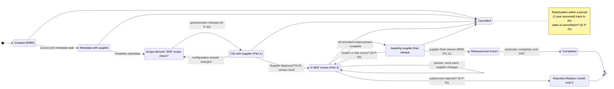

# 05 - Edge-case hunt: process and lifecycle (BDF CIQ)

Discovery analysis only. Nothing is being built. Prepared 2026-10-05 for the first clarification call with BDF's consultant.

**Lens:** what can go wrong along the CIQ lifecycle, from case creation to re-qualification years later. Each edge case either (a) causes a bug or deadlock if we do not design for it, or (b) causes a business dispute (supplier vs BDF, department vs department) if the rule is not agreed up front. BDF wants an app that is "built once and runs for years", so the rarer-but-certain cases (contacts leaving, rules changing, re-qualification) matter as much as the happy path.

Companion documents: `01-expected-workflow.md` (happy path, status model, open decisions W-01 to W-41), `02-modules-and-data-model.md`, `03-user-base-and-access.md`. The "Related" line on each edge case points to those decision IDs, so answers can be recorded in one place.

---

## 0. How to read this

**Sources and citation codes** (same as `00-glossary.md`)

| Code | Source |
|---|---|
| ReqDoc | `CIQ Business process requirements MVP_ v2.0.pdf` (14 p., A. Pevzner, 16 Sep 2026). Cited `[ReqDoc p.X §Y]` |
| BRM | `CIQ_Business_Requirements_Matrix_MVP.xlsx` (51 REQs). Cited `[BRM REQ-ID]` |
| FLM | `CIQ_Field_Level_Requirements_Matrix_v0.6_EN.xlsx`. `[FLM rN]` = sheet 'CIQ new version', Excel row N. `[FLM changelog rN]` = sheet 'Notes & change log'. `[Feldkatalog rN]` = old German sheet 'Feldkatalog (Feldebene)' |
| KB | `CIQ_Knowledge_Baseline.xlsx`. **Origin uncertain**: its "Proposed" status reads "proposed by the build team" [KB ReadMe r21], so it may be a vendor or build-team document rather than BDF's. All "Customer answer" columns are empty |
| CIA | BDF functional screening catalogue, **with Kissflow's own answers already submitted**. `[CIA #n]` |
| VQ | BDF non-functional screening questionnaire, **with Kissflow's own answers already submitted**. `[VQ 'Sub-area']` |
| IKW | IKW 2019 industry supplier questionnaire. **Not Beiersdorf's.** Used only as a reference for industry practice |

**Tags**
- A plain statement with a citation is **STATED** in the documents.
- **Undefined** = the documents say nothing about this situation.
- **CONFLICT** = two documents (or two passages) disagree.
- **(inferred)** = our own reasoning. Every "Proposed default" is inferred: it is what we would build if BDF has no preference, and it must be confirmed. BDF itself asks that open decisions are "not resolved by assumption" [ReqDoc p.2 §2].

**Severity**

| Level | Meaning |
|---|---|
| **Critical** | Deadlock, wrong approval outcome, or an audit and traceability failure. It shapes the core workflow, so it must be decided before any build. |
| **High** | Likely production bug or business dispute within the first months. Decide before build. |
| **Medium** | Needs a default. We can propose one and get it confirmed. |
| **Low** | Configuration detail. Clarify later. |

**Step labels.** The two main documents number the steps differently after PS-06 (see §2.1). This document always writes "ReqDoc PS-xx" or "BRM PS-xx" when the number matters.

---

## 1. Top 15 edge cases to raise tomorrow

Ranked by impact on the core design and the likelihood of a dispute.

| # | ID | Edge case | Why it matters | Sev. | Question for the consultant |
|---|---|---|---|---|---|
| 1 | [E-P-61](#e-p-61) | The two documents end the process differently: supplier final release plus automatic completion (BRM) vs BDF approve/reject plus overall approval (ReqDoc) | The final step, the final status and the PDF depend on it. If the two models are mixed, a rejected material can show as "Completed" | Critical | Which ending is binding for the MVP, who gives the overall approval, and can we see the process diagram? |
| 2 | [E-P-62](#e-p-62) | One department rejects | The BRM has no reject path at all, and the ReqDoc leaves the effect open (NEW-04). Other reviews and supplier tasks are still running | Critical | Does the case stop at once, do the others finish, and can the supplier fix the issue and resubmit in the same case? |
| 3 | [E-P-36](#e-p-36) | What a "review version" is | Every answer to a query changes data. If each answer is a new CIQ version, versions explode; if not, answers overwrite silently | Critical | Is a query answer a new version of the whole CIQ or only of that answer? When does a "resubmission" happen? |
| 4 | [E-P-53](#e-p-53) | How the supplier changes data after Supplier Approval | Metadata stays editable until the final release, but nothing says how other answers can change in Part 2 | Critical | In Part 2, may the supplier change anything at any time, only metadata, or only what BDF asks about? |
| 5 | [E-P-54](#e-p-54) | A configuration answer (e.g., origin) changes after reviews have started | New annexes and departments become relevant, others drop out, and finished reviews may become moot | Critical | Does the case go back to Part 1 (new Supplier Approval) or continue in Part 2 with the new sections as extra tasks? |
| 6 | [E-P-41](#e-p-41) | Supplier cannot provide an item; the department will not accept that | "Closed" means "accepted", and every open point blocks. The point can never close, so the case never ends | Critical | If the item will never come and is not acceptable, does the case end as a rejection, an approval with a deviation, or a cancellation? |
| 7 | [E-P-66](#e-p-66) | Supplier never gives the final release, or refuses | Without the release there is no automatic completion. Cases get stuck one step before the end | Critical | Can BDF close the case without the supplier's release, and with which status? |
| 8 | [E-P-37](#e-p-37) | Which departments must finish before the case can close | Legal is "read only", Customs has no review step, RMM documents in Teamcenter and Sustainability in a separate questionnaire. Any of them can block the end forever | High | Which departments must complete a review, which are only informed, and how does the tool learn that an outside review is done? |
| 9 | [E-P-88](#e-p-88) | Supplier does not react (at any supplier task) | No default deadlines or escalation contacts exist (NEW-16). RMM goes back to chasing by e-mail | High | Default deadlines per supplier task, and who is escalated to (RMM, Procurement, supplier management)? |
| 10 | [E-P-08](#e-p-08) | Supplier contact leaves or must be replaced mid-case | Task assignment is "exclusively on the supplier's side", but contact fields are RMM's. Orphaned tasks, and ex-employees keep access | High | Who administers supplier users: BDF or the supplier itself? |
| 11 | [E-P-20](#e-p-20) | BDF scope check before the questionnaire is released | "Only then is the full questionnaire released", but nobody is named and there is no timeout. Bottleneck at the start of every case | High | Is there a manual scope check? Who does it, and what happens if they do not act in time? |
| 12 | [E-P-50](#e-p-50) | A department reopens or adds an annex after the supplier was asked for the final release | Parts can be added "throughout the entire process", but the supplier is notified "exactly once". Risk: a frozen CIQ with open parts | High | Until when can departments still add requests or annexes? |
| 13 | [E-P-59](#e-p-59) | Shared sections (K2.2, K6.14, K6.17): both approve, or the lead decides (OP-18) | Two departments can reach different conclusions on the same data | High | Does the lead decide alone, or must both agree? What happens if they disagree? |
| 14 | [E-P-85](#e-p-85) | Rules or template change while cases are running | Running cases keep their old version, but re-derivation and late annexes need a version too. An urgent rule fix cannot reach running cases | High | Should running cases stay on the old rules, or can BDF move selected cases to the new ones? |
| 15 | [E-P-77](#e-p-77) | Re-qualification years later | BDF documents are silent. Industry practice is reconfirmation about every two years [IKW p.2]; this decides whether the app is a one-off workflow or a lifecycle record | High | Does BDF reconfirm CIQs periodically, and should the tool track the due date and pre-fill the new CIQ? |

**Also worth raising if time allows:** [E-P-91](#e-p-91) reviewer absence and delegation, [E-P-75](#e-p-75) what a reactivated case looks like, [E-P-21](#e-p-21) origin types with no defined rules (risk of under-review), [E-P-13](#e-p-13) how suppliers ask BDF questions, [E-P-32](#e-p-32) whether BDF may edit supplier answers, [E-P-01](#e-p-01) duplicate cases, [E-P-17](#e-p-17) blends with several origins, [E-P-43](#e-p-43) blocking vs non-blocking points, [E-P-80](#e-p-80) reuse of supplier-level certificates, [E-P-82](#e-p-82) a second production site.

**Suggested call structure (inferred).** Group the questions into five themes so the consultant can route them to the right BDF people:
1. **How the process ends:** E-P-61, E-P-62, E-P-63, E-P-66, E-P-69.
2. **Changes and versions during review:** E-P-36, E-P-53, E-P-54, E-P-55, E-P-50, E-P-85.
3. **Who does what:** E-P-20, E-P-37, E-P-59, E-P-91, E-P-08, E-P-13.
4. **When nobody moves:** E-P-88, E-P-41, E-P-40, E-P-66.
5. **After closure:** E-P-77, E-P-78, E-P-80, E-P-82, E-P-75.

---

## 2. Lifecycle facts and conflicts behind the edge cases

### 2.1 Step crosswalk (short form; full version in `01-expected-workflow.md` §2.2)

| Lifecycle stage used here | ReqDoc step [ReqDoc p.2-3 §2.1] | BRM step [BRM col A/B] |
|---|---|---|
| A Case creation | PS-01 Start CIQ | PS-01 |
| B/C Supplier access, metadata | PS-02 Enter metadata | PS-02 |
| D Scope derivation and release | PS-03 Configure CIQ | PS-03 |
| E Completion and upload | PS-04 | PS-04 |
| F Supplier Approval | PS-05 "Supplier Approval" | PS-05 "Confirmation of completeness" |
| G Activation, parallel review | PS-06, PS-07 | PS-06 |
| H/I Queries, documents, extra parts | PS-08 | PS-07 query, PS-08 answer, PS-09 review of answer |
| K Department completion | PS-09 document results, PS-10 decide complete | PS-10 complete subprocess |
| L Approvals and rejection | **PS-11 approve or reject subprocess**, **PS-12 overall approval** | (none) |
| M Final release, freeze, completion | (none) | **PS-11 supplier final release**, **PS-12 automatic completion** |
| N Final documents, filing | PS-13 | PS-12 (REQ-PROC-046) |
| O Cancellation, reactivation | §3.3.3 | PS-12 (REQ-PROC-049) |

### 2.2 Facts that drive most edge cases

1. **CONFLICT on how the process ends.** The ReqDoc has BDF subprocess approve/reject and an overall approval by a role "to be decided" [ReqDoc p.3 §2.1]. The BRM has department completion, then a supplier final release, then automatic completion, and none of its confirmations is "a Beiersdorf raw material approval" [BRM REQ-PROC-015, -038, -042, -045]. → E-P-61, E-P-62, E-P-66.
2. **The authoritative process diagram was not shared.** The ReqDoc calls it "authoritative for the structure and sequence" [ReqDoc p.2 §2]. The PDF contains no images.
3. **Part 2 starts only after Supplier Approval** [ReqDoc p.1 §1]. The data is "fixed for that review cycle", and "a later resubmission creates a new review version" [ReqDoc p.4 §3.1.5]. Yet metadata stays changeable after PS-05 until the final release [BRM REQ-PROC-007]. → E-P-36, E-P-53, E-P-54.
4. **CONFLICT on what blocks.** "A distinction between blocking and non-blocking open points is not envisaged" [BRM REQ-PROC-036], whereas findings are "blocking or non-blocking" [ReqDoc p.13 REQ-RMES-009] and "open blocking requests" prevent completion [ReqDoc p.4 §3.2.2]. → E-P-43.
5. **CONFLICT on scope adjustment.** The ReqDoc says "extend or reduce" before release [ReqDoc p.10 §5.2]; the BRM says extend with a justification [BRM REQ-CFG-007]. → E-P-20, E-P-22.
6. **CONFLICT on production sites.** One site per CIQ; further sites dropped [FLM changelog r25]. SF-02 still asks "Are there additional production sites?" [ReqDoc p.10 §5.3]. The old catalogue allowed several sites and has an open point "to be clarified with Proc" (yellow cell) [Feldkatalog r7, r8]. → E-P-82.
7. **Lifecycle mechanics are required but not parameterised:** named task owners, due dates, reminders and escalation [ReqDoc p.5 §3.4], but no defaults [KB OpenPoints NEW-16]. → E-P-88.
8. **Re-derivation is a live topic (inferred).** REQ-CFG-008 (re-derivation) and REQ-CFG-009 (data retention), plus REQ-PROC-020 and REQ-PROC-024, carry a light-orange fill that the BRM legend does not explain. It may mark recently added or changed requirements.
9. **BDF has an open-points list we have not seen (inferred).** The BRM legend says "Yellow cell: Open business question - see sheet 'Open points'" [BRM Legend r7], but the file has no such sheet. The ReqDoc cites OP-02, OP-03, OP-13, OP-17, OP-18 and OP-19, which implies a list of at least 19 items. Ask for it.
10. **Re-qualification is absent from all BDF documents.** Only the IKW sample mentions reconfirmation (about every two years) and supplier change notifications [IKW p.2]. → E-P-77, E-P-78.

### 2.3 Lifecycle state model used for this analysis (inferred)

A working model only. Labels ending in "?" mark transitions or states the documents do not define. The full proposed status model is in `01-expected-workflow.md` §4.

---

## 3. Edge cases by lifecycle stage

Format of each entry: **Scenario** (what happens in real life) · **Docs say** (STATED, with citations, or Undefined) · **Proposed default (inferred)** · **Risk if ignored** · **Ask** (business wording for the consultant) · **Related** (decision IDs in docs 01 to 03).

---

### A. Case creation (PS-01)

#### E-P-01 - Duplicate case for the same supplier and raw material - **High**
- **Scenario:** Two RMM colleagues start a CIQ for the same supplier and trade name for two BDF projects. Or a case is started manually and later again from Teamcenter. Or a case is restarted although one was completed last month. The supplier fills in the same questionnaire twice and may answer differently.
- **Docs say:** Creation needs supplier, trade name, supplier contact and BDF owner, and gives a unique ID [BRM REQ-PROC-001]. Cases are searchable by DUNS, INCI and origin type [BRM REQ-PROC-006]. The start must also be possible from Teamcenter [CIA #1]. **Undefined:** any uniqueness rule or duplicate check.
- **Proposed default (inferred):** At creation, search open and recently completed cases by DUNS + trade name (+ production site). Show matches and require a justification to continue. Link related cases. Warn; do not hard-block.
- **Risk if ignored:** Double work for the supplier and reviewers; two contradicting CIQs for one material; two different outcomes for the same material.
- **Ask:** Is a CIQ case unique per supplier and raw material, per supplier, raw material and production site, or per BDF project? Should a duplicate be blocked, warned about, or allowed?
- **Related:** W-27.

#### E-P-02 - What a case belongs to (project, IRMA vs RMT) - **Medium**
- **Scenario:** The same raw material is needed for two BDF projects. One project stops, and RMM cancels the case "because the material is no longer relevant for the project", although the second project still needs it.
- **Docs say:** A case can be cancelled "if the associated raw material is no longer relevant for the project" [ReqDoc p.5 §3.3.3]. The case is an "IRMA CIQ case" [ReqDoc p.3 §3.1.1], and CIA names two processes, "IRMA, RMT" [CIA #1]. KB proposes a BDF material number / IRMA reference field [KB ConfigQ BD-04]. **Undefined:** the project link, and what IRMA and RMT mean.
- **Proposed default (inferred):** A case is per supplier and raw material (and site). Project references are a list. Cancellation is per project reference, and the case is cancelled only when no active reference remains.
- **Risk if ignored:** Wrong cancellations; lost link to the project that triggered the case; wrong reporting.
- **Ask:** What do IRMA and RMT stand for, and do they follow the same lifecycle? Is a case tied to one BDF project, and which number identifies it (material number, IRMA ID, Teamcenter ID)?
- **Related:** W-27.

#### E-P-03 - Supplier missing from, or outdated in, master data - **Medium**
- **Scenario:** A first-time supplier has no master record, so the contact e-mail cannot be pre-filled. Or the master record holds a contact who left years ago.
- **Docs say:** The contact e-mail is "pre-filled automatically from supplier master data" [FLM r4]. Supplier name auto-fill from Teamcenter is post-MVP [FLM r3]. DUNS: "Auto-fill from master data" [FLM r7]. A supplier contact database is "Nice to Have" [CIA #24]. **Undefined:** which master data exists in the MVP, and whether a case can start for an unknown supplier.
- **Proposed default (inferred):** In the MVP, a simple supplier and contact list in the app is the master. RMM can add a supplier or contact at case creation (audited). The case keeps a snapshot.
- **Risk if ignored:** Cases cannot start for new suppliers; invitations go to outdated contacts (E-P-07).
- **Ask:** In the MVP, where does supplier and contact master data come from? Can RMM start a case for a supplier that is not yet in master data?
- **Related:** W-32.

#### E-P-04 - Supplier is a trader; the data sits with the manufacturer - **High**
- **Scenario:** BDF's supplier is a distributor. Composition, toxicology and GMP data belong to the manufacturer, who will not share them with the distributor and offers to send them to BDF directly.
- **Docs say:** Supplier (name), Manufacturer (name & address) and Production site are separate mandatory fields [FLM r3, r8, r9]. The IKW sample asks for the supplier "if not identical with manufacturer" and whether a contract manufacturer is used [IKW p.3]. Supplier-side task assignment happens "exclusively on the supplier's side" [BRM REQ-CTL-001]. **Undefined:** manufacturer participation and confidential direct submission.
- **Proposed default (inferred):** The supplier coordinator may invite manufacturer users to the case with section-level access; every action is audited per user. Allow "visible to BDF only" uploads that the inviting distributor cannot read.
- **Risk if ignored:** Part 1 stalls; the distributor submits second-hand or incomplete data; a confidentiality dispute between manufacturer and distributor.
- **Ask:** How often is the supplier a trader rather than the manufacturer? May manufacturer staff work in the supplier's case, and may they hide documents from the trader?
- **Related:** W-18.

#### E-P-05 - Wrong data at case creation - **Medium**
- **Scenario:** RMM selects the wrong supplier or material, or mistypes the contact e-mail. Supplier A receives a CIQ for a material it does not supply.
- **Docs say:** Missing mandatory fields block creation [BRM REQ-PROC-001]. The e-mail is checked for format only [FLM r4]. Supplier changes to metadata are covered [BRM REQ-PROC-007]. **Undefined:** correction of RMM-entered creation data, and a closure reason "created in error".
- **Proposed default (inferred):** RMM can edit creation data until the supplier first opens the case (audited). After that, a wrong supplier or material means cancelling with reason "created in error" and starting a new case. A case is never moved to another supplier.
- **Risk if ignored:** Data from one supplier visible under another supplier's case; polluted reporting.
- **Ask:** Who may correct case-creation data, and up to which step? Should "created in error" be a separate closure reason?
- **Related:** W-26.

#### E-P-06 - Manual vs Teamcenter start; duplicate triggers - **Low (MVP)**
- **Scenario:** Later, Teamcenter sends the same start trigger twice (a retry), or a manual case already exists for that Teamcenter object.
- **Docs say:** "The trigger is currently outside the target system" [ReqDoc p.3 §3.1.1]. Integrations are out of scope for 2026 [ReqDoc p.2 §1.1]. CIA lists the Teamcenter start as Must Have, and Kissflow answered that it is supported [CIA #1].
- **Proposed default (inferred):** Manual start only in the MVP. Store an optional external reference so a later integration can match cases and reject duplicate triggers by Teamcenter object ID.
- **Risk if ignored:** Duplicate cases once the integration goes live (E-P-01).
- **Ask:** Is manual creation by RMM enough for the MVP? Which identifier will Teamcenter send later?
- **Related:** W-27.

---

### B. Supplier access and onboarding (PS-01 to PS-02)

#### E-P-07 - Invitation bounces or is never opened - **High**
- **Scenario:** The contact e-mail has a typo, the contact has left, or a spam filter blocks the invitation. For weeks the dashboard shows "with the supplier", and nobody notices.
- **Docs say:** The supplier contact "receives a notification with a task" [BRM REQ-PROC-004]. Every notification event is logged [BRM REQ-CTL-010; ReqDoc p.14 REQ-RMES-019]. An optional second e-mail is an "additional recipient of notifications" [FLM r5]. **Undefined:** bounce handling and a "not opened" alert.
- **Proposed default (inferred):** Record delivery status. A bounce creates a task for the RMM owner to fix the contact. If the supplier has not opened the case after N days, remind the supplier, copy e-mail 2, then alert RMM.
- **Risk if ignored:** A silent stall at the very first step. RMM finds out only by chasing manually, which is the problem the project wants to remove.
- **Ask:** Who should be alerted when an invitation bounces or is not opened after N days, and what is N?
- **Related:** W-41.

#### E-P-08 - Supplier contact leaves or must be replaced mid-case - **High**
- **Scenario:** The only supplier contact leaves while four query tasks are open. The supplier asks BDF to give a successor access. Meanwhile the former employee can still log in.
- **Docs say:** Several supplier contacts may work in parallel, and "the assignment of tasks on the supplier side takes place exclusively on the supplier's side" [BRM REQ-CTL-001]. Both contact e-mail fields carry Approval = RMM [FLM r4, r5]. There is no field for the contact's name [FLM changelog r20]. CIA asks for supplier role assignment and person-to-role assignment [CIA #26, #27]. **Undefined:** who adds and removes supplier users, and how open tasks move.
- **Proposed default (inferred):** Two levels. The supplier's coordinator can invite and remove colleagues from the same company; RMM can always replace the primary contact. On replacement, open supplier tasks move to the successor, who sees the full history, and the leaver is deactivated.
- **Risk if ignored:** Orphaned supplier tasks, which breaks "no task without a responsible person" [BRM REQ-CTL-003]. An ex-employee keeps access to BDF requests. Weeks of delay.
- **Ask:** Who administers supplier users: BDF (RMM) or the supplier itself? May a supplier contact invite colleagues without BDF approval?
- **Related:** W-18, U-04.

#### E-P-09 - Named owner for supplier tasks vs supplier-side routing - **Medium**
- **Scenario:** A reviewer sends a query to contact A, but toxicology specialist B must answer it. Or nobody at the supplier feels responsible.
- **Docs say:** Every task needs "exactly one named responsible person or responsible role" [BRM REQ-CTL-003]. A query raised from a finding names the "responsible supplier contact" [ReqDoc p.13 REQ-RMES-010]. Routing on the supplier side is the supplier's job [BRM REQ-CTL-001]. (inferred) Tension: does BDF pick the supplier person, or does the supplier route internally?
- **Proposed default (inferred):** The supplier organisation owns supplier tasks, with the primary contact as default. Any authorised supplier user on the case may act, and the coordinator can re-route. The audit trail records who actually answered.
- **Risk if ignored:** Tasks stuck with the wrong person; disputes about who was informed.
- **Ask:** Should a BDF reviewer choose the supplier recipient of each query, or should every query go to the supplier's coordinator for internal routing?
- **Related:** W-18, U-04.

#### E-P-10 - Which cases a supplier user may see - **Medium**
- **Scenario:** An agent represents several manufacturers. Or a supplier group has several legal entities: should a contact at subsidiary X see the cases of subsidiary Y?
- **Docs say:** "The supplier sees only their own cases" [BRM REQ-CTL-006]. Per-supplier role structures [CIA #26]; multi-level supplier structures are Nice to Have [CIA #28]. **Undefined:** whether "own" means per person, per supplier company or per group.
- **Proposed default (inferred):** A user sees the cases they are invited to. The supplier coordinator sees all cases of their legal entity. Group-level visibility only on request.
- **Risk if ignored:** One supplier's confidential data visible to another; the worst case is competitors served by the same agent.
- **Ask:** Should a supplier contact see all cases of their company, or only the cases they are invited to? How should supplier groups with several legal entities be handled?
- **Related:** U-15.

#### E-P-11 - Shared mailboxes and generic accounts - **Medium**
- **Scenario:** The supplier uses one login, regulatory@supplier.com, shared by five people. Supplier Approval and the final release are given by "regulatory".
- **Docs say:** Confirmations are recorded with name, e-mail and timestamp [BRM REQ-PROC-014], and the final release with role as well [BRM REQ-PROC-042]. Who entered which information must be identifiable [BRM REQ-CTL-001].
- **Proposed default (inferred):** Personal accounts for anyone who edits or confirms. Shared mailboxes only as extra notification recipients.
- **Risk if ignored:** Confirmations without an accountable person; weak evidence in a dispute.
- **Ask:** Must every supplier user, or at least anyone who confirms, have a personal login?
- **Related:** W-18, U-11.

#### E-P-12 - Supplier cannot log in - **Low**
- **Scenario:** The invitation link has expired, or the user lost their MFA device the day before a due date.
- **Docs say:** SSO is required for BDF users [CIA #20]. Supplier authentication is not specified; Kissflow listed its options [VQ 'Authentication / SSO']. **Undefined:** the supplier login method and who supports it.
- **Proposed default (inferred):** Self-service reset. RMM can re-send the invitation. A named support contact appears in the portal.
- **Risk if ignored:** Missed deadlines and escalations caused by access problems, not by the supplier.
- **Ask:** Which login method do you expect for suppliers, and who supports them with login problems: RMM, a BDF helpdesk, or Kissflow?
- **Related:** U-11.

#### E-P-13 - Supplier asks BDF a question - **High**
- **Scenario:** In Part 1 a supplier does not understand a configuration question (e.g., EUDR scope) and e-mails RMM. The answer stays in a mailbox, or the supplier guesses.
- **Docs say:** Queries are defined only from BDF to the supplier [BRM REQ-PROC-029, -030]. Today "every question ... passes through this single point" (RMM) [ReqDoc p.1 §1]. Loops must be retraceable "without having to fall back on e-mails" [BRM REQ-PROC-033]. Supplier guidance and FAQs are Must Have [CIA #34]. **Undefined:** a supplier-to-BDF question channel.
- **Proposed default (inferred):** An "Ask BDF" function at section level. It creates a task for the RMM owner in Part 1, or for the owning department in Part 2, and keeps the history at that section.
- **Risk if ignored:** E-mail traffic continues outside the tool; mis-scoping (E-P-16); no record of what BDF told the supplier.
- **Ask:** When suppliers have questions while filling in the CIQ, who answers: RMM or the department that owns the section? Should that happen in the tool?
- **Related:** W-19.

#### E-P-14 - RMM enters data on behalf of a supplier - **Medium**
- **Scenario:** A small supplier will not use the portal and e-mails a filled-in Word CIQ. RMM types the answers in.
- **Docs say:** Suppliers who upload their own documents will get "a separate process" [ReqDoc p.4 §3.1.4; KB OpenPoints NEW-12]. Supplier confirmations are personal [BRM REQ-PROC-014, -042]. **Undefined:** data entry by BDF on a supplier's behalf, and confirmations on its behalf.
- **Proposed default (inferred):** Not allowed in the MVP. If allowed later, every answer is flagged "entered by BDF on behalf of", with the supplier's source document attached. Confirmations come only from the supplier.
- **Risk if ignored:** The supplier "confirms" data it never saw; BDF owns the errors; the audit trail cannot show who said what.
- **Ask:** Will RMM ever enter CIQ data on behalf of a supplier? If so, who gives the supplier confirmations?
- **Related:** W-31.

---

### C. Metadata entry (PS-02)

#### E-P-15 - Supplier cannot or will not disclose a mandatory metadata item - **High**
- **Scenario:** The FLM puts the composition (INCI, function, concentration range) into the metadata block. A supplier treats the exact composition as a trade secret, or does not know its natural origin index. It cannot submit the metadata, so no scope is ever derived.
- **Docs say:** "Missing mandatory entries block submission of the metadata" [ReqDoc p.3 §3.1.2; BRM REQ-PROC-005]. The composition fields are Mandatory and sit in the "Meta Data" block [FLM r10-r15]; the natural origin index is mandatory [FLM r33]. The "cannot provide + justification" route exists only at the completeness check before PS-05 [BRM REQ-PROC-012]. All internal roles may read all case content [BRM REQ-PROC-019].
- **Proposed default (inferred):** Allow "cannot provide + justification" for metadata fields that do not drive the scope. Configuration answers (SF-xx) must be answered or routed to RMM (E-P-13). Optionally, confidential documents visible to Safety and Regulatory only.
- **Risk if ignored:** Deadlock at step 1. Suppliers enter dummy values to pass validation. Confidentiality complaints.
- **Ask:** What happens if a supplier refuses to disclose the full composition in the portal? Should some documents (composition, patents) be visible only to selected departments?
- **Related:** W-37.

#### E-P-16 - Supplier is unsure about a configuration answer - **Medium**
- **Scenario:** Unsure whether its polymer meets the REACH polymer definition (SF-03), the supplier answers "No". Safety discovers the polymer in Part 2; annexes are missing, so the scope must be re-derived (E-P-54).
- **Docs say:** The SF list is a draft [ReqDoc p.10 §5.3; KB OpenPoints OP-19]. KB asks whether the supplier can judge EUDR scope [KB ConfigQ SF-09] and whether target markets are a BDF fact [KB ConfigQ SF-11]. No "unsure" option exists.
- **Proposed default (inferred):** An "Unsure - ask BDF" option that creates an RMM task before the questionnaire is released. Answers that only BDF knows (e.g., target markets) are pre-filled by RMM and read-only for the supplier.
- **Risk if ignored:** Under-scoped questionnaires found late; rework in Part 2.
- **Ask:** Which configuration answers should BDF provide (e.g., target markets) instead of the supplier? Should the supplier be able to answer "unsure"?
- **Related:** W-36.

#### E-P-17 - Raw material with several origin types (blends) - **High**
- **Scenario:** A blend of a vegetable oil and a petrochemical wax. The FLM radio button allows only one origin, so either A4/A9 (MOAH/PAH) or A1/A2 goes missing.
- **Docs say:** "Source of origin" is a radio button [FLM r16-r30]. The change log notes that the CIQ allows "more than one answer" and asks for confirmation [FLM changelog r35]. The old catalogue had multi-select [Feldkatalog r31-r38]. K2.3 is "Origin type per component" [ReqDoc p.6]. KB asks whether origin is answered per component or per raw material [KB ConfigQ SF-01]. IKW notes multi-component systems [IKW p.2].
- **Proposed default (inferred):** Origin per component with multi-select; the scope is the union of all triggered rules.
- **Risk if ignored:** Contaminant checks skipped (a product-safety risk); late discovery causes rework in Part 2.
- **Ask:** Can a raw material, or one of its components, have several origin types? If so, does the scope become the union of all triggered annexes?
- **Related:** W-35.

#### E-P-18 - Contradicting configuration answers - **Medium**
- **Scenario:** SF-01 = Polymer, but SF-03 ("contains polymer components?") = No. Or SF-01 = Petrochemical, but SF-07 ("mineral-oil based?") = No.
- **Docs say:** KB flags these overlaps [KB ConfigQ SF-01, SF-07; KB ConfigRules R-14, R-15], and notes that combination rules are missing [KB ConfigRules R-xx].
- **Proposed default (inferred):** Cross-checks when the metadata is submitted. Alternatively, derive SF-03 and SF-07 from SF-01 and ask only when needed.
- **Risk if ignored:** Wrong or non-reproducible scope; confused suppliers.
- **Ask:** When SF-01 and SF-03/SF-07 contradict each other, which one wins? Or must the supplier resolve it before submitting?
- **Related:** W-36.

#### E-P-19 - Who owns the metadata ("Approval = RMM") - **Medium**
- **Scenario:** RMM pre-filled the trade name and DUNS, and the supplier overwrites them. Or "Approval = RMM" means RMM must approve the supplier's metadata before the questionnaire is generated, and nobody built that step.
- **Docs say:** Every metadata field has Approval = RMM [FLM r2-r35]. The trade name "can be pre-filled by RMM" [FLM r2]. Metadata "remains changeable" for the supplier [BRM REQ-PROC-007]. **Undefined:** what the Approval column means.
- **Proposed default (inferred):** Read Approval as "reviewing role", not as an extra gate. RMM-owned fields are read-only for the supplier, who can propose a change.
- **Risk if ignored:** An unplanned approval gate discovered during testing; disputes over who changed key identifiers.
- **Ask:** What does "Approval = RMM" in the field matrix mean? Does RMM check the metadata before the questionnaire is generated?
- **Related:** W-14, U-09.

---

### D. Scope derivation and release (PS-03)

#### E-P-20 - BDF scope check before release: who, and what if nobody acts - **High**
- **Scenario:** After derivation, "the department" should look at the scope before the full questionnaire goes out. Six departments are involved. One does not react for two weeks, and the supplier waits.
- **Docs say:** "The department sees the derived scope and can extend or reduce it ... Only then is the full questionnaire released" [ReqDoc p.10 §5.2]. PS-03 is a System step, and PS-04 starts with "Configured CIQ released to the supplier" [ReqDoc p.2 §2.1]. A manual extension needs a justification [BRM REQ-CFG-007]. Every human action is a task [BRM REQ-CTL-003]. **Undefined:** whether the check is mandatory, who does it, and the timeout.
- **Proposed default (inferred):** Release automatically right after derivation; departments or RMM can extend the scope later at any time [BRM REQ-ADR-002]. If BDF wants a gate: a single RMM check with a short deadline and automatic release.
- **Risk if ignored:** A bottleneck at the start of every case, or a gate that exists only on paper.
- **Ask:** Is there a manual scope check before the questionnaire goes to the supplier? If yes, who does it (RMM or each department), and what happens if they do not act in time?
- **Related:** W-07.

#### E-P-21 - Undefined rule outcome: no annexes, no reviewing department - **High**
- **Scenario:** A supplier selects CCU or "waste / side stream". The rule table gives no annexes and the reviewing department is "to be defined". The case goes to review with only the always-on sections, or with no specific reviewer at all.
- **Docs say:** For waste/side stream, CCU and chemical recycling: "None derived from the origin type"; additional evidence and reviewing department "To be defined (OP-19)" [ReqDoc p.11-12 §5.4]. KB marks R-16 to R-18 as missing [KB ConfigRules R-16, R-17, R-18]. The binding table "has to be collected with the business departments" [ReqDoc p.12].
- **Proposed default (inferred):** Fail safe. Any case that hits an undefined or incomplete rule goes to an RMM triage task (a manual scope decision) before release. Never pass silently.
- **Risk if ignored:** New, and potentially riskier, origin types get less review than ordinary vegetable materials.
- **Ask:** Until the rules for waste, CCU and chemical recycling are defined, who decides the scope for such cases?
- **Related:** W-36.

#### E-P-22 - Removing derived scope (reduce vs extend only) - **Medium**
- **Scenario:** Regulatory wants to remove A11 (UK REACH). The origin table makes it mandatory, but the material is not sold in the UK. Or a department deactivates an annex the supplier has already half filled in.
- **Docs say:** CONFLICT: "extend or reduce" [ReqDoc p.10 §5.2] vs "extend the derived scope with a mandatory justification" [BRM REQ-CFG-007]. The origin table contradicts SF-11 for A11/A12 [KB OpenPoints NEW-07]. RMES applicability can be overridden with a reason [ReqDoc p.13 REQ-RMES-004]. Removed data is retained [BRM REQ-CFG-009].
- **Proposed default (inferred):** Only the owning department may reduce, with a justification, audited. Data entered so far is retained and can be restored. The supplier's task for that part is closed with a notice.
- **Risk if ignored:** Inconsistent scopes; deleted supplier work; audit gaps.
- **Ask:** May departments remove rule-derived sections, not only add them? Who must agree?
- **Related:** W-07.

#### E-P-23 - Manual scope changes vs later re-derivation - **High**
- **Scenario:** QM manually added A3 (GMO). Later the supplier changes SF-06. Re-derivation recalculates from the rules and silently drops A3.
- **Docs say:** Manual deviations are "marked as such and auditable" [BRM REQ-CFG-007]. On a metadata change "the scope must be derived again" [BRM REQ-CFG-008]. **Undefined:** whether manual overrides survive re-derivation.
- **Proposed default (inferred):** Manual additions and removals persist and are shown separately from rule results. Re-derivation never undoes a manual decision; conflicts go to the department that made it.
- **Risk if ignored:** Department decisions undone by the system; reviewers stop trusting the scope.
- **Ask:** Should a manual scope change survive a later automatic re-derivation?
- **Related:** W-07, W-11.

#### E-P-24 - Re-derivation in Part 1 while the supplier is filling in - **Medium**
- **Scenario:** The supplier changes SF-01 after completing 60 %. Sections disappear while a colleague is editing one of them.
- **Docs say:** Re-derivation shows "a difference list of the sections", and affected departments are notified [BRM REQ-CFG-008]. Removed answers "remain visible in the history; if the metadata change is reverted, they become active again" [BRM REQ-CFG-009]. Data is "not discarded silently" [ReqDoc p.10 §5.2]. KB asks hide, archive or delete [KB OpenPoints NEW-14].
- **Proposed default (inferred):** Show the supplier the difference list and ask for confirmation before applying. Hidden sections are retained. Co-editors are warned.
- **Risk if ignored:** Lost work, confused suppliers, support calls.
- **Ask:** Should the supplier see which sections will appear or disappear before a change is applied?
- **Related:** W-11.

#### E-P-25 - Optional sections - **Low**
- **Scenario:** The supplier leaves an optional section empty, and a department needs it later. Or the supplier fills it in: does that create a review task?
- **Docs say:** Every section is classified mandatory, optional or not applicable [BRM REQ-PROC-010]. **Undefined:** how optional sections are reviewed, and which rule makes a section optional [KB ConfigRules R-xx].
- **Proposed default (inferred):** Optional sections are reviewed only if filled in. Reviewers may request them with a query.
- **Risk if ignored:** Unnecessary review tasks, or missed information.
- **Ask:** Are optional sections reviewed when filled in, and who decides what is optional?
- **Related:** W-36.

---

### E. Completion and upload (PS-04)

#### E-P-26 - Concurrent editing by several supplier users - **High**
- **Scenario:** Two users edit the K2.1 component table at the same time, and the last save overwrites 20 rows. Or one user gives Supplier Approval while a colleague still has unsaved changes.
- **Docs say:** "Two supplier users work on different sections at the same time without data loss" [BRM REQ-CTL-001]. Kissflow answered "sequentially or in parallel" [CIA #6]. **Undefined:** the same section or table at the same time, and edits that race the Supplier Approval.
- **Proposed default (inferred):** A section-level edit lock with a visible "being edited by", or field-level merge with a conflict warning. Supplier Approval locks the case; unsaved changes elsewhere are rejected with a clear message.
- **Risk if ignored:** Silent data loss, which the supplier will blame on the tool; a submitted version that differs from what the supplier believes it sent.
- **Ask:** Is "different users on different sections" enough, or must two users be able to edit the same section (e.g., the component table) at the same time?
- **Related:** W-18.

#### E-P-27 - "Cannot provide" justifications in Part 1 - **High**
- **Scenario:** To reach submission quickly, the supplier justifies 30 of 40 mandatory items with "not available".
- **Docs say:** With a written justification an item ceases "to be treated as blocking", and the justification is visible to reviewers [BRM REQ-PROC-012]. Submission is blocked until a required N.A. justification is given [ReqDoc p.4 §3.1.4]. Explicit justification cases: waiving K5.1 [ReqDoc p.6]; a negative nanomaterial answer [ReqDoc p.7]; deviations from K2.2 limits [ReqDoc p.6]; pesticides "No → reason mandatory" [FLM r45]. A comment in the old catalogue questions whether a justification is needed at all ("which justification?") [Feldkatalog comment C46]. **Undefined:** who accepts a justification, and whether some items can never be justified away.
- **Proposed default (inferred):** A configurable "justification allowed: yes/no" per mandatory item. Every justification shows up in the owning department's review as an item to accept or query. RMM sees the number of justified gaps at submission.
- **Risk if ignored:** Part 2 floods with queries; the mandatory checks become meaningless.
- **Ask:** Which mandatory items may be replaced by a justification, and which are hard requirements? Who accepts a justification?
- **Related:** W-39.

#### E-P-28 - Long-lead evidence (one item takes weeks) - **Medium**
- **Scenario:** Everything is ready except a second batch analysis or a study that takes three months. Part 2 cannot start before Supplier Approval.
- **Docs say:** "Part 2 begins only after Supplier Approval" [ReqDoc p.1 §1]. K2.2 needs "evidence from at least two batches" [ReqDoc p.6]. **Undefined:** partial submission, or evidence marked "to follow".
- **Proposed default (inferred):** The supplier justifies with "to follow by <date>". On submission, the system creates an additional-document request with that due date automatically, so the review can start.
- **Risk if ignored:** A whole case blocked by one document, or misuse of justifications.
- **Ask:** May a supplier submit with one or two documents marked "to follow by date X", so the review can start?
- **Related:** W-39.

#### E-P-29 - Upload problems; one document for several questions - **Medium**
- **Scenario:** A password-protected or scanned PDF; a 200 MB file; both batch analyses in one file; one SDS that answers both K1 and K6.1.
- **Docs say:** Evidence is uploaded at the triggering question and must "remain permanently linked there"; the acceptance criterion says a K2.2 certificate is linked "exclusively to this question" [BRM REQ-PROC-011]. The pesticides upload is PDF [FLM r46]. At least two batch reports are required [Feldkatalog r26]. **Undefined:** file rules and documents that serve several questions.
- **Proposed default (inferred):** One document, many links: uploaded once, referenced at several questions, one shared version. File type and size limits. Unreadable files rejected at upload where this can be detected.
- **Risk if ignored:** Duplicate uploads with diverging versions; reviewers query unreadable files one by one.
- **Ask:** May one document (e.g., the SDS) answer several questions? Are there file type or size rules?
- **Related:** -

#### E-P-30 - Supplier switches to "own documents" mid-case - **Medium**
- **Scenario:** The supplier starts the CIQ, then uploads its own standard questionnaire and answers every field with "see attachment".
- **Docs say:** A separate process will be specified for suppliers who upload their own documents [ReqDoc p.4 §3.1.4]. Whether it is in the MVP is open [KB OpenPoints NEW-12]. RMES pre-filling needs structured data [BRM REQ-PROC-022].
- **Proposed default (inferred):** RMM decides: either insist on the CIQ (return to the supplier), or close the case with reason "moved to own-document process" and start that process.
- **Risk if ignored:** No structured data for analysis and RMES; reviewers re-type data.
- **Ask:** How many suppliers send their own documents? Is that process part of the MVP, and can a case switch between the two processes?
- **Related:** W-31.

#### E-P-31 - BDF reads drafts before Supplier Approval - **Low**
- **Scenario:** A reviewer looks at draft answers before submission and sends an informal e-mail. The supplier then changes the answers, and both later argue about which version was meant.
- **Docs say:** "All internal roles must be able to read all project content" [BRM REQ-PROC-019]. Section status "with the supplier" [BRM REQ-CTL-006]. **Undefined:** visibility of drafts.
- **Proposed default (inferred):** Before PS-05, BDF sees progress (sections complete, % done). Draft content is read-only and labelled "draft - not submitted".
- **Risk if ignored:** Reviews based on unstable data; version disputes.
- **Ask:** Should BDF see the supplier's draft answers before Supplier Approval, or only its progress?
- **Related:** W-19.

#### E-P-32 - BDF staff edit supplier answers - **High**
- **Scenario:** Regulatory corrects an obvious CAS typo instead of sending a query. At the final release the supplier confirms data it did not enter, or disputes it.
- **Docs say:** Internal roles may edit "only their own business area" [BRM REQ-PROC-019]. It should be possible "to restore the historical data where required" [BRM REQ-PROC-016]. At the final release the supplier confirms that "the information given in the CIQ and the evidence submitted are correct and complete" [BRM REQ-PROC-042]. **Undefined:** whether BDF may change supplier answers.
- **Proposed default (inferred):** BDF never edits supplier answers; corrections go back as queries. If BDF insists on editing, the change is marked "changed by BDF" and listed for the supplier before the final release.
- **Risk if ignored:** Legal and quality disputes over data ownership; the supplier confirmation loses its value.
- **Ask:** May BDF staff ever correct supplier answers directly, or must every correction go back to the supplier?
- **Related:** W-08.

---

### F. Supplier Approval (PS-05) and the review version

#### E-P-33 - Who may give Supplier Approval and the final release - **Medium**
- **Scenario:** A junior user clicks "approve". Later the supplier claims the person was not authorised to make statements on its behalf.
- **Docs say:** Supplier Approval "confirms submission and responsibility for the provided information" [ReqDoc p.4 §3.1.5]. It is recorded with name, e-mail and timestamp [BRM REQ-PROC-014]; the final release also records the role [BRM REQ-PROC-042]. The old catalogue has a verification block with "Person responsible" and an empty "Digital signature" row [Feldkatalog r12, r15]. A11 contains "a signed declaration by the supplier" [ReqDoc p.8]. **Undefined:** which role may sign, and whether an e-signature is needed.
- **Proposed default (inferred):** Only supplier users with a "signatory" role can confirm. The confirmation text is versioned and stored with each confirmation.
- **Risk if ignored:** Confirmations that do not hold up in a dispute.
- **Ask:** Must the supplier confirmations come from a specific role (e.g., QM or an authorised signatory)? Is an electronic signature needed?
- **Related:** W-18, W-30.

#### E-P-34 - Returning a whole submission before Part 2 (formal check) - **Medium**
- **Scenario:** The supplier uploads a blank page to satisfy a mandatory upload. The system check passes, and five departments each find the problem and query it separately.
- **Docs say:** PS-05 requires that "formal mandatory checks are passed" [ReqDoc p.3 §2.1]. RMES starts only "after the formal entry criteria have been met" [ReqDoc p.13 REQ-RMES-001]. **Undefined:** whether a person (RMM) checks before Part 2, and whether a submission can be returned as a whole.
- **Proposed default (inferred):** An optional RMM formal check, configurable. Accept → Part 2. Return to the supplier with reasons → back to PS-04, before any review version or review tasks are created.
- **Risk if ignored:** Wasted review capacity; the supplier gets many scattered queries instead of one clear return.
- **Ask:** Are the "formal mandatory checks" only system validations, or does RMM check the submission before the departments start?
- **Related:** W-14.

#### E-P-35 - Supplier wants to recall right after approving - **Medium**
- **Scenario:** One hour after Supplier Approval, the supplier notices it uploaded last year's CoA.
- **Docs say:** On Supplier Approval the versions "are fixed for that review cycle", and "a later resubmission creates a new review version" [ReqDoc p.4 §3.1.5]. **Undefined:** recall.
- **Proposed default (inferred):** Recall is allowed until the first reviewer starts work. After that, corrections go through the Part 2 change route (E-P-53).
- **Risk if ignored:** Reviewers assess outdated documents; unnecessary versions.
- **Ask:** May a supplier recall its submission before BDF starts reviewing?
- **Related:** W-09.

#### E-P-36 - What exactly a "review version" is - **Critical**
- **Scenario:** In Part 2 the supplier answers 12 queries over six weeks, each changing one field or document. Is each answer a new review version of the whole CIQ, with a new RMES record? Or a new version of that field only?
- **Docs say:** Versions are fixed at Supplier Approval, and "a later resubmission creates a new review version and does not silently overwrite the version previously assessed" [ReqDoc p.4 §3.1.5]. Every assessment refers to the version fixed in PS-05, and it should be possible to "restore the historical data where required" [BRM REQ-PROC-016]. Closure records the "accepted evidence version" [ReqDoc p.13 REQ-RMES-011]. "Exactly one RMES data record" per confirmed CIQ [BRM REQ-PROC-021] vs "retain every RMES version" [ReqDoc p.14 REQ-RMES-016]. Answers and documents are versioned [ReqDoc p.6 §3.4]. **Undefined:** the granularity, and what counts as a resubmission.
- **Proposed default (inferred):** Case-level review version v1 is fixed at PS-05. Later changes are versioned per answer and per document, and each change is tagged with the query or change request that caused it. A new case-level version is created only when the scope changes or the supplier formally resubmits. One RMES record per case, with history per criterion.
- **Risk if ignored:** Either an explosion of versions (an unusable audit trail, RMES restarting each time) or silent overwrites (an audit failure). This is hard to change after go-live.
- **Ask:** When the supplier answers a query in Part 2, is that a new version of the whole CIQ or only of the affected answer? When does a "resubmission" happen?
- **Related:** W-09, W-38.

---

### G. Activation and parallel review (PS-06)

#### E-P-37 - Which departments must finish before the case can close - **High**
- **Scenario:** Legal ("read only") gets a K8 review task and never completes it. RMM reviews in Teamcenter and Sustainability in a separate questionnaire, so the tool never learns they are done. The supplier is never asked for the final release.
- **Docs say:** The synchronisation point "waits only for subprocesses activated for the concrete case" [ReqDoc p.4 §3.2.1]. Described subprocesses: RMES (Safety, Regulatory); QM, whose boundary is open; RMM, documented in Teamcenter, target open; Sustainability, which uses a separate questionnaire [ReqDoc p.4-5 §3.2.3-3.2.6]. K8 is "Read only for Legal" [ReqDoc p.8]. K5.2 has "Safety (to be informed)" [ReqDoc p.6]. Customs and Legal own sections but have no subprocess [KB OpenPoints NEW-11]. Microbiology is a separate role [BRM REQ-CFG-004].
- **Proposed default (inferred):** Configure each department as a "blocking reviewer", a "non-blocking reviewer" or "informed only". For reviews documented outside the tool, add a manual "completed in external system" step with a reference number.
- **Risk if ignored:** A permanent deadlock before the final release, or sections (e.g., customs) that nobody reviews.
- **Ask:** Which departments must actively complete a review before a case can close, and which only need to be informed? How does the tool learn that RMM (Teamcenter) or Sustainability (separate questionnaire) has finished?
- **Related:** W-13, W-14, W-15.

#### E-P-38 - Review task without a named reviewer - **Medium**
- **Scenario:** The task goes to the "Regulatory" pool and nobody picks it up. Overdue tracking does not work because there is no individual owner.
- **Docs say:** Each task has "exactly one named responsible person or responsible role" [BRM REQ-CTL-003]. The RMES dashboard has an "unassigned" state [ReqDoc p.14 REQ-RMES-018]. Assignment must be flexibly configurable [CIA #3].
- **Proposed default (inferred):** Pool tasks with a team lead accountable for them. Optional assignment rules (by supplier or material class). Escalation when a task stays unassigned for N days.
- **Risk if ignored:** Cases waiting invisibly in queues.
- **Ask:** Are review tasks assigned to named reviewers (by whom?), or to department queues where reviewers pick cases?
- **Related:** W-17, U-07.

#### E-P-39 - Reviewing department: from the rule or from section ownership? - **Medium**
- **Scenario:** The rule table says vegetable → "Sustainability, Regulatory". Section ownership says A1 → Safety and Sustainability. Different departments get activated depending on which one is used.
- **Docs say:** The configuration table has a "Reviewing department" column [ReqDoc p.11 §5.4]. Section responsibility is configured separately, and "the distribution of tasks in PS-06 follows exactly this configuration" [BRM REQ-CFG-006]. Ownership conflicts exist for K2.3 and K5.3 [KB Sections K2.3, K5.3; KB OpenPoints NEW-09].
- **Proposed default (inferred):** One source of truth: rules derive sections, and the section-ownership map derives departments.
- **Risk if ignored:** Missing or extra review tasks; contradictory configuration maintained in two places.
- **Ask:** Is the reviewing department derived from the sections in scope, or set directly by the configuration rule?
- **Related:** W-16.

---

### H. Clarification and additional-document loops

#### E-P-40 - Endless back-and-forth - **High**
- **Scenario:** Safety rejects the supplier's answer five times. The supplier complains to BDF purchasing. There is no defined exit.
- **Docs say:** The loop is "repeatable any number of times until no query remains open" [BRM REQ-PROC-035]. Rejected answers go back with a justification [BRM REQ-PROC-034; ReqDoc p.12 §6.2]. Reminders and escalation recipients are configurable [ReqDoc p.14 REQ-RMES-019]. **Undefined:** escalation after repeated rejection.
- **Proposed default (inferred):** Show a round counter. After N rounds or X days, escalate to the department lead and the RMM owner, with three options: accept with a deviation, raise a blocking finding, or end the case.
- **Risk if ignored:** Cases open for months; damage to the supplier relationship.
- **Ask:** After how many rounds or how much time should a clarification escalate, and to whom (department lead, RMM, Procurement)?
- **Related:** W-24.

#### E-P-41 - Supplier cannot provide, department does not accept: deadlock - **Critical**
- **Scenario:** The supplier truly cannot provide a second batch analysis, and the department does not accept the justification. The open point can never be "closed", so the subprocess can never complete, so the case never ends.
- **Docs say:** The supplier may justify why it cannot provide an item [BRM REQ-PROC-032; ReqDoc p.12 §6.2]. "Closed" confirms that the answer "has been reviewed and accepted"; an answer that is not accepted stays open [BRM REQ-PROC-034]. All open points block completion [BRM REQ-PROC-036]. **Undefined:** the end state when the item will never come.
- **Proposed default (inferred):** Add the closing outcome "closed - not accepted". It unblocks completion but records a negative criterion or blocking finding that feeds the approval decision (E-P-62).
- **Risk if ignored:** Cases stuck forever; or departments "accept" just to close, which puts false positives in the record.
- **Ask:** If the supplier definitively cannot provide something and the department does not accept that, how should the case end: rejection, approval with a deviation, or cancellation?
- **Related:** W-05, W-20.

#### E-P-42 - Withdrawing a query - **Medium**
- **Scenario:** A query was sent by mistake, or became obsolete after a scope change. The only end status is "closed", which means "accepted".
- **Docs say:** The statuses are "open", "in progress" and "closed", and closed means accepted [BRM REQ-PROC-034].
- **Proposed default (inferred):** Add a "withdrawn" status with a reason, audited. The supplier task disappears with a short notice.
- **Risk if ignored:** A misleading audit trail (answers marked "accepted" that never came); suppliers working on obsolete requests.
- **Ask:** Can a reviewer withdraw a query sent by mistake, and should the supplier be told?
- **Related:** W-20.

#### E-P-43 - Every open point blocks vs blocking/non-blocking - **High**
- **Scenario:** A reviewer asks a "nice to know" question. The supplier is slow, and the whole subprocess and the final release wait.
- **Docs say:** CONFLICT: "A distinction between blocking and non-blocking open points is not envisaged" [BRM REQ-PROC-036] vs findings classified "at least as blocking or non-blocking" [ReqDoc p.13 REQ-RMES-009], and "Open blocking requests prevent completion" [ReqDoc p.4 §3.2.2].
- **Proposed default (inferred):** The MVP follows the BRM (everything blocks). Findings keep the blocking flag for the approval gate only. To be confirmed.
- **Risk if ignored:** Unnecessary delays, or important points that do not block.
- **Ask:** Should every open question block completion, as the matrix says? Or may reviewers mark some as non-blocking, as the RMES chapter says?
- **Related:** W-06.

#### E-P-44 - Several departments ask about the same thing - **Medium**
- **Scenario:** On the same day, Safety and QM both ask for a new CoA with different requirements. The supplier gets contradictory requests and answers once.
- **Docs say:** Questions are "exchanged directly between the responsible department and the supplier" [ReqDoc p.1 §1; p.2 §2]. Today RMM bundles everything [ReqDoc p.1 §1]. There is an internal communication area for alignment [BRM REQ-PROC-020]. **Undefined:** coordination of parallel queries.
- **Proposed default (inferred):** Before sending, the reviewer sees open queries on the same object and can join one. One supplier answer can close several queries, with each department accepting separately.
- **Risk if ignored:** Supplier frustration; contradictory evidence; double work.
- **Ask:** Should RMM still bundle or check queries before they reach the supplier, or do departments contact the supplier directly?
- **Related:** W-19.

#### E-P-45 - Querying another department's section; handing a point over - **Low**
- **Scenario:** QM asks a question about K2.1, which is Regulatory's section. Or Regulatory raises a point that turns out to be Safety's decision.
- **Docs say:** Internal roles read everything and edit only their own area [BRM REQ-PROC-019]. Only the responsible department may change the status, "unless a documented reassignment has taken place" [BRM REQ-PROC-034; ReqDoc p.13 REQ-RMES-011].
- **Proposed default (inferred):** Allowed. The query belongs to the department that asked it and blocks only that department; the owning department is notified. A reassignment with a reason moves the blocking to the new owner.
- **Risk if ignored:** Unclear accountability; the wrong department's subprocess is blocked.
- **Ask:** May a department query a section owned by another department, and whose completion does that query block?
- **Related:** W-19.

#### E-P-46 - Communication outside the tool - **Medium**
- **Scenario:** The supplier replies to the notification e-mail, or phones the reviewer, and the reviewer accepts verbally. Nothing is recorded.
- **Docs say:** A loop must be retraceable "without having to fall back on e-mails" [BRM REQ-PROC-033]. The supplier sees the responsible BDF person on each query [BRM REQ-PROC-030].
- **Proposed default (inferred):** Notifications are no-reply and carry a link to the task. Reviewers can log a note on the query about contact outside the tool.
- **Risk if ignored:** An incomplete audit trail; decisions that cannot be reconstructed.
- **Ask:** Should e-mail replies from suppliers be captured in the case, or must suppliers always answer in the portal?
- **Related:** W-41.

#### E-P-47 - Internal content sent to the supplier by mistake - **Medium**
- **Scenario:** A reviewer creates a query from a finding, and the internal finding text ("supplier data looks unreliable") goes to the supplier.
- **Docs say:** Internal comments are never visible to suppliers [ReqDoc p.3 §3]. "Findings before publication" are hidden [ReqDoc p.14 REQ-RMES-015]. Queries are created from findings "without duplicating context" [ReqDoc p.13 REQ-RMES-010]. The internal communication area is separate [BRM REQ-PROC-020].
- **Proposed default (inferred):** Query text is always separate from finding text. A "what the supplier will see" preview appears before sending.
- **Risk if ignored:** A confidentiality breach; damaged supplier relations; legal exposure.
- **Ask:** Should queries be checked by a second person before they reach the supplier?
- **Related:** -

#### E-P-48 - Query due dates: internal or visible; late answers; extensions - **Medium**
- **Scenario:** The supplier sees a due date BDF meant as internal. The supplier answers late, asks for more time, or replies with a counter-question.
- **Docs say:** Each request needs a responsible person and "an internal due date (remains flexible)" [BRM REQ-ADR-001]. The supplier sees the task "with reference, justification, responsible person and due date" [BRM REQ-PROC-030]. Every request has a due date [ReqDoc p.12 §6.2]. **Undefined:** visibility, extensions and counter-questions.
- **Proposed default (inferred):** Two dates: a due date shown to the supplier and an internal target. The supplier may request an extension, which the requester approves. A supplier counter-question passes the point back to BDF without closing it.
- **Risk if ignored:** Disputes about deadlines; wrong overdue statistics.
- **Ask:** Is the query due date shown to the supplier? May suppliers ask for an extension or reply with a counter-question?
- **Related:** W-23.

---

### I. Additional documents and additional CIQ parts

#### E-P-49 - Late annex owned by a department that has already finished - **High**
- **Scenario:** Safety activates A6 (polymers, owned by Safety and Regulatory) after Regulatory has completed its review. Does Regulatory have to review A6?
- **Docs say:** Additional parts can be activated "throughout the entire process" and block "the completion of the requesting subprocess" [BRM REQ-ADR-002]. Sections have a lead and co-reviewers [BRM REQ-CFG-006]. A6 is owned by Safety and Regulatory [ReqDoc p.8]. **Undefined:** the effect on the other owners.
- **Proposed default (inferred):** Every owning department of the new part gets a review task. A department that has already completed reopens only for the new part.
- **Risk if ignored:** Parts reviewed by only one of their owners; or completed departments unexpectedly reopened.
- **Ask:** When a department activates an extra annex late, must the annex's other owners review it, even if they have already completed?
- **Related:** W-10.

#### E-P-50 - Race: release request vs late annex or reopening - **High**
- **Scenario:** The last department completes, and the supplier receives the final-release request. An hour later QM activates an annex (or reopens its review). The supplier releases in between, and the CIQ freezes with an open part.
- **Docs say:** Parts can be activated "throughout the entire process" [BRM REQ-ADR-002]. The supplier is notified exactly once, after all departments complete [BRM REQ-PROC-040]. The release task goes out only when all are complete [BRM REQ-PROC-042]. The release freezes the CIQ [BRM REQ-PROC-043]. **Undefined:** the cut-off point, and what happens to a release task that has already been sent.
- **Proposed default (inferred):** The cut-off is the release request. A later activation or reopening first withdraws the release task in the same step and tells the supplier. After the release, changes need a new version or case.
- **Risk if ignored:** A frozen CIQ with open requirements; the "exactly once" notification rule broken; an inconsistent audit trail.
- **Ask:** Until which point can departments still add requests or annexes: until all departments have completed, or until the supplier's final release?
- **Related:** W-25.

#### E-P-51 - Activating a section that is not in the case's template version - **Medium**
- **Scenario:** The business publishes a new Turkey REACH section. Regulatory needs it for a case that started on the old template, which does not contain it.
- **Docs say:** "A CIQ project already started retains the previously valid template version", with Turkey REACH as the example [BRM REQ-CFG-001]. Departments activate "parts of the CIQ template" [BRM REQ-ADR-002].
- **Proposed default (inferred):** Allow a section from the current template to be activated in a running case. Record the template version per section.
- **Risk if ignored:** Needed sections cannot be requested in running cases, so the requests go back to e-mail.
- **Ask:** Should departments be able to add a newly published section to cases that started on an older template?
- **Related:** W-11.

#### E-P-52 - Answers inside chapters that trigger more annexes during review - **Medium**
- **Scenario:** In K6.1 the supplier ticks "See BDF REACH questionnaire (Annex 10)". Or in Annex 2 it selects "Biotechnology / Fermentation", which leads to Annex 3. Such answers can change in Part 2.
- **Docs say:** A K6.1 checkbox activates Annex 10 [Feldkatalog r49, r54]. Fermentation leads to Annex 3 [FLM r41]. The SF questions are a draft [ReqDoc p.10 §5.3].
- **Proposed default (inferred):** The rule engine evaluates any answer in scope, not only metadata. New mandatory parts arising in Part 2 become supplier tasks, and their owners are notified.
- **Risk if ignored:** Parts that should exist are never requested.
- **Ask:** Are there questions inside chapters (not only in the first metadata step) that activate further annexes? Should that also work during the review?
- **Related:** W-36.

---

### J. Supplier changes during Part 2

#### E-P-53 - How the supplier changes data after Supplier Approval - **Critical**
- **Scenario:** A new SDS revision arrives mid-review, or the supplier finds a mistake in K3. Can the supplier simply edit? Only the metadata? Only through a query?
- **Docs say:** Metadata stays changeable "up to the last process step permitted by the business"; a change after PS-05 is possible and triggers the scope-impact check; no change is possible after the release [BRM REQ-PROC-007]. Changes during review are audited and shown to the affected departments [BRM REQ-PROC-031]. The review version is fixed, and a resubmission creates a new version [ReqDoc p.4 §3.1.5]. **Undefined:** whether non-metadata answers are editable in Part 2, and what "last process step permitted" means.
- **Proposed default (inferred):** In Part 2 the questionnaire is read-only for the supplier, with two exceptions: (a) query and request tasks; (b) a supplier "change request" with a reason, which unlocks specific sections. On submission, the change goes to the affected reviewers as a delta.
- **Risk if ignored:** Reviewers assess a moving target, or suppliers cannot correct errors. Both lead to disputes.
- **Ask:** In Part 2, may the supplier change any answer at any time, only metadata, or only what BDF asks for?
- **Related:** W-08.

#### E-P-54 - Configuration answer changed after reviews started - **Critical**
- **Scenario:** In week 4 the origin changes from vegetable to petrochemical. A4 and A9 become mandatory (Safety). The RSPO part is no longer needed, so Sustainability's finished review becomes moot. The supplier must fill in the new annexes.
- **Docs say:** The scope is derived again, with a difference list, and the affected departments are notified [BRM REQ-CFG-008]. Data is retained and comes back on a revert [BRM REQ-CFG-009]. A scope-impact check runs after PS-05 [BRM REQ-PROC-007]. Completed criteria are reopened or confirmed as unaffected [ReqDoc p.13 REQ-RMES-012]. Activation follows the case scope [ReqDoc p.4 §3.2.1]. REQ-CFG-008/009 carry an unexplained orange fill ((inferred) recently changed). **Undefined:** whether new sections send the case back to Part 1 (a new Supplier Approval), how newly needed departments are activated, and what happens to reviews of sections that dropped out.
- **Proposed default (inferred):** Stay in Part 2. New mandatory sections become supplier tasks, like additional parts, each with its own submission. Newly needed departments are activated. Data and reviews of dropped sections are kept and flagged "out of scope after change". Affected completed criteria are reopened or confirmed as unaffected.
- **Risk if ignored:** An inconsistent case: sections in scope without a reviewer, or reviewers on sections no longer in scope. Approvals based on an outdated scope.
- **Ask:** If a key configuration answer changes during the review, should the case go back to Part 1 (a new Supplier Approval), or continue in Part 2 with the new sections as additional tasks?
- **Related:** W-11.

#### E-P-55 - Does a change affect a finished review? Who decides - **High**
- **Scenario:** The supplier fixes a typo in the trade name, and six departments get "reopen" tasks. Or the supplier changes a CAS number, and nobody is told. Or the change arrives while a reviewer is halfway through.
- **Docs say:** A change to data used by a completed criterion "must flag the criterion as impacted and reopen the related review or require an explicit no-impact confirmation", and previously approved results "are never silently retained" [ReqDoc p.13 REQ-RMES-012]. Inform "the departments whose assessment uses the changed source" [BRM REQ-PROC-031]. Every assessment references its source [ReqDoc p.13 REQ-RMES-005].
- **Proposed default (inferred):** The system flags impact using section ownership plus explicit source references. A configurable list of fields with no review impact. A one-click "no impact" confirmation with a comment. Reviewers in the middle of a review see a "newer data available" banner.
- **Risk if ignored:** Too many reopenings (fatigue) or too few (silently outdated approvals). Both are audit findings.
- **Ask:** Who decides whether a supplier change affects a finished review: the system (by mapping fields to sections) or each department?
- **Related:** W-10.

#### E-P-56 - A change is reverted - **Medium**
- **Scenario:** A → B, so reviews reopen, then back to A. Are the earlier results restored?
- **Docs say:** If the metadata change is reverted, the removed answers "become active again" [BRM REQ-CFG-009]. **Undefined:** what happens to reviews after a revert.
- **Proposed default (inferred):** The data is restored. Review results are not restored automatically; the department confirms with a reference to the earlier assessment.
- **Risk if ignored:** Old approvals revived without a check, or needless re-reviews.
- **Ask:** If a change is reverted, may earlier review results be restored automatically?
- **Related:** W-10.

#### E-P-57 - Composition changes and per-component tables - **High**
- **Scenario:** In Part 2 the supplier adds a preservative component. Annex 1 needs a new row, A10 a new substance entry, and A8 (preservatives) may become mandatory. A removed component leaves orphan rows.
- **Docs say:** K2.1 holds "any number of components" [ReqDoc p.6]. Annex 1 rows are generated from the K2.1 components [Feldkatalog r56, r61]. A10 is "per substance" [ReqDoc p.8]. The INCI is pre-filled into Annex 2 [FLM r37]. SF-05 activates A8 [ReqDoc p.10]. **Undefined:** how dependent tables stay in sync.
- **Proposed default (inferred):** Added components create rows, and supplier tasks, in the dependent tables. Removed components keep their rows as history. Composition changes re-run the rules.
- **Risk if ignored:** Dependent annexes out of sync with the composition; an incomplete assessment.
- **Ask:** When the composition changes during review, should the per-component annex rows update automatically, and should the rules run again?
- **Related:** W-37.

#### E-P-58 - BDF changes an input it owns (e.g., a new target market) - **Medium**
- **Scenario:** After the review has started, BDF decides to launch in China, so K6.13 is now needed. The change comes from BDF, not from the supplier.
- **Docs say:** SF-11 target markets drive K6.2, K6.3, K6.13 to K6.15 and A11 to A13 [ReqDoc p.11]. KB asks whether target markets are a BDF fact [KB ConfigQ SF-11].
- **Proposed default (inferred):** RMM changes the configuration answers that BDF owns. The same re-derivation path applies, and the change is audited as a BDF change.
- **Risk if ignored:** Market sections requested by e-mail; a scope that cannot be reproduced.
- **Ask:** If BDF adds a target market during or after the review, how should the extra market sections be requested?
- **Related:** W-11.

---

### K. Department completion and shared sections

#### E-P-59 - Shared sections: who decides, and disagreement - **High**
- **Scenario:** Safety (lead) accepts a contaminant justification in K2.2, and QM (co-reviewer) does not. Does QM's open query block Safety? Who has the final word?
- **Docs say:** For the shared sections K6.14, K6.17 and K2.2, BDF "requires a rule on whether both roles approve or one takes the lead (OP-18)" [ReqDoc p.9 §4.3]. Example: Safety lead and QM co-reviewer for K2.2 [BRM REQ-CFG-006]. KB rates OP-18 High [KB OpenPoints OP-18]. The K6.17 lead is unclear [KB Sections K6.17].
- **Proposed default (inferred):** The lead decides the section result. The co-reviewer may raise queries, which block only its own subprocess, and may record internal dissent. A disagreement goes to the overall approver.
- **Risk if ignored:** Endless internal debate; contradictory results in the final record.
- **Ask:** For shared sections, does the lead department decide alone, or must both agree? What happens if they disagree?
- **Related:** W-12.

#### E-P-60 - A department reopens its own completed review - **High**
- **Scenario:** Safety completes. Two days later a colleague spots an issue, and the supplier has already been asked for the final release.
- **Docs say:** "Reopening" is an audit event [ReqDoc p.6 §3.4; BRM REQ-CTL-009]. The RMES dashboard has a "reopened" state [ReqDoc p.14 REQ-RMES-018]. Reopening after supplier changes is defined [ReqDoc p.13 REQ-RMES-012]. **Undefined:** reopening initiated by the department, and its cut-off.
- **Proposed default (inferred):** A department may reopen with a reason until the supplier's final release, which also withdraws the release task (E-P-50). After the release, only a new version or case.
- **Risk if ignored:** Known issues left unaddressed, or suppliers confused by repeated release requests.
- **Ask:** Can a department reopen its own completed review, and until when?
- **Related:** W-10.

---

### L. RMES approvals, rejection and the overall decision

#### E-P-61 - Which end-of-process model applies; who gives the overall approval - **Critical**
- **Scenario:** Both models get mixed in the build. The supplier releases and the case auto-completes as "Completed", although Safety had rejected. Or BDF's approval comes after the freeze, so a rejection can no longer be fixed.
- **Docs say:** CONFLICT. **ReqDoc:** PS-11 "Approve or reject subprocess"; PS-12 "Overall CIQ approval" by a role "to be decided"; PS-13 documents after the overall decision [ReqDoc p.3 §2.1; p.5 §3.3.2-3.3.3; KB OpenPoints NEW-03]. The Safety and Regulatory approvals gate the overall approval [ReqDoc p.14 REQ-RMES-013, -014]. **BRM:** PS-10 completion is "not a business approval"; PS-11 supplier final release; PS-12 automatic completion; the PDF is generated immediately after the release and contains only the PS-05, PS-10 and PS-11 confirmations [BRM REQ-PROC-038, -042, -045, -046]. "None of the confirmations is presented as a Beiersdorf raw material approval" [BRM REQ-PROC-015]. CIA lists subprocess approval and final approval as Must Have [CIA #11, #14]. The authoritative process diagram was not shared [ReqDoc p.2 §2].
- **Proposed default (inferred, to confirm):** One coherent sequence. Department completion, with Approved/Rejected for Safety and Regulatory → overall BDF decision → if approved: supplier final release → freeze → automatic completion → PDF. If rejected: the supplier is informed and the case closes as "Rejected" (or remediation, E-P-62).
- **Risk if ignored:** The core workflow is built on the wrong model. The final status and the PDF misstate BDF's decision.
- **Ask:** Which ending is binding: the matrix (completion → supplier release → automatic completion) or the PDF (approve/reject → overall approval → final documents)? Who gives the overall approval? Can we see the process diagram?
- **Related:** W-01, W-02, W-03, U-02.

#### E-P-62 - One department rejects - **Critical**
- **Scenario:** Regulatory rejects (e.g., because of SVHC content) while QM and Sustainability are still clarifying points with the supplier.
- **Docs say:** "The effect of a rejected subprocess on the overall CIQ case also remains open and must be decided before the approval workflow is configured" [ReqDoc p.5 §3.3.2; KB OpenPoints NEW-04]. Separate Approved/Rejected decisions, with a mandatory rejection reason [ReqDoc p.14 REQ-RMES-013]. Overall approval only when both are Approved [ReqDoc p.14 REQ-RMES-014]. The BRM has no rejection outcome at all [BRM REQ-PROC-038, -042, -045].
- **Options (inferred):** (a) The case stops at once, and all open tasks, including the supplier's, are closed. (b) The other departments finish, then the overall approver decides. (c) The supplier may remediate, with a new version, within the same case.
- **Proposed default (inferred):** (b), with the option for the other departments to stop early ("not needed due to rejection"); then (c) if the overall approver allows remediation.
- **Risk if ignored:** Wasted work, or a supplier left waiting without knowing the case is dead; inconsistent statuses.
- **Ask:** If one department rejects, does the case stop immediately, do the others finish, and can the supplier fix the issue and resubmit within the same case?
- **Related:** W-04, W-05.

#### E-P-63 - Approval with conditions, deviations or open non-blocking items - **High**
- **Scenario:** The material is acceptable only for rinse-off products, or not for China, or with a known RSPO deviation, or on condition that a third batch analysis follows within six months.
- **Docs say:** "No RSPO certification" is "a deviation to be assessed by BDF" [FLM changelog r162]. K2.2 deviations need a justification [ReqDoc p.6]. Non-blocking findings exist [ReqDoc p.13 REQ-RMES-009]. The only outcomes are Approved and Rejected [ReqDoc p.14 REQ-RMES-013]. **Undefined:** conditional outcomes and follow-ups after closure.
- **Proposed default (inferred):** Three outcomes: Approved; Approved with conditions (condition text plus follow-up tasks with due dates that continue after closure); Rejected. Open non-blocking findings are listed in the final record.
- **Risk if ignored:** Conditions recorded only in free text or e-mail and never followed up.
- **Ask:** Do approvals ever come with conditions or restrictions (markets, product types, follow-up documents)? How should follow-ups after closure be tracked?
- **Related:** W-03.

#### E-P-64 - RMES after a new version or a reopening - **High**
- **Scenario:** Re-derivation creates a new review version. Does RMES start a new record and lose the criterion results, or continue the existing one? Are pre-filled CIQ values overwritten?
- **Docs say:** "Exactly one RMES data record ... with CIQ version" [BRM REQ-PROC-021]. One RMES review "for the submitted CIQ version" [ReqDoc p.13 REQ-RMES-001]. "Retain every RMES version" [ReqDoc p.14 REQ-RMES-016]. Pre-filled fields carry a source reference [BRM REQ-PROC-022]. "Previously approved results are never silently retained" [ReqDoc p.13 REQ-RMES-012].
- **Proposed default (inferred):** One RMES per case, versioned. On a new CIQ version, pre-filled fields whose source changed are flagged for the reviewer, not overwritten. Unaffected results carry over.
- **Risk if ignored:** Lost evaluation work, or outdated pre-filled values in the internal record.
- **Ask:** When the supplier submits a new version, should RMES start again, or carry over earlier results with the changed sources highlighted?
- **Related:** W-38.

#### E-P-65 - Telling the supplier the outcome - **Medium**
- **Scenario:** The case is rejected, and the supplier is either not told or shown the internal rationale.
- **Docs say:** Internal assessments and approval rationales are hidden from suppliers [ReqDoc p.14 REQ-RMES-015; BRM REQ-CTL-002]. The supplier gets one notification after all departments complete, without internal content [BRM REQ-PROC-040]. **Undefined:** how the outcome is communicated.
- **Proposed default (inferred):** A supplier-facing outcome message, written by RMM or the approver and kept separate from the internal rationale.
- **Risk if ignored:** Supplier escalations; leaks of internal assessments.
- **Ask:** Should the supplier be told the outcome (approved or rejected), and who writes the explanation it sees?
- **Related:** W-05, W-41.

---

### M. Supplier final release, freezing, automatic completion (BRM PS-11/PS-12)

#### E-P-66 - Supplier does not give the final release, or refuses - **Critical**
- **Scenario:** The supplier ignores the release request for months, since it has nothing to gain. Or it refuses because it disagrees with a change BDF made or with a result.
- **Docs say:** The release is requested after all subprocesses complete [BRM REQ-PROC-042]. "Without a release from PS-11 no automatic completion takes place"; RMM may complete manually "in exceptional cases (e.g. cancellation)" [BRM REQ-PROC-045]. **Undefined:** refusal and silence at this step.
- **Proposed default (inferred):** Reminders and escalation. The supplier can "decline with reason", which creates an RMM task. After N days, RMM may close the case manually with a distinct status, "closed without supplier release".
- **Risk if ignored:** Cases stuck one step before the end; dashboards full of "almost done" cases.
- **Ask:** What should happen if the supplier does not give the final release? Can BDF close the case without it, and with which status?
- **Related:** W-24, W-25.

#### E-P-67 - Supplier spots an error at the final release - **High**
- **Scenario:** Reading the summary, the supplier sees an outdated specification and cannot honestly confirm "correct and complete".
- **Docs say:** The release confirms the information is "correct and complete" [BRM REQ-PROC-042], and freezing follows [BRM REQ-PROC-043]. **Undefined:** a path to send the case back for correction, and a view of what changed since PS-05.
- **Proposed default (inferred):** "Request correction" opens the Part 2 change route (E-P-53). The affected departments reopen, and a new release request follows. The release screen lists all changes since PS-05, including any made by BDF.
- **Risk if ignored:** Suppliers knowingly release wrong data, or the case deadlocks.
- **Ask:** If the supplier finds an error at the final release, should it be able to send the case back for correction?
- **Related:** W-25.

#### E-P-68 - What the freeze covers - **Medium**
- **Scenario:** After the release, BDF wants to add internal notes, attach the RMES export or record filing details. Or, in the ReqDoc model, the overall decision still has to follow.
- **Docs say:** "All input fields and uploads of this version are locked; an attempt to change is rejected and logged" [BRM REQ-PROC-043]. No change is possible after the release [BRM REQ-PROC-007].
- **Proposed default (inferred):** The freeze covers supplier data, documents and confirmations. Internal notes and filing details stay editable, with an audit trail.
- **Risk if ignored:** Internal work blocked, or "frozen" data that is not really frozen.
- **Ask:** After the freeze, may BDF still add internal notes or documents to the case?
- **Related:** W-33.

#### E-P-69 - Final statuses - **High**
- **Scenario:** Dashboards and Teamcenter need a final status, but "Completed" does not say whether the material was approved, rejected, cancelled or closed without a release.
- **Docs say:** Automatic completion "sets the final status of the CIQ project in all dashboards" [BRM REQ-PROC-045]. Status feedback goes to the preceding system [ReqDoc p.5 §3.3.3], and the final process status goes to Teamcenter via API [CIA #18]. **Undefined:** the list of final statuses.
- **Proposed default (inferred):** Completed - Approved / Completed - Approved with conditions / Rejected / Cancelled / Closed without supplier release.
- **Risk if ignored:** Downstream systems and reports misread the outcome; a material looks approved when it is not.
- **Ask:** Which final statuses should a case have, and which of them go back to Teamcenter?
- **Related:** W-03, W-22.

---

### N. Final PDF, filing and status feedback

#### E-P-70 - PDF generation fails or the PDF is too large - **Medium**
- **Scenario:** A 40-component table plus 80 attachments. Generation times out, the case shows "completed" without a PDF, and the 50 MB e-mail to RMM bounces.
- **Docs say:** The PDF is generated "immediately after the supplier's release", versioned immutably, filed at the case and e-mailed to the RMM owner; its content "still has to be confirmed" [BRM REQ-PROC-046]. Kissflow answered with PDF template management [CIA #7].
- **Proposed default (inferred):** Completion does not wait for the PDF. A "PDF pending/failed" status, with automatic retry and an administrator alert. The e-mail contains a link, not the file. Evidence is listed, not embedded.
- **Risk if ignored:** Cases closed without the final document; silent failures.
- **Ask:** Should the final PDF embed the evidence documents or only list them? Is a link in the RMM e-mail enough?
- **Related:** W-28.

#### E-P-71 - PDF audience, content and timing - **Medium**
- **Scenario:** The supplier wants a copy of its released CIQ, but the PDF includes internal results. Or the PDF is created before BDF's overall decision and does not contain it.
- **Docs say:** The PDF contains the released CIQ status, the evidence list, the PS-05, PS-10 and PS-11 confirmations and the case ID [BRM REQ-PROC-046]. The final document "should consolidate the results of all subprocesses" [CIA #14]. The RMES export must respect the supplier/internal split [ReqDoc p.14 REQ-RMES-020]. Kissflow answered that PDFs can be e-mailed to suppliers [CIA #5].
- **Proposed default (inferred):** Two outputs: a supplier-safe CIQ PDF that may go to the supplier, and an internal final package (including the RMES export and decisions) generated after the final decision.
- **Risk if ignored:** Internal content leaked, or a final document without BDF's decision.
- **Ask:** Does the supplier receive a copy of the final PDF? Should the final document include BDF's review results, or only the supplier data and confirmations?
- **Related:** W-28.

#### E-P-72 - Filing in B-Flow and status feedback in the MVP - **Medium**
- **Scenario:** Integrations are out of scope, so someone must file manually. Nobody knows whether a case has been filed, and Teamcenter shows an old status.
- **Docs say:** The final package is filed in B-Flow and status feedback is given [ReqDoc p.5 §3.3.3]. Integrations are out of scope for 2026 (OP-13) [ReqDoc p.2 §1.1]. KB asks "manual in MVP?" [KB OpenPoints OP-13]. CIA lists B-Flow storage and Teamcenter status as Must Have, and says "Manually upload, rename the documents must be possible" [CIA #12, #15, #18].
- **Proposed default (inferred):** In the MVP, an RMM task "file in B-Flow / update Teamcenter" with a field for the B-Flow reference. Later, an API with retry and a reconciliation report.
- **Risk if ignored:** Unfiled final documents; different statuses in different systems.
- **Ask:** In the MVP, who files the final package in B-Flow and updates Teamcenter, and how do we record that it happened?
- **Related:** W-28.

---

### O. Cancellation and reactivation

#### E-P-73 - Cancelling while supplier tasks are open - **Medium**
- **Scenario:** RMM cancels while the supplier is three hours into data entry, or in the middle of uploading documents.
- **Docs say:** Cancellation needs a justification and "ends all open tasks, including those at the supplier"; the person and timestamp are recorded [BRM REQ-PROC-049]. **Undefined:** supplier notification, and supplier access after cancellation.
- **Proposed default (inferred):** A neutral notification to the supplier, without the internal reason. Edit access ends at once. Read-only access to the supplier's own submitted data for a period. Drafts are retained.
- **Risk if ignored:** Suppliers keep working on dead cases; lost goodwill.
- **Ask:** Should the supplier be told when a case is cancelled, and may it still see its data afterwards?
- **Related:** W-26, W-41.

#### E-P-74 - Who may cancel and why; supplier withdrawal - **Medium**
- **Scenario:** The supplier discontinues the material or refuses to continue. A department thinks the case is pointless. The case was a duplicate.
- **Docs say:** A case can be cancelled "if the raw material is no longer relevant" (role: RMM) [BRM REQ-PROC-049; ReqDoc p.5 §3.3.3]. RMM can complete manually "in exceptional cases (e.g. cancellation)" [BRM REQ-PROC-045]. **Undefined:** other reasons, and withdrawal by the supplier.
- **Proposed default (inferred):** Only RMM cancels, using reason codes: no longer relevant, supplier withdrew, supplier unresponsive, created in error, duplicate, replaced by a new case. Suppliers and departments can request a cancellation, which creates a task for RMM.
- **Risk if ignored:** Misleading statistics; "no longer relevant" used for everything.
- **Ask:** Apart from "no longer relevant", what reasons can end a case? Can a supplier withdraw?
- **Related:** W-26.

#### E-P-75 - Reactivation: what comes back - **High**
- **Scenario:** A case cancelled 11 months ago is reactivated. Meanwhile the rule set has changed, two certificates have expired and the supplier contact has left. Where does the case resume?
- **Docs say:** "A cancelled process can be reactivated within a defined period (assumption: 1 year, to be confirmed)" [ReqDoc p.5 §3.3.3; KB OpenPoints NEW-15]. Cases keep their template and rule-set versions [BRM REQ-CFG-001, -003]. **Undefined:** the resume point, tasks, versions, and what happens after the period ends.
- **Proposed default (inferred):** The case resumes at the step where it was cancelled, with all its data. Tasks are recreated for the current owners. The system offers, but does not force, an upgrade to the current template and rule set, with a difference list. Expired evidence is flagged. After the period: no reactivation, but "copy into a new case".
- **Risk if ignored:** Reactivated cases approved against outdated rules or with expired evidence.
- **Ask:** When a cancelled case is reactivated, should it resume where it stopped with its old rules, or be re-checked against the current rules? What happens after the reactivation period?
- **Related:** W-26.

#### E-P-76 - Retention and personal data after closure - **Medium**
- **Scenario:** Cancelled cases are older than the reactivation period. A former supplier employee asks for their personal data to be deleted, but the audit trail contains their name.
- **Docs say:** The audit trail is immutable [BRM REQ-CTL-009; ReqDoc p.14 REQ-RMES-016]. Kissflow stated that it "does not natively manage configurable records retention policies" [VQ 'Archiving and retention'], and answered on GDPR [VQ 'Data protection / GDPR'].
- **Proposed default (inferred):** The B-Flow archive is the legal record. Data in the app is kept according to BDF policy. Personal data of people who left is pseudonymised where legally allowed.
- **Risk if ignored:** A conflict between audit immutability and data protection; data that grows without limit.
- **Ask:** How long must completed and cancelled cases be kept, and is B-Flow the legal archive?
- **Related:** W-28.

---

### P. Re-qualification, expiry and reuse

#### E-P-77 - Periodic reconfirmation - **High**
- **Scenario:** Two years after approval the CIQ is outdated (new studies, new legal requirements), but nothing reminds anyone.
- **Docs say:** IKW recommends reconfirming the questionnaire regularly, "e. g. in two year intervals" [IKW p.2]. The BDF documents are silent (**undefined**).
- **Proposed default (inferred):** Each completed case has a "reconfirm by" date, and RMM is reminded N months before it. A re-qualification case is pre-filled from the last released version; the supplier confirms "unchanged" or edits.
- **Risk if ignored:** Outdated CIQs remain in use; tracking happens outside the tool.
- **Ask:** Does BDF reconfirm CIQs periodically (e.g., every two years)? Should the system track the due date and pre-fill the new CIQ?
- **Related:** W-33.

#### E-P-78 - Supplier reports a change after completion - **High**
- **Scenario:** After approval, the supplier changes the manufacturing process, or a component is newly listed as an SVHC.
- **Docs say:** IKW: suppliers "should provide their customers automatically and without delay with information on new developments" [IKW p.2]. The CIQ is frozen after the release [BRM REQ-PROC-043]. **Undefined:** a channel for change notifications.
- **Proposed default (inferred):** A "notify change" action on completed cases in the supplier portal. It creates an RMM task to decide between a new version and a new case.
- **Risk if ignored:** Changes arrive by e-mail and get lost; BDF keeps using materials on the basis of outdated data.
- **Ask:** How should a supplier report a change (composition, site, process, regulatory status) after the CIQ is completed?
- **Related:** W-33.

#### E-P-79 - Same raw material again: new case or new version - **Medium**
- **Scenario:** Re-qualification, a supplier change or a legal update for a material that has already been completed.
- **Docs say:** "A later resubmission creates a new review version" [ReqDoc p.4 §3.1.5]. Each case has a unique ID [BRM REQ-PROC-001]. The CIQ is frozen after the release [BRM REQ-PROC-043]. Reopening is an audit event [ReqDoc p.6 §3.4]. **Undefined:** whether completed cases can be reopened, and how cases are linked.
- **Proposed default (inferred):** Completed cases are never reopened. A new case links to its predecessor ("supersedes"), is pre-filled, and offers a field-by-field comparison.
- **Risk if ignored:** Lost history, or completed records changed after the fact.
- **Ask:** For a raw material that has already been qualified, should a later re-qualification be a new case linked to the old one, or a new version within the same case?
- **Related:** W-33.

#### E-P-80 - Supplier-level documents reused across many cases - **High**
- **Scenario:** A supplier with 30 materials uploads the same ISO certificate 30 times, and when it is renewed, 30 cases need updating. Or, with reuse, one expired certificate affects 30 cases.
- **Docs say:** K6.12 GMP/ISO relates "to the supplier, not to the raw material - reuse across cases to be examined (OP-17)" [ReqDoc p.7]. KB proposes "File + expiry date" for ISO certificates [KB QI Q-072] and rates OP-17 Medium [KB OpenPoints OP-17]. A supplier contact database is Nice to Have [CIA #24].
- **Proposed default (inferred):** A supplier/site evidence library with validity dates. At Supplier Approval, a case references a specific, frozen version. A renewal updates the library and notifies open cases. QM reviews each library item once.
- **Risk if ignored:** Duplicate work for suppliers and QM; different certificate versions in different cases.
- **Ask:** Should supplier-level documents (GMP, ISO) be kept once per supplier or site and reused across cases? Is a reused certificate reviewed once, or in every case?
- **Related:** W-32.

#### E-P-81 - Evidence expires during or after the case - **Medium**
- **Scenario:** The RSPO certificate expires during a three-month review. Or an accepted Halal certificate expires after approval.
- **Docs say:** KB asks about SDS validity or maximum age [KB Evidence D-01] and proposes expiry dates only for ISO certificates [KB QI Q-072]. IKW includes a "Recertification date" [IKW p.12]. **Undefined:** how expiry is handled.
- **Proposed default (inferred):** Capture expiry dates for certificate-type evidence. Warn the reviewer when a document expires before the planned completion. After closure, an expiry reminder creates an RMM task.
- **Risk if ignored:** Approvals based on expired evidence.
- **Ask:** Which documents have an expiry date (e.g., RSPO, ISO, Halal, BSE/TSE), and what should happen when one expires?
- **Related:** W-33.

#### E-P-82 - Same material from another production site - **High**
- **Scenario:** The supplier adds a second site, or moves production elsewhere.
- **Docs say:** CONFLICT: one production site per CIQ, with the further-site fields dropped [FLM r9; FLM changelog r25], vs SF-02 "Are there additional production sites?" [ReqDoc p.10 §5.3], vs the old catalogue "several sites per CIQ project possible" with the open point "to be clarified with Proc" (yellow) [Feldkatalog r7, r8]. A production-site qualification process and site approval also appear, with site approval as Must Have [CIA #30, #31].
- **Proposed default (inferred):** One case per production site. A new site means a new case pre-filled from the existing one, or the separate site-qualification process.
- **Risk if ignored:** Unqualified sites delivering under an approval given for another site.
- **Ask:** Does a second production site for the same raw material need its own CIQ case, a separate site-qualification process, or just an update?
- **Related:** W-32.

#### E-P-83 - Legal change requiring re-assessment of approved materials - **Medium**
- **Scenario:** A new restriction or SVHC listing affects some approved raw materials. BDF must find them and re-assess them.
- **Docs say:** Each case keeps the rule-set version it used [BRM REQ-CFG-003]. The limit and rule-set version must stay reproducible [ReqDoc p.13 REQ-RMES-008]. Cases are searchable by INCI and CAS [BRM REQ-PROC-006]. K4.3 is "subject to change" [ReqDoc p.6].
- **Proposed default (inferred):** Search completed cases by structured data, then start targeted re-assessment cases or document requests in bulk.
- **Risk if ignored:** Approved materials not re-assessed after a legal change.
- **Ask:** When a regulation changes, does BDF want to find all affected materials in the system and start re-assessments from there?
- **Related:** W-33.

#### E-P-84 - Supplier renamed, merged, or DUNS changed - **Low**
- **Scenario:** The supplier is acquired, and its name and DUNS change during or after a case.
- **Docs say:** DUNS is the key search field [FLM r7; FLM changelog r24]. **Undefined.**
- **Proposed default (inferred):** The master record is updated. Open cases show the current name; completed cases keep the historical name, linked to the new record.
- **Risk if ignored:** Broken search and history.
- **Ask:** (low priority) Confirm that supplier master data changes should flow into open cases only.
- **Related:** W-32.

---

### Q. Configuration and template versions while cases are running

#### E-P-85 - Rules or template change while cases are running - **High**
- **Scenario:** Rule set v3 becomes v4 (a new EUDR rule) while a case runs on v3. The supplier changes SF-01, and re-derivation runs either on v3 (outdated) or on v4 (mixed). Or a rule error makes A11 mandatory for all origins, and 50 suppliers are affected.
- **Docs say:** Template changes "must not retroactively alter cases already in progress" [BRM REQ-CFG-001]. "Existing cases retain the version used for their derivation" [BRM REQ-CFG-003]. Re-derivation is defined [BRM REQ-CFG-008]. The A11/A12 contradiction [KB OpenPoints NEW-07]. **Undefined:** which version a re-derivation uses, and how running cases can be migrated.
- **Proposed default (inferred):** A case stays on its version, including for re-derivations. An administrator can move selected cases to a new version, with a difference preview, a reason and an audit entry. The same mechanism serves urgent rule fixes.
- **Risk if ignored:** Legally required changes not applied to running cases, or scope changes nobody can explain.
- **Ask:** When the rules change, should running cases stay on the old rules until they finish, or should BDF be able to move selected cases to the new rules?
- **Related:** W-11, U-16.

#### E-P-86 - Section ownership changes mid-case - **Medium**
- **Scenario:** K5.3 moves from Safety to QM while Safety has open queries on it.
- **Docs say:** Section responsibility is configurable and versionable [BRM REQ-CFG-006]. K5.3 ownership is unclear [KB OpenPoints NEW-09]. Reassignment must be documented [BRM REQ-PROC-034].
- **Proposed default (inferred):** Running cases keep their assignment unless an administrator migrates them. Open points move with a documented reassignment.
- **Risk if ignored:** Orphaned tasks or double reviews.
- **Ask:** If section ownership changes, should running cases keep the old assignment?
- **Related:** W-15, W-16.

#### E-P-87 - A BDF limit value changes during a review - **Medium**
- **Scenario:** The cadmium limit is tightened while a case is under review. Is the case evaluated against the old or the new limit?
- **Docs say:** The reported value, unit, limit and result are captured, and "the limit and rule-set version used for the decision remain reproducible" [ReqDoc p.13 REQ-RMES-008]. Criteria are versioned without changing past evaluations [ReqDoc p.13 REQ-RMES-002]. The old catalogue holds heavy-metal limits [Feldkatalog r27-r29]. Where limits are stored is unclear [KB OpenPoints NEW-06].
- **Proposed default (inferred):** Evaluate against the limit valid at evaluation time and store its version. Warn the reviewer when a newer limit exists.
- **Risk if ignored:** Approvals against outdated limits, or decisions that cannot be reproduced.
- **Ask:** If a BDF limit changes during a review, which limit applies: the one valid at Supplier Approval, or the current one?
- **Related:** -

---

### R. Cross-cutting

#### E-P-88 - Supplier does not react (any supplier task) - **High**
- **Scenario:** The supplier ignores the metadata task, the questionnaire, a query or the final release, and the case sits for months.
- **Docs say:** "Named task ownership, due dates, reminders and escalation" are required [ReqDoc p.5 §3.4]. Reminders and escalation recipients are configurable [ReqDoc p.14 REQ-RMES-019]. Default due dates and escalation recipients are not defined [KB OpenPoints NEW-16]. **Undefined:** escalation targets and handling of dormant cases.
- **Proposed default (inferred):** For each task type: a default due date; reminders before, on and after the due date; escalation to the RMM owner, then to the supplier's coordinator or BDF Procurement. After 90 days without activity, RMM gets a "continue or cancel?" task.
- **Risk if ignored:** A hidden backlog; RMM back to chasing by e-mail.
- **Ask:** What are the default deadlines per supplier task, and who is escalated to when a supplier does not react (RMM, Procurement, the supplier's management)?
- **Related:** W-23, W-24.

#### E-P-89 - Time zones, weekends and holidays - **Low**
- **Scenario:** A supplier in Asia, a due date of "Friday" in Hamburg time, and reminders that arrive on local weekends or holidays.
- **Docs say:** **Undefined.**
- **Proposed default (inferred):** Store times in UTC and show local time. Supplier due dates end at the end of the day in the supplier's time zone. Calendar days, unless BDF works with working days.
- **Risk if ignored:** Disputes about missed deadlines; reminders at odd hours.
- **Ask:** Are deadlines in calendar days or working days, and whose calendar applies?
- **Related:** W-23.

#### E-P-90 - Internal review deadlines while waiting for the supplier - **Low**
- **Scenario:** A department's review shows "overdue" although it has been waiting three weeks for the supplier.
- **Docs say:** The RMES dashboard has a "waiting for supplier" state [ReqDoc p.14 REQ-RMES-018]. The requesting department "retains responsibility while waiting for the supplier" [ReqDoc p.4 §3.2.2].
- **Proposed default (inferred):** A department's review clock pauses while all its open points are with the supplier. Separate KPIs for BDF and supplier time.
- **Risk if ignored:** Misleading performance reports.
- **Ask:** Do departments have internal review deadlines, and should they pause while the supplier is answering?
- **Related:** W-23.

#### E-P-91 - Reviewer or case owner absent, leaves, or changes role - **High**
- **Scenario:** A Safety reviewer goes on six weeks' leave with 15 open cases. The RMM owner leaves the company. A reviewer moves from Regulatory to QM.
- **Docs say:** Tasks have named owners [ReqDoc p.5 §3.4]. Reassignment must be documented [BRM REQ-PROC-034; ReqDoc p.13 REQ-RMES-011]. Acting for the other department needs "an auditable delegation" [ReqDoc p.14 REQ-RMES-013; BRM REQ-PROC-039]. No task may be without a responsible person [BRM REQ-CTL-003]. The PDF is e-mailed to the RMM owner [BRM REQ-PROC-046]. **Undefined:** who reassigns, deputies, and the scope and duration of a delegation.
- **Proposed default (inferred):** A deputy per reviewer. Team leads can reassign in bulk. Deactivating a user forces reassignment of their tasks. The audit trail stores the person's role at the time of each action. Delegations are granted by the department lead, per case or for a period.
- **Risk if ignored:** Orphaned tasks; invalid approvals by people who no longer hold the role.
- **Ask:** Who may reassign open work (team lead, RMM, administrator)? Is there a deputy concept, and is delegation across departments ever acceptable?
- **Related:** W-17, U-07.

#### E-P-92 - Too many notifications - **Medium**
- **Scenario:** A supplier with 25 open cases receives 60 e-mails a day and starts ignoring all of them.
- **Docs say:** Notify about every new task, query, answer, resubmission or decision [BRM REQ-CTL-010]. Only one supplier notification at the end of the reviews [BRM REQ-PROC-040], which shows BDF cares about over-notification.
- **Proposed default (inferred):** An optional daily summary for suppliers and reviewers. Immediate e-mails only for new tasks with due dates.
- **Risk if ignored:** Important requests missed; supplier frustration.
- **Ask:** Would a daily summary be acceptable for suppliers and reviewers, or must every event be sent immediately?
- **Related:** W-41.

#### E-P-93 - Languages - **Medium**
- **Scenario:** A Chinese supplier answers free-text questions in Chinese, queries are written in German, and both sides must be able to read the PDF.
- **Docs say:** The FLM is "fully translated into English", with the German catalogue kept as history [FLM changelog r9]. Supplier guidance is Must Have [CIA #34]. **Undefined:** language requirements.
- **Proposed default (inferred):** Supplier portal, questionnaire, notifications and PDF in English, with German optional. Answers in English.
- **Risk if ignored:** Answers reviewers cannot use; translation effort.
- **Ask:** Which languages must the supplier portal, questionnaire, notifications and final PDF support? Must suppliers answer in English?
- **Related:** W-41.

#### E-P-94 - What the supplier sees about the review status - **Medium**
- **Scenario:** The supplier dashboard shows "Rejected by Safety" or "overdue at BDF".
- **Docs say:** Dashboards are role-appropriate [BRM REQ-CTL-006]. Suppliers see no internal assessments [BRM REQ-CTL-002] and get no notification per completed subprocess [BRM REQ-PROC-040].
- **Proposed default (inferred):** Simplified supplier states: "Action required", "Submitted - under review", "Waiting for your final release", "Completed", "Cancelled".
- **Risk if ignored:** Internal information leaks through status labels.
- **Ask:** What should the supplier see about the review: only "under review", or progress per department?
- **Related:** W-22, U-15.

#### E-P-95 - Data entry over weeks: autosave, timeouts, outages - **Medium**
- **Scenario:** A supplier works on the CIQ for three hours, and the session times out without saving. Or a platform restore loses the last day of data, including a Supplier Approval.
- **Docs say:** Kissflow's stated recovery point is 24 hours and its recovery time 48 hours [VQ 'Business continuity']. The BDF documents say nothing (**undefined**).
- **Proposed default (inferred):** Drafts save automatically. After an incident, affected confirmations are re-checked and users are told.
- **Risk if ignored:** Lost supplier work; confirmations that silently disappear.
- **Ask:** Do suppliers usually fill in the CIQ over several sessions, with several people, over several weeks? (Internal, not for the call: check whether a 24-hour recovery point fits confirmations that act as legal statements.)
- **Related:** -

#### E-P-96 - AI suggestions on outdated data - **Low**
- **Scenario:** The AI flags an inconsistency in version 1 of a document. The supplier uploads version 2, but the old suggestion is still shown.
- **Docs say:** AI suggestions are marked as such, carry a source reference, and can be confirmed or discarded by the reviewer [BRM REQ-PROC-024]. The requirement is MVP partial scope [BRM REQ-PROC-024 col H]. The AI must not replace the accountable reviewer [ReqDoc p.5 §3.2.3].
- **Proposed default (inferred):** Suggestions are tied to the document version and flagged "outdated" when the source changes.
- **Risk if ignored:** Reviewers act on outdated suggestions.
- **Ask:** (low priority) Confirm as part of the AI scope discussion.
- **Related:** W-34.

---

## 4. Severity summary

| Stage | Critical | High | Medium | Low | Total |
|---|---|---|---|---|---|
| A Case creation | 0 | 2 | 3 | 1 | 6 |
| B Supplier access and onboarding | 0 | 3 | 4 | 1 | 8 |
| C Metadata entry | 0 | 2 | 3 | 0 | 5 |
| D Scope derivation and release | 0 | 3 | 2 | 1 | 6 |
| E Completion and upload | 0 | 3 | 3 | 1 | 7 |
| F Supplier Approval and review version | 1 | 0 | 3 | 0 | 4 |
| G Activation and parallel review | 0 | 1 | 2 | 0 | 3 |
| H Clarification loops | 1 | 2 | 5 | 1 | 9 |
| I Additional parts | 0 | 2 | 2 | 0 | 4 |
| J Supplier changes in Part 2 | 2 | 2 | 2 | 0 | 6 |
| K Department completion, shared sections | 0 | 2 | 0 | 0 | 2 |
| L Approvals and rejection | 2 | 2 | 1 | 0 | 5 |
| M Final release, freeze, completion | 1 | 2 | 1 | 0 | 4 |
| N PDF, filing, status feedback | 0 | 0 | 3 | 0 | 3 |
| O Cancellation and reactivation | 0 | 1 | 3 | 0 | 4 |
| P Re-qualification, expiry, reuse | 0 | 4 | 3 | 1 | 8 |
| Q Configuration versions in flight | 0 | 1 | 2 | 0 | 3 |
| R Cross-cutting | 0 | 2 | 4 | 3 | 9 |
| **Total** | **7** | **34** | **46** | **9** | **96** |

**Observation (inferred).** The Critical items cluster at two points: the transition into Part 2 (E-P-36, E-P-53, E-P-54) and the end of the process (E-P-61, E-P-62, E-P-66), with the deadlock E-P-41 in between. The happy path in between is well specified. What is missing is the rules for **change** and for **ending**, and that is exactly where long-running workflow apps accumulate bugs after go-live.

---

## 5. Full index

| ID | Edge case | Stage | Severity |
|---|---|---|---|
| E-P-01 | Duplicate case for the same supplier and material | A | High |
| E-P-02 | Case link to project; IRMA vs RMT | A | Medium |
| E-P-03 | Supplier missing from or outdated in master data | A | Medium |
| E-P-04 | Supplier is a trader; data sits with the manufacturer | A | High |
| E-P-05 | Wrong data at case creation | A | Medium |
| E-P-06 | Manual vs Teamcenter start; duplicate triggers | A | Low |
| E-P-07 | Invitation bounces or is never opened | B | High |
| E-P-08 | Supplier contact leaves or is replaced mid-case | B | High |
| E-P-09 | Named owner of supplier tasks vs supplier-side routing | B | Medium |
| E-P-10 | Which cases a supplier user may see | B | Medium |
| E-P-11 | Shared mailboxes and generic accounts | B | Medium |
| E-P-12 | Supplier cannot log in | B | Low |
| E-P-13 | Supplier asks BDF a question | B | High |
| E-P-14 | RMM enters data on behalf of a supplier | B | Medium |
| E-P-15 | Supplier cannot or will not disclose a mandatory metadata item | C | High |
| E-P-16 | Supplier unsure about a configuration answer | C | Medium |
| E-P-17 | Several origin types (blends) | C | High |
| E-P-18 | Contradicting configuration answers | C | Medium |
| E-P-19 | Who owns metadata ("Approval = RMM") | C | Medium |
| E-P-20 | BDF scope check before release | D | High |
| E-P-21 | Undefined rule outcome: no annexes, no reviewer | D | High |
| E-P-22 | Removing derived scope | D | Medium |
| E-P-23 | Manual scope changes vs re-derivation | D | High |
| E-P-24 | Re-derivation in Part 1 while the supplier is editing | D | Medium |
| E-P-25 | Optional sections | D | Low |
| E-P-26 | Concurrent editing by several supplier users | E | High |
| E-P-27 | "Cannot provide" justifications in Part 1 | E | High |
| E-P-28 | Long-lead evidence | E | Medium |
| E-P-29 | Upload problems; one document for several questions | E | Medium |
| E-P-30 | Supplier switches to own documents mid-case | E | Medium |
| E-P-31 | BDF reads drafts before Supplier Approval | E | Low |
| E-P-32 | BDF staff edit supplier answers | E | High |
| E-P-33 | Who may give the supplier confirmations | F | Medium |
| E-P-34 | Returning a whole submission before Part 2 | F | Medium |
| E-P-35 | Recall right after Supplier Approval | F | Medium |
| E-P-36 | What a "review version" is | F | Critical |
| E-P-37 | Which departments must finish before closing | G | High |
| E-P-38 | Review task without a named reviewer | G | Medium |
| E-P-39 | Reviewing department: rule vs section ownership | G | Medium |
| E-P-40 | Endless back-and-forth | H | High |
| E-P-41 | Cannot provide + not accepted = deadlock | H | Critical |
| E-P-42 | Withdrawing a query | H | Medium |
| E-P-43 | Everything blocks vs blocking/non-blocking | H | High |
| E-P-44 | Several departments ask about the same thing | H | Medium |
| E-P-45 | Querying another department's section; handover | H | Low |
| E-P-46 | Communication outside the tool | H | Medium |
| E-P-47 | Internal content sent to the supplier by mistake | H | Medium |
| E-P-48 | Query due dates, extensions, counter-questions | H | Medium |
| E-P-49 | Late annex owned by a finished department | I | High |
| E-P-50 | Race: release request vs late annex or reopening | I | High |
| E-P-51 | Section not in the case's template version | I | Medium |
| E-P-52 | Answers inside chapters triggering annexes in Part 2 | I | Medium |
| E-P-53 | How the supplier changes data after Supplier Approval | J | Critical |
| E-P-54 | Configuration answer changed after reviews started | J | Critical |
| E-P-55 | Does a change affect a finished review? | J | High |
| E-P-56 | A change is reverted | J | Medium |
| E-P-57 | Composition changes and per-component tables | J | High |
| E-P-58 | BDF changes an input it owns (target market) | J | Medium |
| E-P-59 | Shared sections: who decides, disagreement | K | High |
| E-P-60 | Department reopens its own completed review | K | High |
| E-P-61 | Which end-of-process model; overall approver | L | Critical |
| E-P-62 | One department rejects | L | Critical |
| E-P-63 | Approval with conditions or deviations | L | High |
| E-P-64 | RMES after a new version or reopening | L | High |
| E-P-65 | Telling the supplier the outcome | L | Medium |
| E-P-66 | Supplier does not give or refuses the final release | M | Critical |
| E-P-67 | Supplier spots an error at the final release | M | High |
| E-P-68 | What the freeze covers | M | Medium |
| E-P-69 | Final statuses | M | High |
| E-P-70 | PDF generation fails or is too large | N | Medium |
| E-P-71 | PDF audience, content and timing | N | Medium |
| E-P-72 | Filing in B-Flow and status feedback in the MVP | N | Medium |
| E-P-73 | Cancelling with open supplier tasks | O | Medium |
| E-P-74 | Who may cancel and why; supplier withdrawal | O | Medium |
| E-P-75 | Reactivation: what comes back | O | High |
| E-P-76 | Retention and personal data after closure | O | Medium |
| E-P-77 | Periodic reconfirmation | P | High |
| E-P-78 | Supplier reports a change after completion | P | High |
| E-P-79 | Same material again: new case or new version | P | Medium |
| E-P-80 | Supplier-level documents reused across cases | P | High |
| E-P-81 | Evidence expires during or after the case | P | Medium |
| E-P-82 | Same material from another production site | P | High |
| E-P-83 | Legal change requiring re-assessment | P | Medium |
| E-P-84 | Supplier renamed, merged, DUNS changed | P | Low |
| E-P-85 | Rules or template change while cases run | Q | High |
| E-P-86 | Section ownership changes mid-case | Q | Medium |
| E-P-87 | BDF limit value changes during review | Q | Medium |
| E-P-88 | Supplier does not react (any task) | R | High |
| E-P-89 | Time zones, weekends, holidays | R | Low |
| E-P-90 | Review deadlines while waiting for the supplier | R | Low |
| E-P-91 | Reviewer or owner absent, leaves, changes role | R | High |
| E-P-92 | Too many notifications | R | Medium |
| E-P-93 | Languages | R | Medium |
| E-P-94 | What the supplier sees about review status | R | Medium |
| E-P-95 | Data entry over weeks: autosave, outages | R | Medium |
| E-P-96 | AI suggestions on outdated data | R | Low |
