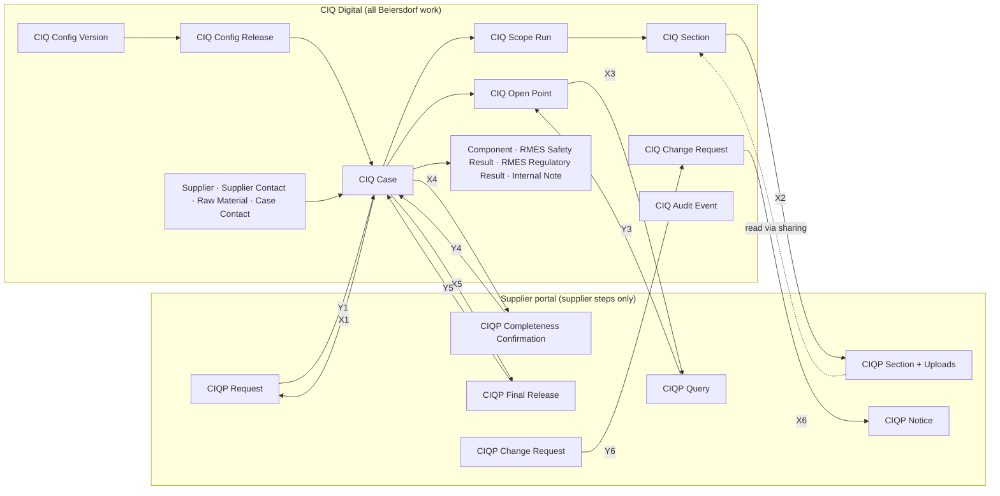
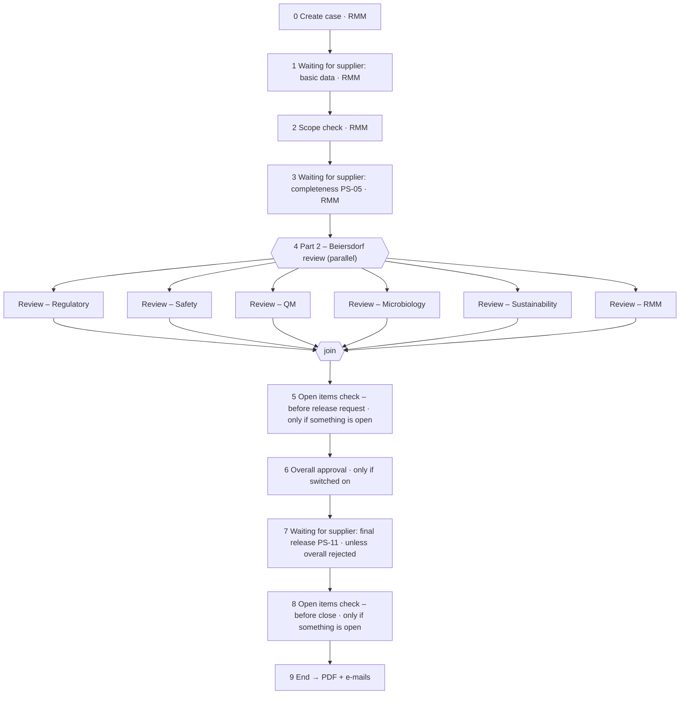

> **SUPERSEDED (2026-10-07) by `app-plan-v4-processes-and-forms.md`.** Thomas set new rules the same day: Process only with steps and SLAs, Data Forms for data, child tables instead of extra records. Kept for its review history; do not build from it.

# CIQ Digital app: processes and forms (plan v3, proposal)

> **INTERNAL to Kissflow. Nothing is built.** Written 2026-10-07 for Thomas.
>
> **Rules it follows** (plan-v3, 7 Oct):
> - Beiersdorf works only in the app; suppliers work only in the portal.
> - The portal has one role, `Supplier`, and supplier steps only.
> - Every portal item has an app twin.
> - It fits the portal as built (`kissflow-build/ciq-supplier-portal/portal-spec.mjs`).
>
> **What it replaces:** the 28-flow v1 app plan (`runs/ciq-digital`, never generated).
>
> **Full detail** (every field, step rule, integration map, 32 risks, and the 57-finding review ledger): `app-plan-v3-detailed.md`.
>
> **How it was made:**
> - 5 source readers;
> - 3 independent designs (parallel-first, one-record-one-writer, maximum consolidation);
> - 2 judges, who both picked "one record, one writer";
> - a synthesis that kept the parallel steps;
> - 3 adversarial reviewers (requirements, Kissflow feasibility with the portal, simplicity), whose 57 findings were all applied.
>
> **Tags:**
> - **[verified]**: tested live.
> - **[verified-offline]**: compiled by the App Builder dry run only.
> - **[manual]**: stated in master.md.
> - **[unverified]**: needs the named test before we rely on it.

## 1. The shape

**16 flows: 7 Processes and 9 Forms.** v1 had 28. Each flow's type follows one rule:

| If the record… | Kissflow type | Flows |
|---|---|---|
| moves between people | **Process** with steps | CIQ Case, CIQ Open Point, CIQ Change Request |
| must never change once written | **Process with no user step**: it completes, and so freezes, when submitted | CIQ Section, CIQ Config Release, CIQ Scope Run, CIQ Audit Event |
| is master data, or a working record that one role keeps updating | **Form** | CIQ Supplier, CIQ Supplier Contact, CIQ Raw Material, CIQ Case Contact, CIQ Config Version, CIQ Component, CIQ RMES Safety Result, CIQ RMES Regulatory Result, CIQ Internal Note |

Three principles keep it simple and scalable:

1. **One record, one writer.** Kissflow silently loses one of two edits made to the same item at the same time [manual §6.6]. So anything people do at the same time gets its own record:
   - one open point per question round;
   - one change request per supplier request;
   - one RMES row per criterion;
   - one chat message per row;
   - one audit item per event.
2. **Parallel steps where people really work at the same time.** Part 2 of the case is one native **Parallel** block, with one branch per department. The change request's impact assessment is a second one. The join replaces v1's Review Track flow, the fan-out integration, the sync logic, the Case Sync role and the Case Index.
3. **The supplier's data stays in the portal.** The app reads section answers and uploads through the flow sharing you set up. It doesn't copy them [unverified until the first app lookup]. Only status and confirmations come back by integration.

The app flows and how they connect to the portal:

## 2. Inventory

| # | Flow | Type | Use | Portal twin |
|---|---|---|---|---|
| P1 | **CIQ Case** | Process | One case cycle from creation to PDF: supplier hand-offs, scope check, parallel department sign-off, optional overall approval, final release | CIQP Request, CIQP Completeness Confirmation, CIQP Final Release |
| P2 | **CIQ Open Point** | Process | One round of one question, document request, additional part, finding, or internal or late department review | CIQP Query (only if it goes to the supplier) |
| P3 | **CIQ Change Request** | Process | A supplier's correction or change notice: triage, then parallel impact assessment, then the outcome notice | CIQP Change Request (in), CIQP Notice (out) |
| P4 | **CIQ Section** | Process, no user step | One released section with its frozen definition. Creating it creates the portal section | CIQP Section |
| P5 | **CIQ Config Release** | Process, no user step | One published configuration bundle (template, rules, ownership, RMES criteria, limits, texts, settings) that cases pin | — |
| P6 | **CIQ Scope Run** | Process, no user step | One scope derivation: which sections, parts and evidence apply, under which rule and answer, including N.A. | — |
| P7 | **CIQ Audit Event** | Process, no user step | Append-only log: who did what, when, on which value or document. Also covers notifications, delegations, assignments, review marks, cancellations and snapshots | — |
| F1 | **CIQ Supplier** | Form | Supplier company. `Supplier_Code` isolates suppliers on every portal item | — |
| F2 | **CIQ Supplier Contact** | Form | Supplier person, mapped to their portal user id | Feeds `Assigned_Contacts` |
| F3 | **CIQ Raw Material** | Form | Material identity across cases and cycles. Carries its supplier | — |
| F4 | **CIQ Case Contact** | Form | Which supplier contacts work on a case, and who may confirm | Feeds contacts on every portal item |
| F5 | **CIQ Config Version** | Form | The Business Admin's drafting space for configuration versions (incl. section definitions). Export source | Definitions reach the portal only as copies via P4 |
| F6 | **CIQ Component** | Form | K2.1 composition as searchable rows (find cases by INCI, CAS, origin) | Read from CIQP Section |
| F7 | **CIQ RMES Safety Result** | Form | Safety's RMES criterion rows, incl. AI suggestions. Only Safety edits | Never |
| F8 | **CIQ RMES Regulatory Result** | Form | Regulatory's RMES criterion rows, incl. AI suggestions. Only Regulatory edits | Never |
| F9 | **CIQ Internal Note** | Form | Internal chat, one message per row | Never |

**What else exists:**
- 21 lists;
- 11 custom roles, plus Admin and User;
- 15 integrations: 11 app↔portal (X1–X6, Y1, Y3–Y6) and 4 inside the app (Z1–Z4).

## 3. Processes

### P1 CIQ Case

**Use.**
- One item per case cycle. A reactivation is a new item with the next cycle number.
- RMM creates the case and holds every step where Beiersdorf waits for the supplier.
- The departments sign off in parallel inside the case. The supplier's confirmations land on it.
- At the end it produces the PDF.

**Related to.**
- **Raw Material (F3):** Reference; the supplier is derived from it.
- **Config Release (P5):** pinned id and hash, plus a frozen copy of the manifest.
- **Case Contact (F4):** the contacts.
- **Created by the case:** Scope Run (P6) and Section (P4).
- **Records that point back to the case:** Open Point (P2), Change Request (P3) and the RMES Results (F7/F8). Their open counts hold the case.

**Shared with the portal.**
- **Out:**
  - X1 creates the **CIQP Request**: case header, supplier, contacts and due date.
  - X4 creates the **CIQP Completeness Confirmation** (PS-05).
  - X5 creates the **CIQP Final Release** (PS-11).
- **In:**
  - Y1 sets basic data received and approves the waiting step.
  - Y4 sets the `Completeness_*` fields (name, e-mail, role, time).
  - Y5 sets the `Final_Release_*` fields and the released section revisions.
- **Never sent:** department flags, decisions, RMES, internal dates.

**Workflow steps.**

| # | Step | Owner | Condition | What happens |
|---|---|---|---|---|
| 0 | Create case (Start) | CIQ RMM | — | RMM picks the raw material, owner, due date and contacts. The release is pinned. The BASIC section is created (P4 → X2) |
| 1 | Waiting for supplier: basic data | CIQ RMM (e-mail off) | — | X1 creates the portal request. The supplier submits basic data. Y1 approves this step. Fallback: RMM submits by hand |
| 2 | Scope check | CIQ RMM | — | 1. Validates BASIC. 2. Runs the scope evaluator, recorded as a Scope Run (P6). 3. Allows extension with a justification (never reduction). 4. Releases one Section (P4) per Mandatory or Optional section, each → X2 portal section. 5. Sets which departments are active |
| 3 | Waiting for supplier: completeness PS-05 | CIQ RMM (e-mail off) | — | X4 asks the supplier to confirm completeness. Y4 records it and approves. The scope can still grow here |
| 4 | **Part 2 – Beiersdorf review**: **parallel** block | — | — | Six branches start together. Each skips if its department isn't active. The case continues only when every active branch is done (native join) |
| 4.x | Review – Regulatory ∥ Review – Safety ∥ Review – QM ∥ Review – Microbiology ∥ Review – Sustainability ∥ Review – RMM | That department's Reviewer role (RMM for the RMM branch, off by default) | `Dept_<D>_Active = "Yes"` | The department reviews its sections, raises open points and fills its RMES rows (F7/F8). It then signs off its own lane: confirm, by, e-mail, time. Safety and Regulatory also record their internal RMES decision and reason. The Workbench refuses the sign-off while the department has open points, unassessed change requests or missing RMES results, and names each blocker. A native gate field is the second line |
| 5 | Open items check – before release request | CIQ RMM | Anything still open (open points, triaged change requests) | Normally skipped. If it runs, RMM resolves the items, or overrides with an audited reason |
| 6 | Overall approval | CIQ Overall Approver | `Overall_Approval_Required = "Yes"` (off by default) | "Approved" is offered only if every required RMES decision is Approved. On rejection the case closes without a release request, and the supplier gets a neutral closing text |
| 7 | Waiting for supplier: final release PS-11 | CIQ RMM (e-mail off) | Not overall-rejected | X5 sends the single release request (REQ-PROC-040/-042). Y5 records the release and approves. RMM can complete manually, with a reason (REQ-PROC-045) |
| 8 | Open items check – before close | CIQ RMM | Anything opened during step 7 | Normally skipped, so completion after the release stays automatic |
| 9 | End | — | — | Z1 generates the PDF, e-mails the RMM owner and the supplier contacts, and logs a notification |

**Why the parallel block is safe.**
- Each branch can write only its own 4–6 lane fields (step permissions). The server refuses writes to any other field [manual §6.6].
- Nobody else writes the case during Part 2: contact changes, assignments and cancellations go to other records.
- There are no child tables on the case.
- **Open risk:** two branch submits a few seconds apart [unverified, K-19P]. Runtime fork and join behaviour [unverified, K-PAR]. The engine compiles a Parallel step with branches [verified-offline].
- **Fallback if those tests fail:** add a "CIQ Department Review" process, with one item per department.

**Late department work.** Examples: a section added after PS-05, a re-review after the supplier changed an answer, a department activated late. Each becomes an Open Point of kind **Department review**, which the open-items checks count. There is no native reopen.

**Cancellation.**
1. The Workbench writes a Cancellation audit event. Z2 e-mails the supplier from it.
2. The case is ended by native Reject: by RMM, or by CIQ Case Admin through the admin route at steps 4 and 6.
3. A close sweep snapshots and withdraws the open portal items, so no supplier task stays open (REQ-PROC-049).

### P2 CIQ Open Point

**Use.**
- One item is **one round** of one request. A return becomes a new round item, so rounds never overwrite each other.
- Kinds: Query, Document request, Additional part, Finding (replaces v1's two finding forms), Internal review (one department asks another), Department review (late department work) and Contact update.

**Related to.**
- Reference to its Case.
- `OP_Key` groups the rounds, and each round points to the previous one.
- References a Section, and optionally an RMES row or a change request.
- An additional part also creates a Section (P4) and a Scope Run (P6).

**Shared with the portal.**
- **Out:** X3 creates one **CIQP Query** per round, but only when `OP_To_Supplier = "Yes"`. It carries the question, the reference to the section, field and document (file name and upload date), the due date, the responsible person, the earlier rounds as text, and the contacts.
- **In:** Y3 copies the supplier's response kind, text and document references back, then approves.
- **Never sent:** internal justification, findings, internal due date, outcome.

**Workflow steps.**

| # | Step | Owner | Condition | What happens |
|---|---|---|---|---|
| 0 | Raise open point (Start) | Any department or RMM (create right) | — | Reference, owner department, responsible person, due dates and justification are mandatory (REQ-PROC-029, REQ-ADR-001) |
| 1 | Waiting for supplier | CIQ RMM (e-mail off) | `OP_To_Supplier = "Yes"` | X3 creates the portal query. Y3 writes the response and approves. Beiersdorf can withdraw here |
| 2–7 | Review – Regulatory / Review – Safety / Review – QM / Review – Microbiology / Review – Sustainability / Review – RMM | That department's Reviewer role | `OP_Dept = "<code>"` (exactly one runs) | The owning department sets the outcome: Accepted, Returned (the Workbench first creates round n+1) or Withdrawn. Only the owning role holds the task (REQ-PROC-034) |
| 8 | End | — | — | — |

No parallel block here: exactly one department owns each point.

### P3 CIQ Change Request

**Use.**
- The app twin of a supplier's change request: a correction, a "Change notice" (a configuration or metadata answer changed after basic data), or an attempt after the final release, which is refused and logged.
- RMM triages it. The affected departments assess the impact **in parallel**, and the supplier gets the outcome as a portal notice.

**Related to.**
- Reference to its Case, set at triage.
- A change notice runs a new Scope Run (additions only), may release new Sections, and raises Department-review points for their lead departments.

**Shared with the portal.**
- **In:** Y6 creates it from **CIQP Change Request**, with change kind, section, field and row, current and proposed value, reason, and the portal item id.
- **Out:** X6 creates the **CIQP Notice**: outcome title and supplier-safe text.

**Workflow steps.**

| # | Step | Owner | Condition | What happens |
|---|---|---|---|---|
| 0 | Receive change request (Start) | Created by Y6; RMM by hand as the fallback | — | — |
| 1 | Triage | CIQ RMM | — | 1. Checks that the requester is a contact of the case. 2. A change after PS-11 is refused and a "Change attempt" event is written (REQ-PROC-043). 3. A change notice gets a re-derivation. 4. RMM sets the impact flags per department and the supplier-safe outcome |
| 2 | **Assess impact**: **parallel** block | — | — | Assess – Regulatory ∥ Assess – Safety ∥ Assess – QM ∥ Assess – Microbiology ∥ Assess – Sustainability. Each runs only if `Impact_<D> = "Yes"`, and each writes only its own four fields. Join |
| 3 | End | — | — | X6 sends the outcome notice |

### P4 CIQ Section (no user step)

- **Use.** One item per released section: BASIC, derived, additional, change notice or reactivation. It records what was released, why, and under which definition. It is frozen at submit.
- **Related to.** Case (key); Scope Run that released it; Config Release definition; the open point or change request that caused it. Read by Open Points and Components.
- **Shared with the portal:**
  - **Out:** X2 creates the **CIQP Section** 1:1 with keys, title, applicability, supplier reason, origin, the merged definition and its hash, due date and contacts. The BASIC prefill travels inside the definition.
  - **In:** no integration. The app reads `Answers_JSON`, `Answers_Rev`, change stamps and Uploads through the sharing [unverified].
- **Steps:** Release section (Start) → End. N.A. sections get no item; they stay in the Scope Run with their rule.

### P5 CIQ Config Release (no user step)

- **Use.** A Business Admin publishes a release. The item stores the full bundle (template, section definitions, rule set, ownership, RMES criteria, limits, texts, reminders, settings), so every published version can always be restored (REQ-CFG-001/-003).
- **Related to.** Built from Config Version rows (F5). Every case pins it. Sessions verify each configuration they load against its hashes.
- **Shared with the portal:** none.
- **Steps:** Publish release (Start, Business Admin; the regression check runs in the UI first) → End. Four-eyes is not in BDF's requirements. If BDF wants it, an approval step can be added later.

### P6 CIQ Scope Run (no user step)

- **Use.** One immutable record of a scope derivation (initial, manual extension, change notice, additional part, reactivation). It holds the inputs, the rule-set version, and every section, part and evidence classification, including N.A. with the rule and answer. **Additions only**, because the scope only grows (REQ-PROC-009/-010, REQ-CFG-008/-009).
- **Related to.** Case; released Sections; change requests and open points that caused it.
- **Shared with the portal:** none.
- **Steps:** Record scope run (Start) → End.

### P7 CIQ Audit Event (no user step)

- **Use.** The append-only trail of who did what, when, on which value and which document (by file name and upload date) (REQ-CTL-009, REQ-RMES-016). It also holds:
  - notification events (REQ-CTL-010);
  - delegations and assignments;
  - section-review marks;
  - change attempts;
  - cancellations;
  - section snapshots.
- **Related to.** Points to the record that owns the data, by key and item id. The Cancellation event triggers Z2.
- **Shared with the portal:** none. Supplier actions are mirrored in from the portal's change stamps.
- **Steps:** Record event (Start, any internal role) → End.
- **Tamper evidence:** a completed item should refuse non-admin edits [unverified, K-FREEZE]. If it doesn't, P6 and P7 become Forms and the claim stays "tamper-evident".

## 4. Forms

| # | Form | Use | Related to | Shared with the portal |
|---|---|---|---|---|
| F1 | CIQ Supplier | One supplier company: code, legal name, DUNS, kind, country, SAP and Teamcenter ids, active and test flags | Referenced by Supplier Contact and Raw Material | `Supplier_Code` goes on every portal item (via the case) |
| F2 | CIQ Supplier Contact | One supplier person: name, e-mail, role, may-confirm flag, **portal user id**, invite state | → Supplier; referenced by Case Contact | `Portal_User_Id` feeds every `Assigned_Contacts`. A contact without one can't be put on a case |
| F3 | CIQ Raw Material | Material identity: trade name, main INCI, BDF, SAP, IRMA and Teamcenter numbers, and its supplier | → Supplier; referenced by Case | Trade name and supplier name go into the portal request (X1) |
| F4 | CIQ Case Contact | A case's contacts, with primary and may-confirm flags | → Supplier Contact; keyed to the case | The RMM session derives `Portal_Contact_Ids` for every portal item from it. A change after PS-05 raises a Contact-update point |
| F5 | CIQ Config Version | Drafting space for each configuration kind (template, section definition, rule set, ownership, RMES criteria, limits, texts, reminders, settings). Each payload is downloadable | Bundled into Config Release | Definitions reach the portal only as copies (X2). Internal annotations never do |
| F6 | CIQ Component | K2.1 composition, one row per component: INCI, CAS, EC, function, additive, origin, concentration range (REQ-PROC-006) | Keyed to the case and section | Rebuilt by RMM from the portal section's answers (read via sharing) |
| F7 | CIQ RMES Safety Result | One row per Safety criterion: applicability, prefill and source (question or document), result, comment, limit check, impact resolution, AI suggestion | → Case. Findings are Open Points | Never (REQ-CTL-002) |
| F8 | CIQ RMES Regulatory Result | The same for Regulatory | → Case | Never |
| F9 | CIQ Internal Note | Internal chat: one message per row, optionally linked to a section, open point or change request | Keyed to the case | Never (REQ-PROC-020) |

**Why F7 and F8 are two Forms.** On a Form every member can edit every row [manual §4.7]. Two Forms make "Regulatory reads Safety but can't edit it" a native rule (REQ-CFG-004).

## 5. What the app and the portal share

| Id | Direction | From → to | When | Data |
|---|---|---|---|---|
| X1 | app → portal | CIQ Case → **CIQP Request** | The case enters "Waiting for supplier: basic data" | Request key, case code, cycle, supplier code, app case id, trade name, supplier name, BDF contact, markets, template label, due date, contacts |
| X2 | app → portal | CIQ Section → **CIQP Section** | The section is released | Keys, title, applicability, supplier reason, origin, definition and hash, due date, app section id, contacts |
| X3 | app → portal | CIQ Open Point → **CIQP Query** | The point enters "Waiting for supplier" | Question, reference, kind, responsible person and department, due date, earlier rounds, app point id, contacts |
| X4 / X5 | app → portal | CIQ Case → **CIQP Completeness Confirmation** / **CIQP Final Release** | The case enters the PS-05 / PS-11 waiting step | Declaration text and key, due date, app case id, the contacts allowed to confirm |
| X6 | app → portal | CIQ Change Request → **CIQP Notice** | Change request completed | Notice title and text, related change request, app id, contacts |
| Y1 | portal → app | CIQP Request → CIQ Case | Basic data submitted | Basic data received, portal request id; approves step 1 |
| Y3 | portal → app | CIQP Query → CIQ Open Point | Supplier responded | Response kind, text, document references, supplier responsible e-mail; approves "Waiting for supplier" |
| Y4 | portal → app | CIQP Completeness Confirmation → CIQ Case | Supplier confirmed | Name, e-mail, role, time; approves step 3 |
| Y5 | portal → app | CIQP Final Release → CIQ Case | Supplier released | Name, e-mail, role, time, released revisions, evidence list; approves step 7 |
| Y6 | portal → app | CIQP Change Request → CIQ Change Request | Supplier submitted | All change fields plus the portal item id; creates the app twin |
| — | portal → app, read | CIQP Section answers and Uploads → app sessions | Any time | Read through the flow sharing, not copied [unverified] |
| Z1–Z4 | inside the app | Case end, Cancellation event, step SLAs | — | PDF and e-mails, cancellation e-mail, reminder logging |

**Never shared with the portal:** department flags and lanes, RMES results and decisions, findings, internal notes, internal due dates, overall decision, audit.

**Integration status.**
- All of them are [unverified] until spike K-09.
- None can be deleted once created, and a human activates each one.
- If an integration can't approve a step, RMM advances the waiting step by hand.
- If an integration can't create an item, a small sync service with API keys does it. That is your decision 1 below.

## 6. Roles (11 custom, plus Admin and User)

| Role | Does |
|---|---|
| CIQ RMM | Creates and runs cases, holds the waiting and check steps, triages change requests, maintains suppliers, contacts and components |
| CIQ Regulatory / Safety / QM / Microbiology / Sustainability Reviewer (5) | Their Part 2 branch, their open points, their change-request assessment. Safety and Regulatory edit only their own RMES Form and record their internal RMES decision |
| CIQ Overall Approver | Overall approval, when switched on |
| CIQ Business Admin | Configuration drafting and publishing releases |
| CIQ Reader | Read-only: Customs, Legal, Auditor, Process Owner |
| CIQ Case Admin | Cancellation through the admin route (members also hold CIQ RMM) |
| CIQ Integration Service | The identity the integrations act as, if K-09 shows they need one |

**Compared with the 18 roles of the old plan:**
- **Removed:** Safety Approver and Regulatory Approver (the reviewer decides, as in the prototype), Config Approver (no four-eyes) and Case Sync (no sync step).
- **Merged:** four read-only roles into CIQ Reader.
- If BDF names separate approvers, "Final decision – Safety" and "Final decision – Regulatory" steps come back inside the branches.

## 7. What changed from v1 (28 → 16 flows)

| v1 | Now | Why |
|---|---|---|
| A16 Review Track + I-2 fan-out + G5 sync + Case Index (A10) + Case Sync role | Parallel block on CIQ Case | The native join does the synchronisation. One flow and one integration fewer, and no sync role |
| A17 Open Point (Form) + A21/A22 Findings | P2 Open Point (Process), one item per round | Under v3 the department review step must be in the app, and a Form can't become a Process later |
| A6 Config Version + A7 Section Definition | F5 Config Version | Same kind of thing: versioned configuration payloads |
| A8 Config Release (four-eyes) | P5 holding the full bundle, no approval step | Not required by BDF. Can be added later |
| A18 RMES Record, A23 AI Suggestion | Header fields on the case; AI fields on F7/F8 | One record per criterion is enough |
| A25 Confirmation, A26 Delegation, A28 Notification Log | Fields on the case, plus categories in P7 Audit Event | Each confirmation lives on the record where it's made |
| A29 Final Document | `Final_PDF` on the case | One PDF per case |
| A30 Portal Link | Dropped | Every portal item carries its app twin id [verified] |
| A3 Supplier Site | Dropped | The site is a BASIC answer |
| A15 Document | Deferred | The app reads portal uploads through the sharing. Comes back if the sharing test or MT-6 fails |
| A12/A13 | Dropped | BRM v2 |
| — | New: P3 Change Request, P4 Section | v3: every portal item has an app twin |

## 8. Decisions for you before anything is built

1. **Parallel sign-off on the case, or one review item per department?** The plan uses the parallel block (simpler, native join). It depends on the runtime tests K-PAR and K-19P. The fallback adds a "CIQ Department Review" process.
2. **Overall approval placement.** When switched on, it comes **before** the supplier's final release request. That meets the requirements document's PS-12 precondition ("required subprocess results available") and keeps the matrix's automatic completion after the supplier releases.
3. **Approver roles.** Safety and Regulatory reviewers record the internal RMES decision themselves (prototype default). The separate approver roles are removed.
4. **No four-eyes on configuration releases.** Not required by BDF.
5. **Audit without a hash chain.** It relies on completed items freezing (K-FREEZE); otherwise the claim stays "tamper-evident".
6. **CIQ Sync Service** (recommended). A small server-side service for:
   - the close sweep on cancellation;
   - section snapshots;
   - the PDF renderer;
   - mirroring supplier history;
   - rebuilds.

   Without it, closing portal items on cancellation needs a portal Admin. That doesn't meet REQ-PROC-049's "no open supplier task" test.
7. **PDF:** option A (renderer with answers, needs the service) or B (reduced GeneratePDF from case fields, disclosed to BDF).
8. **Spikes in the app before generate.** These go on a throwaway `CIQ ZZ Spike` flow, which can't be deleted:
   - K-OFF: offline compile of branch permissions, no-step processes and formula conditions;
   - K-PAR and K-19P;
   - K-20: native gates;
   - K-14: listing as a non-participant;
   - K-FREEZE;
   - K-WB: Workbench writes.

   The portal's blocking supplier-user tests MT-1, MT-2, MT-3 and MT-6 also come first.

## 9. Hand-offs to the portal session (only after you approve this plan)

- **New app step names** that X1, X3, X4 and X5 trigger on:
  - "Waiting for supplier: basic data";
  - "Waiting for supplier: completeness PS-05";
  - "Waiting for supplier: final release PS-11";
  - "Waiting for supplier" on CIQ Open Point.

  They replace the v1 contract names ("Part 1 – with supplier", etc.). Nothing is wired yet, so nothing breaks.
- **Twin meanings:**
  - `App_Open_Point_Id` is the round's item.
  - `App_Notice_Item_Id` is the CIQ Change Request.
- **Two additive fields on CIQP Final Release:** `Released_Revs_JSON` (Mandatory at "Supplier: release") and `Evidence_List_Text`.
- **Supplier UI duties:** block incomplete basic data and incomplete completeness confirmations; raise a "Change notice" when a configuration answer changes; submit all sections at release.
