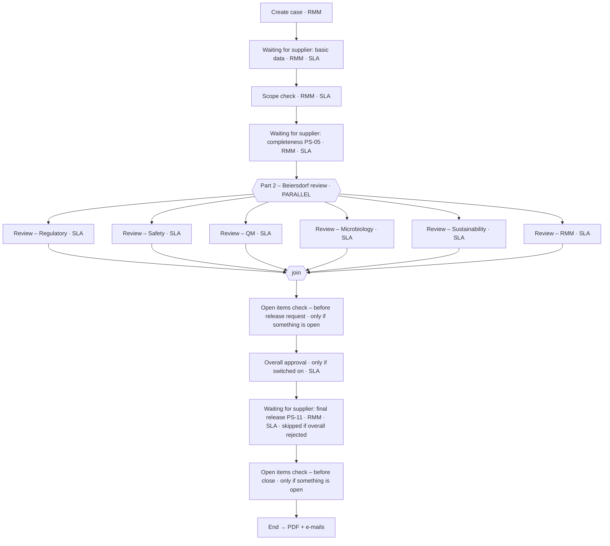

# CIQ Digital app: data model v4 (processes, forms, child tables)

> **Superseded in part by the client call of 9 Oct 2026** (`context/decisions/2026-10-09-client-call.md`). There is no RMM scope check or scope release: the supplier answers the metadata questions and sections open or close live. RMM reviews in Part 2 in parallel with the departments and completes like them. The ending is the requirements-matrix ending only: there is no overall approval and no overall approver. Where this document says otherwise, the decisions file wins.

> **INTERNAL to Kissflow. Proposal; nothing is built.** Written 2026-10-07, after Thomas's rules of the same day.
>
> **Supersedes** `app-plan-v3-processes-and-forms.md` and `app-plan-v3-detailed.md` (16 flows), and the v1 run (28 flows). The portal and the v3 rules are unchanged:
> - the portal has one `Supplier` role and supplier steps only;
> - every Beiersdorf step is in the app;
> - every portal item has an app twin;
> - the as-built portal (`kissflow-build/ciq-supplier-portal/portal-spec.mjs`) is fixed.
>
> **Reviewed** by 3 independent adversarial reviewers (requirements, Kissflow feasibility with portal fit, rules and simplicity). They raised 45 findings: 2 blockers, 30 major, 13 minor. All are applied below, and §8 lists what changed because of them.
>
> **Tags:**
> - [manual §x]: stated in `~/Downloads/master.md`.
> - [verified]: tested live; evidence in the portal BUILD-LOG.
> - [verified-offline]: compiled by the App Builder dry run only.
> - [unverified, test]: the named test must settle it.

## 0. The rules this model follows

**Thomas's rules (7 Oct)**
1. **Process** = the record moves through **steps**, and those steps carry **SLAs**, so we use Kissflow's built-in SLA notifications.
2. **Data Form** = we only store data. There are no steps and no "processes without steps".
3. **No extra records.** Repeated detail goes in a **child table inside its parent**, or in fields on the parent, wherever that is safe. It saves storage and API calls when the UI loads.

**The platform limits that decide "child table or own record?"** [manual]
- **C1 Integrations can't create, copy or update child-table rows.** They fire per item, never per row, and there is no field-change trigger [§4.8].
- **C2 Two people writing one item at the same time:** the last writer wins. Concurrent child-table writes keep only one write, silently [§6.6, §14 #26].
- **C3 Only the holder of the current step can write a process item,** and only the fields that are editable at that step [§3.6].
- **C4 Form grants are per Form, not per row or per table.** Every member can edit every row [§4.7].
- **C5 Form-triggered integrations are [unverified, K-09f].** The "Kissflow Dataform" connector exists in the account, but its triggers and actions haven't been read.

**The check applied to every entity.** Repeated data goes in a child table only if all four of these hold:
- (a) one writer at a time can write the parent when it's needed;
- (b) no integration must create, read or trigger on its rows;
- (c) the rows are few and bounded;
- (d) no cross-case search needs the rows.

Otherwise the data gets its own record. §5 shows the result for every entity.

## 1. All processes and data forms

**11 flows: 3 Processes and 8 Data Forms.** v3 had 16 and v1 had 28.

| # | Name | Type | What it is | Child tables | Portal twin |
|---|---|---|---|---|---|
| P1 | **CIQ Case** | Process | One CIQ case cycle, from creation to the final PDF: • supplier hand-offs; • scope check; • **parallel** department review; • optional overall approval; • final release. It also holds the RMES header, the contacts (as fields) and the three confirmation types | — | CIQP Request, CIQP Completeness Confirmation, CIQP Final Release |
| P2 | **CIQ Open Point** | Process | One question, document request or additional part to the supplier, **with every back-and-forth round inside the same item**. It also covers the internal kinds: late department review, contact update and co-review | **Rounds** | CIQP Query (one portal item per round) |
| P3 | **CIQ Change Request** | Process | A change the supplier reports or requests: a "change notice" after editing configuration answers, a correction, or an attempt after release. RMM triages it, the affected departments assess it **in parallel**, and the supplier gets the outcome | — | CIQP Change Request (in), CIQP Notice (out) |
| F1 | **CIQ Supplier** | Data Form | One supplier company, with its people | **Contacts** | (supplier code and contact ids go onto every portal item) |
| F2 | **CIQ Config Version** | Data Form | Every configuration version: template, section definitions, rule set, ownership, RMES criteria, limits, texts, settings, plus **Release** rows (the full frozen bundle a case pins) | — | — |
| F3 | **CIQ Section** | Data Form | One released section of a case: what was released, why, and for which department. It is the app twin of the portal section. The K2.1 row carries the component list and the search fields | **Components** (K2.1 only) | CIQP Section |
| F4 | **CIQ Scope Run** | Data Form | One run of the scope rules: initial, extension, change notice, additional part. It records every section's classification, including N.A., with the rule and answer behind it | — | — |
| F5 | **CIQ RMES Safety** | Data Form | Safety's RMES sheet for one case: all criteria and findings in **one row** | **Criteria**, **Findings** | — |
| F6 | **CIQ RMES Regulatory** | Data Form | The same for Regulatory | **Criteria**, **Findings** | — |
| F7 | **CIQ Internal Note** | Data Form | Internal chat, one message per row. Never visible to suppliers | — | — |
| F8 | **CIQ Audit Event** | Data Form | Who did what and when, on which value and which document. It also logs notifications, delegations, change attempts, cancellations and snapshots | — | — |

**Dropped:**
- **CIQ Raw Material** → material fields on the case.
- **CIQ Case Contact** → contact fields on the case.
- **CIQ Supplier Contact** → child table on CIQ Supplier.
- **CIQ Component** → child table on the K2.1 section.
- **CIQ Config Release** → Release rows in CIQ Config Version.
- **Per-round open-point items** → the Rounds table.
- **~40 RMES rows per case** → 2 rows with child tables.

**Lists:** about 20.

**Roles: 11.**
- CIQ RMM;
- the five department Reviewers (Regulatory, Safety, QM, Microbiology, Sustainability);
- CIQ Overall Approver;
- CIQ Business Admin;
- CIQ Reader (Customs, Legal, Auditor and Process Owner, read-only);
- CIQ Case Admin;
- CIQ Integration Service;
- plus the defaults Admin and User.

## 2. Processes and their steps

### P1 CIQ Case

**Who acts:**
- **CIQ RMM:** creates the case, holds every "waiting for supplier" step and the checks.
- **The five department Reviewers:** each one's own Part 2 branch.
- **CIQ Overall Approver:** overall approval, if it's switched on.
- **The supplier:** acts only in the portal. Their actions come back through integrations.

| # | Step | Owner | Condition | What happens | SLA (BDF sets durations) |
|---|---|---|---|---|---|
| 0 | Create case (Start) | CIQ RMM | — | RMM enters: • material: trade name, main INCI, BDF, SAP and IRMA numbers; • supplier (from F1) and the case contacts; • owner and due dates. The pinned Release row is copied in. The BASIC F3 row is created after submit | — |
| 1 | Waiting for supplier: basic data | CIQ RMM; after the K-FA test, `Owner_RMM` | — | X1 creates the CIQP Request. Y1 sets "basic data received" and approves | Supplier due date → escalate to the owner |
| 2 | Scope check | CIQ RMM | — | RMM: 1. checks BASIC; 2. runs the rules into an F4 Scope Run; 3. may extend the scope (with a justification, never reduce it); 4. releases one F3 Section per Mandatory or Optional section (→ X2 portal section); 5. sets which departments are active | Scope-check time |
| 3 | Waiting for supplier: completeness PS-05 | CIQ RMM | — | X4 asks the supplier to confirm completeness. Y4 records name, e-mail, role and time, sets the RMES header, and approves | Supplier due date |
| 4 | **Part 2 – Beiersdorf review**: **parallel block** | — | — | Six branches start together. A branch whose department isn't active is skipped. The case moves on only when every active branch is done (native join) | — |
| 4.x | Review – Regulatory ∥ Review – Safety ∥ Review – QM ∥ Review – Microbiology ∥ Review – Sustainability ∥ Review – RMM | That department's Reviewer role (RMM for the RMM branch, off by default) | `Dept_<D>_Active = "Yes"` | The department reviews its sections, raises open points, and fills its RMES sheet (Safety and Regulatory, F5/F6). It then signs off **only its own lane fields**: confirm, by, e-mail, time, on-behalf-of. Safety and Regulatory also record their internal RMES decision and reason. The submit is blocked while the department has open points, unassessed change requests, RMES gaps or open findings: by the Workbench, and by a native gate field [unverified, K-20] | Review time, with a reminder and an escalation (REQ-RMES-019) |
| 5 | Open items check – before release request | CIQ RMM | Something is still open (a blank count also holds) | Normally skipped. RMM resolves the leftovers (late department reviews, contact updates), or overrides with a reason, which is audited | Check time |
| 6 | Overall approval | CIQ Overall Approver | `Overall_Approval_Required = "Yes"` (off by default) | Approve only if every required RMES decision is Approved. On a rejection the case ends without a release request, and a neutral closing text goes to the supplier | Approval time |
| 7 | Waiting for supplier: final release PS-11 | CIQ RMM | Not overall-rejected | X5 sends the **single** release request (REQ-PROC-040). Y5 records the release and approves. RMM can complete manually, with a reason (REQ-PROC-045) | Supplier due date |
| 8 | Open items check – before close | CIQ RMM | Something opened during step 7 | Normally skipped, so completion stays automatic | Check time |
| 9 | End | — | — | Z1: PDF, e-mails to the RMM owner and the supplier contacts, notification log | — |

**Key fields** (all scalars, because integrations can read only fields, C1):
- **Identity and material:** case code, cycle, `Trade_Name`, `Main_INCI` and `BDF_Material_No` (plain Text fields that X1 reads; not lookups, because CIQ Raw Material is dropped), SAP and IRMA numbers, supplier code and name.
- **Pinned release:** row id, hash and manifest copy.
- **Contacts:** `Case_Contacts_JSON`, which is the list the UI shows. Also `Portal_Contact_Ids`, `Confirm_Contact_Ids` and `Supplier_Contact_Emails`, Mandatory at Start.
- **Department flags.**
- **Six lanes** (confirm, by, e-mail, time, on-behalf-of; plus the RMES decision for SAF and REG).
- **PS-05 and PS-11 confirmation fields.**
- **RMES header:** `RMES_Key`, plus `RMES_Created_At` from Y4. This is REQ-PROC-021's one RMES record per case.
- **Late completions.**
- **Holds and gates:** blank-safe counts over P2, P3, F5 and F6 [unverified, K-20/K-20F].
- **Outcome:** overall decision, completion trigger, PDF.

**Why the parallel block is safe:**
- Each branch writes only its own 5–7 fields, and no child tables.
- Nobody else writes the case during Part 2: contact changes go through a P2 "Contact update", assignments through F8.
- The engine compiled a Parallel step [verified-offline]. Branch-scoped permissions are [unverified-offline, K-OFF]. Runtime behaviour is [unverified, K-PAR/K-19P].
- Fallback: one review item per department.

**Cancellation:**
1. RMM rejects at its own steps. In Part 2, CIQ Case Admin rejects through the admin route [K-13].
2. An F8 Cancellation event is written.
3. The case's open P2 and P3 items are ended.
4. A **close sweep** (sync service) snapshots and withdraws every open portal item, so no supplier task is left (REQ-PROC-049).

The same sweep runs after an overall rejection or a manual completion.

### P2 CIQ Open Point (one item per point; every round inside)

**Use:** a Beiersdorf department, or RMM, asks the supplier something specific about one place in the questionnaire. It can be:
- a **query**;
- a **document request**;
- an **additional part** (a new section to fill).

It happens mainly in **Part 2** (requirements document PS-08, the clarification loop), and RMM can raise one at Scope check. Every open point blocks its department's sign-off and the release request until it is closed (REQ-PROC-036).

**Internal kinds**, which skip the supplier step:
- **Department review:** late work. Examples: a department activated after the fork, or a re-review after the supplier changed an answer that a completed department relied on.
- **Contact update:** RMM refreshes the contacts.
- **Internal review:** an optional co-review.

**Who acts:**
- **Raise:** any department Reviewer, or RMM.
- **Respond:** the supplier contacts, in the portal (the Supplier role).
- **Review the answer:** only the owning department (REQ-PROC-034).
- **Responsible person and due dates:** required (REQ-ADR-001).

| # | Step | Owner | Condition | What happens | SLA |
|---|---|---|---|---|---|
| 0 | Raise open point (Start) | The raising department or RMM | — | Required: • kind, owner department, to-supplier yes/no; • reference (section, field, row, or document by file name and upload date); • question and supplier-facing justification; • responsible person; • internal and supplier due dates. An additional part also asks RMM (or the sync service) to create its F3 section | — |
| 1 | Waiting for supplier | CIQ RMM at generate; after the K-FA test, `Responsible_User` | `OP_To_Supplier = "Yes"` | X3 creates the portal query **for the current round**. Y3 copies the answer (kind, text, referenced documents), sets `Awaiting_Response = "No"`, and approves | Supplier due date |
| 2–7 | Review – Regulatory / Review – Safety / Review – QM / Review – Microbiology / Review – Sustainability / Review – RMM | The owning department's Reviewer role | `OP_Dept = "<code>"` (exactly one runs) | The department sets one of these outcomes: • **Accepted** (closed; it records which document was accepted); • **Withdrawn** (closed, with a reason); • **Return**: the Workbench appends round n to **Rounds**, writes round n+1's question, justification and due date, clears the answer fields, sets `Awaiting_Response = "Yes"`, and **sends the item back** to step 1. That re-fires X3 [unverified, K-09h]; fallback X3b on ItemSentBack | Internal due date |
| 8 | End | — | — | — | — |

**Fields:**
- The **current round** is kept as plain fields, so X3 can copy them: key, round number, question, justification, due dates, responsible person and department, reference, `Portal_Contact_Ids`, `Thread_Text`.
- **Rounds** (child table) is the full history: question, answer, outcome, reason, document, by and at. Only the owning department writes it, at its own step (one writer).

### P3 CIQ Change Request

**Use:**
- **Change notice.** Under BRM v2 the supplier can change metadata and configuration answers until the final release, and every change must re-derive the scope (REQ-CFG-008, REQ-PROC-007). Kissflow has no field-change trigger, so the supplier UI raises a change notice whenever such an answer changes.
- **Correction.** The supplier asks Beiersdorf to correct a value they can't edit themselves, for example the target markets that RMM sets.
- **Attempt after the final release.** It is refused and logged (REQ-PROC-043).
- **Department information.** The departments whose assessment used the changed data are informed (REQ-PROC-031).

**Who acts:**
- **The supplier** raises it in the portal.
- **CIQ RMM** triages it.
- **The affected department Reviewers** assess it in parallel.
- **The supplier** gets the outcome as a portal notice.

| # | Step | Owner | Condition | What happens | SLA |
|---|---|---|---|---|---|
| 0 | Receive change request (Start) | Created by Y6 from the portal; RMM by hand as the fallback | — | — | — |
| 1 | Triage | CIQ RMM | — | 1. Checks that the requester is a contact of the case. 2. **After PS-11:** refuses it and writes an F8 "change attempt" event. 3. **Change notice:** writes a new F4 Scope Run (additions only). New sections become F3 rows (→ portal sections), and a Department-review point is raised for each new section's lead department. 4. Sets the impact flags per department and the supplier-safe outcome text | Triage time |
| 2 | **Assess impact**: **parallel block** | — | — | Assess – Regulatory ∥ Assess – Safety ∥ Assess – QM ∥ Assess – Microbiology ∥ Assess – Sustainability. Each runs only if `Impact_<D> = "Yes"`, and each writes only its own four fields. A re-assessment goes into that department's RMES sheet | Assessment time |
| 3 | End | — | — | X6 sends the CIQP Notice with the outcome | — |

## 3. Data Forms

| # | Form | Description | Child tables | Who writes |
|---|---|---|---|---|
| F1 | **CIQ Supplier** | Code (`Supplier_Code`, the isolation key on every portal item), legal name, DUNS, kind, country, SAP and Teamcenter ids, active, test. Plus parent mirrors: `Contact_Portal_Ids_Text` (search) and `Pending_Invites` (count) | **Contacts:** name, e-mail, role, may confirm, **portal user id**, active, invite requested and invited. One portal user who serves two suppliers gets a row under each | CIQ RMM. Business Admin is Viewer unless BDF says otherwise. Rows are written one at a time, re-read and merged |
| F2 | **CIQ Config Version** | One row per configuration version and kind: template, section definition, rule set, ownership (lead plus co-reviewers), RMES criteria, limits, texts, reminders, settings, and **Release**. A Release row holds the **full bundle** (`Release_Bundle_JSON` plus hash), so a pinned release never depends on rows that could change. Copy-on-write: publishing never edits a row. Downloadable (REQ-CFG-001/-003) | — | CIQ Business Admin, as member without Delete [K-17]. Each publish writes an F8 event |
| F3 | **CIQ Section** | One row per released section. Fields: • the X2 set 1:1 with the portal: keys, title, applicability, supplier reason, origin, `Definition_JSON` and hash, due date, contacts; • internal fields: lead department, query owner, co-review departments, scope-run key, derivation kind, override justification. The K2.1 and BASIC rows also hold the search mirrors (INCI, CAS, origin types, DUNS) and `Source_Answers_Rev` (REQ-PROC-006) | **Components** (K2.1 only): INCI, CAS, EC, function, additive, origin, min and max concentration. Rebuilt from the portal answers (read via sharing) whenever they change, and once after the final release | CIQ RMM and CIQ Integration Service (sync service) only. Reviewers are Viewers. A department asks for an additional part through its open point |
| F4 | **CIQ Scope Run** | One row per evaluator run (initial, extension, change notice, additional part, reactivation). Fields: trigger, rule-set version, input hash, full result including N.A. with rule and answer, added sections, override justification, by, at. **Additions only** (REQ-PROC-009/-010, REQ-CFG-008/-009) | — | The session that ran it: RMM, or a department for an extension |
| F5 | **CIQ RMES Safety** | **One row per case** (created by the first Safety session after PS-05, keyed by the case's `RMES_Key`, with a Reference to the case). Header counts: open criteria, open blocking findings; these feed the case gate. `Editing_By` / `Editing_Since` lock, so only one Safety user writes at a time | **Criteria:** code, part, title, applicability and basis, source (question, value, answer rev, or document by file name and upload date), prefill, result, comment, by, at, limit check, impact resolution, AI suggestion with source, and who confirmed it. **Findings:** text, criterion, blocking, state, linked open point | Safety only (Reviewer and Approver). Native: Regulatory can read but not edit (REQ-CFG-004) |
| F6 | **CIQ RMES Regulatory** | The same for Regulatory | Criteria, Findings | Regulatory only |
| F7 | **CIQ Internal Note** | One message per row: case, optional link (section, open point, finding), text, author, department, time (REQ-PROC-020) | — | Every internal role. The author edits their own messages, by convention |
| F8 | **CIQ Audit Event** | One row per business event (REQ-CTL-009): who, what, when, old and new value, document by file name and upload date. Categories: notification (REQ-CTL-010), delegation, assignment, section-review mark, scope, configuration, change attempt, cancellation, snapshot, item created | — | **Recommended:** only the CIQ Integration Service (sync service) writes; every person is a Viewer, so the trail is immutable for Beiersdorf roles. **Otherwise:** writers without Delete [K-17], and the claim is "tamper-evident" |

## 4. What the app and the portal share

| Id | Direction | From → to | Fires when | Data |
|---|---|---|---|---|
| X1 | app → portal | CIQ Case → CIQP Request | The case enters "Waiting for supplier: basic data" | Request key, case code, cycle, supplier code and name, trade name, **Main_INCI, BDF_Material_No** (portal fields added 2026-10-07), BDF contact, markets, template label, due date, `Case_Contacts_JSON`, contacts |
| X2 | app → portal | CIQ Section (Form row) → CIQP Section | The row is created [unverified, K-09f; fallback: sync service] | Section keys, title, applicability, supplier reason, origin, definition and hash, due date, app section id, contacts |
| X3 / X3b | app → portal | CIQ Open Point → CIQP Query | The point enters "Waiting for supplier", including after a Return (K-09h), or ItemSentBack (X3b) | Current-round key, round number, question, justification, reference, responsible person and department, due date, previous rounds (`Thread_Text`), app point id, contacts |
| X4 / X5 | app → portal | CIQ Case → Completeness Confirmation / Final Release | The PS-05 or PS-11 waiting step is entered | Declaration text and key, due date, app case id, contacts allowed to confirm |
| X6 | app → portal | CIQ Change Request → CIQP Notice | The change request ends | Notice title and text, related key, contacts |
| Y1 | portal → app | CIQP Request → CIQ Case | Basic data submitted | "Received", portal request id; approve step 1 |
| Y3 | portal → app | CIQP Query → CIQ Open Point | Supplier responded | Response kind, text, document references; approve "Waiting for supplier" (only while `Awaiting_Response = "Yes"`) |
| Y4 / Y5 | portal → app | Confirmations → CIQ Case | Supplier confirmed or released | Name, e-mail, role, time (Y5 adds released revisions and the evidence list); approve the waiting step |
| Y6 | portal → app | CIQP Change Request → CIQ Change Request | Supplier submitted | All change fields, portal item id, raised by |
| — | portal → app, **read** | CIQP Section answers and uploads | Any time | Read through the flow sharing, not copied [unverified until the first app lookup] |
| Z1 / Z2 | inside the app | Case ended / cancelled | — | PDF, e-mails, notification log; neutral cancellation e-mail |

**Connector check (2026-10-07, read-only, `kissflow-build/ciq-digital/spikes/k09f-dataform-connector-result.json`):** [verified: connector metadata; runtime still K-09]
- **The Kissflow Dataform connector exists:**
  - triggers: *item created*, *item updated*, *item deleted*;
  - actions: create, update, fetch one, fetch many, delete.
  - So X2 from a CIQ Section row, Y3 into a Form, and integration-written audit rows all have a real event or action.
- **The Kissflow Process connector also has:**
  - *item sent back* (the X3b trigger);
  - *item about to enter a step*, which fires even for skipped steps;
  - *SLA breached at this step*;
  - *Approve an item*;
  - **Skip and complete**, which ends an item from an integration: a possible native close for portal items on cancellation, tested in K-09;
  - **Create and submit items in bulk** (master.md §4.8 says "no multi-create"; to be tested).

**Never shared with the portal:** department lanes and decisions, RMES, findings, internal notes, internal due dates, the overall decision, the audit trail.

**Integration status.** All integrations are [unverified] until spike K-09. Each one is built once, can't be deleted, and is switched on by a person.
- **The CIQ Sync Service** (a small server-side service with API keys) is the only valid fallback for creating portal items. Beiersdorf users have no portal role.
- It also runs the close sweep, snapshots, the PDF renderer and the component rebuild.
- It is decision 1 in §7.

## 5. The child-table checks (where each piece of data lives, and why)

| Data | Lives in | Why not the other option |
|---|---|---|
| Q&A rounds of an open point | **Child table Rounds** on CIQ Open Point | One writer (the owning department, at its step). No integration touches rows. Bounded. One item per point instead of one per round |
| The open points themselves | Own items (P2) | Not a child table of the case: up to six departments raise them at the same time in Part 2 (C2). Departments can't write the case outside their branch (C3). X3/Y3 need an item per point (C1). They need steps with SLAs (rule 1). The cross-case dashboard needs them (REQ-PROC-036) |
| Supplier contacts | **Child table Contacts** on CIQ Supplier | One writer (RMM). Small. Parent mirror fields cover cross-supplier search |
| Case contacts | **Fields** on CIQ Case (`Case_Contacts_JSON`, plus three id/e-mail fields) | Not a child table: X1–X6 must copy them into the portal's required `Assigned_Contacts` (C1) |
| RMES criteria and findings | **Child tables** on one RMES row per case and department | One department per row (grants, C4), with a lock field. Counts are lifted to header fields for gates and dashboards. Two Forms, because Safety and Regulatory must not edit each other (REQ-CFG-004) and must not write one item at the same time (C2) |
| K2.1 components | **Child table Components** on the K2.1 CIQ Section row | One writer (RMM or sync rebuild). Search mirrors sit on the row, which is a Form, so it is writable at any time. Not on the case, which nobody can write during Part 2 or after End (C3) |
| Released sections | Own Form rows (F3) | Each one creates its own portal item (X2 needs an item event, C1). Rows are added after Scope check, when RMM holds no case step (C3) |
| Scope runs | Own Form rows (F4), 1–4 per case | Runs come from different people at different times: Scope check, change-notice triage, additional parts (C3) |
| Material identity | **Fields** on CIQ Case | No separate master needed for the MVP |
| Department sign-off | **Fields** on CIQ Case (one lane per department) | Not a child table: six branches would write one table at the same time (C2) |
| Chat messages, audit events | Own Form rows | Many people post at any time (C2). One row per message or event is the natural size |

**Rough load cost of one case screen** (20 sections, 8 open points): about 38 API calls, against about 65 in v3, if the case's open points can be listed (test K-14; fallback: list them from F8 "item created" events).

## 6. Hand-offs to the portal session (only after you approve)

**Confirmed by Thomas on 2026-10-07; part of the contract handed to the portal session when the app is complete:**
- **D23:** the release-request check always runs once (an RMM task) before X5 fires.
- **D27:** automatic completion after Y5 (PS-11). **The supplier UI must refuse the final release while any of the supplier's own CIQP Queries or Change Requests of the case are open.**
- **X3:** carries the action condition `OP_To_Supplier = "Yes"` (accepted by the portal session).
- **CIQ Open Point outcome:** Accepted / Withdrawn. A return is a native send-back plus the next-round fields; the Rounds history uses its own list (Accepted / Returned / Withdrawn).

- **App step names** that X1, X3, X4 and X5 trigger on:
  - "Waiting for supplier: basic data";
  - "Waiting for supplier: completeness PS-05";
  - "Waiting for supplier: final release PS-11";
  - "Waiting for supplier" on CIQ Open Point.
- **`App_Open_Point_Id` now means the point**, not the round. Each round still gets its own CIQP Query, with `Round_No`.
- **Additive portal fields** on CIQP Final Release: `Released_Revs_JSON` and `Evidence_List_Text`.
- **Supplier UI duties:**
  - block incomplete basic data and incomplete completeness confirmations;
  - raise a "change notice" whenever a configuration or metadata answer changes;
  - submit every section at release.

## 7. Decisions and tests before anything is built

**Thomas decided (2026-10-07, in the CIQ Digital session):**
- **Sync service: YES.** The CIQ Sync Service is in scope. It runs:
  - the close sweep;
  - the snapshots;
  - portal-item creation as the fallback for X2/X3;
  - the single-writer audit;
  - the component rebuild.
- **PDF: option A.** A full PDF, built by the service's renderer.
- **Test flows: approved** in the app. Thomas deletes clutter later from the front end.

**Your decisions** (as originally listed; 1, 2 and 7 are now decided)
1. **CIQ Sync Service: yes or no.** Without it:
   - cancellation leaves open supplier tasks (REQ-PROC-049 fails from the app);
   - X2 and X3 have no fallback;
   - the audit can't be single-writer.
2. **PDF.** Option A: a full PDF built by the service. Option B: a reduced PDF from case fields, disclosed to BDF.
3. **Parallel department sign-off on the case**, kept if K-PAR/K-19P pass.
4. **Overall approval before the supplier's final release**, when it's switched on.
5. **No four-eyes on configuration releases.** BDF doesn't require it; it can be added later as a real approval step with an SLA, which would make it a Process.
6. **Safety and Regulatory reviewers record the RMES decision themselves.** No separate approver roles.
7. **OK to create the throwaway spike flows**, which can't be deleted.

**Tests before generate (a Form can't become a Process later)**
- **K-09f:** can a Form row trigger an integration, and can an integration write to a Form? This decides X2, Y3 into a Form, and the audit actions.
- **K-09h:** does a send-back re-fire X3?
- **K-OFF:** offline compile of:
  - six branches with branch-scoped permissions;
  - formula conditions;
  - child tables with step permissions;
  - blank-safe aggregates.
- **K-PAR / K-19P:** parallel fork, join and concurrent branch submits.
- **K-20 / K-20F:** native gates over Form header counts.
- **K-14:** listing a case's open points as a non-participant.
- **K-17:** a Form member without Delete.
- **K-23:** an SLA that follows a due-date field.
- **Portal blockers:** MT-1, MT-2, MT-3, MT-6.

**Spike results that change the build** (2026-10-07; details in `kissflow-build/ciq-digital/SPIKES.md`):
- **Cross-flow SUM aggregates can't be expressed in App Builder 1.0.0** [verified-live]. It publishes the aggregate pointing at its own flow. So the case holds and lane gates (counts over CIQ Open Point, CIQ Change Request and the RMES rows) need a REST graft after generate. Until a graft is proven, the Workbench gate is the primary guard and the hold steps run unconditionally.
- **Child-table step permissions are table-level only** [verified-offline]. A step can make a whole child table Editable or ReadOnly, not single columns. Rounds, Components, Criteria and Findings are designed table-level, so this fits.
- **Integrations come out of App Builder incomplete** [verified-live]. All X/Y/Z integrations are built in the builder or over REST (the portal session builds the cross-container ones).
  - The REST recipe now works in this account [verified, 2026-10-07]: connection, skeleton, server-resolved fields, mappings, publish. Both test integrations were completed this way.
  - Switching an integration on is builder-only (REST `on` gives 403).
- **Child-table rows are writable over REST** with the front-end shape `"Table::<ChildModelId>": [{_id, _index, _is_created | …fields | _is_deleted}]` [verified, 2026-10-07]:
  - on Forms: create/draft and update;
  - on Processes: at the actor's own step.
  - Integrations still can't write child rows (C1). The sync service and Workbench sessions can, so the Contacts, Components, Rounds, Criteria and Findings child tables stay as designed.
- **Native aggregates are not reliable as built** [verified, 2026-10-07]. App Builder's embedded SUM never computes. Re-pointed at the child table, it summed across all items. The cross-flow SUM stays blank. So gates and holds use **plain Number count fields written by the acting person's Workbench at their own step**; the gate and hold **formulas** read those. Formulas compute server-side [verified]. Native aggregates come back only after a builder-made aggregate is captured and proven.
- **A data-form trigger fires an integration, and an integration creates Form rows** [verified live, 2026-10-07]. X2 from a CIQ Section row is viable.
- **The account key acts as its own user (Thomas)** [verified in the app, 2026-10-07]. It can submit a later step only when that user is a member of the step's role: Spike Point "Spike review" (Role B) submitted fine. The earlier refusal came from an empty Role A plus a reused Start task id. **Design rule unchanged:** every human step is done by a person (Workbench or native), never by the sync service, so the sync service's user must be in no step-owner role.
- **The cross-flow SUM can be fixed after generate:** a one-attribute REST graft re-points it, and a published process accepts the graft [verified]. Runtime recalculation is K-20F.
- **List ids are authored without `_A00`**, so the display names come out clean [verified-live].
- **Proven to compile and publish:** parallel branches with branch-scoped permissions, a condition on a formula field, a `!=` condition, a Mandatory formula field, an embedded SUM on a Form [verified-live publish]. Runtime behaviour is K-PAR/K-19P/K-20, which need a real user.

**After generate (by hand):**
- per-step Send-back and Reject switches:
  - Case: Send-back off on every step; Reject only on RMM steps (cancellation);
  - Open Point: Send-back on only at the review steps (for Return);
  - Change Request: both off;
- flow Admin for Case Admin;
- SLA durations;
- field-assigned owners (after K-FA).

## 8. What the review changed in the first v4 draft

| Finding | Change made |
|---|---|
| Case contacts in a child table would block every portal create (2 reviewers, blocker) | Contact ids and e-mails are fields on the case. Contacts changed during Part 2 go through a "Contact update" point |
| X2 fallback "the RMM session creates it" is impossible: Beiersdorf users have no portal role (blocker) | The fallback is the sync service, and K-09f runs before generate. F3 carries the full X2 field set |
| Late department work had no task (major) | "Department review" open points, counted by the holds |
| Cancellation left open supplier and internal tasks (major) | Cascade plus a close sweep |
| Findings in RMES child tables escaped the gates (major) | Header counts plus a case Reference feed the native gates and the dashboard |
| Search fields on the case go stale, and K2.1 per component was missing (major) | Components child table and mirrors on the K2.1 section row |
| Published configuration could be edited or deleted (major) | Full bundle on the Release row, copy-on-write, no Delete |
| The audit trail was editable by everyone (major) | Single writer through the service, or no Delete plus "tamper-evident" |
| The Open Point return loop broke the Y3 guard and couldn't feed X3 (major) | Current-round fields on the item, an `Awaiting_Response` guard, X3b fallback |
| The RMES row had no single writer or named creator (major) | Lock fields; the first session creates it, keyed by the case's `RMES_Key` |
| Scope runs were scattered (minor/major) | One F4 Scope Run form |
| Smaller fixes | Completion e-mail per lane; outcome "not accepted (closed)" removed; co-review field; blank-safe holds; switch list; supplier contacts merge rule |
