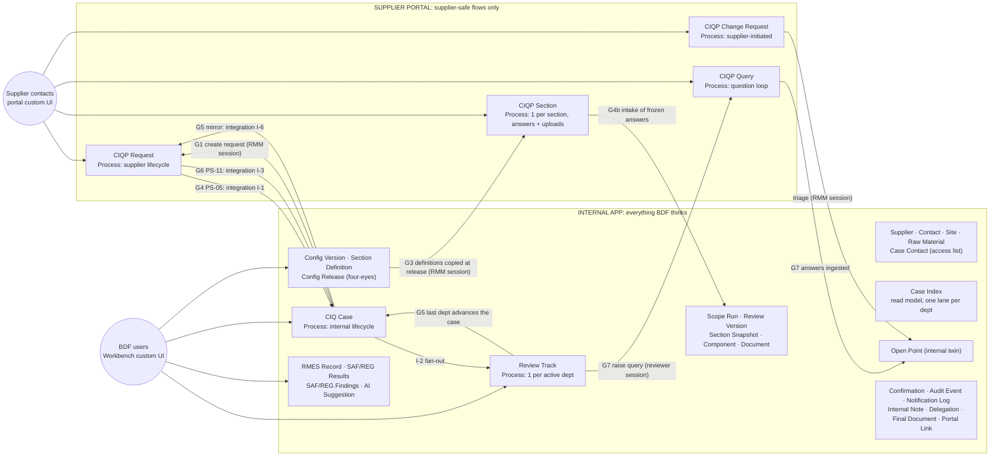

# CIQ on Kissflow: the data-model plan (internal app + supplier portal)

> ## §0-v5 · v5 is validated and binding (Thomas, 14 Oct 2026)
>
> Thomas validated plan v5 on 2026-10-14: "all OK, go with your recommendations, start the night build".
> - **Binding detail:** `plan-v5-final.md`, with Thomas's item list in `plan-v5-for-thomas.md` (V-01…V-53).
> - **Where the two differ:** `plan-v5-final.md` wins over every section below and over plan v3/v4.
> - **What still counts below:** older sections stay only for history and for the parts v5 doesn't touch.
>
> **Shared names across both containers** (use them exactly; app flows start `CIQ `, portal flows `CIQP `):
>
> | Container | Flow (type) | v5 status | Detail |
> |---|---|---|---|
> | Portal | CIQP Request (Process) | changed: "the CIQ", one item per case. Steps "Supplier: fill in the CIQ" (`Activity_15rz7z2`), then "Supplier: keep the CIQ up to date" (`Activity_1mhx3t7`) (as built 14 Oct). New fields listed in plan-v5 §3.1; child table `CIQP_Request_A00_Uploads` | §3.1 |
> | Portal | CIQP Query (Process) | kept; adds `Edited_At`, `Edit_Note` | §3.2 |
> | Portal | CIQP Final Release (Process) | kept; it is the release task | §3.3 |
> | Portal | CIQP Help Article (Form) | kept | §3.4 |
> | Portal | CIQP Section, CIQP Completeness Confirmation, CIQP Notice, CIQP Change Request, ZZ Spike Assignee | no longer used; Supplier grants removed | §3.5 |
> | App | CIQ Case (Process) | changed: a backbone with "Waiting for supplier: CIQ" (`Activity_1kltjdn`) and "Beiersdorf review and final release" (`Activity_gwgj5o`), both owned by Integration service; `Case_Phase` and the other new fields in §4.1 | §4.1 |
> | App | **CIQ Review** (Process) | new: one item per department review | §4.2 |
> | App | CIQ Open Point (Process) | changed: the "Open point – <Dept>" steps (ids of the old `Review – <Dept>` steps); no waiting step; `Thread_JSON` | §4.3 |
> | App | **CIQ Case Data** (Form) | new: the read model and supplier-data mirror; written only by the service | §4.4 |
> | App | **CIQ Mail Outbox** (Form) + integration **CIQ Mail – send outbox mail** | new; the only mail path (R-1) | §4.5, §4.6 |
> | App | **CIQ Service Request** (Form) | new: the Workbench → service command channel | §4.13 |
> | App | CIQ Supplier, CIQ Config Version, CIQ Scope Run, CIQ RMES Safety, CIQ RMES Regulatory, CIQ Internal Note, CIQ Audit Event (Forms) | kept or changed (Audit Event is service-only) | §4.7–§4.12 |
> | App | CIQ Section (Form), CIQ Change Request (Process), Overall approver (role) | no longer used; the role is deleted | §4.14 |
> | Both | **CIQ Sync Service** (external, API key) | new: every portal↔app hand-off. No cross-container integrations (I-1, I-3, I-6, X1–X6, Y1–Y6 are replaced) | §8 |
>
> **Files** (as built 14 Oct, spike S-2 proven):
> - Supplier files live in `CIQP_Request_A00.Supplier_Files`. Each `CIQP_Request_A00_Uploads` row points at its file through `Upload_Attachment_Id`.
> - The service copies each file into `CIQ_Case_A00.Supplier_Files`, a new Attachment field.
> - CIQ Case Data → Documents records `Doc_Attachment_Id`.
> - The final PDF goes to `CIQ_Case_A00.Final_PDF`.
>
> **Added on 14 Oct night (build findings):**
> - CIQ Case Data `Sync_Note` is a Textarea (else `Sync_State_JSON`).
> - Both RMES Findings child tables get `Findings_Key`.
> - CIQ Service Request gets `Attempt_No`.
> - CIQP Request gets `Change_Report_By_Email` and `Change_Report_At` (as built).
>
> **Added on 15 Oct night (verifier findings, app session fixer):**
> - CIQ Open Point `Open_Num` = `IF(ISBLANK(OP_Outcome),1,0)`: every closed outcome (Accepted, Withdrawn, Not accepted) counts 0. Part of the B2 fields publish.
> - CIQ Open Point `OP_Dept` is field-level Required (enforced at Start, P7), so a point can't skip all six conditional steps. The service still checks `OP_Dept` against CIQ Review Dept before it submits. Part of the B2 fields publish.
> - CIQ Case "Waiting for supplier: CIQ" has **no native SLA**. No SLA metadata shape is proven (the old engine and master.md have none) and BDF's durations are unset. Supplier reminders and escalations come only from the service through the outbox (V-35, H-19).
> - Built as planned and read back: CIQ Mail Outbox, CIQ Service Request, CIQ Case Data (child tables `CIQ_Case_Data_A00_Components`, `_Documents`, `_Requested_Documents`, `_Change_Reports`), Supplier `Supplier_City` + Contacts `Contacts_Key` / `Contacts_Title` / `Contacts_Deactivated_At`, both RMES Findings `Findings_Key`, Note `Note_Mentions_Emails` / `Note_Mentions_Names`. The ids match `kissflow-build/sync/ids.mjs`.
>
> **Cross-container keys** (both sides use these exact names):
> - `Case_Code`, `Cycle_No`, `Supplier_Code`.
> - App ↔ portal item ids:
>   - CIQ Case `Portal_Request_Item_Id` ↔ CIQP Request `App_Case_Item_Id`;
>   - CIQ Open Point `Portal_Query_Item_Id` ↔ CIQP Query `App_Open_Point_Id` + `Round_No`;
>   - CIQ Case `Portal_Release_Item_Id` ↔ CIQP Final Release `App_Case_Item_Id`.
> - Contacts: CIQ Case `Portal_Contact_Ids` / `Confirm_Contact_Ids` → portal `Assigned_Contacts`.
> - Configuration: CIQ Case `Rule_Set_Version` / `Template_Version` / `Release_Item_Id` → CIQP Request `Rule_Set_Version` / `Template_Version` / `Config_Bundle_JSON` / `Config_Bundle_Hash`.
>
> **Decisions settled by the validation:**
> - **V-17 (a):** CIQ Review steps are role-assigned.
> - **V-19 (b):** CIQ Open Point steps are field-assigned to the raiser if spike S-11 passes, otherwise role-assigned.
> - **V-27:** the Overall approver role is deleted.
> - **V-33:** one outbox, in the app.
> - **V-35:** reminders and escalations are sent by the service.
> - **V-52:** a default reviewer per department in the Settings configuration row.
> - **V-53:** RMES is readable only by its own department, plus the Auditor (both forms) and the Case administrator.
> - **V-03 / V-04:** the service runs locally in dev. For UAT it runs on AWS Lambda (else Google Apps Script) under a dedicated "CIQ Integration Service" user.
> - **V-07:** the request stays with the supplier at "keep the CIQ up to date" for good.
>
> **Who builds what:**
> - **The app session** builds every app object, including the outbox, the mail integration and the role changes.
> - **The portal session** builds the portal, the sync service and the portal spikes.
> - **No session** writes to the other's container.

> **Superseded in part by the client call of 9 Oct 2026** (`context/decisions/2026-10-09-client-call.md`). There is no RMM scope check or scope release: the supplier answers the metadata questions and sections open or close live. RMM reviews in Part 2 in parallel with the departments and completes like them. The ending is the requirements-matrix ending only: there is no overall approval and no overall approver. Where this document says otherwise, the decisions file wins.

> **INTERNAL to Kissflow.** Written 2026-10-06 after call 1. **On 2026-10-07 the portal was built and verified in the Development sandbox; the app is designed but not yet generated. See §0.**
>
> **Build route (decided 2026-10-07).**
> - **Portal and integrations:** the portal and the cross-container integrations (I-1, I-3, I-6) are built over REST with the shapes cited from [MM].
>   - Old `app-agents` 1.6.0 engine: `tools/kissflow-app-agents-1.6.0/`.
>   - Credentials: `.env`.
> - **Internal app:** built with the App Builder plugin (`app-builder@kissflow` 1.0.0), which can't reach portals, in a separate session.
> - **This plan is the contract between the two sessions.** App Builder must reproduce §3.2 and the names used across containers.
> - **Changes after generating:** App Builder 1.0.0 can't edit the app afterwards, so later changes to the app use REST/patch.
> - Development sandbox: `https://dev-beiersdorf.kissflow.eu`. Containers: `CIQ_Digital_A00` and `CIQ_Supplier_Portal_A00`.
> - The portal is an app with its own app ID and its own user management. Thomas handles portal user management.
> - Because we build in a Development sandbox, the permanence risk (R24) is much smaller.
>
> **What this is.** The recommended Kissflow data model for the CIQ MVP. It takes **Design C (isolation-first)** as the base and grafts the best ideas of **Design B (config as data)** and **Design A (native first)**. The three source designs are in this folder; their scores are in Appendix A.
>
> **Inputs:** `~/Downloads/master.md` (cited **[MM §x]**), the prototype domain model (`prototype/src/domain/*.ts`, cited **proto:**), analyses 01, 02, 03 and 07, the BRM (51 acceptance criteria) and FLM v0.6.
>
> **Evidence rule.** Our manual says only two things about portals: they are "a parallel external-facing variant" [MM §2.1], and `GET /flow/2/{acc}/portal/{app}/flow` works for portal and application containers [MM §3.3]. **Everything else about portals is UNVERIFIED** and has a spike in §12. The design names a fallback for each one.
>
> **Review pass (2026-10-06).** A sceptical review against master.md, the prototype domain code and BDF's acceptance criteria was applied in place. What changed, and which risks stay open, is listed in **Review notes** at the end.

---

## 0. Status on 2026-10-07: BRM v2 and what is built

> **Superseded for the portal and roles (7 Oct, later the same day):** see `plan-v3-supplier-portal-one-role.md`. The portal now has one role, `Supplier`, and supplier-only steps; every Beiersdorf step lives in the app. The portal paragraphs below describe the overnight v2 build, which has been replaced.

**Portal: built and verified live (403/403 read-back checks, 12/12 runtime smoke tests).** The as-built record is `kissflow-build/ciq-supplier-portal/BUILD-LOG.md`. The single source the build reads is `kissflow-build/ciq-supplier-portal/portal-spec.mjs`. Where they differ, those two files supersede §3.1, §4.1–§4.3, the portal part of §5, the CIQP Request part of §6.1, §6.3 and the portal part of §7.2.

**App:** designed in the session "App Builder - CIQ Digital" from this plan plus the v2 overrides in `kissflow-build/ciq-digital/START-HERE.md` (drop A12/A13, additive documents, internal chat, lead-only ownership, …). `author-generate` waits for Thomas's approval.

**BRM v2 (6 Oct) changes this plan as follows:**

1. **No review version (REQ-PROC-016).**
   - The supplier edits answers and uploads in `CIQP Section` until the final release (PS-11). The PS-05 "submit every section to End" is gone; the supplier UI submits the sections at PS-11.
   - A12 `CIQ Review Version` and A13 `CIQ Section Snapshot` are dropped.
   - A changed value replaces the old one and is traced by the audit trail (A27) and native item history (MT-14).
2. **The scope only grows (REQ-CFG-008/009).** Sections are never withdrawn by a re-derivation. Additional sections are new `CIQP Section` items (`Section_Origin`).
3. **Documents are additive, with file name and upload date (REQ-PROC-011/029/033/034).**
   - There are no versions.
   - Queries reference a document by `Ref_Doc_File_Name` + `Ref_Doc_Uploaded_At`.
   - There is no upload in the query or in the change request.
   - Whether a supplier can still delete a table row natively is MT-6. If it can, the fallback is one item per upload.
4. **Supplier edits after PS-05 have no platform event.** Integrations have no field-change trigger. The supplier UI raises a `CIQP Change Request` with `Change_Kind = "Change notice"`, which gives RMM a native task to re-derive the scope and inform the departments.
5. **Additional parts** are raised as a `CIQP Query` with `Response_Required = "Yes"`. The supplier closes it with "Additional part completed" (§6.3's `Response_Required = No` design no longer works under v2).
6. **Every ending closes the case's open sections and queries**: PS-11, AS-02, manual completion and cancellation. The closing mechanism (initiator withdraw, or the Case Admin route) is MT-12.
7. **Verified platform facts (spikes in BUILD-LOG):**
   - Steps can be assigned from a `MultiUser` field: `Resource {ValueType:"Field", Value, Field}` (M1 works at the shape and routing level; "any of" is MT-1).
   - The API key can't act after Start.
   - Select-based step conditions route, and an unmatched value ends the item, so routing fields are required Selects.
   - Membership removal is `DELETE …/member/{roleId}`.
   - With the admin key, ReadOnly-at-Start isn't enforced and any membership allows initiating. Non-admin behaviour is MT-3/MT-4.

---

## 1. Summary

1. **Two containers, one airlock.** The **portal** holds only flows where every field is something the owning supplier may see. The **app** holds everything BDF thinks: configuration, review, RMES, findings, notes, decisions and audit. The supplier role has **no grant at all** in the app.
2. **Four supplier-facing processes in the portal.** `CIQP Request` (the supplier's lifecycle), `CIQP Section` (one per released section, holding the copied definition, the answers and the uploads), `CIQP Query` (the question loop) and `CIQP Change Request`. All are Processes, so a supplier sees an item only as a participant [MM §3.6].
3. **Thirty internal flows in the app.** 27 Forms and 3 Processes: `CIQ Case` (internal lifecycle), `CIQ Review Track` (one per activated department) and `CIQ Config Release` (four-eyes publishing).
4. **Configuration is versioned data, not native form fields.** Template, rule set, section ownership, RMES criteria, limits, texts and settings are JSON payloads with a SHA-256 hash in `CIQ Config Version`. A case pins one **release** (a bundle of versions). At scope release, each section definition is **copied into the case's own section item**, so a running case can never change when BDF publishes v2. This is how we pass REQ-CFG-001 and REQ-CFG-003 literally.
5. **Only the relevant departments review.** The scope evaluator derives the departments from the pinned ownership version. A native integration creates one review track per department; tracks for departments that are not activated skip every step, so they get no task and no e-mail. Each department step is owned by a static role, so "only Safety completes Safety" is enforced by the platform. Safety and Regulatory tracks count as finished only after their final decision step, never after the review step.
6. **One writer per record.** Section items, queries, department tracks, per-department RMES results and findings, and per-department "lane" rows in the case index. Nobody ever writes the same record as someone working in parallel [MM §6.6, §14 #83].
7. **The React prototype becomes two Kissflow custom UIs** (Workbench in the app, supplier UI in the portal), built from the same repo and the same `domain` code the client saw. Native Kissflow keeps routing, tasks, e-mails, send-back loops, freezing and item history.
8. **Effort: about 32–40 builder-days**, roughly 3.5–4 weeks of calendar time with two builders, including a 3-day spike block. The first day of spikes decides two things: whether a portal step can be assigned from a field holding portal users, and whether internal users can act in portal steps. Day 2 decides whether the cross-container integrations (I-1, I-3, I-6) are safe to re-fire.



**How data crosses the airlock.** Only three kinds of writer cross: (W1) integrations that copy fields, (W2) internal Workbench sessions calling `kf.api` with the portal's `_application_id`, and (W3) the supplier UI, which writes only portal flows. The supplier never writes the app, and there is no Reference or lookup from the portal to the app. The portal schema is the whitelist: an internal field cannot be copied into a portal field that does not exist.

| Gate | Business event | Direction | Mechanism (fallback) |
|---|---|---|---|
| G1 | RMM creates the case; supplier gets access and a task (REQ-PROC-001, -004) | App → Portal | RMM session creates `CIQP Request` and the `BASIC` section item, then submits Start |
| G2 | Supplier submits basic data | inside portal | Native step hand-off to "Beiersdorf: scope check" |
| G3 | RMM checks and releases the scope (REQ-PROC-009, -010; REQ-CFG-007) | Both | RMM session: writes `CIQ Scope Run` (full result incl. N.A.), then one `CIQP Section` per M/O section with the copied definition |
| G4 | Supplier completeness confirmation, PS-05 (REQ-PROC-014, -016, -017) | Portal → App | Integration I-1 approves `CIQ Case` "Part 1" (fallback: the RMM dashboard detects it and runs "Start Part 2") |
| G4b | Review-version intake | Portal → App | First internal session after G4; idempotent, because the sources are already frozen natively |
| G5 | Last activated department finishes (REQ-PROC-040) | App → Portal | The finishing reviewer's or approver's session advances `CIQ Case` step 2, guarded natively if K-20b passes. Integration I-6 mirrors the result to the portal request (fallback: the next RMM session) |
| G6 | Supplier final release, PS-11 (REQ-PROC-042, -045) | Portal → App | Integration I-3 (trigger: the request **leaves** "Supplier: final release") approves "Awaiting final release" (fallback: session sync) |
| G7 | Part 2 questions, answers, change requests (REQ-PROC-029…036) | Both | Reviewer and RMM sessions |
| G8 | Cancellation (REQ-PROC-049) | App → Portal | RMM session withdraws portal items (fallback: `CIQP BDF Case Admin` admin route); `CIQ Case Admin` ends app items RMM does not hold (overall-approval step, I-2 tracks) |

---

## 2. Decision table

| # | Decision | Why | From |
|---|---|---|---|
| D1 | **Airlock split**: portal = supplier-safe fields only; app = everything else; supplier role has zero app grants | A leak becomes impossible by construction, not by hiding fields. `scope` is "a view convention, not row-level security" [MM §4.7] | C |
| D2 | **Every supplier-specific portal flow is a Process.** No portal Boards, Datasets or supplier-specific Forms | Form members see every row, Board members every card; a Process is listable by a non-admin only through `/myitems` [MM §3.4–§3.7, §14 #22] | C (A, B agree) |
| D3 | **Supplier isolation by participation**: supplier steps assigned from `Assigned_Contacts` on the item; supplier role has no report or View grant. Ladder M1 → M2 (portal org scoping, if it exists) → M4 (mediated broker) | No per-record assignee is proven for the engine [MM §4.6]. Decide on spike day 1 | C |
| D4 | **Configuration as versioned JSON** (`CIQ Config Version` + copy-on-write `CIQ Section Definition`), **not native questionnaire fields** | Native fields change live for every item [MM §3.3]. Native-first fails a literal REQ-CFG-001 test (label and help-text edits, builder rights) | B, C (rejects A) |
| D5 | **A case pins one release bundle** (`Config_Kind = Release`, listing one version per domain) | One key to pin and audit; `Evaluator_Version` stamped on every scope run | B |
| D6 | **Definitions copied into each `CIQP Section` at release** | Running cases keep their version by construction; the supplier never reads config | B, C |
| D7 | **Answers as a JSON working copy on the section item; typed registers at capture** (`CIQ Section Snapshot` per section revision, `CIQ Component`, `CIQ Document`), plus search mirrors on the case | Satisfies REQ-PROC-006 ("find by DUNS, INCI, origin"; K2.1 per component). Honest count: intake at PS-05 is **~60–100 sequential Form creates** (one snapshot per in-scope section, components, documents, version, RMES record, lanes, confirmation, audit), i.e. 120–200 calls, about 1–2 minutes as a resumable background job (K-16). B's per-field ledger would add another 100–150 sequential creates per PS-05 [MM §3.5]; kept as a later upgrade | C (B's ledger deferred) |
| D8 | **One condition grammar** (JSON) for rules, field visibility and RMES applicability; one evaluator ported from `proto:rules.ts` / `proto:selectors.ts` with its tests | "Same input + same version → same result" (REQ-PROC-009); Decision Tables are plan-gated [MM §4.4] | B |
| D9 | **App `CIQ Case` is a Process; portal `CIQP Request` carries the supplier lifecycle** with internal hand-off steps | Department flags and outcomes stay in the app; the fan-out integration runs inside the app | C |
| D10 | **Department review = one `CIQ Review Track` Process item per department**, not parallel branches on one item | Five departments writing one item lose data [MM §6.6]; a parallel node cannot grow for late activation | B, C (rejects A) |
| D11 | **Sync from listable single-writer rows** (`CIQ Case Index` lanes), using write-then-read and an idempotent advance. Before advancing, each lane is confirmed against its track's `_status` by a direct GET (where K-14 allows), because lane ownership is a convention, not a grant | A non-admin cannot list other users' process items [MM §3.6, §14 #22]. C's "re-read all tracks" needs a listing that does not exist. Form rows are editable by every member [MM §4.7] | new (fixes C) |
| D12 | **Open point = portal `CIQP Query` (supplier wording, loop) + app `CIQ Open Point` twin** (justification, finding link, internal due date, outcome) | The prototype's client-side thread filter becomes physically separate records; two due dates | C |
| D13 | **RMES results and findings split per department** (Safety / Regulatory forms) | "Regulatory cannot edit Safety" is enforced by grants, not UI (REQ-CFG-004, REQ-RMES-003, -011) | C |
| D14 | **RMES results are current-state rows; every change writes an audit event with old and new value**; decisions store a snapshot hash | Gates, counts and dashboards need one current row per criterion; history stays in the hash-chained audit | B |
| D15 | **Yes/No answers are Selects on a `Yes No` list, never Booleans; confirmations are a one-value `Confirm` Select** | "Not answered" must differ from "No"; step-level Mandatory misbehaves on Booleans [MM §4.4] | A, B |
| D16 | **Change attempts after the freeze arrive as `CIQP Change Request`, are refused and logged** | REQ-PROC-043 "rejected **and logged**" passes literally | C |
| D17 | **No native pages for suppliers; no `ir.permissions[]` grants for the supplier role; grant-audit script after every change** | Page auto-grant escalates viewers to editors; `ir.permissions[]` adds report View on all items [MM §3.4, §4.7, §14 #21] | C |
| D18 | **Native belt-and-braces gates where spikes pass** (SUM aggregate over a helper number + Mandatory formula field) on department steps (K-20) **and on the `CIQ Case` sync step** (K-20b) | The UI gate is primary; a native refusal is a second line if it works. Every member of a step's role can submit it from Kissflow's own My Tasks, bypassing our UI | A |
| D19 | **Two custom UIs from the prototype repo**, single-file Vite build + HashRouter [MM §6.1 B] | Reuses what the client validated; no port to a new framework | B |
| D20 | **Section items by default; "work packages" (several sections per item) as a fallback** | Per-section freeze, status and attribution; falls back if e-mails cannot be suppressed or 40 creates are too slow | C, A |

---

## 3. Flow inventory

Names are display names. Kissflow assigns ids from the name (`CIQ Case` → `CIQ_Case_A00`), so we **read the real ids back after creation** [MM §2.3]. "Session" means a signed-in user acting through our custom UI.

### 3.1 Portal (CIQ Supplier Portal)

> **As built (2026-10-07):** see §0 and `kissflow-build/ciq-supplier-portal/BUILD-LOG.md`. All five portal flows exist with these names; ids `CIQP_Request_A00`, `CIQP_Section_A00`, `CIQP_Query_A00`, `CIQP_Change_Request_A00`, `CIQP_Help_Article_A00`.

| # | Flow | Type | Purpose | Key fields | Written by | Read by |
|---|---|---|---|---|---|---|
| P1 | CIQP Request | Process | Supplier-facing case lifecycle, one per case × cycle | Request_Key, Case_Code, App_Case_Item_Id, Assigned_Contacts, Released_Scope_JSON, PS-05 and PS-11 confirmation fields, Supplier_Release_Requested | RMM session (G1, G3); supplier at its steps; integration I-6 (G5 mirror; fallback RMM session) | Its contacts (participation); internal portal roles (View) |
| P2 | CIQP Section | Process | One released section (or package) of one case × cycle × revision: copied definition, answers, uploads | Section_Item_Key, Section_Key, Rev_No, Revision_Origin, Definition_JSON, Answers_JSON, Uploads (child) | RMM session (release); department session (additional part, accepted change); supplier at "Complete section" | Participants; internal View |
| P3 | CIQP Query | Process | Supplier side of an open point: question, reference, supplier due date, rounds, answer, files | Query_Key, Dept_Code, Ref_* tuple, Question_Text, Supplier_Due_Date, Response_*, Thread_JSON | Reviewer session (raise, decide); supplier (respond) | Participants; internal View |
| P4 | CIQP Change Request | Process | Supplier-initiated correction or metadata change, incl. attempts after the freeze | CR_Key, Case_Code, Dept_Code, Ref keys, Proposed_Value_JSON, Change_Reason | Supplier (initiator); RMM (triage); owning department (assess) | Initiator; internal View |
| P5 | CIQP Help Article *(optional)* | Form | Supplier-agnostic FAQ and quick-start guide (CIA #34). Every portal user may read every row, by design | Article_Title, Article_Body, Sort_Order | RMM / Business Admin | All portal users |

**Rules for every portal flow:** no Reference or lookup fields; no aggregates; no field a supplier must not read; values written by our sessions or integrations are Text, not Selects (no list dependency; step conditions work on Text); Selects only where the supplier picks; **the supplier never edits a User field** (no portal-wide user picker, §7.4 T10).

### 3.2 App (CIQ Digital)

| # | Flow | Type | Purpose | Key fields | Written by | Read by |
|---|---|---|---|---|---|---|
| A1 | CIQ Supplier | Form | Supplier company, the isolation unit | Supplier_Code, Supplier_Legal_Name, DUNS_Number, Supplier_Kind, Parent_Supplier, external keys | RMM, Business Admin | All internal |
| A2 | CIQ Supplier Contact | Form | Supplier person; join key to the portal user | Contact_Email, Contact_Full_Name, Contact_Supplier (Ref), Contact_Role, Can_Confirm, Portal_User_Key | RMM | All internal |
| A3 | CIQ Supplier Site | Form | Manufacturer / production site (one per case, FLM changelog r25) | Site_Code, Site_Supplier (Ref), Site_Kind, Site_Address | RMM | All internal |
| A4 | CIQ Raw Material | Form | Material identity and external keys | Trade_Name, Main_INCI, Material_Supplier (Ref), BDF_Material_No, IRMA_Ref, TC_Item_Ref, SAP_Material_No | RMM | All internal |
| A5 | CIQ Case Contact | Form | **Authoritative per-case access list** | Case_Code, Contact (Ref), Is_Primary, Can_Confirm_On_Case, Added/Removed_At | RMM | All internal |
| A6 | CIQ Config Version | Form | One row per version of each configuration kind, incl. the **Release** bundle | Config_Key, Config_Kind, Config_State, Payload_JSON, Content_Hash, Evaluator_Version | Business Admin (draft); approver session (publish) | All internal |
| A7 | CIQ Section Definition | Form | Copy-on-write render definition of one section revision | Section_Def_Key, Section_Key, Rev_No, Definition_JSON, Internal_Annotations_JSON, Content_Hash | Business Admin | All internal |
| A8 | CIQ Config Release | Process | Four-eyes approval of a release (draft → test → approve → published); **the frozen anchor of every published hash** | Release_Key, Change_Summary, Release_Manifest_JSON, Manifest_Hash, Regression_Result_JSON, Test_Case_Codes | Business Admin; Config Approver | Business Admin, Config Approver, Auditor |
| A9 | CIQ Case | Process | Internal case hub and lifecycle | Case_Code, header, pinned keys + Release_Hash, Dept_*_Active, Any_Dept_Rejected, Supplier_Notice_Text, ingested confirmations, outcome, cancellation | RMM; Case Sync sessions; integrations I-1, I-3 | All internal |
| A10 | CIQ Case Index | Form | Listable read model: one **lane** row per case × cycle × (Case or department) | Index_Key, Index_Lane, Case_Phase, Waiting_On, Lane_State, Assigned_Reviewer, Section_Marks_JSON, search mirrors | Each lane by its owner only, **by convention** (Form members can edit every row [MM §4.7]; §6.2 cross-checks) | All internal |
| A11 | CIQ Scope Run | Form | One immutable rule-engine run: inputs, versions, full result incl. N.A., diff | Run_Key, Scope_Trigger, Release_Key, RuleSet_Key, Evaluator_Version, Input_JSON, Result_JSON, Diff_JSON, Departments_Activated, Run_Hash | RMM session; reviewer session (Part 2 activation) | All internal |
| A12 | CIQ Review Version | Form | Manifest of the frozen review version n | Version_Key, Cycle_No, Manifest_JSON, Version_Hash, Final_Hash | Intake session (G4b); finalizer (G6) | All internal |
| A13 | CIQ Section Snapshot | Form | Frozen answers of one section revision | Snapshot_Key, Section_Key, Rev_No, Answers_JSON, Snapshot_Hash | Intake; accepting reviewer | All internal |
| A14 | CIQ Component | Form | K2.1 composition, one typed row per component per revision | Row_Id, INCI, CAS_No, EC_No, Component_Function, Is_Additive, Component_Origin, Conc_Min/Max | Intake; accepting reviewer | All internal |
| A15 | CIQ Document | Form | One row per document version, linked to its question | Doc_Key, Doc_Version, Doc_Kind, Section/Field/Row keys, Original_Title, Technical_Title, file or pointer | Intake; accepting reviewer | All internal |
| A16 | CIQ Review Track | Process | One department's subprocess for one cycle | Track_Key, Track_Case (Ref), Dept_Code, Activated, Dept_Gate (formula), Assigned_Reviewer, Track_Decision, Track_Closed, Reopen_Of_Key | Integration I-2 (or intake session); department sessions (late activation, reopen); department and approver roles at their steps | All internal |
| A17 | CIQ Open Point | Form | Internal twin of a portal query | OP_Key, Dept_Code, OP_Kind, Ref_* tuple, Internal_Justification, Responsible_User, Internal_Due_Date, Blocking, Is_Open, OP_Outcome, Rounds_JSON, Finding_Code | Reviewer sessions (a mirror; the portal query's step is the authority, §4.7) | All internal |
| A18 | CIQ RMES Record | Form | Exactly one per confirmed CIQ version (REQ-PROC-021) | RMES_Key, RMES_Case (Ref), Case_Code, Cycle_No, pinned RMES and limit keys, SAF/REG decision hashes | Intake session (RMM, Safety or Regulatory user only, §9) | All internal |
| A19 | CIQ RMES Safety Result | Form | Safety criterion results | Result_Key, Criterion_Code, Applicable, Criterion_Result, Result_Comment, source keys, limit check, Impact_Resolution | Safety sessions (rows created by the first Safety session) | All internal (Regulatory read-only) |
| A20 | CIQ RMES Regulatory Result | Form | Regulatory criterion results | same schema as A19 | Regulatory sessions | All internal (Safety read-only) |
| A21 | CIQ Safety Finding | Form | Safety findings | Finding_Code, Result_Key, Finding_Text, Blocking, Finding_State, Open_Point_Key | Safety sessions; limit evaluator | All internal |
| A22 | CIQ Regulatory Finding | Form | Regulatory findings | same schema as A21 | Regulatory sessions | All internal |
| A23 | CIQ AI Suggestion | Form | Marked, sourced AI suggestion; confirm or discard (REQ-PROC-024) | Doc_Key, Doc_Version, Quoted_Passage, Claim, AI_State | SAF/REG sessions | All internal |
| A24 | CIQ Internal Note | Form | BDF-only discussion (REQ-PROC-020) | Case_Code, Linked_Kind, Linked_Key, Note_Dept, Note_Text | All internal | All internal |
| A25 | CIQ Confirmation | Form | Every formal confirmation and decision, immutable | Confirmation_Kind, Confirmation_Dept, Confirmation_Decision, Person name/e-mail/role, Confirmed_At, On_Behalf_Of, Text_Key, Record_Hash | Sessions; ingestion of supplier confirmations | All internal |
| A26 | CIQ Delegation | Form | Auditable delegation and reassignment (REQ-PROC-039, REQ-RMES-011/-013) | Grantor, Delegate, Delegation_Scope, Delegation_Dept, Case_Code, Valid_From/To, Reason | Department roles, approvers, RMM | All internal |
| A27 | CIQ Audit Event | Form | Hash-chained business audit (REQ-CTL-009, REQ-RMES-016) | Seq_No, Actor, Action_Code, Object_Kind/Key/Version, config keys, Old/New_Value_JSON, Prev_Hash, Event_Hash | Every internal session | Auditor and all internal |
| A28 | CIQ Notification Log | Form | Every notification event (REQ-CTL-010), incl. the native e-mails our transitions cause | Event_Code, Recipient, Channel, Sent_At, Related_Key | The session that caused the transition (intake for integration-caused ones); see K-23 | All internal |
| A29 | CIQ Final Document | Form | Final PDF and RMES export with SHA-256 (REQ-PROC-046, REQ-RMES-020) | Doc_Purpose, Cycle_No, PDF_File, File_Hash, Sent_To, BFlow_Doc_Id | Integration I-4 or renderer | All internal |
| A30 | CIQ Portal Link | Form | Idempotency ledger and job state for every airlock crossing | Link_Key, Gate, Items_JSON, Job_State, Lease_Until, Attempts, Last_Error | Internal sessions | RMM, Auditor |

**Not used:** Boards (every lifecycle has cross-role gates, and Board members see all cards [MM §2.2, §5.4]); Datasets (sharing is UI-only, no admin-key scope [MM §11.4]); Decision Tables (plan-gated [MM §4.4]); `SequenceNumber` unless spike K-22 passes [MM §14 #59]; a separate rule-row or field-catalogue Form (one JSON payload per version is atomic, and field keys are enforced unique by the admin console).

---

## 4. Field-level spec for the core flows

**Conventions.** `R` = required (step-level Mandatory at the named step). Every field not edited at Start is ReadOnly at Start [MM §14 #53]. No field called `Name`, `Status`, `Type`, `Country`, `Priority`, `Category`, `Currency` or `Project` [MM §2.3, §14 #4–#6]. Long text is `Textarea`, never `TextArea` [MM §3.3]. JSON lives in `Textarea` (size checked in K-16). Dates as `YYYY-MM-DD`; omit blanks, never send `''` [MM §3.5]. Machine-written codes are Text; Selects only where a person picks or where native reports must filter, and **every Select names a list in §5 that is populated in the same apply** (no inline options exist [MM §3.8]). Generic words are never a whole field name: References and Selects carry an owner prefix (`Case_Supplier`, `Track_Case`, `Criterion_Result`, `Track_Decision`, `OP_Outcome`), because generic names auto-wire or collide [MM §2.3, §14 #4–#6]. Reference writes are `{ "_id": … }` objects, never bare strings [MM §3.5]. Flow descriptions ≤ 250 characters [MM §2.3]. Field ids are read back after publish (long names are truncated [MM §2.3]); the mapping module uses ids, never labels. Formulas use nested `IF` and `ISBLANK`; `AND`/`OR` are avoided until proven on the tenant.

### 4.1 P1 `CIQP Request` (portal Process)

> **As built (2026-10-07):** `App_Case_Item_Id` is required. `Supplier_Release_Requested` is a Select Yes/No, Mandatory at "Beiersdorf: review in progress". `Assigned_Contacts` (MultiUser) and the header fields are Editable at both RMM steps. Full field list: `portal-spec.mjs`.

| Field | Type | R / step | Notes |
|---|---|---|---|
| Request_Key | Text | R Start | `CIQ-2026-0142\|1`; the display field (system `Name` is API-immutable [MM §4.4]) |
| Case_Code, Cycle_No | Text, Number | R Start | |
| App_Case_Item_Id | Text | Start | Opaque integration locator for I-1/I-3 [MM §4.8]; no content behind it for the supplier |
| Trade_Name, Supplier_Display_Name | Text | Start | Projections |
| BDF_Contact_Name, BDF_Contact_Email | Text, Email | R Start | Responsible person shown to the supplier (REQ-PROC-030) |
| Markets_Label | Text | Start | SF-11, read-only for the supplier (AS-06) |
| Template_Label | Text | Start | e.g. "CIQ-2026 v1" |
| Supplier_Due_Date | Date | R Start | Supplier-facing; the internal due date lives on `CIQ Case` |
| Case_Contacts_JSON | Textarea | Start | `[{name,email,role,canConfirm}]` of **this case only**; feeds the coordinator's picker |
| Assigned_Contacts | User (multi), or Email if K-04 says so | R Start; ReadOnly at every supplier step | **Assignee source of every supplier step (M1)**. Values are portal user ids read from `CIQ Supplier Contact.Portal_User_Key` (how to obtain them is part of K-04). The assignee is resolved when a step is entered, so a contact change on a running step needs `reassignItem` (K-13), not a field edit |
| Released_Scope_JSON | Textarea | Editable only at "scope check" | `[{sectionKey, code, title, applicability:"Mandatory"\|"Optional", supplierReason, addedLater, inScope}]`. **No N.A. sections, no rule ids** (REQ-PROC-009) |
| Completeness_Confirm | Select `CIQP Confirm` | **R at "Supplier: questionnaire"** | PS-05; UI says "completeness confirmation, not the final release" (REQ-PROC-014) |
| Completeness_By_Name, _By_Email, _At, _Text_Key | Text, Email, DateTime, Text | R same step | Text key = versioned declaration text |
| Supplier_Release_Requested | Text (`Yes` / `No`) | Editable only at "Beiersdorf: review" | Copied by I-6 from `CIQ Case.Release_Path` (fallback: RMM session); condition of the final-release step (§6.1). A neutral flag, not an outcome |
| Final_Release_Confirm | Select `CIQP Confirm` | **R at "Supplier: final release"** | PS-11 (REQ-PROC-042) |
| Final_Release_By_Name, _By_Email, _By_Role, _At, _Text_Key | Text, Email, Text, DateTime, Text | R same step | Name, role, e-mail, time |
| Supplier_Notice | Textarea | internal steps | Supplier-worded notices (re-derivation, cancellation, closure). Never the internal reason. The closure notice is copied by I-6 from `CIQ Case.Supplier_Notice_Text` **before** step 4 is left: an ended item cannot be written any more |
| Progress_JSON | — | — | *Removed in review:* several contacts would write it in parallel (last writer wins [MM §14 #83]). The supplier UI derives progress from the section items |

### 4.2 P2 `CIQP Section` (portal Process)

> **As built (2026-10-07):** v2 version. No `Rev_No`/`Supersedes_Key`/`Revision_Origin`; `Section_Origin`, `Answers_Changed_At` and the guard `Section_Release_Confirm` (Mandatory at the supplier step, set only at PS-11) were added. Uploads have no version columns. The supplier step is called "Supplier: fill in section".

| Field | Type | R / step | Notes |
|---|---|---|---|
| Section_Item_Key | Text | R Start | `CIQ-2026-0142\|1\|K2.1\|r1` |
| Case_Code, Cycle_No | Text, Number | R Start | |
| Section_Key, Section_Code, Section_Title, Section_Sort | Text, Text, Text, Number | R Start | `BASIC` = GEN + SF-01…SF-12 in one item, created at G1 |
| Applicability_Label | Text | Start | Mandatory / Optional |
| Supplier_Reason | Text | Start | e.g. "Because you selected Vegetable origin" (supplier wording; no rule ids) |
| Added_Later | Text (`Yes` / blank) | Start | "Subsequently activated" marker (REQ-ADR-002); session-written, so Text |
| Rev_No, Supersedes_Key | Number, Text | Start | Part 2 changes create a new revision item |
| Revision_Origin | Text | R Start | `Initial` / `Additional part` / `Accepted change` / `Restored`. **Condition of "Complete section": `Revision_Origin != "Accepted change"`**, so a revision that only records an accepted Part 2 change goes straight to End (frozen) and never gives the supplier a second task |
| Definition_JSON | Textarea | R Start | **Copy** of A7 `Definition_JSON` without internal annotations (§4.10) |
| Definition_Hash | Text | R Start | Re-verified by the supplier UI on load |
| Answers_JSON | Textarea | Editable at "Complete section" | Working copy (§4.10c); per-answer `by`/`at` (REQ-CTL-001) |
| Answers_Rev | Number | same | Concurrency counter. Kissflow has no conditional write, so the protocol is: read (rev n) → merge own keys → write rev n+1 → **read back** → if rev or any key differs from what was written, re-merge and retry (max 3) [MM §6.6]. Detects loss; it cannot prevent it |
| Editing_By, Editing_Since | Text, DateTime | same | Soft lock, "being edited by" |
| Supplier_Responsible_Email | Text | same | Supplier-side assignment as data, picked from `Case_Contacts_JSON` (REQ-CTL-001) |
| Assigned_Contacts | User (multi) | R Start; ReadOnly after | M1 assignee |
| Section_Done | Select `CIQP Yes No` | same | Informative |
| **Uploads** (child table) | — | Editable at "Complete section" | Upload_Id (uuid), Field_Key, Row_Id, Doc_Kind (`CIQP Doc Kind`), Upload_File (Attachment), Original_Title, Version_No, Supersedes_Upload_Id, Uploaded_By_Email, Uploaded_At. **Rows are never deleted** [MM §6.6]. A form instance (`initForm`) is opened immediately before each `addRow` and never kept open, because saving a form instance may write back a stale `Answers_JSON` over a colleague's newer answers [MM §14 #83]; the answers are re-read after every upload (K-12). Fallback if K-12 fails: one `CIQP Document` process item per upload |

### 4.3 P3 `CIQP Query` and P4 `CIQP Change Request` (portal Processes)

> **As built (2026-10-07):** `Dept_Code` and `Response_Required` are required Selects. `Ref_Doc_File_Name` + `Ref_Doc_Uploaded_At` replace `Ref_Doc_Version`. `Response_Doc_Refs_JSON` replaces `Response_Files`/`Proposed_Value_JSON`. `Thread_JSON` is ReadOnly for the supplier. `Supplier_Responsible_Email` was added. P4 has no `Change_Files`, and its `Dept_Code` is a Select.

`CIQP Query`:

| Field | Type | R / step | Notes |
|---|---|---|---|
| Query_Key | Text | R Start | `OP-0142-03` |
| Case_Code, Cycle_No | Text, Number | R Start | |
| Dept_Code | Text | R Start | Routing code for step conditions (REG, SAF, QM, MIC, SUS, RMM) |
| Kind_Label | Text | R Start | "Question from Beiersdorf", "Document request", "Additional section to complete". A finding-driven query shows as a question (REQ-RMES-015) |
| Ref_Kind, Ref_Section_Key, Ref_Field_Key, Ref_Row_Id, Ref_Doc_Id, Ref_Doc_Version | Text ×5, Number | Ref_Kind and Ref_Section_Key R Start | Stable row uuid, never a position. **No reference → cannot send** (REQ-PROC-029) |
| Ref_Label | Text | R Start | "K2.1 › component 3 (INCI …) › CAS number": the jump target |
| Question_Text, Supplier_Justification | Textarea | R Start | Written **as supplier text** |
| Responsible_Name | Text | R Start | REQ-ADR-001 |
| Supplier_Due_Date | Date | R Start; Editable at the "Beiersdorf review" steps | REQ-ADR-001; the internal due date sits on the twin. A returned answer gets a fresh due date before the send-back (prototype: +7 days) |
| Response_Required | Text (`Yes` / `No`) | R Start | `No` for "Additional section to complete": the supplier's single task is then the new `CIQP Section` item, and "Supplier: respond" is skipped by its condition (REQ-PROC-030: one task per request). The traffic light of such a point follows the section item |
| Assigned_Contacts | User (multi) | R Start; ReadOnly after | M1 |
| Round_No | Number | — | +1 on every return |
| Response_Kind | Select `CIQP Response Kind` | **R at "Supplier: respond"** | Answer / Document / Additional part completed / Cannot provide (REQ-PROC-032) |
| Response_Text, Proposed_Value_JSON | Textarea | same | Proposed value = a Part 2 correction `{fieldKey,rowId,value,unit}` |
| Response_Files | Attachment (multi) | same | New evidence versions |
| Thread_JSON | Textarea | both sides | Supplier-safe history `[{round,side,action,text,by,at,docKeys}]` (REQ-PROC-033) |
| Supplier_Outcome_Label | Text | review steps | Accepted / Closed by Beiersdorf / Withdrawn |
| New_Section_Item_Key | Text | — | For additional parts |

`CIQP Change Request`: CR_Key, Case_Code, Cycle_No, Change_Kind (Select `CIQP Change Kind`: Metadata correction / Configuration answer change / Other correction), Section_Key, Field_Key, Row_Id, Current_Value_Text, Proposed_Value_JSON (R), Change_Reason (R), Change_Files (Attachment), Dept_Code (Text; set by RMM at triage = the section's lead department), BDF_Response_Text (supplier wording), Supplier_Outcome_Label. **Integrity rule:** before acting, triage checks that `_created_by` is a contact of `Case_Code` in `CIQ Case Contact`; otherwise it is refused as invalid. Steps in §6.3: RMM triages, the **owning department** decides (REQ-PROC-034: only the responsible department sets the status).

### 4.4 A9 `CIQ Case` (app Process)

| Field | Type | R / step | Notes |
|---|---|---|---|
| Case_Code | Text | R Start; ReadOnly after | `CIQ-2026-0142`, app-generated with a collision check on `CIQ Case Index` (`?q=`) |
| Case_Title | Text | R Start | `<trade name> – <supplier>` |
| Trade_Name | Text | R Start | FLD-GEN-001 |
| Raw_Material | Reference → CIQ Raw Material (lookup BDF_Material_No, Main_INCI; **no autofill**) | Start | Autofill needs same-named own fields [MM §4.4]; the mirrors below are written explicitly by sessions instead |
| Case_Supplier | Reference → CIQ Supplier (lookup Supplier_Legal_Name, DUNS_Number; no autofill) | R Start; ReadOnly after | Renamed from `Supplier` (generic name [MM §2.3]) |
| Production_Site | Reference → CIQ Supplier Site | Start | FLD-GEN-005 |
| Owner_RMM | User | R Start | Responsible BDF owner; receives the PDF (REQ-PROC-001, -046) |
| Target_Markets | Multiselect `CIQ Market` | R Start | SF-11, owned by RMM (AS-06) |
| Case_Priority | Select `CIQ Case Priority` | Start | Internal only |
| Supplier_Due_Date, Internal_Due_Date | Date | R Start | Only the first is projected to the portal |
| Release_Key + Template_Key, RuleSet_Key, Ownership_Key, RMES_Key, Limits_Key, Texts_Key | Text | R Start; ReadOnly after | **Pinned versions.** Text keys, not References, so a lookup change can never re-point them |
| Release_Hash | Text | R Start; ReadOnly after | `Manifest_Hash` copied from the published `CIQ Config Release` item. Every config load is verified against this chain, never against the editable `CIQ Config Version` row alone (§4.11) |
| Overall_Approval_Required | Select `CIQ Yes No` | Start; ReadOnly after | Copied from the Settings version: the switch for AS-01 |
| Current_Cycle | Number | — | 1, 2 … (resubmission, reactivation) |
| Dept_REG_Active … Dept_SUS_Active, Dept_RMM_Active | Select `CIQ Yes No` | Editable at "Part 1" and "Part 2" | Written at scope release; read by I-2 |
| Any_Dept_Rejected | Select `CIQ Yes No` | Editable at "Part 2" | Written by the G5 session |
| Release_Path | Formula `IF(Any_Dept_Rejected="Yes", IF(Overall_Approval_Required="Yes","No","Yes"), "Yes")` | — | Same-model formula used as a step condition [MM §4.4, §4.6]; nested IF instead of `AND` (not in the proven function list). Copied to the portal by I-6 |
| Supplier_Notice_Text | Textarea | Editable at "Part 2" | Neutral supplier wording written by the G5 session when no release is requested (AS-02); copied by I-6 into the portal `Supplier_Notice` |
| Open_Tracks, Sync_Gate | Aggregate (SUM of `CIQ Review Track.Open_Track_Num` where `Track_Case` = this item), Formula `IF(Open_Tracks=0,"OK","")` | `Sync_Gate` Mandatory at "Part 2" | **Optional, K-20b.** Native refusal if anyone submits the sync step from Kissflow's own My Tasks while an activated track is still open. Grafted after A16 exists (§11) |
| Completeness_By_Name/_Email/_At, Final_Release_By_Name/_Email/_Role/_At | Text, Email, DateTime | Completeness_* Editable at "Part 1"; Final_Release_* Editable at "Awaiting supplier final release"; ReadOnly elsewhere | Written by I-1 / I-3 (or session). Fields must be Editable at the step the integration acts on (K-09) |
| Overall_Decision, Overall_Reason | Select `CIQ Decision`, Textarea | ReadOnly at Start; editable only at "Overall approval" | Reason required on rejection (UI gate) |
| Completion_Trigger | Text | **Mandatory at "Awaiting supplier final release"** | "Supplier final release" (written by I-3) / "Manual by RMM: …" (REQ-PROC-045). The Mandatory flag is a soft guard: an accidental native submit by any RMM member needs a typed reason, and the audit flags it |
| Cancel_Reason, Cancelled_At, Reactivation_Deadline, Reactivates_Case_Item | Textarea, DateTime, Date, Text | — | REQ-PROC-049; ReqDoc §3.3.3 |
| Main_INCI, BDF_Material_No, Supplier_DUNS, Origin_Types | Text, Text, Text, Multiselect `CIQ Origin Type` | written at intake | Search mirrors (REQ-PROC-006). `Trade_Name`, `Main_INCI` and `BDF_Material_No` also go to the portal's `CIQP Request` in X1 (added 2026-10-07, Thomas) |
| Portal_Request_Item_Id | Text | — | One-way pointer |
| Source_System, Source_Event_Id, BFlow_Folder_Id | Text | — | Integration keys (§10) |
| Final_PDF | Attachment | — | Target of GeneratePDF if Form targets are unwireable (K-15) |

### 4.5 A10 `CIQ Case Index` (app Form): the listable read model

One row per **lane**: `Index_Key` = `CIQ-2026-0142|1|CASE` or `…|SAF`. **The CASE lane is written only at sequential gates (G1, G3, G4, G5, G6, G8). Each department lane is written only by that department's sessions.** Parallel facts therefore never share a row. This is a writing convention, not a grant: every Form member can edit every row [MM §4.7], so G5 never trusts a lane alone (§6.2). Lane rows are created by the RMM session at G3 (and by the activating session for a late lane). A server-side search view (`?q=`) on this form is created and granted to every internal role through `formview/{viewId}/member/batch` [MM §3.4, §3.5].

| Field | Type | Lane | Notes |
|---|---|---|---|
| Index_Key, Case_Code, Cycle_No | Text, Text, Number | all | |
| Index_Lane | Select `CIQ Index Lane` | all | Case, REG, SAF, QM, MIC, SUS, RMM |
| App_Case_Item_Id, Portal_Request_Item_Id | Text | CASE | |
| Case_Phase, Phase_Since, Waiting_On | Select `CIQ Case Phase`, DateTime, Select `CIQ Waiting On` | CASE | Read model only; truth is `_current_step` |
| Trade_Name, Supplier_Name, Supplier_DUNS, Main_INCI, BDF_Material_No, Origin_Types, Target_Markets, Owner_RMM, Supplier_Due_Date | mirrors | CASE | Search and dashboards (REQ-PROC-006, REQ-CTL-006) |
| Release_Key, Current_Cycle, Overall_Approval_Required, Departments_Activated | mirrors | CASE | What a non-participant needs from `CIQ Case` if K-14 shows process items cannot be read by non-assignees |
| Lane_State | Select `CIQ Lane State` | dept | Not activated, Unassigned, In review, Waiting for supplier, Ready for decision, Completed, Approved, Rejected, Reopened (REQ-RMES-018). **Terminal for G5:** `Completed` for departments without a decision step; only `Approved` / `Rejected` for SAF and REG (their review step ends in `Ready for decision`) |
| Track_Item_Id, Assigned_Reviewer | Text, User | dept | |
| Section_Marks_JSON | Textarea | dept | `{sectionKey:"In review"\|"Reviewed"\|"Impacted"}` for REQ-CTL-006 section status |
| Open_Points_Open, Blocking_Reasons_JSON | Number, Textarea | dept | Named blockers (REQ-PROC-036, REQ-RMES-018) |
| Lane_Updated_At, Completed_At, Decided_At | DateTime | dept | |

### 4.6 Scope, snapshots, components, documents (app Forms)

- **A11 `CIQ Scope Run`:** Run_Key (`CIQ-2026-0142|S3`), Case_Code, Cycle_No, Run_No, Scope_Trigger (Select `CIQ Scope Trigger`: Initial / Configuration change / Revert / Manual extension / Part 2 activation), Release_Key, RuleSet_Key, RuleSet_Hash, Template_Key, Ownership_Key, Evaluator_Version, Input_JSON (SF answers + component origins), Result_JSON (`[{section, applicability, firedRules[], reason, origin, override:{by,at,justification}}]` **including N.A. with its reason**, REQ-PROC-009/-010), Evidence_JSON, Departments_Activated (Multiselect `CIQ Review Dept`), Diff_JSON (`{added,removed,changed}`, REQ-CFG-008), Override_Justification, Run_By (User), Run_At, Run_Hash. Written once, never edited.
- **A12 `CIQ Review Version`:** Version_Key (`…|v1`), Case_Code, Cycle_No, Cycle_Origin (Text, machine-written: Completeness confirmation / Resubmission / Reactivation), Scope_Run_Key, Manifest_JSON (`{sectionKey: {snapshotKey, hash}}`), Version_Hash, Final_Hash, Final_Frozen_At.
- **A13 `CIQ Section Snapshot`:** Snapshot_Key (`…|v1|K2.1|r1`), Case_Code, Cycle_No, Section_Key, Rev_No, Section_Def_Key, Answers_JSON, Capture_Event (Text, machine-written: Completeness confirmation / Accepted change / Final release), Capture_OP_Key, Supersedes_Key, Out_Of_Scope (Yes/No, REQ-CFG-009), Snapshot_Hash.
- **A14 `CIQ Component`:** Component_Key, Case_Code, Cycle_No, Rev_No, Row_Id (uuid), Row_Position, INCI, CAS_No, EC_No, Component_Function, Is_Additive (Yes/No), Component_Origin (Select `CIQ Origin Type`), Conc_Min, Conc_Max (Number), Entered_By_Email, Entered_At, Supersedes_Key. One typed row per component: "K2.1 analysable per component without opening a document" (REQ-PROC-006).
- **A15 `CIQ Document`:** Doc_Key, Doc_Version, Case_Code, Cycle_No, Doc_Kind (Select `CIQ Doc Kind`), Section_Key, Field_Key, Row_Id, Query_Key, Original_Title, Technical_Title (REQ-RMES-017), Portal_Item_Id, Portal_Upload_Id, Doc_File (Attachment, if K-12 shows the value can be copied; otherwise a pointer only), Uploaded_By_Email, Uploaded_At, Supersedes_Key, Valid_Until, BFlow_Doc_Id.

### 4.7 A17 `CIQ Open Point` (app Form, internal twin)

OP_Key (R), Case_Code, Cycle_No, Dept_Code (Select `CIQ Review Dept`, R), OP_Kind (Select `CIQ OP Kind`: Query / Document request / Additional part / Finding query / Supplier change request), **the same Ref tuple as the portal** plus Ref_Finding_Code (**internal only**), Internal_Justification (R), Responsible_User (User, R), Internal_Due_Date (Date, R), Blocking (Yes/No, default Yes, REQ-PROC-036), OP_Phase (Select `CIQ OP Phase`: With supplier / Under review / Closed), Is_Open (Yes/No; exact, because closing is always an internal action), OP_Outcome (Select `CIQ OP Outcome`: Accepted / Not accepted – final / Withdrawn), Outcome_Reason, Accepted_Evidence_Ref (`doc:DOC-0007@2` or `snap:<key>`), Round_No, Rounds_JSON (append-only per round: text, answer, files, by, at, evidence versions), Portal_Query_Item_Id, Track_Key, New_Section_Key, Delegation_Key. Only if K-20 is pursued: Twin_Track (Reference → CIQ Review Track) and Open_Num (formula `IF(Is_Open="Yes",1,0)`), because a cross-flow aggregate needs a Reference to match on and has no per-record filter [MM §4.4].

**Who owns the status.** Every reviewer role can edit every twin (Form grant), so the twin is a mirror, not the authority. The authority for "open / in progress / closed" is the portal query's `_current_step` / `_status`, where only the owning department's role can act (REQ-PROC-034). The completion gate re-reads the portal query of every twin it counts as closed before it lets a department finish.

### 4.8 A16 `CIQ Review Track` (app Process)

Track_Key (`…|v1|SAF|t1`), Track_Case (Reference → CIQ Case), Case_Code, Cycle_No, Dept_Code (Select `CIQ Review Dept`), Activated (Yes/No), **Dept_Gate** = formula `IF(Activated="Yes", Dept_Code, "NONE")`, Activation_Reason (e.g. "lead of K2.1, K6.1, A10"), Owned_Sections_JSON, Assigned_Reviewer (User; the named owner as data, REQ-CTL-003), Track_Due_Date, Late_Activation (Yes/No), Reopen_Of_Key, Reopen_Reason, Completion_Confirm (Select `CIQ Confirm`; label "Review completed — not a raw-material approval", REQ-PROC-038), Completion_Note, Track_Decision (Select `CIQ Decision`; ReadOnly at Start, Mandatory at the decision steps 7–8), Decision_Reason, On_Behalf_Of (A26 key), Track_Closed (Select `CIQ Yes No`; set to Yes by the session in the same update that precedes the last actionable submit), Open_Track_Num (formula `IF(Activated="Yes", IF(Track_Closed="Yes",0,1), 0)`; feeds `CIQ Case.Open_Tracks`, K-20b). Optional native gate fields if K-20 passes: Open_Blockers (cross-flow **SUM of `Open_Num`** over the twins whose `Twin_Track` is this item; COUNT cannot filter on state) and Gate (`IF(Open_Blockers=0,"OK","")`, step-Mandatory). A native **Reject** on a track is read as Track_Decision = Rejected with the reject comment as reason; Reject is disabled on review steps 1–6 where K-13 shows that is possible. Steps in §6.2.

### 4.9 RMES (app Forms)

- **A18 `CIQ RMES Record`:** RMES_Key (`…|v1`; exactly one per case × cycle), RMES_Case (Ref → CIQ Case), Case_Code, Cycle_No, Review_Version_Key, RMES_Config_Key, Limits_Config_Key, RuleSet_Key, Created_At, SAF_Decision_Hash, REG_Decision_Hash, Export_Doc_Key. Created at intake when SAF or REG is activated, by an RMM, Safety or Regulatory session holding the G4b lease (§9). If a duplicate appears anyway, the row with the earliest `_created_at` wins and later ones are marked void, never deleted.
- **A19 / A20 `CIQ RMES Safety Result` / `CIQ RMES Regulatory Result`** (identical schemas): Result_Key (`…|v1|S-A1`), RMES_Key, Case_Code, Cycle_No, Criterion_Code, RMES_Part (Select `CIQ RMES Part`), Criterion_Title (copied, so later template edits never change history), Applicable (Yes/No; N.A. rows stay visible, REQ-RMES-004), Applicability_Basis (Text: Rule / Override), Override_Reason, Prefill_Value, Source_Section_Key, Source_Field_Key, Source_Row_Id, Source_Doc_Id, Source_Doc_Version, Source_Section_Rev (REQ-RMES-005), Criterion_Result (Select `CIQ RMES Result`), Result_Comment, Recorded_By (User), Recorded_At, Result_Rev (Number), Reported_Value, Reported_Unit (Select `CIQ Unit`), Limit_Value, Limit_Comparator (Text), Limits_Version_Label, Limit_Pass (Yes/No), Impact_Resolution (Select `CIQ Impact Resolution`: Reopened / No impact confirmed), Impact_Note, AI_Suggestion_Key, Is_Pending (formula `IF(Applicable="Yes", IF(ISBLANK(Criterion_Result),1,0), 0)`).
  - **Impacted is derived, not stored** (REQ-RMES-012): a result is impacted when its `Source_Section_Rev` is lower than the latest accepted revision of that section. The accepting department (say QM on K2.2) has no edit right on Safety rows, so a stored flag would need a cross-department write; deriving it needs none. The owner resolves it on its own row (new `Result_Rev`, or "No impact confirmed").
  - **Rows are created lazily per department:** the first Safety session after intake creates the Safety rows from the pinned RMES criteria (keyed by Result_Key, idempotent), the first Regulatory session the Regulatory rows. An intake run by RMM cannot create them (RMM has only View).
- **A21 / A22 `CIQ Safety Finding` / `CIQ Regulatory Finding`:** Finding_Code, RMES_Key, Result_Key, Source keys, Finding_Text (R), Blocking (Yes/No), Finding_Origin (Text: Manual / Limit check / AI confirmed), Finding_State (Select `CIQ Finding State`: Open / Issued to supplier / Closed), Open_Point_Key, Raised_By/At, Closed_By/At, Close_Reason. A limit exceedance (e.g. As > 0.5 mg/kg under BDF-LIM-2026.1) creates a blocking finding automatically.

### 4.10 Confirmations and audit (app Forms)

- **A25 `CIQ Confirmation`:** Confirmation_Key, Case_Code, Cycle_No, Confirmation_Kind (Select: Scope release / Completeness confirmation / Department completion / Final Safety decision / Final Regulatory decision / Final release / Overall decision / Cancellation / Reactivation / Manual completion), Confirmation_Dept (Select `CIQ Department`), Confirmation_Decision (Select `CIQ Decision`: Confirmed / Approved / Rejected), Person_Name, Person_Email, Person_Role, Confirmed_At (DateTime), On_Behalf_Of, Text_Key, Text_Version, Portal_Activity_Ref, Rationale, Record_Hash. This is what keeps the three confirmation types distinguishable in the project and the PDF (REQ-PROC-015).
- **A27 `CIQ Audit Event`:** Event_Key, Case_Code (or `CONFIG`), Seq_No, Event_At (UTC), Actor_Side (Select `CIQ Actor Side`), Actor_Name, Actor_Email, On_Behalf_Of, Action_Code (verb phrase from `proto:actions.ts`, e.g. "Raised query"), Object_Kind, Object_Key, Object_Version, Source_Refs_JSON, Config_Keys (`TPL=…;RS=…;LIM=…;RMES=…`), Old_Value_JSON, New_Value_JSON, Event_Reason, Prev_Hash, Event_Hash, Portal_Activity_Ref. Supplier actions cannot write here (the supplier never writes the app): they are recorded by native portal history and mirrored into this chain by the internal session that next touches the item, with `Portal_Activity_Ref` pointing at the native entry. The per-answer `by` stamps in `Answers_JSON` are client-written, so intake checks them against the native item history and flags mismatches (REQ-CTL-001).

### 4.11 Configuration: versions, sections, fields, rules, ownership, limits

**A6 `CIQ Config Version`** (one row per version): Config_Key (R; e.g. `RULESET|RS-2026.2`), Config_Kind (Select `CIQ Config Kind`: Template / Rule set / Section ownership / RMES criteria / Limit set / Text bundle / Reminders / Settings / Regression set / **Release**), Version_Label, Config_State (Select `CIQ Config State`: Draft / Test / Published / Retired; edits only in Draft, **by convention**: a Form member can still edit a Published row [MM §4.7]), Payload_JSON (R), Content_Hash (SHA-256 of the canonical payload), Evaluator_Version (rule set and RMES), Paired_Config_Key, Change_Note (R), Regression_Result_JSON, Supersedes_Key, Published_By (User), Published_At.

Payload shapes:

| Kind | Payload_JSON |
|---|---|
| Template | Ordered manifest `[{sectionKey, sectionDefKey, hash, partGroup}]` |
| Rule set | `[{ruleCode, configQuestion, condition, outcome, targets:{sections,evidence}, departments, precedence, basis, note, active}]`. Seed: R-00…R-121 from `proto:rules.ts`; R-111 Turkey in RS-2026.2 |
| Section ownership | `{sectionKey: {lead, co[], coReviewMode:"Read only"\|"Track", informed[]}}`. K2.2 = Safety lead, QM co (REQ-CFG-006) |
| RMES criteria | `[{criterionCode, part, dept, title, resultKind, applicability, prefill:[{from,key}], limitParams[], order, active}]`. Seed: `proto:actions.ts rmesCriteria` |
| Limit set | `[{param, substance, fieldKey, comparator, value, unit, method, loqRule, autoBlockingFinding}]`. Seed: As ≤ 0.5, Cd ≤ 0.1, Cr ≤ 5.0 mg/kg; MOAH ≤ 1.0 mg/kg |
| Text bundle | `{textKey: {audience:"supplier"\|"internal", lang:{en,de}}}`: confirmation, notification and PDF texts |
| Reminders | `proto:` `ReminderSetting[]` |
| Settings | `{overallApprovalRequired, reactivationMonths, defaultSupplierDueDays, deptReviewMode:{RMM:"None"\|"Track",…}}` |
| Regression set | Reference materials `[{materialKey, configAnswers, components, expectedScope, expectedEvidence}]` |
| **Release** | `{template, ruleSet, ownership, rmes, limits, texts, reminders, settings: {key, hash}}` — the bundle a case pins |

**A7 `CIQ Section Definition`:** Section_Def_Key (`A1|r3`), Section_Key, Section_Code, Section_Title, Section_Kind (Basic / Chapter / Annex / Sub-section), Parent_Section_Key, Sort_Order, Rev_No, Definition_JSON (R), Supplier_Help_JSON, Internal_Annotations_JSON (FLM "Approval" owner, remarks; **never copied to the portal**), Content_Hash, Def_State (Select `CIQ Config State`).

**Where a published hash really lives.** A6 and A7 are Forms, so a Business Admin can still edit a Published row and recompute its `Content_Hash`; a hash stored on the same editable row proves nothing. The anchor is therefore the `CIQ Config Release` **process item**: before its approval step, the release session writes `Release_Manifest_JSON` (`{domain: {key, hash}}` for every payload and section definition) and `Manifest_Hash`; both are ReadOnly from the approval step on, and the item is frozen natively at End. A case copies `Manifest_Hash` into `Release_Hash` at creation. Every load of a rule set, RMES criteria, limits or texts verifies payload → manifest → `Release_Hash`; a mismatch blocks the action and raises an audit event (REQ-CFG-001, -003; REQ-RMES-002, -008). The approver UI also refuses approval when the approver is the release's initiator (four-eyes; one person may hold both roles).

`CIQ Config Release` steps: Start (Business Admin) → "Regression and test" (CIQ Business Admin) → "Approve release" (CIQ Config Approver; manifest ReadOnly) → End. Publishing (`Config_State = Published` on the A6 rows, new Release row) is written by the approver's session after End.

**The JSON contracts** (one evaluator in `domain/evaluator`, ported from the prototype with its tests):

(a) **Condition grammar**, used by rule conditions, field `visibleWhen` and RMES applicability:
```jsonc
{ "all": [node, ...] } | { "any": [node, ...] } | { "not": node }
{ "field": "FLD-A1-201", "op": "eq", "value": "Yes" }            // answer in this case
{ "config": "SF01", "op": "contains", "value": "Vegetable" }      // configuration answer
{ "component": "ORIGIN", "op": "any-eq", "value": "Petrochemical" }
{ "scope": "A4", "op": "in", "value": ["Mandatory","Optional"] } // RMES applicability
{ "market": "*", "op": "any-not", "value": "EU" }
// ops: eq, neq, in, contains, any-eq, any-not, gt, gte, lt, lte, isSet, isEmpty
```
REQ-CFG-003 example: `{"all":[{"config":"SF01","op":"contains","value":"Vegetable"},{"config":"SF08","op":"eq","value":"Yes"}]}` → A1 §5 + RSPO evidence. Semantics (to confirm, Q13): union across components and origins; Mandatory > Optional > N.A.; untouched sections are N.A. with "no rule activates"; origins with no rules flag a manual RMM scope check (`proto:needsManualScopeCheck`).

(b) **A field inside `Definition_JSON`** (field keys are the FLM ids, immutable and never reused):
```jsonc
{ "key":"FLD-A1-202", "label":"Pesticides analysis (PDF)", "kind":"File", "req":"conditional",
  "visibleWhen":{"field":"FLD-A1-201","op":"eq","value":"Yes"}, "owner":"SUS", "source":"FLM r46",
  "upload":{"accept":["application/pdf"],"evidenceCode":"D-07"}, "naAllowed":false }
// kinds: Text, Long text, Email, Number, Decimal, Number with unit, Range, Yes/No, Single choice,
// Multiple choice, Date, File, Table (columns with stable keys, rowKey "uuid", minRows)
// "Conditional mandatory" = mandatory when visible, enforced by our validator [MM §4.4]
```
Answer options are listed inline in the definition, not as Kissflow Lists, so they are version-pinned (REQ-CFG-001 "answer options").

(c) **`Answers_JSON`:** `{ "FLD-A4-101": {"v":0.8,"unit":"mg/kg","by":"<userId>","byName":"…","at":"…","rev":1}, "FLD-5.1-002": {"na":true,"just":"…",…}, "K2.1-COMP": {"rows":[{"_row":"c-7f3a","_pos":3,"INCI":{"v":"…"},"CAS":{"v":"…"},…}]} }`.

### 4.12 Masters (app Forms)

- **A1 `CIQ Supplier`:** Supplier_Code (R), Supplier_Legal_Name (R), DUNS_Number (R; 9 digits, UI-validated), Supplier_Kind (Manufacturer / Distributor / Trader), Parent_Supplier (Reference → self), Supplier_Country_Code (Select `CIQ Country Code`), Teamcenter_Supplier_Id, SAP_Vendor_Id, Supplier_Active (Yes/No).
- **A2 `CIQ Supplier Contact`:** Contact_Full_Name (R), Contact_Email (R; join key to the portal user), Contact_Supplier (Reference → A1, R), Contact_Role (Coordinator / Quality / Regulatory / Key account / Other; CIA #25 as data), Can_Confirm (Yes/No), Portal_User_Key, Invited_At, Contact_Active.
- **A3 `CIQ Supplier Site`:** Site_Code, Site_Supplier (Reference → A1), Site_Kind, Site_Title, Site_Address (Textarea), Site_Country_Code (Select `CIQ Country Code`).
- **A4 `CIQ Raw Material`:** Material_Code, Trade_Name (R), Main_INCI, Material_Supplier (Reference → A1), BDF_Material_No, IRMA_Ref, TC_Item_Ref, SAP_Material_No.
- **A5 `CIQ Case Contact`:** Case_Contact_Key (`CIQ-2026-0142|c.mueller@supplier.test`), Case_Code, Contact (Reference → A2; lookup Contact_Email, Contact_Full_Name, Contact_Supplier), Is_Primary, Can_Confirm_On_Case, Added_By, Added_At, Removed_At. A removal re-assigns the open portal items (K-13).

---

## 5. Lists

All lists are prefixed (`CIQ ` in the app, `CIQP ` in the portal), **created and populated in the same apply**, and append-only: never remove a value a live record uses [MM §3.8, §14 #3]. Seed data and UI code import the exact strings from one constants module. A portal Select cannot be assumed to read an app list (unverified), so the portal has its own.

| List (app) | Values |
|---|---|
| CIQ Yes No | Yes, No |
| CIQ Confirm | Confirmed |
| CIQ Department | RMM, REG, SAF, QM, MIC, SUS, CUS, LEG |
| CIQ Review Dept | REG, SAF, QM, MIC, SUS, RMM |
| CIQ Index Lane | Case, REG, SAF, QM, MIC, SUS, RMM |
| CIQ Origin Type | Vegetable (bio mass), Animal, Mineral, Petrochemical / fossil, Polymer, Waste / side stream, Carbon capture (CCU), Chemical recycling |
| CIQ Market | EU, UK, TR, CN, US, CA, OTHER |
| CIQ Case Priority | Normal, High |
| CIQ Case Phase | Basic data, Scope check, Supplier input, Review, Final release, Overall approval, Completed, Rejected, Cancelled |
| CIQ Waiting On | Supplier, BDF, None |
| CIQ Lane State | Not activated, Unassigned, In review, Waiting for supplier, Ready for decision, Completed, Approved, Rejected, Reopened |
| CIQ Scope Trigger | Initial, Configuration change, Revert, Manual extension, Part 2 activation |
| CIQ Config Kind | Template, Rule set, Section ownership, RMES criteria, Limit set, Text bundle, Reminders, Settings, Regression set, Release |
| CIQ Config State | Draft, Test, Published, Retired |
| CIQ Section Kind | Basic, Chapter, Annex, Sub-section |
| CIQ OP Kind | Query, Document request, Additional part, Finding query, Supplier change request |
| CIQ OP Phase | With supplier, Under review, Closed |
| CIQ OP Outcome | Accepted, Not accepted – final, Withdrawn |
| CIQ RMES Part | A, B, C, D |
| CIQ RMES Result | Available, Not available, Plausible, Implausible, Listed, Not listed, Negative, Not applicable |
| CIQ Unit | mg/kg, %, ppm, ug/kg, mm2/s, none |
| CIQ Finding State | Open, Issued to supplier, Closed |
| CIQ Impact Resolution | Reopened, No impact confirmed |
| CIQ Decision | Confirmed, Approved, Rejected |
| CIQ Confirmation Kind | Scope release, Completeness confirmation, Department completion, Final Safety decision, Final Regulatory decision, Final release, Overall decision, Cancellation, Reactivation, Manual completion |
| CIQ Doc Kind | SDS, CoA, Specification, Analysis, Certificate, Statement, Other |
| CIQ Supplier Kind | Manufacturer, Distributor, Trader |
| CIQ Contact Role | Coordinator, Quality, Regulatory, Key account, Other |
| CIQ Site Kind | Manufacturer, Production site |
| CIQ AI State | Proposed, Confirmed, Discarded |
| CIQ Actor Side | BDF, Supplier, System |
| CIQ Job State | Pending, Running, Done, Failed |
| CIQ Country Code | ISO 3166 alpha-2 subset (seeded) |

| List (portal) | Values |
|---|---|
| CIQP Yes No | Yes, No |
| CIQP Confirm | Confirmed |
| CIQP Response Kind | Answer, Document, Additional part completed, Cannot provide |
| CIQP Doc Kind | SDS, CoA, Specification, Analysis, Certificate, Statement, Other (identical to CIQ Doc Kind) |
| CIQP Change Kind | Metadata correction, Configuration answer change, Other correction, Change notice *(v2)* |
| CIQP Dept Code | REG, SAF, QM, MIC, SUS, RMM *(added 2026-10-07: routing codes are Selects)* |

Questionnaire answer options (origins in SF-01, RSPO models, plant parts …) are **not** Kissflow lists: they live in `Definition_JSON`, so they are versioned with the template.

Machine-written enumerations are Text on purpose and need no list: `Cycle_Origin`, `Capture_Event`, `Applicability_Basis`, `Finding_Origin`, `Revision_Origin`, `Response_Required`, `Added_Later`, `Supplier_Release_Requested`. `Def_State` reuses `CIQ Config State`. Total: 33 app lists + 5 portal lists = 38.

---

## 6. Workflows, statuses, and "only the relevant departments"

All processes: an explicit terminal End [MM §14 #54]; outcome and decision fields ReadOnly at Start [MM §14 #53]; step conditions as `=` formulas [MM §14 #52]; no "Rejected" steps, because native Reject and Send-back with a mandatory comment exist on every step [MM §14 #81].

**Two rules added in review, because native controls bypass our UI:**

1. **Every step can be acted on from Kissflow's own My Tasks** by any member of its owner role. Hand-off steps therefore carry a native guard where one exists (K-20b on the sync step; Mandatory trigger fields on steps 1 and 3 of `CIQ Case`), are owned by the narrowest role that can do the job, and have e-mails off where K-11 allows.
2. **Integrations must be safe to re-fire.** I-1, I-2, I-3 and I-6 fire on step events; a native send-back that re-enters a trigger step would fire them again, and an `Approve` that lands on the wrong step would complete it (for example, an overall approval). So: (a) every trigger that leads to an `Approve` or a create is step-specific (`ItemEntersToStep` / `ItemExitsToStep` on a named step), never `ItemCompleted` of a process that can reach End by more than one path (I-4 may use `ItemCompleted` because it only renders a PDF); (b) send-back is disabled on `CIQ Case` steps 2–4 and on `CIQP Request` steps 4–5, and the supplier UI offers send-back only from step 3 to step 2 (K-13 checks that per-step disabling exists); (c) K-09 measures what `Approve` does when the target is at another step or already ended; if it approves whatever step is current, the integration is replaced by its session fallback.

### 6.1 The case: two linked processes

**Portal `CIQP Request`** (supplier-facing)

| # | Step | Owner | Condition | What happens |
|---|---|---|---|---|
| 0 | Start "Issue request" | RMM session (G1) | — | Header projection, `Assigned_Contacts` |
| 1 | Supplier: basic data & configuration | `Assigned_Contacts` (M1) | — | Supplier fills the `BASIC` section; the UI lists every blocking field (REQ-PROC-004, -005). Native task e-mail = the invitation |
| 2 | Beiersdorf: scope check | CIQP BDF RMM | — | RMM runs G3 (derive, extend with justification, release). Send-back to step 1 if basic data is wrong |
| 3 | Supplier: questionnaire | `Assigned_Contacts` | — | **PS-05:** validator → submit every in-scope section to End (native freeze) → `Completeness_*` → submit. A changed configuration answer = the supplier UI **sends back to step 2** with a supplier-worded comment, so RMM gets a native re-derivation task (REQ-CFG-008) |
| 4 | Beiersdorf: review in progress | CIQP BDF RMM (e-mail off if K-11 allows) | — | Wait step. Entering it fires I-1. Left by I-6 when `CIQ Case` leaves "Part 2" (I-6 writes `Supplier_Release_Requested` and `Supplier_Notice` first); fallback: the next RMM session. Only RMM users, who own the case, hold this task, so no unaffected department sees it (REQ-PROC-017). If K-09 fails both ways, the owner reverts to CIQP BDF Sync and that trade-off is stated to BDF |
| 5 | Supplier: final release | `Assigned_Contacts` | `Supplier_Release_Requested = "Yes"` | **The single supplier notification** (REQ-PROC-040, -042) |
| 6 | End | — | — | Frozen (REQ-PROC-043). I-3 fires when the item **leaves step 5**, so a request that ends without a release request (AS-02) never triggers it |

**App `CIQ Case`** (internal)

| # | Step | Owner | Condition | Advanced by |
|---|---|---|---|---|
| 0 | Start "Create case" | CIQ RMM | — | RMM submit (REQ-PROC-001: missing mandatory fields block creation), then G1 |
| 1 | Part 1 – with supplier | CIQ RMM | — | I-1 `Approve` at PS-05 (fallback: RMM dashboard "Start Part 2"). `Completeness_At` is Mandatory here, so a premature native submit needs a typed value and is flagged by the audit verifier |
| 2 | Part 2 – Beiersdorf review | CIQ Case Sync (e-mail off if K-11 allows) | — | Entering fires I-2 (track fan-out). Submitted by G5. `Sync_Gate` Mandatory if K-20b passes, so nobody can submit it from My Tasks while an activated track is open. Leaving it fires I-6. **Residual risk:** members of departments that are not activated still see a native task here; if K-20b or K-11 fail, the fallback owner is CIQ RMM and G5's app half runs in the next RMM session ("Ready for release" tile), disclosed as such |
| 3 | Awaiting supplier final release | CIQ RMM | `Release_Path = "Yes"` | I-3 `Approve` at PS-11; RMM manual completion in exceptions (REQ-PROC-045), which also withdraws the portal request so no supplier task is left open. `Completion_Trigger` Mandatory here |
| 4 | Overall approval | CIQ Overall Approver | `Overall_Approval_Required = "Yes"` | Approver submit, or native Reject with comment. **UI gate (REQ-RMES-014):** Approve is offered only when both required RMES decisions are Approved and no blocking finding or open point remains; each blocker is named. In the AS-02 path (a department rejected) only Reject is offered |
| 5 | End | — | — | Fires I-4: PDF + e-mail to `Owner_RMM` (REQ-PROC-046) |

Both endings are switchable without rebuild (AS-01): the BRM ending (release → completed) and the PDF ending (overall approval). If a department rejects and overall approval is on, step 3 is skipped, the portal ends without a release request, and the supplier sees a neutral `Supplier_Notice` (AS-02).

**Cancellation (G8):** RMM rejects the app case at its current step with `Cancel_Reason` when RMM holds that step (steps 1–3); at step 4, or for tracks created by I-2, the **CIQ Case Admin** role (flow Admin on A9 and A16) uses the admin route. RMM withdraws the portal request where it is the initiator; otherwise CIQP BDF Case Admin does. The cascade withdraws open sections, queries and tracks and verifies that no open task remains (REQ-PROC-049; K-13 proves the admin-route withdraw in both containers). **Reactivation** = a new cycle: a new `CIQ Case` item with the same `Case_Code`, `Current_Cycle + 1` and `Reactivates_Case_Item` = the old id, plus a new `CIQP Request` and section copies.

**Reopen after G5** (REQ-RMES-012 while the supplier already holds the final-release task): the case is never sent back to step 2 (I-2 would re-fire and duplicate every track) and the request is never moved back into step 4 (I-1 would re-fire). Default: **G5 is the point of no return for the cycle.** A supplier change after G5 arrives as a change request and is either refused and logged, or accepted as the start of a new cycle (resubmission) after the release. This is stricter than the prototype, which allowed a reopen from "Awaiting final release"; it goes to BDF as open decision 18. Before G5, a reopen is a new track with `Reopen_Of_Key`, which also turns `Sync_Gate` red again.

**Derived statuses** (never a custom Status select [MM §3.6, §14 #66]):

| Shown as | Derived from |
|---|---|
| Basic data / Scope check / Supplier filling in | `CIQP Request._current_step` = 1 / 2 / 3 |
| Department review | app step 2 (lanes give the per-department picture) |
| Awaiting final release / Overall approval | app step 3 / 4 |
| Completed / Rejected / Cancelled | app `_status`; Cancelled = rejected **and** `Cancel_Reason` set |
| Section: open → in progress → with the supplier → reviewed → completed (REQ-CTL-006) | section item answers; open twins on that section; lead lane's `Section_Marks_JSON`; owning track completed |
| Open point traffic light (REQ-PROC-034) | `CIQP Query._current_step`: red = "Supplier: respond", amber = a review step, green = End accepted, grey = End not accepted / withdrawn. For an additional part (`Response_Required = No`): red while its section item is at "Complete section", amber once that item has ended |

### 6.2 Department review: only the relevant departments

1. **Activation is data.** At scope release, the evaluator takes the **lead** department of every M/O section under the pinned ownership version, plus co-departments whose `coReviewMode = "Track"`, filtered by the Settings `deptReviewMode` (prototype `departmentsForScope`, OP-18). RMM's session writes `Dept_*_Active` on `CIQ Case` and `Departments_Activated` on the scope run. Customs and Legal are informed and read-only (AS-07).
2. **Fan-out is native.** I-2 (app trigger `ItemEntersToStep` "Part 2") creates six `CIQ Review Track` items with a literal `Dept_Code` and `Activated` copied from the flag [MM §4.8]. A track that is not activated has `Dept_Gate = "NONE"`, skips every step and ends: no task, no e-mail, so **exactly** the affected departments are notified (REQ-PROC-017). If an all-skipped item does not auto-complete (K-10), the intake session creates only the activated tracks. I-2 re-fires whenever the case re-enters step 2, which the send-back rule in §6 prevents; as a second line, intake detects duplicate `Track_Key`s per cycle and withdraws the later ones.
3. **Track steps:**

| # | Step | Owner | Condition |
|---|---|---|---|
| 1–6 | Review – Regulatory / Safety / QM / Microbiology / Sustainability / RMM | the matching CIQ reviewer role (CIQ RMM for RMM) | `Dept_Gate = "<code>"` |
| 7 | Final decision – Safety | CIQ Safety Approver | `Dept_Gate = "SAF"` |
| 8 | Final decision – Regulatory | CIQ Regulatory Approver | `Dept_Gate = "REG"` |
| 9 | End | — | — |

4. **Completion (PS-10).** The UI gate refuses submission while the department has an open twin (each confirmed against its portal query, §4.7), a pending applicable RMES result, a negative result without a comment, or an open blocking finding, and names each blocker with type, section, status and responsible person (REQ-PROC-036, -039; REQ-RMES-006, -009). Then: write a `Department completion` confirmation, set `Track_Closed = Yes` on tracks without a decision step, submit the step, update the department lane to `Completed`. **Safety and Regulatory:** their review step ends with the lane at `Ready for decision`, not `Completed`. The decision step (7 or 8) repeats the RMES part of the gate (REQ-RMES-006, -009, -013: no approval with a pending criterion or an open blocking finding; reason mandatory on rejection), writes the `Final Safety/Regulatory decision` confirmation, sets `Track_Decision` and `Track_Closed`, submits, and moves the lane to `Approved` or `Rejected`. K-20 may add a native refusal on top.
5. **Sync (G5).** Run by the session that finished a track (the last review step for QM, MIC, SUS, RMM; the decision step for SAF and REG). It writes its own lane first, then lists the case's lanes (Form, listable) and compares with `Departments_Activated`. It advances only if (a) every activated lane is terminal (`Completed` for departments without a decision step, `Approved`/`Rejected` for SAF and REG; `Ready for decision` is **not** terminal), (b) each terminal lane is confirmed by a direct GET of its track (`_status` = Completed or Rejected) where K-14 allows, and (c) no twin of the case is still open for any department, including RMM points without an RMM track. It then sets `Any_Dept_Rejected` and, if no release will be requested, `Supplier_Notice_Text`, and submits app step 2. I-6 mirrors the outcome to the portal request. Write-then-read means at least one of two simultaneous finishers sees both, **if** the Form list reflects a write immediately (K-19 measures this); a second advance finds the step already moved and stops. The RMM "stuck case" tile is the safety net.
6. **Late activation** (an additional part for a department without a track, REQ-ADR-002): the reviewer's session sets the flag, writes a `Part 2 activation` scope run, creates the department lane and a track with `Late_Activation = Yes` (reviewer roles therefore hold InitiateItems on `CIQ Review Track`, §7.2).
7. **Reopen** (REQ-RMES-012): a **new** track with `Reopen_Of_Key`. Ended items are never mutated.
8. **Shared sections** (K2.2, K6.14, K6.17): the lead completes; co-reviewers read and raise queries under their own department (prototype assumption, configurable per section).

### 6.3 Supplier steps

> **As built (2026-10-07):** under v2, additional parts use `Response_Required = "Yes"`, and sections are not withdrawn by a re-derivation (the scope only grows). See §0.

- **Assignee.** Every supplier step uses `Assigned_Contacts`, holding all named contacts of that case from `CIQ Case Contact`; any of them can act (K-04 confirms "any of").
- **Supplier-side assignment** ("only the supplier assigns", REQ-CTL-001) is data: the coordinator sets `Supplier_Responsible_Email` on sections and queries, picking from `Case_Contacts_JSON`. No portal-wide user picker opens.
- **Parallel work without loss.** Different sections are different items, which is what REQ-CTL-001 tests. Two contacts on the same section use read-merge-write with read-back verification on `Answers_JSON` (`Answers_Rev`, §4.2) plus the soft lock; uploads are added one row at a time through a freshly opened form instance [MM §6.6, §14 #26, #83].
- **One task per request** (REQ-PROC-030): each query is its own item with its own native task. An additional part gives the supplier exactly one task, the new `CIQP Section` item; its `CIQP Query` skips "Supplier: respond" (`Response_Required = No`) and waits at the department's review step.
- **Sections removed by a Part 1 re-derivation** (REQ-CFG-009): the RMM session withdraws the section item (RMM is its initiator), so no supplier task stays open; answers stay in the withdrawn item's history. If the change is reverted, a new revision item (`Revision_Origin = Restored`, `Supersedes_Key` = the withdrawn item) is created with the retained answers copied in.
- **Accepted Part 2 changes:** the accepting department's session creates a new `CIQP Section` revision with `Revision_Origin = Accepted change`; it skips "Complete section" and ends frozen at once, so the supplier gets no second task.
- **Open points:** `CIQP Query` steps are Start (reviewer session) → "Supplier: respond" (`Assigned_Contacts`; condition `Response_Required = "Yes"`) → "Beiersdorf review – <dept>" (six conditional steps on `Dept_Code`, each owned by the portal department role) → End. **Return** = native send-back to "Supplier: respond" with a mandatory comment, labelled "Visible to supplier" (REQ-PROC-034, -035). Only the owning department's role can act on its step (REQ-PROC-034, REQ-RMES-011); reassignment = native reassign + `CIQ Delegation` row.
- **Change requests:** Start (supplier) → "Beiersdorf: triage" (CIQP BDF RMM: validity check, sets `Dept_Code`; refuses invalid or post-release requests with native Reject) → "Beiersdorf: assess – <dept>" (six conditional steps on `Dept_Code`, owned by the portal department roles, as on queries) → End. Accepted changes create a new `CIQP Section` revision and twin, rerun the scope if a configuration answer changed (REQ-PROC-007, REQ-CFG-008), and make dependent RMES results show as impacted (derived, §4.9; REQ-PROC-031, REQ-RMES-012). The affected departments are informed through their Workbench inbox and a Notification Log row; there is no native e-mail for this. **After the final release every change request is refused and logged** as "Rejected change attempt" (REQ-PROC-043).

---

## 7. Roles and permissions

### 7.1 Roles

**App:** defaults `Admin` (2 named platform admins only) and `User` (no grants), plus 18 custom roles: CIQ RMM; CIQ Regulatory / Safety / QM / Microbiology / Sustainability Reviewer; CIQ Safety Approver; CIQ Regulatory Approver; CIQ Customs; CIQ Legal; CIQ Overall Approver; CIQ Business Admin; CIQ Config Approver; CIQ Auditor; CIQ Process Owner; CIQ Case Sync (all reviewers, **both approver roles** and RMM, because whoever finishes the last track runs G5); **CIQ Case Admin** (RMM leads; flow Admin on A9 and A16 for the cancellation cascade, nothing else); CIQ Integration Service (the identity integrations act as; K-09 establishes whether it needs membership at all). The approver roles default to the same people as the matching reviewer roles (prototype: the Safety reviewer decides) unless BDF names separate approvers.

**Portal:** default `Admin` and default role (no grants), plus 11 custom roles: **CIQP Supplier Contact** (all external users of all suppliers; safe *only* because it has no View grant), CIQP BDF RMM, CIQP BDF Case Admin, CIQP BDF Regulatory / Safety / QM / Microbiology / Sustainability, CIQP BDF Sync (**created only if K-09 fails**: then it owns request step 4 instead of CIQP BDF RMM), CIQP BDF Reader (every internal user), CIQP Integration Service.

No per-supplier roles: they do not scale and step owners are static [MM §4.6]. If linked roles across containers work (K-18), the internal portal roles become links to the app roles; otherwise a `roles-sync` script keeps them equal. Membership: `PUT /app_role/2/{acc}/{roleId}?_application_id=…` with `Users[]`, retried and verified by per-role GET (`UserCount`), because the call is flaky and roles start empty [MM §3.2, §14 #7].

### 7.2 Grant matrix

Grants via `POST /flow/2/{acc}/{family}/{flow}/member/batch`, with `_application_id` in the body [MM §3.4]. **I** = Process Member `["InitiateItems"]`; **M** = Process Member `[]` (act on steps only; K-06); **V** = on a Form, Viewer; on a Process, Member `["View"]` if K-21 passes, otherwise I with "+ New" hidden (a stated trade-off [MM §3.4, §4.7]); **E** = Form Member (edit; `["Delete"]` unless K-17 shows `[]` works); **A** = flow Admin; **–** = nothing. Grants are additive across the roles a user holds. "Own lane" or "own area" inside one Form is a convention, never a grant [MM §4.7].

**App**

| Flow | RMM | Dept reviewers | SAF / REG approver | Customs, Legal | Overall approver | Business Admin | Config Approver | Auditor, Owner | Case Sync | Svc |
|---|---|---|---|---|---|---|---|---|---|---|
| A1–A4 masters | E | V | V | V | V | E | V | V | – | E |
| A5 Case Contact | E | V | V | V | V | – | – | V | – | E |
| A6–A7 config | V | V | V | V | V | E | E | V | – | V |
| A8 Config Release (Process) | – | – | – | – | – | I | M | V | – | – |
| A9 CIQ Case (Process) | I | V | V | V | M | – | – | V | M | M |
| A10 Case Index | E | E (own lane) | E | V | V | – | – | V | E | E |
| A11–A15 scope, version, snapshot, component, document | E | E | E | V | V | – | – | V | – | E |
| A16 Review Track (Process) | I | **I** (late activation, reopen; "+ New" hidden) | M | V | V | – | – | V | – | I |
| A17 Open Point twin | E | E | E | V | V | – | – | V | – | – |
| A18 RMES Record | E | SAF, REG: E; others V | E | V¹ | V | – | – | V | – | – |
| A19 Safety Result, A21 Safety Finding | V | **SAF: E; REG and others: V** | SAF-A: E; REG-A: V | V¹ | V | – | – | V | – | – |
| A20 Regulatory Result, A22 Regulatory Finding | V | **REG: E; SAF and others: V** | REG-A: E; SAF-A: V | V¹ | V | – | – | V | – | – |
| A23 AI Suggestion | V | SAF, REG: E | E | V | V | – | – | V | – | – |
| A24 Internal Note | E | E | E | E | E | – | – | V | – | – |
| A25 Confirmation, A27 Audit Event, A28 Notification Log | E² | E² | E² | V (A27, A28: E², for their notes) | E² | E² | E² | V | – | E² |
| A26 Delegation | E | V | E | V | V | – | – | V | – | – |
| A29 Final Document | V | V | V | V | V | – | – | V | – | E |
| A30 Portal Link | E | E | E | – | – | – | – | V | – | E |

¹ Default follows REQ-PROC-019 ("all internal roles read all project content"). If BDF narrows RMES visibility (U-03, C-1/C-11), this is a grant change only. ² Append-only by convention; tamper-evident through the hash chain if `Delete` cannot be removed (K-17).

**CIQ Case Admin** holds only **A** on A9 `CIQ Case` and A16 `CIQ Review Track` (admin-route withdraw and reject for cancellation). **Intake** (G4b) runs only in a session whose user holds CIQ RMM, Safety or Regulatory, because only those can write every intake target (A11–A15, A18, A25, A27, A30); QM, MIC and SUS sessions never start it. **No native page, card or nav item may reference A19–A22 for any role that only reads them**: the page auto-grant would make Regulatory an editor of Safety results and break REQ-CFG-004 [MM §3.4, §14 #21]. Analysts' native reports, if any, are granted through report membership only and checked by the grant-audit script.

**Portal**

| Flow | **Supplier Contact** | BDF RMM | BDF Case Admin | BDF departments | BDF Sync | BDF Reader | Svc |
|---|---|---|---|---|---|---|---|
| P1 CIQP Request | **M, no View** (or none, K-06) | I + V (owns steps 2 and 4) | A | V | – (M + V only if K-09 fails) | V | A |
| P2 CIQP Section | **M, no View** | I + V | A | I + V | – | V | A |
| P3 CIQP Query | **M, no View** | I + V | A | I + V (each owns its review step) | – | V | A |
| P4 CIQP Change Request | **I, no View** | M + V (triage) | A | M + V (each owns its assess step) | – | V | A |
| P5 CIQP Help Article | V | E | – | – | – | V | – |
| Native pages / nav | **none** | none for CIQP flows | | | | | |

### 7.3 Isolation mechanism

- **Supplier A vs supplier B (inside the portal):** participation. A supplier is a participant only of its own case's items; it lists only with `getMyItems` / `getMyTasksItems` / `getParticipatedItems` [MM §6.2]. Ladder decided on spike day 1: **M1** field-driven assignee (primary) → **M2** native portal organisation scoping, if one exists → **M4** mediated broker with server-side keys (+3–5 days, a hosted component BDF IT must accept).
- **Supplier vs BDF internals:** the airlock. Nothing internal is ever in a portal record: no N.A. sections or rule ids, findings, RMES, notes, department states, decisions, internal dates, priority, cancellation reasons or audit.
- **Where the internal hand-off steps live:** **Option P** (primary): internal roles own steps on portal processes (K-03). **Option A**: portal processes hold only supplier steps; scope check and sync move to `CIQ Case` steps; each supplier completion becomes a gate (+1.5–2 days). **Option I**: no internal portal membership at all → integration-only airlock or M4.
- **Inside BDF:** read everything (REQ-PROC-019); edit only one's own area, enforced natively where BDF will test it literally: department steps on tracks and queries, per-department RMES results and findings. Shared registers (snapshots, twins, lanes, notes) are editable by every reviewer and tamper-evident through the audit chain; anything a gate decides on is re-checked against the native source (query or track `_status`), never read from a shared register alone.

### 7.4 Escalation traps and how we avoid each

| # | Trap | Counter-measure |
|---|---|---|
| T1 | `Editable` on a Process silently includes `InitiateItems` [MM §3.4, §14 #20] | Supplier role gets Member `[]` (K-06) and InitiateItems only on P4. Reviewers become co-initiators of tracks: UI hides "+ New"; intake flags orphan items not created by internal users |
| T2 | Page auto-grant: a page card escalates viewers to editors on every referenced flow [MM §3.4, §14 #21] | No native pages or nav in the portal for the supplier role; apply with `ir.pages=[]` and no baseline pages [MM §4.11]. **Grant-audit script after every portal change** |
| T3 | `ir.permissions[]` = membership + report View on all items [MM §4.7] | Supplier grants only by direct `member/batch`, never through `ir.permissions[]`; read back `GET …/member` and every report's members |
| T4 | Form and Board members see all rows [MM §3.5, §5.4] | No supplier-specific Forms, no Boards, no Datasets |
| T5 | Process listing for non-admins is `/myitems` only [MM §3.6] | Listable Form read models (Case Index lanes, twins, confirmations); K-14 may relax this |
| T6 | 423 grant lock during publish [MM §3.4, §14 #16] | Serial grants with retry, a **final re-grant pass**, every response checked |
| T7 | Roles start empty; submit 403 [MM §3.2] | Members added and verified per role before testing |
| T8 | Admin routes "work" for testers who are admins [MM §14 #33] | Every leak and acceptance test runs as a genuinely non-admin user |
| T9 | Cross-container lookups would project app rows into portal forms | Forbidden; keys are Text |
| T10 | A User field in a portal form may open a portal-wide user picker | `Assigned_Contacts` read-only for suppliers; coordinator picks from `Case_Contacts_JSON` |
| T11 | Comments on portal items are visible to the supplier | Internal discussion only in `CIQ Internal Note`; send-back box labelled "Visible to supplier"; neutral step names |
| T12 | Hidden step fields may still come back on an API read | No hidden internal fields exist on portal records; the only internal value is an opaque item id |
| T13 | Any member of a step's role can act on it from Kissflow's own My Tasks, bypassing every UI gate | Narrowest owner role per hand-off step; native guards (K-20/K-20b, Mandatory trigger fields); e-mails off on wait steps (K-11); the audit verifier flags transitions that have no matching gate event |
| T14 | Applying through the engine adds baseline pages (`ensureExperience`) that auto-grant the roles they target [MM §4.11, §5.2] | The portal is authored with the REST shapes of §3 and §4.10 directly, never with `applyIR`. If the engine is used for the app, `ir.pages=[]` and every auto-added page is deleted before the grant pass; the grant-audit script lists pages per role in both containers |
| T15 | An integration re-fires when its trigger step is re-entered, and `Approve` may complete whatever step is current | Step-specific triggers, send-back disabled on trigger and hand-off steps, K-09 measures `Approve` on a mismatched step (§6) |

**Leak test (run per release, as each of 4 synthetic supplier users):** listing and search, direct GET of another supplier's item, attachment URL (signed in and anonymous), e-mails, item history, status labels, PDF, lookups, user pickers, report grants, cancellation text, AI output, and devtools on the supplier's own session. An internal "Leak test" page prints PASS/FAIL with the API evidence.

---

## 8. Versioning, freeze and audit

| Object | How it is versioned | How it is frozen | Requirement |
|---|---|---|---|
| Template, rule set, ownership, RMES criteria, limits, texts, settings | One `CIQ Config Version` row per version; sections copy-on-write in `CIQ Section Definition` | Four-eyes `CIQ Config Release` → Published; hashes anchored in the frozen release item (`Manifest_Hash`) and verified on every load; Draft-only editing is a convention, so the anchor, not the row, is the proof | REQ-CFG-001, -003, -006; REQ-RMES-002, -008 |
| Release | `Config_Kind = Release` bundles one version per domain | Published with its hash; **a case pins `Release_Key` and `Release_Hash` at creation** | REQ-CFG-001 "running case keeps the version" |
| Case questionnaire | Definitions copied into `CIQP Section` at release | Case-owned copy; config edits cannot reach it | REQ-CFG-001, REQ-PROC-009 |
| Scope | One `CIQ Scope Run` per derivation, extension, re-derivation, revert or activation | Written once + `Run_Hash`; `Evaluator_Version` stamped | REQ-PROC-009/-010; REQ-CFG-007/-008/-009; REQ-ADR-002 |
| Review version | PS-05 submits every section to End (native read-only, a later write returns `050313`); intake writes snapshots, components, documents and the version manifest with `Version_Hash` | Native + hash | REQ-PROC-016 |
| Part 2 change | New section revision + new snapshot rows; earlier revisions stay as restorable history; impacted RMES results flagged | Nothing is overwritten | REQ-PROC-007, -016, -031; REQ-RMES-012 |
| Out-of-scope data | Part 1: section item withdrawn (answers stay in its history), `inScope:false` in `Released_Scope_JSON`; Part 2: snapshot `Out_Of_Scope = Yes`. On revert a `Restored` revision copies the answers back | Retained | REQ-CFG-009 |
| Final freeze | PS-11 ends the request; all sections already at End; `Final_Hash` on the review version; change requests refused and logged | Native + logged refusal | REQ-PROC-043 |
| RMES | Current-state rows; every write → audit event with old/new value; decision snapshot hash on the RMES record | Tamper-evident | REQ-RMES-013, -016 |
| Confirmations | `CIQ Confirmation` + `Record_Hash`, chained in the audit | Immutable by convention | REQ-PROC-014, -015, -042 |
| Audit | Native item history in both containers **plus** `CIQ Audit Event` hash chain per case (concurrent writers form a tolerated fork; gaps or edits are flagged by the verifier in the Auditor view) | Tamper-evident | REQ-CTL-009, REQ-RMES-016 |
| Final PDF | `CIQ Final Document` + `File_Hash` | Immutable record | REQ-PROC-046 |

**Wording to BDF:** "tamper-evident business audit plus platform history", **not** "unalterable even by platform admins" (our VQ r12 answer), because admin update and delete routes exist [MM §3.6]. Admin membership is limited to two named people.

**Test environment (REQ-CFG-001 "in the test environment"):** a `Test` state lets RMM create flagged test cases pinned to a draft release. Native task e-mails cannot be suppressed per case, so test cases are always assigned to synthetic supplier users; no real supplier is ever a test-case contact. If BDF wants a separate tenant instead, a `ciq-config-pack` script exports a release as signed JSON and imports it with a hash check (Q-16).

---

## 9. Custom UI vs native

**What the prototype becomes.** One repo (the prototype), two builds, both single-file Vite + HashRouter custom UIs [MM §6.1 B, §6.12]:

| Build | Container | Prototype screens reused | Users |
|---|---|---|---|
| **CIQ Workbench** | App custom UI | RMM dashboard, case list and detail tabs, new case, scope check and release; review queue and workspace (sections, open points, RMES, findings, notes, completion panel); approvals; informed list; admin (template manager, rule table, ownership matrix, reminders, scope simulator, regression check, publish); reports, audit trail, reconstruction | All internal roles, gated by `kf.user.AppRoles` |
| **CIQ Supplier Portal UI** | Portal custom UI (K-08; fallback: native portal page + one page-level component) | Supplier home and tasks, metadata step, scope preview, questionnaire and section panels, component table, completeness check, answer drawer, help | `CIQP Supplier Contact` |

The "Our understanding" pages are a discovery artefact and are not shipped.

**How it calls Kissflow.** A shared `domain` package (types, evaluator on the JSON grammar, completeness validator, hashing, the portal ↔ app mapping module with pure-function tests [MM §6.8]) and a `kf-seam` layer [MM §6.4]:

- App Forms: `kf.app.getDataform(id)` (`getItems` paged, `createItem` → `submitItem` with a **new id**, `updateItem`); creates strictly sequential [MM §3.5]. The draft slot is per user per form, so **all creates of a session go through one FIFO queue**, background jobs (intake, cascade) included, and a Web Locks (`navigator.locks`) lock serialises the queue across two tabs of the same user. A second device of the same user is a known, rare collision; the queue retries a 409/404 once after re-reading.
- App Processes: `kf.app.getProcess(id)` (`getMyTasksItems`, `getItem`, `submitItem`, `sendbackItem`, `rejectItem`, `reassignItem`) as the real assignee [MM §3.6].
- Portal items from the Workbench: `kf.api('/process/2/{acc}/{flow}…?_application_id={PORTAL}', {method, body})` with a **plain-object body** [MM §6.3] (K-07, which must prove a submit **past** the StartEvent as well; that is unconfirmed even for real users [MM §15]).
- Supplier UI: SDK on portal flows only; `getMyItems` / `getMyTasksItems` / `getParticipatedItems`; assignee-route updates; files via `kf.client.uploadFile` + `initForm(id).getTable(<Uploads>).addRow` [MM §6.2, §6.6]. It never calls the app, never uses admin routes, holds no keys.
- Roles: production role from `kf.user.AppRoles`; the dev role switcher only when `kf.app.getRoles()` resolves [MM §6.7]. `isLive()` per call; a `KF_DIAG` surface and a bundle hash stamp [MM §6.4].

**Prototype action → Kissflow write path** (each write is read back):

| Prototype action | Session | Writes, in order |
|---|---|---|
| `createCase` | RMM | Validate every mandatory input in the UI **before any write** (REQ-PROC-001; a process create does not validate [MM §3.6]) → `CIQ Case` create (pins `Release_Key`, `Release_Hash`) + submit Start; on a submit failure, delete the Start draft → `CIQ Case Contact` rows → `CIQP Request` create + submit Start (portal) → `BASIC` section item → Case Index CASE lane → audit, notification log |
| `saveConfig`, `setAnswer`, `setComponents`, `setJustification`, `uploadDocument` | Supplier | `CIQP Section` assignee update (read-merge-write on `Answers_JSON`); uploads one row at a time |
| `submitMetadata` | Supplier | Validate `BASIC` → submit request step 1 |
| `releaseScope`, `extendScope` | RMM | Read `BASIC` → evaluator on the pinned rule set → `CIQ Scope Run` → section items create + submit (sequential, progress bar) → request `Released_Scope_JSON` → submit step 2 → `Dept_*_Active` → Scope release confirmation → lanes → Portal Link row for G4b (state Pending, so intake later contends on an existing row) → audit |
| `confirmCompleteness` | Supplier | Validator → submit every section → `Completeness_*` → submit step 3 (resumable: on the next open the UI finishes whatever is left). Then I-1 → app step 2 → I-2 fan-out. The first RMM, Safety or Regulatory session takes the G4b lease (update the Pending Portal Link row with its id and `Lease_Until`, wait, read back; the id that persisted wins) and runs intake: review version, snapshots, components, documents, RMES record, Notification Log rows for the integration-caused e-mails, confirmation |
| `raiseOpenPoint`, `findingToQuery` | Department | `CIQP Query` create + submit → `CIQ Open Point` twin → (additional part: new section item, scope run, track if missing) → lane → audit |
| `supplierRespond` | Supplier | Query update (`Response_*`, `Thread_JSON`, files) → submit |
| `reviewResponse` (accept / return / not accepted) | Department | Accept: apply proposed change as a new section revision + snapshot + impact scan → `Supplier_Outcome_Label` → submit → twin closed. Return: native send-back with the supplier-facing reason. Not accepted: close + internal rationale on the twin |
| `recordCriterion`, `addFinding`, `closeFinding` | SAF / REG | First session of the department: create its result rows from the pinned criteria. Then own result or finding form (+ audit with old/new value) |
| `completeReview` | Department | Gate → Department completion confirmation → track review step submit → own lane (`Completed`, or `Ready for decision` for SAF/REG) → G5 check (not for SAF/REG) |
| `rmesDecision` | SAF / REG approver | RMES gate → decision hash on the RMES record → `Final … decision` confirmation → `Track_Decision`, `Track_Closed` → decision step submit → own lane `Approved`/`Rejected` → G5 check |
| `finalRelease` | Supplier | `Final_Release_*` → submit step 5. Then I-3 → app step 3 → (overall approval) → End → I-4 PDF |
| `overallDecision` | Overall approver | App step 4 submit or Reject → confirmation → audit |
| `cancelCase`, `reactivateCase` | RMM (+ CIQ Case Admin, CIQP BDF Case Admin) | Cascade (§6.1) / new `CIQ Case` item and new cycle |
| `publishTemplateV2`, `setOwnership`, `updateReminder` | Business Admin → Config Approver | Draft versions → regression run → `CIQ Config Release` → approver publishes (states, hashes, new Release row) |

**What stays native:** step routing and conditions, static step owners and field-driven supplier assignees, per-step Editable / ReadOnly / Mandatory, send-back loops with mandatory comments, reject, withdraw and reassign, My Tasks inboxes and assignment e-mails (the single supplier release notification, the department notifications), step SLAs with `SlaBreached` escalation (the MVP's reminders, K-23), native freezing, item history, lists, and native reports on app Forms for analysts (granted through report membership only, never through pages or cards, §7.2).

**What is our code:** questionnaire renderer and validator, scope evaluator and regression runner, completion gates and blocker lists, airlock gates (G1–G8) with the Portal Link ledger, the hash chain and verifier, dashboards (native cards are static [MM §5.1]), and the leak-test page. A **data-driven** reminder sender (per-request due dates, configurable recipients, REQ-ADR-001, REQ-RMES-019) has no runtime in a client-only design: a session cannot send e-mail and integrations cannot loop over rows [MM §4.8]. MVP default: native step SLAs + `SlaBreached` escalation, with the business-editable `Reminders` payload documenting the intended rules; a Scheduler-connector job or a small hosted sender is the upgrade (K-23).

---

## 10. Integrations to prepare

**Internal integrations** (server-resolved 2-pass authoring; each ships `IsActive:false` and **a human activates it**; they cannot be deleted through the API, so we author them once on the real containers [MM §4.8]):

| Id | Trigger | Action | Field map | Fallback |
|---|---|---|---|---|
| I-1 | Portal `CIQP Request` ItemEntersToStep "Beiersdorf: review in progress" | App `CIQ Case` UpdateAnItem (`Completeness_*`) then Approve step 1; locator `App_Case_Item_Id` | Copy only | RMM dashboard "Start Part 2" (K-09). Re-fire only if step 4 is re-entered, which the send-back rule prevents (§6) |
| I-2 | App `CIQ Case` ItemEntersToStep "Part 2" | 6 × `CreateAndSubmitItem` into `CIQ Review Track` | `Dept_Code` literal; `Activated` ← `Dept_<X>_Active`; Case `_id`, Case_Code, Current_Cycle | Intake session creates the activated tracks (K-10) |
| I-3 | Portal `CIQP Request` **ItemExitsToStep "Supplier: final release"** (not ItemCompleted: in the AS-02 path the request ends without step 5, and an Approve would then complete the overall-approval step) | App `CIQ Case` UpdateAnItem (`Final_Release_*`, `Completion_Trigger` = "Supplier final release") then Approve step 3 | Copy + literal | Session sync, which first checks that the case is at step 3 (K-09) |
| I-6 | App `CIQ Case` ItemExitsToStep "Part 2 – Beiersdorf review" | Portal `CIQP Request` UpdateAnItem (`Supplier_Release_Requested` ← `Release_Path`, `Supplier_Notice` ← `Supplier_Notice_Text`) then Approve step 4; locator `Portal_Request_Item_Id` | Copy only | The next RMM session ("Release pending" tile runs it automatically); if K-09 fails in the app → portal direction, CIQP BDF Sync owns step 4 and the G5 session does it (§6.1) |
| I-4 | App `CIQ Case` ItemCompleted | GeneratePDF + Email to `Owner_RMM`; file kept on the case and registered in `CIQ Final Document` | — | Webhook → external renderer → attach [MM §6.15] (K-15). An integration cannot hash, so `File_Hash` is computed by the finalizer session that registers the file; whether a completed item still accepts the `Final_PDF` attachment is part of K-15 |
| I-5 *(optional)* | `SlaBreached` on supplier and track steps | Email escalation | — | Reminder sender job |

Connections are provisioned per account (`POST /integration/2/{acc}/connection/{connectorId}/{ver}/SystemApiKey`), and `Connector.Version` must match the connection's version [MM §4.8]. The identity an integration acts as (and whether `CIQ Integration Service` / `CIQP Integration Service` need members or grants at all) is established in K-09; integration-caused e-mails are logged in `CIQ Notification Log` by intake, since a Form target may be unwireable [MM §4.8].

**Keys to store now for later integrations** (all in the app; external systems never touch the portal):

| System | Later use | Keys stored now |
|---|---|---|
| Teamcenter / IRMA | Webhook case start (CIA #1); status call-out (CIA #18) | `CIQ Case.Source_System`, `Source_Event_Id` (idempotency); `CIQ Supplier.Teamcenter_Supplier_Id`; `CIQ Raw Material.TC_Item_Ref`, `IRMA_Ref`, `BDF_Material_No` |
| B-Flow | File the final package and evidence (CIA #12, #15) | `CIQ Case.BFlow_Folder_Id`; `CIQ Document.BFlow_Doc_Id`, `Technical_Title`; `CIQ Final Document.BFlow_Doc_Id`, `File_Hash` |
| SAP MDG | Supplier and material master (CIA #32) | `CIQ Supplier.SAP_Vendor_Id`, `DUNS_Number` (natural key); `CIQ Raw Material.SAP_Material_No` |
| SSO | BDF staff via Entra ID SAML; suppliers by invitation + MFA (Q18) | Platform configuration, no data |

**Environment** (changed 2026-10-07):
- `.env` (gitignored, chmod 600) holds `KF_DOMAIN`, `KF_ACCOUNT_ID`, `KF_ACCESS_KEY_ID`, `KF_ACCESS_KEY_SECRET`, `KF_APP_ID` and `KF_PORTAL_ID`.
- Keys are read from there only. They are never put in code, bundles, docs, logs or chat [MM §1.1].

---

## 11. Build order and first week

**Build order** (backend first; referenced before referencers; every layer read back [MM §4.11, §16-R1]):

0. Take a read-only inventory of both containers in the **Development sandbox** (K-01): validate the key, then list flows, roles and pages. No writes until the day-1 decision.
1. Spikes (§12) on **real shells with final names** where possible, because flows and integrations are effectively permanent [MM §3.9]. Probe-only flows (K-04, K-06, K-10, K-20, K-21 test processes) go into a separate throwaway app and portal in the Development sandbox; otherwise they are named `ZZ Spike …`, left unreferenced and listed in `HANDOFF.md`, because they cannot be deleted reliably [MM §3.9, §11]. Decision memo: Option P/A/I, rung M1/M2/M4.
2. Roles: app, then portal (reuse defaults). 3. Role members (synthetic: 1 per internal role; 2 competing suppliers × 2 contacts), verified by GET.
4. Lists + items, app then portal. 5. App masters A1–A5. 6. App config A6, A7, A8.
7. **All remaining flow shells first** (PASS 1), so ids exist for every reference [MM §4.11]. Then publish in reference order: A9 `CIQ Case` (references A1, A3, A4; no aggregate yet) → app registers A10–A15, A17–A30 (A18 references A9) → A16 `CIQ Review Track` (references A9) → optional grafts that point back: `Open_Tracks`/`Sync_Gate` on A9 (K-20b), `Twin_Track`/`Open_Num` on A17 (K-20). Adding fields to a published Process works only with a hygienic blob and per-step Permission entities [MM §3.3]; use the `add-field` patch verb.
8. Portal processes P2, P3, P4, P1 (+P5), built from `kissflow-build/ciq-supplier-portal/`, with no auto-added pages (T14). Thomas handles portal user management.
9. Step permissions and step settings (send-back and reject disabled where §6 says so), hygiene check, publish.
10. Grants (serial, 423 retry), form-view grants for the Case Index search view, **final re-grant pass**, **grant-audit script** (members, report members and pages per role, both containers).
11. Integrations I-1…I-4 and I-6: drafts, then the human activates.
12. Seed config release `CR-2026.1` from the prototype (sections and FLM v0.6 fields, R-00…R-121, ownership, RMES criteria, limits, texts) and publish it through the four-eyes path. Prepare template v2 + RS-2026.2 (Turkey REACH) as a draft for the live demo.
13. Seed masters and deterministic demo cases **through the UI as real assignees** (API keys cannot advance past Start [MM §3.6]).
14. Custom UIs: Workbench, then the supplier UI; upload; check in the real container.
15. QA: role × page in both containers, leak test × 4 supplier users, two-browser concurrency, the 51 BRM scripts, cleanup. Then `HANDOFF.md` and the backend contract.

**First week (two builders, from the day the keys arrive):**

| Day | Builder 1 (platform) | Builder 2 (code) |
|---|---|---|
| 0 | `.env`; K-01 read-only inventory of both containers; ask Kissflow product about K-03, K-04, K-05b, K-08 | Repo split into `domain`, `kf-seam`, `workbench`, `portal`; port the evaluator to the JSON grammar with the prototype tests |
| 1 | K-02, K-03, K-04, K-05, K-06, K-07, K-08 → **decision memo** (Option P/A/I, M1/M2/M4) | Definition JSON + Answers JSON contracts; seed converter FLM/prototype → payloads |
| 2 | K-09 … K-15 | Completeness validator, hashing, mapping module + tests; harness with an SDK stub that matches real shapes [MM §9.2] |
| 3 | K-16 … K-23; roles, members, lists, masters, config Forms | Seam for config and masters; admin console reads live config |
| 4 | Portal + app processes, step permissions, hygiene check, publish; grants + re-grant + grant audit | Workbench G1/G3 (create case, scope check, release) against the live tenant |
| 5 | Integrations drafted and activated; seed `CR-2026.1`; first case walked to PS-05 as real users | Supplier UI on live data: basic data, questionnaire, uploads, PS-05 |

Exit criterion for week 1: one synthetic case reaches Part 2 with the correct department tracks, and the leak test passes for two competing suppliers.

---

## 12. Spikes to run when the keys arrive

> **As built (2026-10-07):** K-01, K-02, K-04 (shape and routing), the size part of K-16 (a 160 KB Textarea round-trips byte-identical) and Select conditions passed live. The K-16 timing checks have not been run yet. K-06/K-21 and ReadOnly-at-Start are inconclusive with the admin key and moved to MORNING-TESTS. Results are in `kissflow-build/ciq-supplier-portal/BUILD-LOG.md`.

All calls follow [MM §3.11]: two headers, plain JSON, independent read-back. "As supplier A" means inside the portal UI session of a real non-admin portal user, never an API key. `$A` = app id, `$P` = portal id. Record every result in `MEMORY-LOCAL.md` with a tier tag.

**Day 1: load-bearing (decide the architecture at the end of the day)**

| # | Question | Exact check | Pass | If it fails |
|---|---|---|---|---|
| K-01 | Are both ids valid containers for our key? | `GET /flow/2/{acc}/application/$A`; `GET /flow/2/{acc}/portal/$P/flow`; `GET /flow/2/{acc}/portal/$A/flow`; `GET /app_role/2/{acc}/list?_application_id=$P`; `GET /flow/2/{acc}/process/?_application_id=$P&page_number=1&page_size=300` | Both readable; default roles listed | Fix ids or keys with the user / Kissflow product |
| K-02 | Can we author flows, lists and roles in the portal over REST? | `POST /flow/2/{acc}/process/?_application_id=$P {"Name":"CIQP Request","Description":"…"}` → `GET/PUT /metadata/2/{acc}/process/{id}/draft` → `POST …/publish`; `POST /flow/2/{acc}/list/?_application_id=$P` + `POST /flow/2/{acc}/list/{id}/items {"ListItems":[…]}` | Publish works; items read back | Author portal flows in the builder UI and capture golden blobs; the rest is unchanged |
| K-03 | Can internal users hold portal roles, own portal steps and act on them? (Option P) | `POST /app_role/2/{acc}/ {"Name":"CIQP BDF RMM","_application_id":"$P"}` → `PUT /app_role/2/{acc}/{role}?_application_id=$P` with an internal user in `Users[]` → per-role GET (`UserCount`) → grant on a test step → the internal user submits and sends back | Internal user acts on the portal step | **Option A** (+1.5–2 d); or linked roles (K-18) |
| K-04 | Can a portal step be assigned from a field holding portal users, single and multi, with "any of" semantics? (M1) | Builder UI: step assignee = field `Assigned_Contacts`. Create with A, then A+A2; submit Start (`POST /process/2/{acc}/{proc}/{item}/{act}/submit?_application_id=$P`). As A, A2 and B: `kf.app.getProcess(id).getMyTasksItems()`. One of A/A2 submits: does the step close for both? Change the field while a step is active: does the task re-route (expect no)? Find how an internal session obtains a portal user's `_id` for the field (user directory call), to fill `Portal_User_Key`. Export the draft to capture the `Resource` shape | A and A2 get the task, B does not; first submit closes it; portal user ids are obtainable | K-05b (M2), then **M4** broker (+3–5 d) |
| K-05 | Row isolation and leak channels for a participant with no View grant | As A: `getMyItems({status:"all"})`, `getParticipatedItems()`; `kf.api` GET `/process/2/{acc}/{proc}/{itemB}/{actB}?_response_type=full&_application_id=$P` (expect 403); admin GET (expect refusal); `GET /flow/2/{acc}/process/{proc}/report?_application_id=$P` (expect 403); B's attachment URL signed in and anonymous; global search for B's `Case_Code`; any user picker; `POST /form/2/{acc}/<A10 id>/list?_application_id=$A` (expect 403) | A sees only its own items; every probe of B fails | **M4** |
| K-05b | Does the portal have a supplier-organisation model with server-side scoping? (M2) | Portal user admin settings; ask Kissflow product | M2 available | — |
| K-06 | Does Process Member `[]` act on assigned steps without being able to initiate? Is membership needed at all? | Grant `CIQP Supplier Contact` Member `[]` on P3; as A, `POST /process/2/{acc}/<P3>?_application_id=$P` (expect `050302`); act on an assigned item (expect OK). Repeat with no membership | Supplier role: `[]` (or nothing) on P1–P3, InitiateItems only on P4 | T1 mitigations: orphan detection, ignore items not created by internal users |
| K-07 | Can the Workbench (app custom UI) create, read and advance portal items? Do cross-container References resolve? | As RMM in the app UI: `kf.api('/process/2/'+acc+'/<P1>?_application_id='+P, {method:'POST', body:{Request_Key:'ZZ-PROBE'}})` → submit Start → GET; then, as a member of the owner role, update fields and **submit a later step** (step 2) and send back, through `kf.api` and through `kf.app.getProcess('<P1 id>')`. Separately: an app Form Reference to a portal flow (`LHSModelApplicationId:$P`), publish, read back | G1/G3/G5/G7/G8 work from the Workbench | Internal portal actions move into a small internal page hosted in the portal, or T2-style integration bridging. References stay Text either way |
| K-08 | Can the portal host a custom UI? | Portal Settings → Custom UI → upload a hello zip (`manifest.json {"Category":"Application","Framework":"React"}`); as A check `window.kf.user`, `kf.account._id`, `kf.api`, `kf.client.uploadFile`, `kf.user.AppRoles` | Supplier UI build ships to the portal | Native portal page + one page-level component (+1 d), with the grant audit confirming no report grant |

**Day 2: mechanics**

| # | Question | Exact check | Pass | If it fails |
|---|---|---|---|---|
| K-09 | Cross-container integrations (I-1, I-3, I-6) and their re-fire safety | `GET /connector/2/{acc}/subscription` → `POST /flow/2/{acc}/integration?_application_id=$A` → draft with trigger on a **portal** process and action Approve on an **app** process, and the reverse (app trigger, portal action) → `GET …/action/{id}/fields` → PUT → publish → human activates → move a test request to the step. Then: (a) does `ItemExitsToStep` fire only for the named step; (b) what does Approve do when the target is at **another step** or already ended (expect refusal; fatal if it approves the current step); (c) does UpdateAnItem respect step field permissions; (d) which identity acts, and does it need role membership | Part 2 starts and the release request reaches the supplier with no user action; a mismatched Approve is refused | RMM-session "Start Part 2" / "Release pending" + stuck tile; disclose that "automatic" means "on the next internal session". If (b) fails, every cross-container hand-off becomes the session path |
| K-10 | Intra-app fan-out, and does an all-skipped item end? | I-2 with 6 actions; one track with `Activated = "No"`; `proc.getProgress({instanceId})` | Inactive tracks end with no task or e-mail | Intake session creates only activated tracks |
| K-11 | E-mail control and content | Switch off step e-mail on `CIQP Section` "Complete section", on request step 4 and on `CIQ Case` step 2; run a case as supplier; read every e-mail; `getProgress` as supplier; check visible step names; as a QM user on a case without QM, check native My Tasks for the step-2 task | Per-step control; no internal text | Work packages (~8 items); owner of `CIQ Case` step 2 falls back to CIQ RMM (§6.1) |
| K-12 | Attachments in a child table on a portal process | `const f = await proc.initForm(id); f.getTable('<Uploads id>').addRow({…File…})`; read as colleague A2; open from the Workbench; copy the attachment value into `CIQ Document.Doc_File` and read back. While A2 holds newer `Answers_JSON`, A adds a row through a form instance opened earlier: is A2's answer overwritten? | Uploads table works; register holds the file; adding a row never rewrites `Answers_JSON` (else: open the instance just before `addRow`, re-read after) | `CIQP Document` process item per upload; register keeps a pointer |
| K-13 | Loop and lifecycle actions | Department `sendbackItem({…stepId:<Respond>, comment})`; supplier send-back from step 3 to 2; initiator `withdrawItem` at a supplier step; Case Admin admin-route withdraw in **both** containers (portal request; app case at the overall-approval step; an I-2-created track); `reassignItem` after a contact change; can send-back and reject be **disabled per step** (§6 rule 2)? | Native loops, cancel, contact changes, per-step disabling | Admin route; withdraw + re-create items; if send-back cannot be disabled, I-1/I-2/I-6 move to their session paths |
| K-14 | Can internal non-admins list and read process items they do not take part in? | Grant report View on `CIQ Review Track`; from the Workbench try the report endpoint / `getItems({viewId})`; GET one track by id as a non-participant reviewer (needed by G5's cross-check) | Workbench lists tracks and cases directly; G5 can confirm a track's `_status` | Case Index lanes (the default design) plus the CASE-lane mirrors; G5 trusts lanes and the audit verifier flags anomalies |
| K-15 | GeneratePDF for a dynamically scoped CIQ | I-4 on `CIQ Case` ItemCompleted → GeneratePDF (template with a repeating table) → attach to the case → e-mail `Owner_RMM` | PDF filed and sent without user action | Webhook → external renderer → attach [MM §6.15] |

**Day 3: limits and plan**

| # | Question | Exact check | Pass | If it fails |
|---|---|---|---|---|
| K-16 | Size and time | 120 KB `Answers_JSON` and 20 KB `Definition_JSON` round-trip on a portal item; 40 sequential cross-container create + submit, timed; a full intake (~80 sequential Form creates), timed | Round-trip intact; release < 60 s; intake < 2 min as a resumable job | Work packages; split JSON; background progress; snapshot only changed sections after v1 |
| K-17 | Form append-only and delete attribution | `member/batch` Form `Role:"Member", Permission:[]` → create (draft + submit) and update OK, `deleteItem` refused; admin delete → `_deleted_by` present | Append-only registers | Hash chain only (tamper-evident) |
| K-18 | Linked roles across containers | Grant an **app** role on a **portal** flow via `member/batch` with `_application_id:$P`, or in Studio | One role set | Mirror roles + `roles-sync` script |
| K-19 | Concurrent writes and read-your-writes | Two users update different fields of one Form row at once; two contacts update different keys of one section via read-merge-write; two users each update their own lane and immediately list the lanes: does each list show the other's write? | Both persist; a list reflects a write at once | One writer per row (already the default); strict section lock; G5 re-lists after a short delay and the stuck tile catches the rest |
| K-20 | Native gate hardening (optional) | Cross-flow **SUM** aggregate of the twin helper `Open_Num` over twins whose `Twin_Track` Reference is the track [MM §4.4 shape 2; COUNT has no state filter] + Mandatory formula `Gate` on the department step; submit with 1 blocker; check when the aggregate recalculates | Native refusal in addition to the UI gate | UI gate only (the default) |
| K-20b | Native guard on the `CIQ Case` sync step | SUM aggregate of `Open_Track_Num` over tracks whose `Track_Case` is the case → `Sync_Gate` Mandatory at step 2; with one activated track open, submit step 2 from native My Tasks as an unaffected-department member (expect refusal) | Premature sync refused natively | Step-2 owner falls back to CIQ RMM; G5's app half runs in the RMM session (§6.1) |
| K-21 | True read-only process grant | `member/batch` `Role:"Member", Permission:["View"]` for Auditor on `CIQ Review Track`; as auditor create (expect `050302`) and read | Read without initiate | Member + InitiateItems with "+ New" hidden (trap stated to BDF) |
| K-22 | Plan features and case id | Decision Tables (expect `403 YourPlanNotSupport`), GeneratePDF available, portal-user licence tier, `SequenceNumber` on `CIQ Case` | Known plan | Rules as data (default); app-generated `Case_Code` |
| K-23 | Reminders, escalation and notification logging without a server | Step SLA on a supplier step and a track step; `SlaBreached` → Email; can an SLA follow a date field (`Supplier_Due_Date`)? Scheduler connector + Search action: can a daily job find overdue queries and e-mail their contacts? Which native e-mails can be listed afterwards for `CIQ Notification Log`? | Configurable reminders with no hosted code | Native step SLAs only, the `Reminders` payload documents intent, and a hosted sender is quoted as an add-on (REQ-RMES-019 partly met) |

---

## 13. Open decisions for BDF that change the model

Defaults are built switchable, so most answers change data or a grant, not the structure. If call 1 already answered one, record the answer here before building. Question numbers refer to `context/analysis/13-call-plan-ranked-questions.md` (Q1–Q19) and `07` §9 (Q-01…Q-22).

| # | Decision | Default we build | What changes in the model | Ref |
|---|---|---|---|---|
| 1 | How a case ends: BDF overall approval or not; who holds it | Supplier release ends the case; overall approval switchable | `Settings.overallApprovalRequired`; members of CIQ Overall Approver. No structural change | Q9, Q-05 |
| 2 | What a department rejection does | Others finish; overall decision if switched on; supplier gets a neutral notice | `Any_Dept_Rejected`, `Release_Path` | Q10 |
| 3 | Which departments must complete; RMM track; do co-reviewers get a task (REQ-CFG-006 "K2.2 Safety lead, QM co") | REG, SAF, QM, MIC, SUS complete; CUS, LEG informed; co-reviewers read only | Ownership `coReviewMode`, Settings `deptReviewMode`; RMM step already exists | Q6, Q-04 |
| 4 | Supplier changes after PS-05 | **Answered by BRM v2: free edits until PS-11** (see §0). Earlier default: only via change requests and query answers, reviewed by the owning department | If free edits are wanted: `CIQP Section` gains a Part 2 editing step and intake becomes diff-based | Q11, Q-06 |
| 5 | Composition table and multiple origins; units | One row per component; union of origins; one fixed unit per field | Definition JSON only | Q12, Q-18 |
| 6 | One rule principle; precedence; owner and sign-off of rule table v1.0 | Union; Mandatory > Optional > N.A.; unscoped → RMM | Rule-set payload and evaluator semantics; Business Admin / Config Approver members | Q13, Q14, Q-03 |
| 7 | Who "the supplier" is; can one person act for several suppliers | Access per case for named contacts only | `CIQ Case Contact` stays the access list; group view would need M2 | Q15, Q-01 |
| 8 | Which supplier contacts may confirm PS-05 / PS-11 | Any case contact with `Can_Confirm` | Field already present | Q-08 |
| 9 | Can QM, Micro, Sustainability, Customs, Legal read RMES? | Yes (REQ-PROC-019) | Grant change V → – | U-03, C-1/C-11 |
| 10 | Blocking vs non-blocking open points and findings | All block (REQ-PROC-036) | `Blocking` flag default; a per-kind setting in Settings | Q-07 |
| 11 | Test environment: separate tenant or test mode | Test mode inside production | Config-pack export/import if a separate tenant | Q-16 |
| 12 | Supplier logins (invitation + MFA) and BDF SSO | As stated | Platform setup, no data | Q18, Q-15 |
| 13 | PDF content; does the supplier get a copy | RMM only | Supplier-safe copy written to `CIQP Request` if yes | Q-12 |
| 14 | Reactivation rules | Same case, new cycle, within 12 months, by RMM | Already modelled (`Cycle_No`) | Q-13 |
| 15 | Volumes and languages | EN only; tens of cases | Text bundles and definition labels become `{en,de}`; volumes size licences and K-16 | Q8, Q-21, Q-22 |
| 16 | Is FLM v0.6 the test content | FLM v0.6 fields + placeholders for other sections | Seed content only | Q3, Q-02 |
| 17 | RMES template and limits; who owns limits | Prototype thin slice (≈8 criteria, heavy metals + MOAH) | RMES and limit payloads only | Q-10 |
| 18 | Can a department reopen after the supplier has been asked for the final release? | No: G5 is the point of no return for the cycle; later changes start a new cycle (§6.1) | If yes: K-13 must show that a Case Admin can pull back an active supplier step, else it is not buildable natively | W-11, REQ-RMES-012 |
| 19 | Are the Safety and Regulatory final decisions taken by the reviewers themselves (as in the prototype) or by separate approvers? | Same people: the approver roles get the reviewers as members | Role membership only | Q-05, REQ-RMES-013 |
| 20 | Must a delegation be approved before it takes effect? | No: a delegation is a recorded fact (A26 Form) | If yes, A26 must be created as a **Process** from day 1; a Form cannot gain a workflow later [MM §4.2] | REQ-PROC-039, REQ-RMES-013 |
| 21 | Does "editable until the final release" (v2) include the time **after all departments have completed** (G5)? May departments add parts after the release request went out? | Not yet built. The model has no route from "Supplier: final release" back to review (it would re-fire I-1) | If yes: a P1 route back to review that does not re-fire I-1 (needs per-step send-back control, K-13). If no: sections become read-only once the release is requested | v2 REQ-PROC-016, REQ-CFG-008, REQ-ADR-002 |

---

## 14. Effort estimate

Calibrated on [MM §17]: design dominates; apply takes minutes. Reusing the prototype screens and domain code saves most of the UI build compared with designs B and C.

| Work package | Builder-days |
|---|---|
| Spikes K-01…K-23 (incl. K-20b and the re-fire checks in K-09 / K-13), Kissflow product check, decision memo | 3–3.5 |
| Backend in two containers: 35 flows, 29 roles, 38 lists, step permissions and step settings, members, grants, form-view grants, re-grant pass, grant-audit script | 4–5 |
| Integrations I-1…I-4 and I-6 (2-pass, activation, cross-container and re-fire tests) | 1.5–2 |
| `domain` package: evaluator on the JSON grammar, validator, hashing, mapping module (ported with tests) | 1.5–2 |
| Config seed (FLM → Definition JSON, R-00…R-121, ownership, RMES, limits, texts) + Turkey v2 draft | 1–1.5 |
| `kf-seam` + airlock gates G1–G8 + Portal Link ledger and leases + per-session write queue + intake, sync (with native cross-checks), finalize, cancel jobs | 3.5–4.5 |
| Supplier UI: rewire the prototype screens to live data (inbox, renderer, uploads, Q&A, confirmations, change requests) | 3–4 |
| Workbench: RMM (create, scope check, dashboard, case detail), review workspace (sections, open points, RMES, findings, gates, decisions), admin console (versions, rules, ownership, regression, four-eyes, test mode), reports and auditor view | 7.5–9 |
| PDF / finalizer, notification log and sender, hash chain + verifier | 1.5–2 |
| Synthetic seed (2 competing suppliers, deterministic cases walked as real users) | 1 |
| QA: role × page in both containers, leak test × 4 supplier users, concurrency, 51 BRM scripts, cleanup | 3.5–4.5 |
| Supplier guide, FAQ, 3-minute video (CIA #34) | 1 |
| **Total (Option P + M1)** | **≈ 32–40** (the rows sum to 32–40; the pre-review total of 29–37 was one day short of its own rows) |
| Contingencies | +1.5–2 for Option A · +1 for a portal page component instead of a custom UI · **+3–5 for the M4 broker** · +1–2 for a hosted reminder sender if K-23 fails and BDF needs data-driven reminders |

**Calendar:** about 3.5–4 weeks with two builders, including the spike days. **BDF inputs on the critical path:** rule table v1.0 (OP-19), RMES template and limits (G-07), MVP test content (G-20), the ending decision (Q9).

---

## Appendix A: scoring of the three designs

Scores 1 (weak) to 5 (strong).

| Criterion | A: native-first | B: config as data | C: isolation-first |
|---|---|---|---|
| (a) Passes BDF's acceptance criteria literally (BRM 51 + key RMES) | **3** — five named gaps under pure native (CFG-001 labels/help, CTL-001 per answer, PROC-029 field jump, PROC-043 attempt log, CTL-006 per section) | **5** — walk-throughs for every named criterion; strongest traceability | **4** — all covered; completion gates UI-only; less typed data than B |
| (b) Supplier isolation and confidentiality | **3** — internal routing data on portal records; review may move into the portal (T1b); relies on hidden sections | **4** — container + participation; department flags and opaque ids on portal records | **5** — airlock with a field whitelist, supplier wording separated from internal reasoning, grant-audit script |
| (c) Business self-service and versioning without IT | **2** — admins need builder rights; label and help-text edits not pinned; dev → prod promotion per change | **5** — full config as data, release bundle, regression, test mode | **4** — config as data and four-eyes; no release bundle or evaluator stamp |
| (d) Feasibility per master.md | **2** — five departments write one item in parallel (violates [MM §6.6]); ~1,350 step permissions; write-once processes cannot be listed by auditors; many unproven natives | **3** — avoids most pitfalls; 100–150 sequential ledger creates per PS-05; 61 lists; case lifecycle held in the portal | **4** — avoids pitfalls; misses that non-admins cannot list process items for the sync |
| (e) MVP effort / time to a demo-able build | **3** — 22–30 d, but +4–6 d to match the prototype the client validated | **2** — 32–40 d | **3** — 30.5–37.5 d |
| (f) Long-term maintainability | **3** — little code, but every questionnaire change is builder work and fields accumulate | **3** — clean contracts, but the largest code base and most flows | **4** — one owner per fact, one mapping module; two lifecycles to keep aligned |
| (g) App / portal split clarity | **3** — split by "who acts", with shared flows | **4** — clear, but the case lifecycle lives in the portal | **5** — named gates G1–G8 and a whitelist |
| **Total (of 35)** | **19** | **26** | **29** |

**Verdict.** C is the base. From B we take the release bundle, the evaluator version stamp, the JSON grammar and definition contracts, the action → write-path map, read-merge-write concurrency, current-state RMES rows with audited changes, and the two-build custom UI that reuses the prototype. From A we take Yes/No and Confirm Selects instead of Booleans, the native gate hardening (if K-20 passes), the work-package idea as a fallback, the topology ladder discipline and the script set. New in this plan: the sync rule based on listable single-writer lane rows (C's sync assumed a process listing that non-admins do not have), merging C's Portal Link and B's Job table into one ledger, one `BASIC` item instead of separate GEN/CFG items, and RMM as an optional track department.

## Appendix B: prototype → Kissflow map

| Prototype (`types.ts`) | App | Portal |
|---|---|---|
| `id`, `materialName`, `inci`, `materialNo` | `CIQ Case` Case_Code, Trade_Name, Main_INCI, Raw_Material | Case_Code, Trade_Name (projection) |
| `supplierId`, `manufacturer`, `site`, `supplierContactIds` | Case_Supplier, Production_Site; `CIQ Case Contact` rows | Supplier_Display_Name; `Assigned_Contacts`, `Case_Contacts_JSON` |
| `ownerId`, `dueDate`, `priority` | Owner_RMM, Internal_Due_Date, Case_Priority | BDF_Contact_*, Supplier_Due_Date |
| `phase`, `phaseHistory` | `CIQ Case._current_step` + lanes; native history | `CIQP Request._current_step` |
| `templateVersion`, `ruleSetVersion` | Pinned `Release_Key` and domain keys | Template_Label |
| `config` (SF-01…12) | Scope run `Input_JSON`; Origin_Types, Target_Markets | `BASIC` section `Answers_JSON` (SF-11 read-only) |
| `scope` | `CIQ Scope Run.Result_JSON` (incl. N.A., rule ids, overrides) | `Released_Scope_JSON` (M/O + supplier reason) |
| `answers`, `answeredBy`, `justifications` | `CIQ Section Snapshot` per revision | `CIQP Section.Answers_JSON` |
| `components`, `documents` | `CIQ Component`, `CIQ Document` | K2.1 rows in `Answers_JSON`; `Uploads`, `Response_Files` |
| `reviews`, `informed` | `CIQ Review Track` + lanes; CUS/LEG roles | — |
| `openPoints`, `thread` (incl. internal notes) | `CIQ Open Point` twin; internal `note` messages → `CIQ Internal Note` only | `CIQP Query` (supplier wording, `Thread_JSON`) |
| `rmes`, `RmesCriterion`, `LimitCheck`, `Finding`, `aiSuggestion` | A18–A23 | — |
| `confirmations`, `overall`, `cancelled` | `CIQ Confirmation`; Overall_*; Cancel_* | Completeness_*, Final_Release_*; Supplier_Notice |
| `audit`, `internalNotes`, `reviewVersion` | `CIQ Audit Event` + native history; `CIQ Internal Note`; `CIQ Review Version` | native history; Cycle_No, Rev_No |
| `templates`, `RULE_SETS`, `ownership`, `reminders`, `assumptions.overallApproval` | `CIQ Config Version` (+ `CIQ Section Definition`) | copied definitions in `CIQP Section` |

## Appendix C: where the 51 BRM criteria are carried

| Requirements | Carrier |
|---|---|
| REQ-CFG-001, -002, -003, -006 | Config versions + section definitions + release bundle; hashes anchored in the frozen release item and pinned as `Release_Hash`; definitions copied into the case; JSON grammar; ownership payload; regression set; four-eyes release |
| REQ-CFG-004, REQ-CTL-002, REQ-PROC-019 | Airlock + participation + asymmetric grants; per-department RMES forms; leak test |
| REQ-PROC-001, -004, -005 | `CIQ Case` Start mandatory fields; G1; `BASIC` item; validator lists blocking fields |
| REQ-PROC-006 | Search mirrors on the case and index; `CIQ Component` typed rows |
| REQ-PROC-007, -031, REQ-CFG-008, -009 | Send-back to scope check (Part 1); change requests and revisions (Part 2); scope runs with diff; out-of-scope retention |
| REQ-PROC-009, -010, REQ-CFG-007 | Evaluator + `CIQ Scope Run` (N.A. with rule); released scope M/O only; justified extension |
| REQ-PROC-011, -012, REQ-CTL-001 | Uploads at the field; validator + justifications; per-answer `by`/`at`; one item per section |
| REQ-PROC-014, -015, -016, -042 | Confirm Selects + name/e-mail/role/time; `CIQ Confirmation` kinds; native freeze at PS-05 + snapshots |
| REQ-PROC-017, -018 | I-2 fan-out with `Dept_Gate`; one track per department; narrow owners on hand-off steps (residual risk on `CIQ Case` step 2, §6.1) |
| REQ-PROC-020 | `CIQ Internal Note` (app only) |
| REQ-PROC-021, -022, -024 | `CIQ RMES Record` at intake; prefill from snapshots with source keys; `CIQ AI Suggestion` |
| REQ-PROC-029, -030, -032…-036, REQ-ADR-001, -002 | `CIQP Query` + twin: mandatory reference, responsible, due date; native send-back loop; owner-only review steps; additional parts; UI gate with named blockers |
| REQ-PROC-038, -039, -040 | Track completion confirmation; static approver steps + delegation; G5 (terminal lanes only, cross-checked) + I-6 single release notification |
| REQ-PROC-043, -045, -046, -049 | Native freeze + refused change requests logged; native End; I-4 PDF + hash; cancellation cascade |
| REQ-CTL-003, -006, -009, -010 | Static or field assignees + `Assigned_Reviewer`; derived statuses and lanes; hash-chained audit; notification log |
| REQ-RMES-006, -009, -012, -013, -014 | Gate at the review step and again at the decision step; impacted derived from source revisions; `Track_Decision` + confirmation; overall-approval UI gate (§6.1) |
| REQ-RMES-019 | Native step SLAs + `SlaBreached`; data-driven reminders depend on K-23 |

## Review notes (sceptical pass, 2026-10-06)

Checked against master.md (§2.3, §3.2–§3.9, §4.2–§4.11, §5, §6, §14, §15), the prototype domain code (`types.ts`, `actions.ts`, `selectors.ts`, `rules.ts`, `catalog.ts`), the 51 BRM criteria and REQ-RMES-001…020. Nothing was built and no tenant was touched.

**What changed in this plan**

| # | Severity | What would have broken | Change made |
|---|---|---|---|
| R1 | Critical | I-3 fired on `CIQP Request` **ItemCompleted**. In the AS-02 path (a department rejects, overall approval on) the request ends without step 5, I-3 fires anyway and its `Approve` would complete the overall-approval step: a rejected case approved by an integration | I-3 now triggers on leaving "Supplier: final release" only; §6 rule 2 makes every Approve/create trigger step-specific; K-09 measures what `Approve` does on a mismatched step |
| R2 | Critical | G5 counted a Safety/Regulatory lane as done at `Completed`, which the lane reached after the **review** step, before the final decision step. The supplier could be asked for the final release before Safety decided (REQ-PROC-040, REQ-RMES-014) | New lane state `Ready for decision`; SAF/REG are terminal only at `Approved`/`Rejected`; the decision step runs G5; the RMES gate is repeated at the decision step |
| R3 | High | Native send-back on any step re-enters trigger steps: I-2 would duplicate all six tracks, I-1 could approve the wrong app step | Send-back disabled on `CIQ Case` steps 2–4 and request steps 4–5 (K-13 checks it is configurable); duplicate-track detection at intake; reopen after G5 removed (open decision 18) |
| R4 | High | Sync steps were owned by roles holding every reviewer (app) or every internal user (portal). Unaffected departments got a native task (REQ-PROC-017 literal fail), and anyone could submit the step from Kissflow's own My Tasks and release the case early | Portal step 4 now owned by CIQP BDF RMM and left by new integration **I-6**; app step 2 gets a native guard (`Sync_Gate`, K-20b), e-mails off (K-11) and a stated residual risk with fallback; trap T13 |
| R5 | High | Published-config integrity rested on `Content_Hash` stored on the same editable Form row. A Business Admin could edit a Published rule set and its hash, silently changing running cases (REQ-CFG-001, -003; REQ-RMES-008) | Hashes anchored in the frozen `CIQ Config Release` item (`Release_Manifest_JSON`, `Manifest_Hash`); cases pin `Release_Hash`; four-eyes self-approval refused in the UI; A8 steps defined |
| R6 | High | Build order published A18 (`Case` Ref) and A16 before A9 existed: dangling references at publish [MM §4.11] | Shells first, then A9 → registers → A16 → back-pointing grafts |
| R7 | High | `ensureExperience` adds pages that auto-grant; a page or card on A19–A22 would make Regulatory an editor of Safety results (REQ-CFG-004) and could give the supplier role report access in the portal | Portal authored by REST only; no pages/cards on A19–A22 for readers; grant audit lists pages per role (T14) |
| R8 | High | Cancellation assumed RMM can reject the case at any step; at the overall-approval step and on I-2 tracks RMM is neither assignee nor initiator | New app role `CIQ Case Admin` (flow Admin on A9, A16); K-13 covers admin-route withdraw in both containers; manual completion also withdraws the portal request |
| R9 | High | Additional parts created both a query task and a section task (two tasks for one request, REQ-PROC-030); accepted Part 2 changes created a section revision that landed back at the supplier as a new task; sections removed by re-derivation stayed open as supplier tasks | `Response_Required` on queries, `Revision_Origin` with a step condition on sections, withdraw-and-restore for removed sections |
| R10 | Medium | Grants contradicted the design: reviewers had only M on `CIQ Review Track` but create late-activation and reopen tracks; a QM/MIC/SUS session running intake could not create the RMES record; RMM-run intake could not create Safety/Regulatory result rows; impact flags required cross-department writes | Reviewers get I on A16; intake restricted to RMM/SAF/REG sessions with a lease on a pre-created ledger row; RMES rows created lazily per department; `Impacted` derived from source revisions |
| R11 | Medium | Lanes, twins and config rows are Form rows every member can edit [MM §4.7]; the plan treated "own lane" as a permission | Marked as convention; G5 and the completion gate re-check native `_status` of tracks and portal queries (K-14) |
| R12 | Medium | Selects without a backing list (`Cycle_Origin`, `Capture_Event`, `Applicability_Basis`, `Impact_Resolution`, `Finding_Origin`, `Def_State`) would publish with empty lists and drop values [MM §3.8] | Machine-written ones made Text; `CIQ Impact Resolution` added; `Def_State` reuses `CIQ Config State` (38 lists) |
| R13 | Medium | `autofill` on `CIQ Case` References had no same-named own fields (silent no-op [MM §4.4]) | Lookups kept without autofill; mirrors written explicitly |
| R14 | Medium | Generic field names (`Supplier`, `Case`, `Result`, `Decision`, `Outcome`, `Dept`, `Reason`, `Country_Code`) risk auto-wiring and collisions [MM §2.3, §14 #4–#6] | Prefixed names throughout; convention added |
| R15 | Medium | K-20's "COUNT of open twins" cannot filter by state and the twin had no Reference to match on [MM §4.4] | SUM over helper numbers with a `Twin_Track` Reference; same pattern for `Open_Tracks` |
| R16 | Medium | Read-merge-write on `Answers_JSON` had no verification, and an `initForm` instance used for uploads could write back a stale `Answers_JSON` | Read-back protocol defined; fresh form instance per upload; K-12 tests the overwrite |
| R17 | Medium | Concurrent Form creates by one user (background intake plus a click, or two tabs) collide on the per-user singleton draft [MM §3.5, §14 #25] | One FIFO write queue per session, Web Locks across tabs |
| R18 | Medium | "Data-driven reminder sender" and full notification logging had no runtime in a client-only design (REQ-ADR-001, REQ-RMES-019, REQ-CTL-010) | MVP = native SLAs + escalation; logging by the transition's session or intake; K-23 decides the upgrade (+1–2 d contingency) |
| R19 | Medium | Change requests were decided by RMM alone, not by the owning department (REQ-PROC-034) | Triage step (RMM) then conditional department assess steps |
| R20 | Medium | Overall approval had no gate for REQ-RMES-014 | UI gate at step 4; only Reject in the AS-02 path |
| R21 | Low | Intake size understated (~30 writes) | ~60–100 sequential creates, timed in K-16 |
| R22 | Low | `AND()` in formulas is not in the proven function list | Nested `IF` |
| R23 | Low | Internal inconsistencies: `Trigger` vs `Scope_Trigger`, `Phase` vs `Case_Phase`, "§7.4 L9" (no such trap), Case Sync membership missing the approvers who finish SAF/REG tracks, effort total one day below its own rows, `Progress_JSON` written by several contacts at once | Fixed; effort now 32–40 builder-days |
| R24 | Low | Spike probe flows and integrations are permanent [MM §3.9] | Build happens in the Development sandbox (App Builder only allows that); probes go into a throwaway sandbox app or use `ZZ Spike` naming, listed in `HANDOFF.md` |

**Risks that stay open (and where they are decided)**

1. **Supplier assignment from a field (M1)** remains the load-bearing unknown (K-04); M4 adds 3–5 days.
2. **Cross-container integrations** (I-1, I-3, I-6) and the semantics of `Approve` on a mismatched step (K-09). If unsafe, every hand-off becomes "on the next internal session", which BDF may not accept as "automatic" (REQ-PROC-017, -045).
3. **Per-step disabling of send-back and reject** is not documented in master.md (K-13). Without it, the re-fire protection rests on the UI and on duplicate detection.
4. **Unaffected departments seeing the `CIQ Case` step-2 task** in native My Tasks if K-11 and K-20b both fail; the fallback (RMM-owned step, G5 on the next RMM session) delays the release request.
5. **Reading process items as a non-participant** (K-14). If it fails, G5 and the completion gate rely on Form mirrors that any reviewer can edit; the hash-chained audit then detects tampering but does not prevent it.
6. **Advancing a step past the StartEvent from a custom UI** is unconfirmed for real users too [MM §15]; K-03 and K-07 must prove it before any gate is built.
7. **Reopen after the release request** is not supported by default (open decision 18) and differs from the prototype the client saw; say so on the next call.
8. **Audit immutability**: admin routes can still edit and delete; the wording to BDF stays "tamper-evident", not "unalterable".
