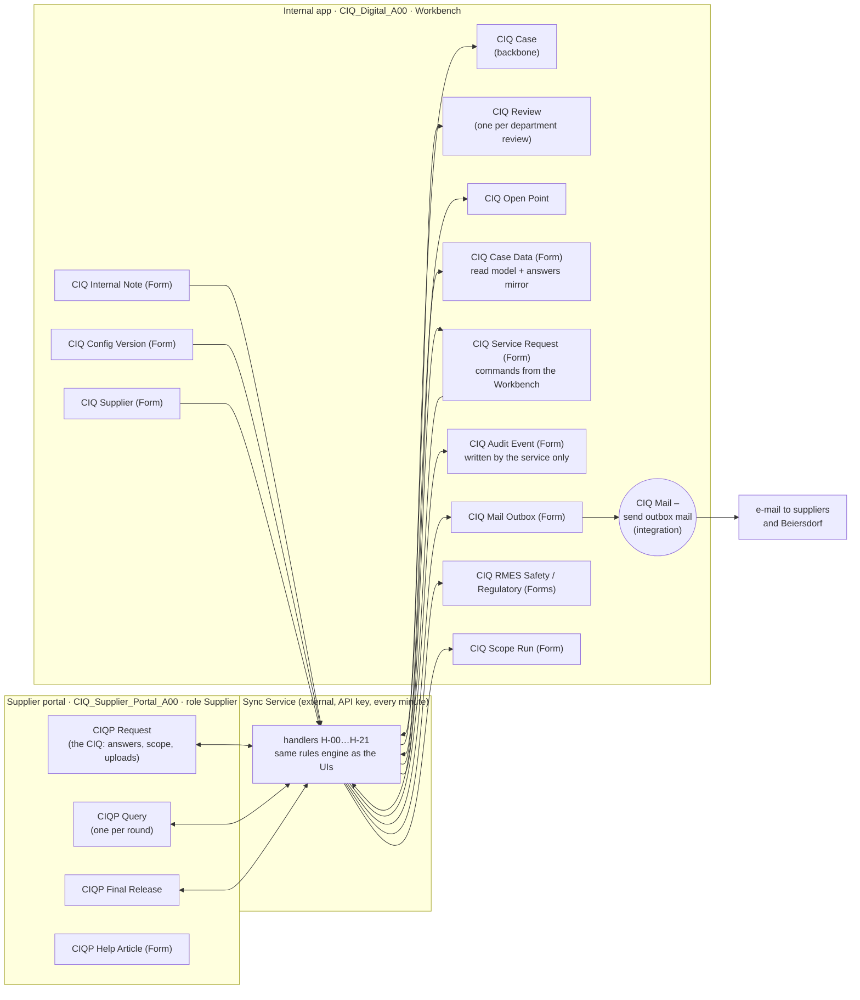

# CIQ v5: Kissflow build plan for the final app and portal

**Kissflow-internal.** Never cite this file to Beiersdorf.

**Status:** **validated by Thomas on 2026-10-14** ("all OK, go with your recommendations, start the night build"); written by the portal session. Where an item offered options, the recommendation is what was chosen. **Nothing has been written to Kissflow:** the live state was read with GET only, and the inventories are in `kissflow-build/plan-v5/`.

**What happens before anything is built:**
- Thomas validates every item in `plan-v5-for-thomas.md` (the plain-language version of this plan).
- The App Builder – CIQ Digital session reviews it.
- The agreed parts then go into the shared contract `kissflow-data-model-plan.md`.

**Ground truth:**
- The finalised prototype: `prototype/FINAL-APP-SPEC.md`, `DEMO-GUIDE.md` and its domain code. These are extracted in `kissflow-build/plan-v5/requirements.md`, cited here as **A-xx, B-xx, C-xx, D-xx, E-xx, F-xx, G-xx**.
- The client decisions of 9 and 12 Oct (`context/decisions/2026-10-09-client-call.md`).
- The live inventories `inventory-app.md` and `inventory-portal.md`.
- The fact sheet `kissflow-facts.md`.
- The app session's `STATUS-2026-10-14.md`.

**Evidence tags.** Every platform claim carries one:

| Tag | Meaning |
|---|---|
| **[proven]** | Tested live on this sandbox. The evidence is in `kissflow-facts.md`. |
| **[documented]** | Stated in master.md or the vendor metadata, or proven in another Kissflow project, but not tested here. |
| **[to test S-n]** | Not proven. Spike S-n (§14) settles it, and §14 names the fallback. |
| **[decision]** | A choice for Thomas, not a platform fact. |

---

## 0. The plan on one page

**What changes.** The 9 Oct decisions changed the shape of the work:
- the supplier fills in the whole CIQ in one task, and sections open and close live;
- RMM reviews in parallel with the departments;
- the case ends with the requirements-matrix ending (no overall approval);
- the final document is produced at the release by an external script.

The live containers still have the 7–8 Oct shape:
- per-section portal items;
- RMM scope check;
- 6 fixed parallel lanes on the case;
- overall approval;
- send-back loops.

v5 changes the live objects **in place** (same ids), adds **5 Kissflow objects** (1 process, 3 forms, 1 integration) plus the external sync service, and stops using **7 flows and 1 role**.

**Review status:** the App Builder – CIQ Digital session reviewed proposals 1–6 on 14 Oct and agreed with all of them, with conditions. Those conditions are folded in below and marked "(app review)".

| Container | Object | Kissflow type | v5 |
|---|---|---|---|
| Portal | CIQP Request | Process | **Change.** It becomes "the CIQ": one item per case that holds every supplier answer, the live scope, the uploads and the requested documents. The supplier keeps it from invitation to the end |
| Portal | CIQP Query | Process | **Keep** (+2 fields). One item per question round |
| Portal | CIQP Final Release | Process | **Keep.** The "give the final release" task, created when every review is complete and withdrawn if a review reopens |
| Portal | CIQP Help Article | Form | **Keep** |
| Portal | CIQP Section, CIQP Completeness Confirmation, CIQP Notice, CIQP Change Request, ZZ Spike Assignee | Process | **Not used.** Supplier access removed; the flows stay published (the API can't delete them) |
| App | CIQ Case | Process | **Change.** It becomes a backbone with two system-held steps: "Waiting for supplier: CIQ" and "Beiersdorf review and final release". The phase is a field. Cancel and reactivate are fields, not native ends |
| App | **CIQ Review** | Process | **New.** One item per department review (RMM included). It replaces the 6 fixed lanes, so reviews can start late, reopen and be reassigned |
| App | CIQ Open Point | Process | **Change.** It stays at the raising department's step through every round. No "waiting for supplier" step and no send-back |
| App | **CIQ Case Data** | Form | **New.** One row per case: the supplier's answers mirrored from the portal, documents, requested documents, components, change reports, track and open-point summaries, and the final document with its seal. It is what the Workbench reads |
| App | **CIQ Mail Outbox** | Form | **New.** One row per e-mail. One integration sends every row |
| App | **CIQ Service Request** | Form | **New** (app review). The Workbench's command channel to the service. A user creates a row ("raise this point", "cancel this case", "I completed my review"); the service checks who asked (the platform's `_created_by`) and whether that person may do it, then carries it out and writes the result back on the row |
| App | CIQ Supplier | Form | **Change** (+4 fields; only the Business administrator edits) |
| App | CIQ Config Version | Form | **Keep.** Rule sets, questionnaire versions and releases as data |
| App | CIQ Scope Run, CIQ RMES Safety, CIQ RMES Regulatory | Form | **Keep** |
| App | CIQ Internal Note | Form | **Change** (+2 fields for @mentions) |
| App | CIQ Audit Event | Form | **Change.** It becomes written **only by the service**; every person is a Viewer, so no Beiersdorf user can edit or delete the trail. New list values |
| App | CIQ Section, CIQ Change Request | Form / Process | **Not used** |
| App | **CIQ Mail – send outbox mail** | Integration | **New.** Dataform "item created" on CIQ Mail Outbox → send an e-mail. This is Thomas's one generic e-mail integration (R-1) |
| Both | **CIQ Sync Service** | External script (uses the API key) | **New.** It does every portal↔app hand-off, the e-mails' content and recipients, reminders, and the final PDF (AS-12). It replaces all planned X/Y cross-container integrations |

**Why a service and not native cross-container integrations.**
- The cross-container pieces are unproven:
  - the Process connector only lists its own container's processes;
  - a Text → MultiUser copy is untested;
  - an integration can't loop or copy child rows.
- The service uses only pieces we have proven: create at Start, the admin write route, withdraw, Form create/update/list, and child rows on Forms.
- Thomas approved the sync service on 7 Oct.

**What stays in the custom UIs.** These are not Kissflow objects:
- the Workbench renders the questionnaire, the rules, the review workspace and the admin editors;
- the portal UI renders the supplier's questionnaire and computes the live scope.

All three (portal UI, Workbench and service) use **the same rules engine: the prototype's domain code**. So a scope is the same everywhere by construction (B-06).

---

## 1. Rules this plan follows

### 1.1 Thomas's rules

- **R1. A Process is only for a record that moves through steps with SLAs.** Pure data goes in Forms. There are no processes without steps.
- **R2. Child tables, not extra records,** where one writer at a time can write them.
- **R3. The portal has one role, `Supplier`, for external users only.**
  - Portal processes have supplier steps only.
  - Every Beiersdorf decision is an app step.
  - Every portal item has an app twin.
- **R4. In place, never regenerate.**
  - Flow ids stay, because the Workbench, the portal UI and the inventories use them.
  - App Builder 1.0.0 can't edit after generate, so app changes go through REST grafts by the app session.
  - Never re-run `kf apply` on rev 31: it would rename the live roles back [proven].
- **R5. Each session writes only to its own container.**
  - The app session builds every app object, including the outbox and the mail integration.
  - The portal session builds the portal, the sync service and the spikes.
  - At run time the service writes data rows into both containers. That is data, not build.

### 1.2 Platform facts that shape the design

| # | Fact | Tag | Consequence in v5 |
|---|---|---|---|
| P1 | The API key can't update fields after Start (`050313`). The admin route `PUT /process/2/{acc}/admin/{proc}/{item}` writes any field of an in-progress item | [proven] app; portal [to test S-5] | The service writes in-progress items only through the admin route |
| P2 | The key can submit a step only when its user is in the step's role. Send-back over the key returns 500. Reject and withdraw work; withdraw is the initiator's action | [proven] | No design depends on send-back. The service only ends items it started (withdraw) and its own system-held steps |
| P3 | There is no write locking. Two writes within ~0.1 s lose one, even on different fields | [proven] | Separate writers is not enough (app review). **Every writer (the Workbench, the portal UI and the service) reads back after each write and re-applies, up to 3 times.** The service skips an item whose holder wrote in the last ~2 s and retries on its next run |
| P4 | `getParticipatedItems` fails platform-wide. People list only items they started and their open tasks. `getItem` needs the activity instance id | [proven] / [documented] | Workbench read model = a Form (CIQ Case Data) that Viewers can list. The supplier keeps the request item at a step (§3.1) so it never disappears |
| P5 | The REST process list is `/myitems` only. Forms can be listed (`POST /form/2/{acc}/{form}/list`) | [documented]; Form reads [proven] by the inventories | The service finds work through Form rows (Audit Event, Case Data) and the item ids it stored itself. It never needs to list processes it didn't start |
| P6 | An integration has 1 trigger + actions, no field-change trigger, no child rows, no lookups, and is switched on by hand. It runs once with sample data when switched on | [proven] | Exactly one integration: the mail outbox. The rows already carry the recipient, subject and body |
| P7 | Field-level Required at Start is enforced. Step Mandatory is not enforced on key submits | [proven] | The UIs enforce the gates. Required-at-Start protects the hand-off data |
| P8 | A Textarea round-trips 122 KB exactly | [proven] | JSON payloads (answers, configuration bundle) live in Textareas |
| P9 | A Form create replaces child-row ids, and a modify with an unknown row id adds a duplicate | [proven] | Every child row carries its own Text key. Re-read rows, then write by server id |
| P10 | Parallel branches are fixed at design time. Nothing moves backwards after a join | [proven] | Department reviews are their own items (CIQ Review), not lanes |
| P11 | A step can be assigned from a MultiUser field (`Resource{ValueType:"Field"}`) | [proven] portal | Every supplier step is assigned from `Assigned_Contacts` |
| P12 | A published process accepts grafts: add fields, change steps, re-PUT the workflow. Fields can't be deleted. **A field grafted onto a published process has no per-step permissions, so it can't be written at any step, even Start, until each activity has a permission naming it** | [proven] / [documented] (master §3.3) | Obsolete fields stay, set Hidden at every step so native forms stay clean. New process fields are added with the old engine's `add-field` verb, which adds the per-step permissions, or inside the graft. **Every new field is set explicitly on every step:** Editable/Mandatory where the step tables say so, ReadOnly or Hidden everywhere else (app review) |
| P13 | A no-pages app's tasks don't show in the Kissflow home queue | [proven] | The Workbench is the only task surface for Beiersdorf users |
| P14 | In this sandbox Thomas is every user (a member of every role, and the key user) | [proven] | Per-user rules (isolation, step ownership) are not proven until test users exist (S-7) |
| P16 | **A Form list row carries `_id` and the business fields only.** `_created_by`, `_modified_by`, `_created_at` and `_modified_at` come with the per-row GET | **[proven] 15 Oct** (live sync smoke) | The service reads every waiting Service Request and every new note in full before it checks who wrote it |
| P17 | **REST rejects DateTimes with milliseconds** (400 `KISSFLOW_ERROR_01020` "The date/time … is invalid"), as the SDK does | **[proven] 15 Oct** (live sync smoke) | Every writer sends `…:ssZ`. The service normalises every write body |
| P15 | The old engine's patch verbs can add and change steps but can't remove them (app review). Removing a step is a hand-made graft (getDraft → drop the activity and its permission/resource/expression entities and refs → putDraft → publish). Removing a whole parallel block has never been tried | [proven] verbs list; block removal [to test S-12] | Rehearse on the test flow CIQ ZZ Spike Case (it has a 6-branch block) before touching CIQ Case. Before each graft, list the live items on a step being removed |

---

## 2. The big picture

**How work moves:**
- **People act in the UIs.**
  - The supplier works in the portal UI on the items they hold.
  - Beiersdorf users work in the Workbench on the items they hold (their review, their open point), and write Form rows (notes, RMES, configuration, suppliers).
  - For everything else, and to record what they did, they create a **CIQ Service Request** row.
- **The service is the only bridge, and the only writer of the audit trail.** Every minute it:
  1. reads new Service Request rows and new notes, and the portal items whose ids it stored;
  2. checks each request;
  3. applies the effects in either container;
  4. writes the audit events and the outbox rows for the e-mails.
- **Expected delay:** a supplier action is visible in the Workbench within about 1 minute, and a mail arrives about 6 s after its outbox row [proven latency for integrations].

---

## 3. Portal objects (built by the portal session)

### 3.1 CIQP Request `CIQP_Request_A00` (Process): CHANGE, it becomes "the CIQ"

**Why one item per case and not one item per section.** Since 9 Oct (D-1):
- the supplier fills in the whole CIQ in one task;
- sections open and close live as metadata answers change (B-07);
- the questionnaire stays editable until the final release is requested (B-30; locked from then on, Thomas 15 Oct, see the note at the end of §3.1).

Per-section items would have to be created and withdrawn live, many times per case. One item carries everything, and the supplier holds a step on it from invitation onwards.

**Keep all 16 fields:** `Request_Key`, `Case_Code`, `Cycle_No`, `Supplier_Code`, `App_Case_Item_Id`, `Trade_Name`, `Main_INCI`, `BDF_Material_No`, `Supplier_Display_Name`, `BDF_Contact_Name`, `BDF_Contact_Email`, `Markets_Label`, `Template_Label`, `Supplier_Due_Date`, `Case_Contacts_JSON`, `Assigned_Contacts`.

**Add these header fields:**

| Field id | Type | Written by | Holds |
|---|---|---|---|
| `Rule_Set_Version` | Text | service, at Start | the pinned rule set, e.g. RS-2026.2 |
| `Template_Version` | Text | service, at Start | the pinned questionnaire version, e.g. v2 |
| `Config_Bundle_JSON` | Textarea | service, at Start | the case's rules + questionnaire version: sections, fields, options, help texts, settings (incl. the origins without rules). Copied from the Release row. **Supplier-safe:** no internal notes or rule bases (§11.3) |
| `Config_Bundle_Hash` | Text | service, at Start | the hash of that bundle |
| `BDF_Set_JSON` | Textarea | service | the values Beiersdorf sets, shown locked: GEN-001 trade name, GEN-002 supplier, GEN-003 DUNS, GEN-008/009 contact e-mails, SF-11 target markets (B-05). Kept out of `Answers_JSON` so the service never writes the supplier's answers |
| `Config_Answers_JSON` | Textarea | supplier (service: set back after a refused save, see the note below) | SF-01…SF-12 (except SF-11) |
| `Answers_JSON` | Textarea | supplier (service: set back after a refused save) | answers keyed by field id (A-05) |
| `Answered_By_JSON` | Textarea | supplier (service: set back after a refused save) | per key: name, e-mail and time (REQ-CTL-001) |
| `Justifications_JSON` | Textarea | supplier (service: set back after a refused save) | per field, section (K5.1 waiver) or requested-document key |
| `Components_JSON` | Textarea | supplier (service: set back after a refused save) | K2.1 rows, each with its own row id (A-06) |
| `Scope_JSON` | Textarea | supplier UI (engine) | per section: applicability, supplier reason, added later. **No rule ids** (D-10); the service recomputes the internal detail |
| `Manual_Scope_JSON` | Textarea | service | sections a department added (B-29). They are never lowered |
| `Requested_Docs_JSON` | Textarea | supplier UI (engine) | requested-document slots: key `EV:…`, document name, section, the supplier's wording, added later (A-08) |
| `Answers_Rev` | Number | supplier | +1 per save; the service's change signal |
| `Answers_Changed_At` | DateTime | supplier | |
| `Answers_Changed_By_Email` | Text | supplier | |
| `Editing_By`, `Editing_Since` | Text, DateTime | supplier | presence hint when two contacts work at the same time (B-12) |
| `Completeness_Confirm` | Select (CIQP Confirm) | supplier | the PS-05 declaration (B-10) |
| `Completeness_By_Name`, `Completeness_By_Email`, `Completeness_By_Role`, `Completeness_At` | Text, Email, Text, DateTime | supplier | who confirmed, and when |
| `Case_Phase_Label` | Text | service | supplier wording: Filling in · With Beiersdorf · Awaiting your final release · Completed · Cancelled |
| `Request_Locked` | Select (CIQP Yes No) | service | Yes while the supplier may change nothing: from the release request (H-08, label "Awaiting your final release") until it is withdrawn (H-10) or the case is reactivated into review (H-13), and for good once the case is completed or cancelled (H-11, H-12). Thomas, 15 Oct; before that: "Yes once the case is completed or cancelled" |
| `Questions_History_JSON` | Textarea | service | every open point's supplier-visible thread (A-11), kept after its queries end (P4) |
| `Release_By_Name`, `Release_At` | Text, DateTime | service | a copy of the final release, for the completed view |
| `Change_Report_Text` | Textarea | supplier | "Report a change" (B-36) |
| `Change_Report_Rev` | Number | supplier | +1 per report |
| `Change_Report_By_Email`, `Change_Report_At` | Text, DateTime | supplier | who reported and when (as built 14 Oct). The UI allows the next report only after the previous one has its receipt in `Change_Reports_JSON`, so a quick second report never overwrites the first |
| `Change_Reports_JSON` | Textarea | service | the receipts: CR number, date, text |
| `Keep_Open_Gate` | Text formula `""` | — | Mandatory at the second supplier step, so a native "Submit" can't end the item by mistake. Native enforcement is [documented] |

**Add child table `CIQP_Request_A00_Uploads`** (as built 14 Oct; model "CIQP Request Uploads"). One row per uploaded file: answers, requested documents and files sent with a question answer (A-07). Columns:
- `Upload_Id` (own key)
- `Upload_Section_Key`
- `Upload_Field_Key` (a field id or `EV:…`)
- `Upload_Row_Id` (K2.1 row)
- `Upload_Doc_Kind` (CIQP Doc Kind)
- `Upload_File` (Attachment)
- `Upload_File_Name`
- `Uploaded_By_Email`
- `Uploaded_At`

This is Thomas's "child table with the field name and the attachments".

**Where the files themselves live (as built 14 Oct, after spike S-2):**
- Every file sits in one header Attachment field, **`Supplier_Files`**. One Attachment field keeps every upload side by side: an upload adds, never replaces [proven S-2c].
- Each child row points at its file through **`Upload_Attachment_Id`** (the `Attach-…` id). The child column `Upload_File` is not used.
- The service downloads and attaches files on header fields by API key [proven S-2b/S-2d]. Child-table attachment cells are unproven.
- The supplier's own upload through the custom UI is [to test S-1].

**Steps** (re-PUT; the workflow stays Sequence):

| Step | Activity | Assignee | Editable | Mandatory | SLA |
|---|---|---|---|---|---|
| Issue request (Start) | `Activity_1fvwo2u` (keep) | — (service) | every header field | (field Required at Start: the 9 existing Required fields) | — |
| **Supplier: fill in the CIQ** (rename of "Supplier: submit basic data") | `Activity_15rz7z2` (as built; the rename gave a new id) | Field `Assigned_Contacts` [proven] | the supplier fields above, `CIQP_Request_A00_Uploads`, `Editing_*`, `Completeness_*` | `Completeness_Confirm`, `Completeness_By_Name`, `Completeness_By_Email`, `Completeness_At` | supplier due date (BDF value) |
| **Supplier: keep the CIQ up to date** (new) | `Activity_1mhx3t7` (as built) | Field `Assigned_Contacts` | the supplier fields, `CIQP_Request_A00_Uploads`, `Editing_*`, `Change_Report_Text`, `Change_Report_Rev` | `Keep_Open_Gate` (never satisfied, so this step is never submitted) | none |
| End | `Activity_gafhuz` (keep) | — | — | — | — |

The service fields are ReadOnly at both supplier steps; the service writes them through the admin route.

**What each step means to the supplier:**
- **Submitting "fill in the CIQ"** is the completeness confirmation (B-10). The portal UI allows it only with zero blockers (B-09) and for a contact who may confirm (B-11). That rule lives in the UI only: the server can't tell contacts apart within the step.
- **"Keep the CIQ up to date"** is held through Part 2 and after:
  - in review the questionnaire stays editable (B-30);
  - while the final release is requested the UI shows the request read-only (`Request_Locked` with the label "Awaiting your final release"); the release itself is given on the CIQP Final Release task (Thomas, 15 Oct);
  - after the release or a cancellation the UI shows the request read-only (`Request_Locked`), with "Report a change" on a completed case.

  So the supplier keeps seeing closed requests, which Participated (P4) would otherwise hide.

  If someone edits answers after the lock, the service ignores the change and logs "Change attempt refused" (B-35).

**[decision] Trade-off of the keep-open step.** Kissflow counts the item as "in progress" forever. A cancelled case also keeps the supplier's (locked) task, so reactivation can continue it (B-32). The alternative is to end the item at release or cancellation; then the supplier loses sight of it, cannot report a change from the portal, and a reactivated case needs a new item.

**Note, Thomas 15 Oct (before the client call): the questionnaire locks at the final-release step.** Once the release is requested the supplier can change nothing (answers, metadata, K2.1 rows, justifications, uploads, requested-document justifications); giving the release stays possible. So `Request_Locked` now means "the service takes no supplier change", not "closed":
- the service writes `Request_Locked` = "Yes" with `Case_Phase_Label` "Awaiting your final release" in the same pass that creates the CIQP Final Release (H-08), "No" when it withdraws it (H-10, a reopened review: back to review) or reactivates the case into review (H-13), and keeps "Yes" on completed and cancelled cases (a case reactivated into final-release is locked again);
- the portal UI refuses every write on a locked request (or one labelled "Awaiting your final release") before writing, shows the questionnaire read-only with "Your questionnaire is locked because Beiersdorf has requested your final release. If something must change, contact Beiersdorf; they can reopen the review.", and still offers the release on its own task; it tells "locked for the release" from "closed" by the label (an open release task wins over the lock);
- a save that still reaches the locked request (an older page, or one in flight when the lock landed) is refused by the service and audited "Change attempt refused", nothing is mirrored (as after the release, B-35). **Amended 15 Oct (review findings):** the service also sets the request's supplier JSON (`Config_Answers_JSON`, `Answers_JSON`, `Justifications_JSON`, `Components_JSON` and the stamps in `Answered_By_JSON`) back to the case in the same pass, and marks the save's Uploads rows as handled (ledger `uploadsRefused`). So the locked page never shows a refused value as saved, and a later save after a reopen never mirrors it. An Uploads row that reached the locked request without its save signal (the portal's lock refused the upload notice) is logged "Change attempt refused" and marked when the request unlocks (H-10, H-13). Open: such a row stays visible in the portal's document list, because the admin route cannot remove child rows (unproven); it is never taken over;
- **amended 15 Oct (review findings), order of events:** a supplier save the service has not mirrored yet goes before a Workbench action that locks or unlocks the questionnaire: before a review completion (H-08, request or poll), before a reopen of a locked case (H-09/H-10) and before a reactivation (H-13). A save the portal took while the questionnaire was open is therefore never refused by the lock that the last completion sets, and a save that reached the locked request is refused before the reopen unlocks it. A completion is dated by the CIQ Review item's own `Completed_At`: a supplier change after that moment in a section the department owns reopens the review at once (completeReview `completedAt`; a new CIQ Review item "Reopened", C-02), also when the poll picks the completion up after the save, and the release request is then not sent;
- the same day's second rule: in review, a supplier change in a section whose lead or co-reviewing department has completed reopens that review (H-02 → H-09, see §8.2).
- this changes the walk-through (§12) at step 6: the late origin change needs a reviewer's reopen first (the release task is withdrawn and the request unlocked then, H-10); the change itself then reopens Safety (H-07) and, through the section owners, any other completed review of the sections it touches. The sync e2e test follows this order.

**JSON shapes** (as built 14–15 Oct; the portal UI and the sync service both use these, and `kissflow-build/sync/README.md` has the detail):

| Field | Shape |
|---|---|
| `Config_Bundle_JSON` | `{format:"ciq-bundle/1", release:{key,label,ruleSetVersion,templateVersion,manifestHash}, ruleSet:{version, rules: RuleData[] without basis/note}, template: TemplateData, settings:{undefinedOrigins}}`. `Config_Bundle_Hash` is the SHA-256 of the canonical JSON |
| `Answers_JSON` | `{ "<field id>": value }`, with the K2.1 rows under `"K2.1:components"` in `Components_JSON` |
| `Answered_By_JSON` | `{ "<key>": {by, name, email, at} }` |
| `Scope_JSON` | `[{sectionId, applicability, reason, addedLater}]`: supplier wording, no rule ids or SF codes |
| `Requested_Docs_JSON` | `[{key:"EV:…", doc, sectionId, why, addedLater}]` |
| `Case_Contacts_JSON` | `[{id (portal user id), name, email, title, mayConfirm}]` |
| `Questions_History_JSON` | `[{opId, kind, ref, sectionId, fieldId, rowId, question, justification, dueDate, status (supplier wording), statusCode (open · answered · accepted · not-accepted · closed · withdrawn-with-case), rounds, thread[], edits[]}]` |
| CIQP Query `Response_Doc_Refs_JSON` | `[{uploadId, attachmentId, fileName, sectionKey, fieldKey}]` |

### 3.2 CIQP Query `CIQP_Query_A00` (Process): KEEP

- **Use:** one item per round of an open point.
- **Lifecycle:**
  - the service creates it and submits Start;
  - the supplier answers at "Supplier: respond" (`Activity_qohzey`), choosing Answer, Document or Cannot provide;
  - the service withdraws it if Beiersdorf closes the point while it is open.
- **Add 2 fields:** `Edited_At` (DateTime) and `Edit_Note` (Text), both written by the service. They drive the "Changed by Beiersdorf" badge when the raiser edits an open question (B-17).
- **Documents sent with an answer** are uploaded to the request's `CIQP_Request_A00_Uploads` (at the question). The query points to them through `Response_Doc_Refs_JSON` (B-15).

### 3.3 CIQP Final Release `CIQP_Final_Release_A00` (Process): KEEP

- **Creation:** the service creates it when the last review completes (B-24). `Assigned_Contacts` is set from the contacts who may confirm, so the platform itself limits who gets the task (B-11). `Declaration_Text` is the fixed release text (A-15).
- **The supplier:** releases at "Supplier: release" (`Activity_1gx3sjo`). The UI first checks the release blockers (B-33).
- **Withdrawal:** the service withdraws it when a review reopens or a late section sends the case back to review (B-25, B-27, B-28). Withdraw by the initiator is [proven] in the app; on a portal item it is [to test S-5].
- **SLA:** rem-5 (3 days) as the native SLA (BDF value).
- **No field changes.**

### 3.4 CIQP Help Article `CIQP_Help_Article_A00` (Form): KEEP

- The Help page content (E-29). Suppliers are Viewer [proven].
- Its 5 rows are rewritten for the new flow (one task, live sections, the e-mails a supplier gets). This is a data write by the portal session.

### 3.5 Not used any more (portal)

| Flow | Why | Action |
|---|---|---|
| CIQP Section | Answers live on CIQP Request (§3.1) | Remove the Supplier grant. Leave it published |
| CIQP Completeness Confirmation | Completeness = submitting "fill in the CIQ" | Remove the Supplier grant |
| CIQP Notice | Notices to suppliers go by e-mail (C-12, C-15) | Remove the Supplier grant |
| CIQP Change Request | "Report a change" is written on the request (§3.1) | Remove the Supplier grant (it is the only one with InitiateItems) |
| ZZ Spike Assignee | Throwaway probe, 8 stale items | Delete the 8 items (admin DELETE), keep the flow (no grants) |

Archiving these flows in the builder later is Thomas's choice. The plan never needs them.

### 3.6 Portal lists

No changes:
- **CIQP Doc Kind:** matches A-07.
- **CIQP Response Kind:** Answer, Document and Cannot provide are used; "Additional part completed" stays for additional-part points.
- **CIQP Confirm:** used.
- **CIQP Yes No:** used.
- **CIQP Change Kind:** no longer used.

### 3.7 Portal roles and grants

| Flow | Supplier `RoEK4XPKXCvH` | Admin `RoEK3_yhR4wx` | User `RoEK3_ymADTV` |
|---|---|---|---|
| CIQP Request | Member `[]`: acts on assigned steps, cannot start items. Whether `[]` stops starting is [to test S-7] | unchanged | none |
| CIQP Query | Member `[]` | unchanged | none |
| CIQP Final Release | Member `[]` | unchanged | none |
| CIQP Help Article | Viewer | unchanged | none |
| The 5 unused flows | **none** (removed) | unchanged | none |

**Members:**
- **Supplier:** only external supplier users, managed by Thomas. Thomas is a member today (dev); he leaves before the user tests [decision].
- **Admin** is empty and stays empty. The service uses the account key, not a portal role.

---

## 4. App objects (built by the App Builder – CIQ Digital session, through REST grafts)

### 4.1 CIQ Case `CIQ_Case_A00` (Process): CHANGE, it becomes the backbone

**The new shape:**
- The case is the record of one CIQ case cycle, from RMM's start to the completed final document.
- People do their work on CIQ Review and CIQ Open Point.
- The case itself waits in two system-held steps.
- The phase is a field, so the phase changes that Kissflow can't model are plain field writes:
  - review ⇄ awaiting final release (B-25, B-27);
  - cancel and reactivate (B-31, B-32).

**Steps** (re-PUT):

| Step | Activity | Owner | Condition | Fields | SLA |
|---|---|---|---|---|---|
| Create case (Start) | `Activity_p1i6xz` (keep) | RMM, in the Workbench | — | **Mandatory:** `Case_Code`, `Cycle_No`, `Trade_Name`, `Main_INCI`, `BDF_Material_No`, `Supplier_Code`, `Supplier_Legal_Name`, `Owner_RMM`, `BDF_Contact_Name`, `BDF_Contact_Email`, `Supplier_Due_Date`, `Case_Contacts_JSON`, `Portal_Contact_Ids`, `Confirm_Contact_Ids`, `Supplier_Contact_Emails`, `Target_Markets_Text`, `Release_Item_Id`, `Release_Key`, `Manifest_Hash`, `Rule_Set_Version`, `Template_Version`. **Editable:** `Case_Title`, `Priority`, `Duplicate_Reason`, `Follow_Up_Of_Case`, `Follow_Up_Of_Report`, `SAP_Material_No`, `IRMA_Ref`, `Case_Test`, `Markets_Label`, `Template_Label`, `Release_Manifest_JSON`. `Request_Key` and `Overall_Approval_Required` are no longer Mandatory | — |
| **Waiting for supplier: CIQ** (rename of "Waiting for supplier: basic data") | `Activity_1kltjdn` (keep) | role **Integration service** (was CIQ RMM) | — | all ReadOnly (the service writes through the admin route) | **none native** (amended 15 Oct): no SLA metadata shape is proven, BDF's durations are unset, and a native reminder would go to the service user anyway. Supplier reminders and escalations come only from the service (V-35, H-19) |
| **Beiersdorf review and final release** (rename of "Waiting for supplier: final release PS-11") | `Activity_gwgj5o` (keep) | role **Integration service** | **none** (was `Overall_Decision != "Rejected"`) | all ReadOnly | none on the case; the SLAs are on the reviews and the release |
| End | `Activity_ycf01a` (keep) | — | — | — | — |

**Removed steps** (D-1, D-3; STATUS §2.1):
- `Activity_1feompb` Scope check
- `Activity_1a281c6` Waiting for supplier: completeness PS-05
- `Activity_on1xvu` Part 2 parallel block, with its lanes `Activity_xnbq22`, `Activity_1armoq0`, `Activity_1kxceje`, `Activity_1252uy3`, `Activity_h505sh` and `Activity_vrfxbc`
- `Activity_1lo09cp` Open items check before release
- `Activity_dullxt` Overall approval
- `Activity_luckcl` Open items check before close

**The case number** (app review): `Case_Code` (CIQ-2026-NNNN) is Mandatory at Start. The Workbench:
1. creates the item;
2. writes `Case_Code` with updateItem, still at Start;
3. submits.

Writing at Start is [proven] for the key. For a real user it is part of S-1.

**Who submits what:**
- RMM submits Start.
- The service submits "Waiting for supplier: CIQ" after the supplier's completeness confirmation, then "Beiersdorf review and final release" after the final release and the final document.
- The key can submit a step whose role contains its user [proven].

**Conditions from the app review:**
- Every list, report and dashboard filters on `Case_Phase`, never on Kissflow's own item status: a cancelled case is still "in progress" for Kissflow.
- In dev the key user is Thomas, so the two service-held steps sit in his own queue.
  - [decision] Use a separate dev service user so demos stay clean.
- Native SLA reminders on these two steps would go to the service user, not to the supplier or RMM. Supplier reminders and escalations therefore come from the service through the outbox (H-19).
  - [decision] This departs from Thomas's rule "a Process because its steps' SLAs notify".

**Add fields:**

| Field id | Type | Written by | Holds |
|---|---|---|---|
| `Template_Version` | Text | RMM at Start (Workbench) | the questionnaire version pinned next to `Rule_Set_Version` (B-50) |
| `Case_Phase` | Select (CIQ Case Phase) | service | A-02 |
| `Priority` | Select (CIQ Priority) | RMM at Start | normal/high (A-01) |
| `Duplicate_Reason` | Textarea | RMM at Start | B-02 |
| `Follow_Up_Of_Case`, `Follow_Up_Of_Report` | Text | RMM at Start | B-03 |
| `Cancel_Reason`, `Cancelled_By_Name`, `Cancelled_At`, `Cancelled_From_Phase` | Textarea, Text, DateTime, Text | service | B-31 |
| `Reactivate_Reason`, `Reactivated_At` | Textarea, DateTime | service | B-32 |
| `Release_Requested_At`, `Portal_Release_Item_Id` | DateTime, Text | service | B-24 |
| `Final_Document_Hash`, `Final_Document_At` | Text, DateTime | service | A-20, the "document seal" |
| `Undefined_Origin` | Select (CIQ Yes No) | service | B-52 |
| `Case_Data_Item_Id` | Text | service | the link to its CIQ Case Data row |
| `Supplier_Files` | Attachment | service (attach route) | a copy of every supplier file from the portal, so reviewers can open them on the case. ReadOnly at every step [proven route S-2] |

**Fields that stay in use:**
- the existing identity, material, supplier, contacts and pinning fields;
- `Portal_Request_Item_Id`, `Request_Key`;
- `Completeness_Confirm/By_Name/By_Email/By_Role/At` and `Final_Release_Confirm/By_Name/By_Email/By_Role/At` (copies of the supplier's confirmations, written by the service);
- `RMES_Key`, `RMES_Created_At`, `Completion_Trigger`, `Final_PDF`, `Origin_Types` (SF-01 mirror for search).

**Fields no longer used** (about 70; they can't be deleted, so they become Hidden at every step):
- `Basic_Data_Received`;
- the 6 `Dept_*_Active`;
- `Initial_Scope_Run_Key`;
- the completeness/final-release request, text and due-date keys;
- `Released_Revs_JSON`, `Evidence_List_Text`;
- the 6 lanes (`*_Review_Confirm`, `*_Completed_*`, `*_On_Behalf_Of`, `*_RMES_Decision*`);
- the open counts, gaps, gates and holds;
- `Late_Completions_Text`;
- `Overall_*`, `Overall_Approval_Required`;
- `Reactivates_Case_Item`, `Supplier_Closing_Text`.

**Cancel and reactivate** (B-31, B-32):
- Cancel is **not** a native reject or withdraw, because those are terminal and the case could not continue [proven].
- The service sets `Case_Phase = Cancelled` and the cancel fields; the item stays at its step.
- Reactivating within 365 days sets the phase back from `Cancelled_From_Phase`.
- [decision] Whether a case cancelled for more than 12 months is withdrawn natively (housekeeping) is left open; nothing depends on it.

### 4.2 CIQ Review (Process): NEW

**Why.** The prototype's review track (A-09) needs things the 6 fixed lanes can't do:
- start for only the departments in scope (B-10);
- join late (B-27);
- reopen after completion (B-25);
- be reassigned (B-26);
- be waited on by the release request.

After a lane is submitted or the join is passed, Kissflow can't go back (P10). One item per activation does all of this with native steps and SLAs, and "My reviews" becomes the reviewer's task list.

**Who starts it:** always the service:
- at completeness, for RMM and the lead department of every in-scope section;
- later for late activation, a reopen or a reactivation.

**Fields:**

| Field id | Type | Req | Holds |
|---|---|---|---|
| `Review_Key` | Text | field Required | `<Case_Code>-<Dept>-<Round_No>`, e.g. CIQ-2026-0001-SAF-2 |
| `Case_Code` | Text | field Required | |
| `Cycle_No` | Number | | |
| `Case_Item_Id` | Text | field Required | |
| `Supplier_Code`, `Trade_Name` | Text | | for lists |
| `Review_Dept` | Select (CIQ Review Dept: REG, SAF, QM, MIC, SUS, RMM) | field Required | decides the step |
| `Round_No` | Number | | 1, then +1 per reopen or late activation |
| `Activation_Kind` | Text | | Completeness · Added later · Reopened · Reactivated |
| `Activation_Reason`, `Activated_By_Name` | Textarea, Text | | the reopen reason (B-25), the late-activation reason |
| `Assignee_User`, `Assignee_Name`, `Assignee_Email` | User, Text, Email | | the default holder, reassignable (F-08) |
| `Reassign_Reason` | Textarea | | B-26 |
| `Track_Status` | Select (CIQ Track Status) | | In review · Waiting for supplier · Reopened · Completed · Ended (B-13) |
| `Open_Count`, `RMES_Gaps` | Number | | the track's unresolved own points; for SAF/REG, also criteria without a result plus open findings (B-24). Written by the service |
| `Review_Gate` | Text formula: `IF(OR(ISBLANK(Open_Count),ISBLANK(RMES_Gaps)),"",IF(Open_Count+RMES_Gaps=0,"OK",""))` | | blank-safe [proven pattern] |
| `Review_Confirm` | Select (CIQ Confirm) | | |
| `Completed_By`, `Completed_By_Name`, `Completed_By_Email`, `Completed_At` | User, Text, Email, DateTime | | the department's completion confirmation (A-15) |
| `RMES_Decision`, `RMES_Decision_Reason` | Select (CIQ Decision), Textarea | | SAF/REG only (B-22) |
| `Rejection_Handling`, `Rejection_Note`, `Rejected_Depts_Covered` | Select (CIQ Rejection Handling), Textarea, Text | | RMM only (B-24, G-09) |
| `On_Behalf_Of` | Text | | |

**Steps:**

| Step | Owner | Condition | Editable | Mandatory | SLA |
|---|---|---|---|---|---|
| Activate review (Start) | service | — | all | (field Required) | — |
| Review – Regulatory | Regulatory Affairs reviewer | `Review_Dept = "REG"` | `Assignee_*`, `Reassign_Reason`, `Review_Confirm`, `Completed_*`, `RMES_Decision`, `RMES_Decision_Reason`, `On_Behalf_Of` | `Review_Confirm`, `Completed_By`, `Completed_At`, `RMES_Decision`, `Review_Gate` | review time (rem-3: 5 d) |
| Review – Safety | Product Safety reviewer | `Review_Dept = "SAF"` | as REG | as REG | as REG |
| Review – QM | Quality Management reviewer | `Review_Dept = "QM"` | without `RMES_*` | without `RMES_Decision` | as REG |
| Review – Microbiology | Microbiology reviewer | `Review_Dept = "MIC"` | as QM | as QM | as REG |
| Review – Sustainability | Sustainability reviewer | `Review_Dept = "SUS"` | as QM | as QM | as REG |
| Review – RMM | Raw Material Manager (RMM) | `Review_Dept = "RMM"` | as QM, plus `Rejection_*` and `Rejected_Depts_Covered` (the "RMM only" group above; made explicit 15 Oct) | as QM | as REG |
| End | — | — | — | — | — |

Conditional single-step routing is the same proven pattern as CIQ Open Point [proven].

**Completing a review:**
- The reviewer completes it in the Workbench by writing their own step fields and submitting.
- This needs a real user's SDK write after Start (S-1). The key itself is refused (`050313`). If S-1 fails, the fallbacks are the native task form, or a Service Request that the service applies through the admin route, followed by the reviewer's submit.

**Who gets the task** [decision]:
- **(a) Role** (recommended to start; proven): every member of the department gets the task. The Workbench shows "My reviews" by `Assignee_User`, and reassigning only changes that field. This matches D-06: track actions are open to members of the track's department.
  - **Consequence** (app review): Kissflow's own task notifications and SLA reminders go to **every** member of the role. For "Review – RMM" that is every RMM, not just the case owner. `Assignee_User` only filters the Workbench.
- **(b) Field** (app review's preference): assign each step from a MultiUser `Assignee_Users`, so only the assignee gets the task (for RMM: the case owner). It needs:
  - S-11: field assignment inside the app, proven so far only in the portal;
  - S-5: whether changing the field mid-step moves the task, otherwise a reassign means withdrawing and re-creating the item.

**Why extra records here** (rule R2, app review): the 6 lanes on the case could hold the reviews without extra records. But a lane can't be reopened once it is submitted or the join has passed (P10), and a department can't join late. One record per activation is the only native way.

### 4.3 CIQ Open Point `CIQ_Open_Point_A00` (Process): CHANGE

**The new shape:**
- A point stays at its department's step from raising to closing.
- Rounds, returns and edits are field changes plus a new portal query, so no send-back (P2) and no "waiting for supplier" step are needed.
- Status: Open (with the supplier) / In progress (answered, with Beiersdorf), in `OP_Progress`.
- Closed means the item completed, with `OP_Outcome`.

**Who starts it:** always the service, on the Workbench's request (a CIQ Service Request row `op.raise`). The service is then the initiator and can withdraw the point when the case is cancelled (B-31). Withdraw is the initiator's action [proven].
- Points the system raises (B-28, B-29) use the same path.
- The raiser is recorded in `Raised_By_User`.
- [decision] The cost: a raised question reaches the supplier about one minute later than in the prototype.

**Steps** (re-PUT):

| Step | Activity | Owner | Condition | Editable | Mandatory |
|---|---|---|---|---|---|
| Raise open point (Start) | `Activity_18t0lhi` (keep) | service | — | all | `OP_Key`, `Round_No`, `Case_Code`, `Cycle_No`, `Supplier_Code`, `Case_Item_Id`, `OP_Kind`, `OP_Dept`, `Raised_By_Dept`, `Raised_By_User`, `Ref_Kind`, `Ref_Label`, `Question_Text`, `Supplier_Justification`, `Responsible_User`, `Supplier_Due_Date`. `Internal_Justification`, `Internal_Due_Date` and `Start_Gate` are no longer Mandatory |
| **Open point – Regulatory** (rename of "Review – Regulatory") | `Activity_uka3mx` (keep) | Regulatory Affairs reviewer | `OP_Dept = "REG"` | `Question_Text`, `Supplier_Justification`, `Supplier_Due_Date`, `Responsible_User`, `Responsible_Name`, `Round_No`, `Query_Key`, `Kind_Label`, `OP_Progress`, `OP_Outcome`, `Outcome_Reason`, `Return_Reason`, `Thread_JSON`, `Closed_At`, `Closed_By` | `OP_Outcome` (at submit) |
| Open point – Safety | `Activity_1kdump3` | Product Safety reviewer | `OP_Dept = "SAF"` | as REG | as REG |
| Open point – QM | `Activity_1go37bt` | Quality Management reviewer | `OP_Dept = "QM"` | as REG | as REG |
| Open point – Microbiology | `Activity_hha7u2` | Microbiology reviewer | `OP_Dept = "MIC"` | as REG | as REG |
| Open point – Sustainability | `Activity_y4af4g` | Sustainability reviewer | `OP_Dept = "SUS"` | as REG | as REG |
| Open point – RMM | `Activity_xc8fbb` | Raw Material Manager (RMM) | `OP_Dept = "RMM"` | as REG | as REG |
| End | `Activity_i73i25` (keep) | — | — | — | — |

**Removed:** `Activity_4k7uck` "Waiting for supplier". Before removing it, the app session lists the items sitting there; only test items are expected. The `IsSendbackEnabled` switch on the 6 steps is no longer needed and can stay.

**Who gets the step** [decision] (app review):
- **(a) Role:** the raising department's role. Raiser-only (D-05, AS-08) is then enforced by the Workbench and re-checked by the service on every request.
- **(b) Field** (recommended if S-11 passes; **chosen: S-11 proven 15 Oct**): a MultiUser `Raiser_Assignee` holding the raiser, so Kissflow itself stops anyone else accepting or closing. The service fills it at Start; it retries without it until the field is live. A system-raised point holds its responsible person. When a track is reassigned, the system points follow (B-26), which depends on the mid-step rerouting test in S-5.

**Add fields:**
- `Raised_By_User` (User), `Raised_By_Name` (Text): the raiser. Only the raiser accepts, returns, edits or closes (D-05). The Workbench enforces this, because Kissflow permissions are per role, not per person.
- `Thread_JSON` (Textarea): every thread entry (A-11) and edit (A-12): raised · answered · returned · accepted · cannot provide · note · edited · withdrawn. It is the source for the open-points tab, the supplier history and the final PDF (R-2).
- `Closed_At` (DateTime), `Closed_By` (User).

**Fields that stay in use:**
- `OP_Key`, `Round_No`, `Query_Key`;
- the case keys;
- `OP_Kind`, `OP_Dept`, `Raised_By_Dept`, `OP_To_Supplier` (always "Yes");
- `Ref_*`, `Kind_Label`, `Question_Text`, `Supplier_Justification`;
- `Responsible_User/Name/Dept_Label`, `Supplier_Due_Date`;
- `Response_Kind/Text/Doc_Refs_JSON`, `Supplier_Responsible_Email`, `Portal_Query_Item_Id`;
- `OP_Progress`, `OP_Outcome`, `Outcome_Reason` (internal close reason, never to the supplier), `Return_Reason`, `Ref_Internal_Key` (the RMES finding, B-21);
- `Portal_Contact_Ids`, `Open_Num`.

**Amended 15 Oct (verifier findings):**
- `Open_Num` = `IF(ISBLANK(OP_Outcome),1,0)`. The old formula counted the new "Not accepted" outcome as open.
- `OP_Dept` is field-level Required, which is enforced at Start (P7). Otherwise a point with a blank or unknown `OP_Dept` would skip all six conditional steps and complete at once. The service also checks `OP_Dept` against CIQ Review Dept before it submits.

**Fields no longer used** (Hidden): `Internal_Justification`, `Internal_Due_Date`, `New_Section_Item_Key`, `Awaiting_Response`, `Accepted_Doc_*`, `Reviewed_*`, `Late_Decision*`, `On_Behalf_Of`, `Thread_Text`, `Start_Gate`, and the `Rounds` child table (`Thread_JSON` replaces it, because only the admin route writes reliably after Start).

### 4.4 CIQ Case Data (Form): NEW, the Workbench's read model and the supplier-data mirror

**Why a Form:**
- Every internal role must list all cases, open points, tracks and answers (E-03…E-23).
- Process items can only be listed by people who started them or hold a task (P4, P5).
- A Form lists all rows for its Viewers [documented]. Real-user listing as a Viewer is [to test S-7].

**One writer:** the service. It is the only Member; everyone else is a Viewer. This avoids lost updates (P3).

**One row per case**, created by the service when RMM creates a case.

**Conditions from the app review:**
- **Nothing role-restricted goes into this row.** A Form row shows every field to every Viewer. So it carries:
  - no RMES criteria, results or findings (they stay in the RMES forms; REQ-CFG-004);
  - no internal-note text;
  - no decision reasons.

  `Tracks_JSON` carries a SAF/REG decision's value only (RMM needs it, B-24). `Open_Points_JSON` threads carry only what every internal role already sees on the Open points tab.
- **Lag.** The row reflects an action within one service run (60 s). Until then the Workbench shows "updating…" for that item.
- **Child rows:**
  - matched by their own key (`Comp_Row_Id`, `Doc_Key`, `Req_Key`, `CR_Key`);
  - server row ids are re-read before any modify (P9).
- **Size.** If S-8 measures `Answers_JSON` near the proven 122–160 KB, it is split per part: `Answers_JSON_Part1` for GEN…K5, `_Part2` for K6…Annex.

**Header fields:**

| Group | Field ids |
|---|---|
| Keys | `Case_Code` (field Required), `Cycle_No`, `Case_Item_Id`, `Portal_Request_Item_Id`, `Portal_Release_Item_Id`, `Supplier_Code` |
| Case summary (for lists, dashboard, reports) | `Supplier_Name`, `Supplier_DUNS`, `Trade_Name`, `Main_INCI`, `BDF_Material_No`, `Owner_RMM_Name`, `Owner_RMM_Email`, `Case_Phase` (Select CIQ Case Phase), `Phase_History_JSON`, `Priority`, `Due_Date`, `Created_At`, `Completed_At`, `Cancelled_At`, `Template_Version`, `Rule_Set_Version`, `Target_Markets_Text`, `Origin_Types`, `Undefined_Origin` |
| Supplier data (mirrored from CIQP Request) | `Config_Answers_JSON`, `Answers_JSON`, `Answered_By_JSON`, `Justifications_JSON`, `Scope_JSON` (full internal detail: fired rules, reasons, manual extensions, added later), `Fixed_Scope_At`, `Answers_Rev`, `Answers_Changed_At` |
| Work summaries | `Tracks_JSON` (one entry per CIQ Review: dept, round, status, assignee, started, completed, decision, item id), `Open_Points_JSON` (one per point: key, dept, kind, status, outcome, reference, question, due date, responsible, rounds, thread, item ids), `Confirmations_JSON` (completeness, each department completion, final release; A-15), `Open_Points_Count`, `Overdue_Points_Count` |
| Final document | `Final_Document_JSON` (A-20, written once at release), `Final_Document_Hash` (the seal), `Final_PDF` (Attachment; fallback home, §10) |
| Sync | `Synced_At`, `Sync_Note` (**Textarea**: the service's JSON ledger of owner, contacts, components and documents bookkeeping, cancellation; added 14 Oct. If it was already built as Text, a Textarea `Sync_State_JSON` takes this role) |

**Child tables** (column ids prefixed, P9):

| Child table | Columns |
|---|---|
| `Components` (K2.1, searchable) | `Comp_Row_Id`, `Comp_INCI`, `Comp_CAS_No`, `Comp_EC_No`, `Comp_Function`, `Comp_Is_Additive` (CIQ Yes No), `Comp_Origin`, `Comp_Conc_Min`, `Comp_Conc_Max` |
| `Documents` | `Doc_Key` (= the portal `Upload_Attachment_Id`), `Doc_Section_Key`, `Doc_Field_Key` (a field id or `EV:…`), `Doc_Row_Id`, `Doc_File_Name`, `Doc_Kind`, `Doc_Attachment_Id` (the copy's id in `CIQ_Case.Supplier_Files`; Form-row attachments are unproven, so the file lives on the case), `Doc_Uploaded_By`, `Doc_Uploaded_At` |
| `Requested_Documents` (Thomas's requested-documents table, A-08) | `Req_Key` (`EV:…`), `Req_Doc_Name`, `Req_Section_Key`, `Req_Rule_Ids` (internal), `Req_Why_Text` (supplier wording), `Req_Status` (Received · Not provided, justified · Missing), `Req_Justification`, `Req_Added_Later` (CIQ Yes No), `Req_Kept` (CIQ Yes No). Files are the `Documents` rows with `Doc_Field_Key = Req_Key` |
| `Change_Reports` (A-16) | `CR_Key` (CR-NNNN), `CR_Text`, `CR_By_Name`, `CR_By_Email`, `CR_At`, `CR_Follow_Up_Case` |

This replaces the CIQ Change Request process, because a change report is data with no steps in the prototype (B-36).

### 4.5 CIQ Mail Outbox (Form): NEW

**Use:** one row = one e-mail. The service is the only writer (it computes recipients, applies the supplier whitelist (C-00), merges bursts (F-15) and sets idempotency keys (C-21)).

| Field id | Type | Holds |
|---|---|---|
| `Mail_Key` | Text, field Required | idempotency key, e.g. `op-raised:OP-0001-03:r1` |
| `Event_Code` | Text | C-01…C-20, e.g. `op-raised` |
| `Audience` | Text | Supplier / Internal |
| `To_Emails` | Textarea | comma-separated recipients |
| `Subject` | Text | |
| `Body_Text` | Textarea | supplier mails only use whitelisted facts |
| `Link_Url` | Text | portal or Workbench link (deep link: [to test S-9]) |
| `Case_Code`, `Related_Key` | Text | |
| `Created_At` | DateTime | |
| `Sent_Status` | Text | written by the integration's second action ("Sent") |
| `Attempt_No` | Number | 1, 2, 3 |

**Grants:** the Integration service is a Member; the Case administrator and the Auditor are Viewers (the "e-mails sent" log). Nobody else has access: internal mails can quote notes.

**Retry and dead letters** (app review):
- A row still without `Sent_Status` after 10 minutes is retried: the service writes a new row with `Mail_Key` + `#2`.
- After attempt 3 the mail is a dead letter. It shows in Workbench Diagnostics, and the service log alerts Thomas.
- **Duplicate risk** (app review): if the mail went out but action 2 failed, the retry sends it a second time.
  - If S-3 shows that the integration's run history can be read, the retry checks it first.
  - Otherwise we accept a rare duplicate. That is better than a lost mail.

### 4.6 CIQ Mail – send outbox mail (Integration): NEW

**This is R-1:** Thomas's one generic e-mail integration, used by both containers.
- **Trigger:** Kissflow Dataform 1.5.4, "item created", on CIQ Mail Outbox. A Form trigger fired a live integration [proven], with ≈6 s latency.
- **Action 1:** Email connector 1.0.6, "send e-mail": `To ← To_Emails`, `Subject ← Subject`, `Body ← Body_Text` (plus the link). Field-mapped recipients are [to test S-3].
- **Action 2:** Kissflow Dataform "Update an item" on the same row (`_id` from the trigger, which is a [proven] mapping): `Sent_Status ← "Sent"`. The action exists in the connector metadata; running it is [to test S-3].
  - **Fallback A:** HTTP connector 2.0.0 → an external mailer webhook.
  - **Fallback B:** the service sends the mail itself, and the outbox stays the log.
- **Connection:** a new Email connection. The Dataform connection `CnEKHrH5GzkY` is reused for the trigger.
- **Switching on:** by Thomas in the builder [proven: builder-only]. The sample run on switch-on [proven] will send one sample mail. The first outbox row is a harmless test row to Thomas.
- **Why one outbox in the app, not one per container:** suppliers' and Beiersdorf's mails come from the same service. A second outbox in the portal would duplicate the integration without any gain.
  - [decision] If Thomas wants supplier mails to start in the portal, a portal outbox Form with no Supplier grant works the same way.

### 4.7 CIQ Supplier `CIQ_Supplier_A00` (Form): CHANGE

**Add:**
- `Supplier_City` (Text) (A-21);
- child columns:
  - `Contacts_Key` (own row key, P9);
  - `Contacts_Title` (Text; replaces `Contacts_Role` in the UI);
  - `Contacts_Deactivated_At` (DateTime).

**Kept:**
- `Supplier_Code`, `Supplier_Legal_Name`, `DUNS_Number`, `Supplier_Kind`, `Supplier_Country_Code`, `Supplier_Active`, `Supplier_Test`, `Contact_Portal_Ids_Text`, `Pending_Invites`;
- in `Contacts`: name, e-mail, `Contacts_Can_Confirm` (= may confirm), `Contacts_Portal_User_Id`, `Contacts_Active`, invite requested and invited.

**Rules (Workbench and service):**
- DUNS has exactly 9 digits and is unique. A contact's e-mail is unique across all users.
- Deactivation is refused while the supplier has open cases, and for the last active contact.
- Rows are never deleted (B-38…B-41).
- Kissflow has no unique constraint [documented absence], so uniqueness is checked in the Workbench and re-checked by the service.

**Portal users** (F-01): adding a contact sets `Contacts_Invite_Requested_At`. Thomas then invites the person as a portal user in the Supplier role and fills in `Contacts_Portal_User_Id`. No invite API is known, so this stays a manual step [decision].

### 4.8 CIQ Config Version `CIQ_Config_Version_A00` (Form): KEEP (no field change)

How it is used is in §11. Grants change (§6).

### 4.9 CIQ Scope Run `CIQ_Scope_Run_A00` (Form): KEEP

- One row per scope milestone:
  - completeness (the fixed scope);
  - each Part 2 growth (B-28);
  - each department addition (B-29);
  - each reactivation.
- Live Part 1 changes are not stored here; they become Audit Event rows "Scope changed" (B-07).
- The service is the only writer.

### 4.10 CIQ RMES Safety / Regulatory `CIQ_RMES_Safety_A00`, `CIQ_RMES_Regulatory_A00` (Forms): KEEP

- **Creation:** the service creates the row when SAF or REG gets a track (B-10, B-27). It fills the criteria from the configuration's "RMES criteria" and "Limit set" rows, plus the scope-dependent criteria (A-13).
- **Department work:** the department writes results, comments and findings in the Workbench, with the existing lock fields `Editing_By/Since`.
- **Refresh:** the service adds newly applicable criteria and recomputes the limit checks (B-23).
- **Findings:** `Findings_Blocking` is always "Yes", because every open finding blocks (G-03). New child column `Findings_Key` (Text, own row key, P9; added 14 Oct) in both forms.
- **The decision** sits on the SAF/REG CIQ Review item (A-13).
- **Who sees it:** only the owning department (§6, note ²). Everyone else sees the decision value only.

### 4.11 CIQ Internal Note `CIQ_Internal_Note_A00` (Form): CHANGE

Add:
- `Note_Mentions_Emails` (Text) and `Note_Mentions_Names` (Text), written by the Workbench when the note is posted (B-37). The service mails each mentioned person (C-20).
- The section link uses the existing `Linked_Kind` / `Linked_Key`.

### 4.12 CIQ Audit Event `CIQ_Audit_Event_A00` (Form): CHANGE

**What it is:** the case history (History tab) and the global log (Audit trail) (A-17, A-18).

**Writer:** from v5 it is written **only by the service** (app review). Every person is a Viewer, so the trail can't be edited or deleted by any Beiersdorf role, without waiting for K-17.

**What the service records:**
- every Service Request it carries out or refuses. The actor is the request's platform `_created_by`;
- every supplier action it sees in the portal (save, upload, completeness, answer, release, change report). The actor is the portal user;
- its own actions (actor "System").

Refused change attempts on closed cases are recorded as "Change attempt" (B-04, B-35).

**Changes:**
- Add the values "Supplier master", "Review" and "Internal note" to CIQ Event Category.
- Grants: every role Viewer, Integration service Member (§6).

### 4.13 CIQ Service Request (Form): NEW, the Workbench's command channel (app review)

**Why:** most Workbench actions need work the user can't or shouldn't do in Kissflow:
- creating items in the other container;
- changing items the user doesn't hold;
- recording an audit event.

The user states the request in a row, and the service decides and acts.

| Field id | Type | Holds |
|---|---|---|
| `Request_Key` | Text, field Required | unique key made by the Workbench (idempotency) |
| `Request_Code` | Text | `case.created`, `case.cancel`, `case.reactivate`, `op.raise`, `op.accepted`, `op.returned`, `op.notaccepted`, `op.edited`, `op.closed`, `review.completed`, `review.reopen`, `review.reassign`, `section.add`, `rmes.saved`, `followup.started`, `supplier.changed`, `config.published`, `reminders.run` |
| `Case_Code`, `Object_Key` | Text | the case; the point, review, supplier or configuration key |
| `Payload_JSON` | Textarea | the request's content (e.g. the point's question, reference and due date) |
| `Request_Status` | Select (CIQ Request Status: Done · Refused · Failed) | blank = waiting |
| `Result_Note` | Textarea | why it was refused or failed; or what was done |
| `Result_Item_Id` | Text | the item the service created |
| `Processed_At` | DateTime | |
| `Attempt_No` | Number | retries of a Failed request (≤ 3; added 14 Oct) |

**How the service checks a request:**
1. Who asked = the row's platform `_created_by`, never a payload field.
2. For a row still waiting (blank `Request_Status`): if `_modified_by` differs from `_created_by`, the request is refused. Form grants are per Form, not per row [documented], so this catches another user changing someone's request. The check never applies after the service's own write-back, which makes the service the modifier.
3. Role membership (role GET [proven]).
4. The prototype's own guards (the same `check` rules as the domain code: raiser only, own department, phase, required texts).

A refused request gets `Refused` and the guard's text. The Workbench shows it as the usual refusal message (F-09).

**One at a time per user** (app review). This is the busiest Form, and Kissflow keeps one draft per user per Form: simultaneous creates by one user collide [proven]. So the Workbench creates Service Request rows strictly one at a time per user, through its existing create queue.

**Grants:**
- Member (create; without Delete if S-6 passes) for every acting role: RMM, the 5 reviewers, Customs, Legal, the Business administrator.
- Integration service Member.
- Auditor Viewer.

### 4.14 Not used any more (app)

| Object | Why | Action |
|---|---|---|
| CIQ Section (Form) | Sections are configuration data; answers are in CIQ Case Data | Grants to Viewer for the Case administrator only |
| CIQ Change Request (Process) | Change reports are a child table on CIQ Case Data (A-16) | Grants to the Case administrator only |
| Overall approver (role) | No overall approval (D-3) | No grants. Thomas deletes it or leaves it empty [decision] |
| Integrations Z1, Z2 (empty, off) | Replaced by the service and the outbox | Stay off (they can't be deleted) |
| Integrations "CIQ ZZ Spike log – point completed", "– register created" (ON) | Test harness | **Thomas switches them off** (builder-only) |
| CIQ ZZ Spike Case / Point / Log / Register | Test harness, no members | Leave |

---

## 5. Lists (app; the portal is unchanged, §3.6)

**New lists:**

| List | Items |
|---|---|
| CIQ Case Phase | Supplier filling in the CIQ · Review · Awaiting final release · Completed · Cancelled |
| CIQ Track Status | In review · Waiting for supplier · Reopened · Completed · Ended |
| CIQ Priority | Normal · High |
| CIQ Rejection Handling | Continue to final release · Cancel the case |
| CIQ Request Status | Done · Refused · Failed |

**Changed lists.** A list's items are replaced as a whole [documented], so **every existing value stays in the new set** and old items keep valid values (app review). Values no longer offered are simply not shown by the UIs.

| List | New set (added values in bold) |
|---|---|
| CIQ OP Kind | Query · Document request · Additional part · Internal review · Department review · Contact update · **Finding** |
| CIQ OP Outcome | Accepted · Withdrawn · **Not accepted** |
| CIQ Event Category | the 17 existing + **Supplier master · Review · Internal note** |

**Unchanged lists:** CIQ Yes No, Confirm, Decision, Department, Review Dept, OP Progress, Config Kind, Config State, Release Stage, RMES Part, RMES Result, AI State, Impact Resolution, Supplier Kind, Country Code, Actor Side.

**No longer used:** CIQ CR Outcome, CIQ Round Outcome, CIQ Contact Role.

---

## 6. Roles and grants (app)

**Roles.** Apply the 11 prepared D38 renames (role ids stay; renaming keeps the id [proven]):

| Id | Live name | v5 name | Members |
|---|---|---|---|
| `RoEKl83f9jPF` | CIQ RMM | Raw Material Manager (RMM) | RMM users |
| `RoEKl84Hca4w` | CIQ Regulatory Reviewer | Regulatory Affairs reviewer | |
| `RoEKl84xAFRW` | CIQ Safety Reviewer | Product Safety reviewer | |
| `RoEKl85WB1yE` | CIQ QM Reviewer | Quality Management reviewer | |
| `RoEKl8647K2u` | CIQ Microbiology Reviewer | Microbiology reviewer | |
| `RoEKl86bQQrO` | CIQ Sustainability Reviewer | Sustainability reviewer | |
| `RoEKwv6pxX3g` | Customs & Trade Compliance | (same) | |
| `RoEKwvH8qaxG` | Legal / IP | (same) | |
| `RoEKl87f38Xw` | CIQ Business Admin | Business administrator | |
| `RoEKl88CJiLP` | CIQ Reader | Auditor | |
| `RoEKwvR_cPvv` | Business owner (reports) | (same) | |
| `RoEKl88jv4dv` | CIQ Case Admin | Case administrator (technical) | Thomas |
| `RoEKl89I5nGx` | CIQ Integration Service | Integration service (technical) | **only the service's user** in UAT [decision] |
| `RoEKl8790ycA` | CIQ Overall Approver | retired | none |
| `RoEK3_3Jy9XU` | Admin / Developer | (default app admin) | Thomas |

The default User role (`RoEK3_3NtdWL`) no longer exists. Nothing in v5 uses it. Thomas confirms that the deletion was intended.

**Grants.** Notation:
- **Init** = Member `["InitiateItems"]`
- **View** = Member `["View"]`
- **Adm** = flow Admin
- **Edit** = Form Member **without** Delete (K-17 [to test S-6]; fallback Member `["Delete"]` with "tamper-evident" wording)
- **Read** = Viewer
- **—** = none

| Role | Case | Review | Open Point | Case Data | Outbox | Service Request | Supplier | Config | Scope Run | RMES Saf | RMES Reg | Note | Audit |
|---|---|---|---|---|---|---|---|---|---|---|---|---|---|
| RMM | Init | View¹ | View¹ | Read | — | Edit | Read | Read | Read | — | — | Edit | Read |
| Regulatory Affairs reviewer | View | View¹ | View¹ | Read | — | Edit | — | Read | Read | —² | **Edit** | Edit | Read |
| Product Safety reviewer | View | View¹ | View¹ | Read | — | Edit | — | Read | Read | **Edit** | —² | Edit | Read |
| QM / Microbiology / Sustainability reviewer | View | View¹ | View¹ | Read | — | Edit | — | Read | Read | — | — | Edit | Read |
| Customs, Legal | View | View | View | Read | — | Edit | — | Read | Read | — | — | Edit | Read |
| Business administrator | View | View | View | Read | — | Edit | **Edit** | **Edit** | Read | — | — | Read | Read |
| Auditor | View | View | View | Read | Read | Read | — | Read | Read | Read² | Read² | Read | Read |
| Business owner | View | View | View | Read | — | — | — | Read | Read | — | — | Read | Read |
| Case administrator | Adm | Adm | Adm | Read | Read | Read | Read | Read | Read | Read | Read | Read | Read |
| Integration service | Init + step owner | Init | Init | Edit | Edit | Edit | Edit | Edit | Edit | Edit | Edit | Read | Edit |

¹ They act at their own role's step without starting items. Whether a View member gets the task as a non-admin is [to test S-7] (K-06/K-21).

² **RMES is visible only to its own department** (app review; REQ-CFG-004). The prototype shows the RMES tab only to Safety and Regulatory, and keeps RMES out of the final document. RMM and the others see only the decision value, through the CIQ Review item and `Tracks_JSON`. Validated (V-53): each department reads only its own; the Auditor reads both.

**What changes against today** (inventory §4):
- **RMM:** write → View on Open Point; write → Read on Supplier, Scope Run and Audit.
- **Reviewers:** write → View on Open Point; write → Read on Scope Run and Audit.
- **The audit trail:** every person becomes Read; only the service writes it.
- **RMES:** only its own department (plus the service and the Case administrator) keeps access. Today every role can read both forms.
- **Delete is removed everywhere.**
- **Customs, Legal, Auditor and Business owner:** no Delete on notes; the Auditor and the Business owner become Read on notes.
- **The Business administrator** becomes Edit on Supplier.
- **New:** everything on CIQ Review, Case Data, Outbox and Service Request.
- **Change Request and Section:** only the Case administrator keeps access.

---

## 7. Connections between the flows

Every link, how it is made, when, and its evidence tag. "Text key" means a Text field that carries the other item's key or id. The only native Reference is RMES → Case.

| # | From → to | How | When | What moves | Tag |
|---|---|---|---|---|---|
| L-01 | CIQ Supplier → CIQ Case | Text keys, copied by the Workbench at Start | RMM creates a case | `Supplier_Code`, `Supplier_Legal_Name`, contacts → `Case_Contacts_JSON`, `Portal_Contact_Ids`, `Confirm_Contact_Ids`, `Supplier_Contact_Emails` | [proven] Text fields; real-user create [to test S-1] |
| L-02 | CIQ Config Version (Release row) → CIQ Case | Text keys at Start | RMM creates a case | `Release_Item_Id`, `Release_Key`, `Manifest_Hash`, `Rule_Set_Version`, `Template_Version` | [proven] fields |
| L-03 | CIQ Case → CIQ Case Data | service creates the row and writes `Case_Data_Item_Id` on the case | ≤1 min after creation | case summary | Form create [proven]; admin write [proven] |
| L-04 | CIQ Case → **CIQP Request** (portal twin) | service: REST create at Start + submit; `Portal_Request_Item_Id` ↔ `App_Case_Item_Id` | ≤1 min after creation | header, `Assigned_Contacts` (from `Portal_Contact_Ids`), `Config_Bundle_JSON` + hash, `BDF_Set_JSON` | create + submit to a field-assigned step [proven] (DEC:492) |
| L-05 | CIQP Request → CIQ Case Data | service: admin GET, mirror on `Answers_Rev` change | every minute | answers, scope (recomputed with internal detail), components, documents (+ files [to test S-2]), requested documents | admin GET [proven]; Form child rows [proven] |
| L-06 | CIQP Request (completeness submit) → CIQ Case | service submits "Waiting for supplier: CIQ"; copies the confirmation | ≤1 min | `Completeness_*` | key submit in own role [proven] |
| L-07 | CIQ Case → **CIQ Review** | service creates one item per track | completeness; late; reopen; reactivation | keys, dept, assignee, round | create + submit [proven pattern]; conditional routing [proven] |
| L-08 | CIQ Case → CIQ RMES Safety / Regulatory | Reference `Result_Case` (native) + `RMES_Key`; service creates | when SAF/REG gets a track | criteria from configuration | Reference [proven]; Form create [proven] |
| L-09 | CIQ Review ↔ CIQ Open Point | Text key (`Case_Code` + dept); service keeps `Open_Count`, `Track_Status` | each point change | counts, status | admin write [proven] |
| L-10 | Workbench request → **CIQ Open Point** | Service Request `op.raise` → service checks it and creates the item | ≤1 min | point content, raiser | [proven] pieces |
| L-11 | CIQ Open Point ↔ **CIQP Query** (portal twin per round) | service: create per round; `Portal_Query_Item_Id` ↔ `App_Open_Point_Id` + `Round_No` | raise, return, question edit after an answer | question, reference, justification, due date, previous rounds | create + submit [proven]; admin write on portal [to test S-5] |
| L-12 | CIQP Query (answer) → CIQ Open Point | service: admin GET → admin PUT | every minute | `Response_*`, thread entry, `OP_Progress` | [proven] app side |
| L-13 | CIQ Open Point / thread → CIQP Request | service writes `Questions_History_JSON` | each thread change | the supplier-visible thread only | admin write on portal [to test S-5] |
| L-14 | CIQ Review (all complete) → **CIQP Final Release** | service creates; `Portal_Release_Item_Id` | last track completes | declaration, `Assigned_Contacts` = may-confirm contacts | [proven] create |
| L-15 | Reopen or late section → CIQP Final Release | service withdraws | reopen while awaiting release | — | withdraw [proven] app; portal [to test S-5] |
| L-16 | CIQP Final Release (submit) → CIQ Case + CIQ Case Data | service: confirmation copy, final document, PDF, seal, then submits the case's Part 2 step | ≤1 min | `Final_Release_*`, `Final_Document_JSON`/hash, `Final_PDF` | attach [to test S-2] |
| L-17 | Cancel / reactivate request → case, request, queries, release, reviews, points | Service Request → service | ≤1 min | phase, lock, withdrawals, re-creations | withdraw [proven]; lock = admin write |
| L-18 | CIQP Request (change report) → CIQ Case Data `Change_Reports` | service | ≤1 min | text, who, when | [proven] pieces |
| L-19 | CIQ Supplier (contact change) → open CIQP items and the case | Service Request `supplier.changed` → service | ≤1 min | `BDF_Set_JSON` e-mails, `Assigned_Contacts` replacement | rerouting a step when its assignee field changes mid-step [to test S-5] |
| L-20 | CIQ Internal Note → mail | service reads new notes | ≤1 min | mentions | Form list [documented] |
| L-21 | Any handler → CIQ Mail Outbox → integration → e-mail | Form row → Dataform trigger → Email action | ≈6 s after the row | recipients, subject, body | trigger [proven]; Email action [to test S-3] |
| L-22 | Any Workbench action → CIQ Service Request → CIQ Audit Event | the Workbench creates the request (as the user); the service writes the audit row | ≤1 min | who (`_created_by`), what, when, old/new | real-user Form create [to test S-1]; service writes [proven] |
| L-23 | Supplier action in the portal → CIQ Audit Event | service | ≤1 min | portal user, what, when | [proven] pieces |

**No other connections exist:**
- no native cross-container integration;
- no portal↔app lookup;
- the app never reads portal items directly.

So the unshared portal flows (Notice, Completeness Confirmation, Final Release) need no sharing change.

---

## 8. CIQ Sync Service

### 8.1 What it is

**Code:** a Node 20 program in `kissflow-build/sync/`. It reuses the prototype's domain code for rules, scope, requested documents, mail texts and the final document.

**Runs:** every minute, plus "now" on demand.

**Uses:**
- the account API key, read from the environment or the host's secret store and never written anywhere;
- `kissflow-build/lib/kf.mjs` (read/write client) with these write rules:
  - one write in flight per item;
  - write, then read back, re-applying up to 3 times (P3);
  - Form creates one at a time (same-user parallel creates collide [proven]);
  - an idempotency key for every created item or row (`Review_Key`, `OP_Key`, `Query_Key`, `Mail_Key`, `CR_Key`); before creating, it checks the ids it stored on the case and the case data;
  - it never submits a human step;
  - it submits only:
    - the Start of items it creates;
    - the two Integration-service steps of CIQ Case.

**Where it runs** [decision]:
- **Tonight and in dev:** a scheduled runner on Thomas's Mac.
- **UAT (from 26 Oct):** AWS Lambda + EventBridge (1 min) or Google Apps Script (1-min trigger), with the key in that host's secret store.

**Identity** [decision]: today the key acts as Thomas. For UAT, a dedicated Kissflow user "CIQ Integration Service" with its own key, member of the Integration service role only (P14).

**State:** it needs almost none.
- Waiting Service Requests are the rows without `Request_Status`.
- New notes are found through a cursor over Internal Note rows, kept in the host's storage.
- Every handler is idempotent, so a lost cursor only means a replay.

### 8.2 Handlers

**What the service reads:**
- **Service requests:** new CIQ Service Request rows without a status, each checked first (§4.13).
- **Portal polling:** items whose ids it stored, read with the admin GET.
- **Notes:** new CIQ Internal Note rows.

| # | Trigger | Effects, in order | Mails |
|---|---|---|---|
| H-00 | Every Service Request | 1. Check it (§4.13). 2. Refused → `Request_Status` = Refused + the guard text + an audit "Refused". 3. Otherwise run the request's handler below, write the audit row(s), then `Request_Status` = Done (or Failed with the error, retried on the next run up to 3 times) | — |
| H-01 | Request `case.created` (with the case item id) | 1. Create the CIQ Case Data row. 2. Create CIQP Request: header, `Assigned_Contacts`, `Config_Bundle_JSON` from the Release row, `BDF_Set_JSON`. Submit Start. 3. On the case: `Portal_Request_Item_Id`, `Case_Data_Item_Id`, `Request_Key`, `Case_Phase` = Supplier filling in. 4. Check that `Case_Code` is unique (no native unique key); alert RMM on a clash | C-01 |
| H-02 | CIQP Request `Answers_Rev` changed | 1. Mirror to CIQ Case Data: JSON fields, `Components`, `Documents` (+ files, S-2) and `Requested_Documents` rows. 2. Recompute the scope with internal detail. 3. If the scope changed, an audit "Scope changed" (B-07). 4. In Part 2: H-07 for growth, H-21 for RMES, data-changed mail; and (Thomas, 15 Oct) a change in a section whose lead or co-reviewing department has completed reopens that review through H-09 (new CIQ Review item, reason "The supplier changed <section> after your review", one C-02 per reopen; RMM only for its own sections; metadata answers keep H-07). 5. After the lock: audit "Change attempt refused", no mirror (B-35). Since 15 Oct the lock also holds while the final release is requested; the request's supplier JSON is set back to the case and the save's uploads are marked handled, so nothing refused is shown as saved or mirrored after a reopen (amended 15 Oct). 6. Catch-up (amended 15 Oct): a save not mirrored yet is applied before H-08, before H-09 on a locked case and before H-13 | C-10 (debounced 10 min, merged per case and author, F-15), C-02 |
| H-03 | CIQP Request moved to "keep the CIQ up to date" (completeness) | 1. Copy `Completeness_*` to the case. 2. Fix the scope: Scope Run row (trigger Completeness), `Fixed_Scope_At`, `Requested_Documents` fixed. 3. Create CIQ Review items: RMM (assignee = `Owner_RMM`) + the lead department of every in-scope section among REG/SAF/QM/MIC/SUS. 4. Create RMES rows for SAF/REG. 5. `Undefined_Origin`. 6. `Case_Phase` = Review (case, case data, portal label). 7. Submit the case's "Waiting for supplier: CIQ" | C-02 (each assignee), C-03 (Customs and Legal members) |
| H-04 | Request `op.raise`, or a system point from H-07/H-15 | 1. Create CIQ Open Point (Start fields, `Raised_By_*`, `Thread_JSON` "raised"). Submit Start. 2. Create CIQP Query round 1. Submit Start. Write `Portal_Query_Item_Id`. 3. On the track: `Open_Count` + 1, `Track_Status` = Waiting for supplier. 4. `Questions_History_JSON`, `Open_Points_JSON` | C-04 |
| H-05 | CIQP Query completed (supplier answered) | 1. On the point: `Response_*`, `Supplier_Responsible_Email`, thread "answered" or "cannot provide", `OP_Progress` = In progress. 2. Track back to In review when no own point is open. 3. Histories and summaries | C-05 (raiser + responsible) |
| H-06 | Request `op.accepted`, `op.returned`, `op.notaccepted`, `op.edited`, `op.closed` (raiser only) | **Returned**, or **edited question after an answer** (new round): `Round_No` + 1, `OP_Progress` = Open, new CIQP Query with `Previous_Rounds_JSON`; due date = the later of the old one and now + 7 d. **Edited while open:** admin write on the open query + `Edited_At`/`Edit_Note`. **Accepted / not accepted / closed:** withdraw an open query if one exists; `Open_Count` − 1; SAF/REG not accepted → a closed finding (B-16). **If S-1 fails:** the service also applies the point's field writes through the admin route; ending actions are still the raiser's submit (Workbench or native form) | C-06 / C-08 / C-07 / C-09 |
| H-07 | Scope grew in Part 2 (from H-02) | 1. Scope Run row (Added later). 2. Per added or upgraded section: activate or reopen the lead track (H-09); a system point "additional part" via H-04 (responsible = the track's assignee, due in 14 d); new `Requested_Documents` rows (added later). 3. A new origin without rules → `Undefined_Origin`, reopen RMM. 4. If awaiting release → H-10 | C-10a, C-02 |
| H-08 | CIQ Review completed (seen on the item; the Workbench also files `review.completed` for the audit) | 1. `Tracks_JSON`, `Confirmations_JSON` (department completion). 2. If every track of the case is completed and none is open: create CIQP Final Release (`Assigned_Contacts` = may-confirm contacts), submit Start; `Portal_Release_Item_Id`, `Release_Requested_At`, `Case_Phase` = Awaiting final release. 3. Lock the request (Thomas, 15 Oct): `Request_Locked` = Yes, label "Awaiting your final release". 4. Order (amended 15 Oct): a save not mirrored yet goes first (H-02 catch-up); the completion is dated by the item's `Completed_At`, and a supplier change after it in a section the department owns reopens the review at once (H-09; no release request then) | C-11 (once per release item), C-02 for such a reopen |
| H-09 | Request `review.reopen` (B-25), or late activation (B-27, H-07, H-15) | 1. Create a CIQ Review with `Round_No` + 1 and the `Activation_Kind`/reason. 2. If awaiting release → H-10. 3. A SAF/REG joining late → RMES row | C-02 |
| H-10 | Release request withdrawn | Withdraw CIQP Final Release; `Case_Phase` = Review; portal label; unlock the request (`Request_Locked` = No, Thomas 15 Oct). Before the reopen, a save that reached the locked request is refused (H-02 catch-up); at the unlock, an Uploads row stored without its save signal is logged and never taken over (amended 15 Oct) | C-12 |
| H-11 | CIQP Final Release completed | 1. Copy the release to the case (`Final_Release_*`) and the request (`Release_*`). 2. Build `Final_Document_JSON` + seal → CIQ Case Data. 3. Render the PDF and attach it to `CIQ_Case.Final_PDF` (S-2); `Final_Document_Hash`/`At`; audit "Final PDF". 4. Lock the request (`Request_Locked`, label Completed). 5. Submit the case's Part 2 step, so the case ends; `Case_Phase` = Completed | C-13 (supplier), C-14 (RMM owner) |
| H-12 | Request `case.cancel` (RMM) | 1. Case: `Case_Phase` = Cancelled, `Cancel_*`, `Cancelled_From_Phase`. 2. Every unresolved point: outcome Withdrawn, thread "withdrawn" ("Case cancelled: …"), withdraw the item. 3. Withdraw the open CIQP Query and CIQP Final Release items. 4. Withdraw open CIQ Review items (`Track_Status` = Ended). 5. Lock the request (label Cancelled) | C-15 |
| H-13 | Request `case.reactivate` (≤ 365 d) | 1. Phase back from `Cancelled_From_Phase`; unlock the request when that is review (`Request_Locked` = No), keep it locked when it is the final release (Thomas, 15 Oct); optional new due date. A save that reached the cancelled request is refused first (H-02 catch-up, amended 15 Oct). 2. Re-create CIQ Review items for the unfinished tracks (Reactivated). 3. If the case was awaiting release, re-create CIQP Final Release. 4. Closed points stay closed | C-16 |
| H-14 | Request `review.reassign` | `Assignee_*` on the review (unless the Workbench wrote it); system-raised points of the track follow (`Responsible_User`) | C-02 |
| H-15 | Request `section.add` (department, B-29) | 1. `Manual_Scope_JSON` on the request; scope in the case data; Scope Run row. 2. Activate the lead and asking tracks (H-09). 3. A system point "additional part" owned by the asker (H-04) | C-04, C-02 |
| H-16 | CIQP Request `Change_Report_Rev` changed (completed case) | 1. Add a `Change_Reports` row (CR-NNNN). 2. Receipt in `Change_Reports_JSON`. 3. Audit | C-17 |
| H-17 | New CIQ Internal Note with mentions | Mail every mentioned active internal user except the writer | C-20 |
| H-18 | Request `supplier.changed` (Business administrator) | E-mail change → `BDF_Set_JSON` and the case's `Supplier_Contact_Emails` on open cases. Deactivation with a replacement → `Assigned_Contacts` on the open portal items and `Portal_Contact_Ids` on the case | C-01 to the replacement |
| H-19 | Every hour | Reminders rem-1/2/3/5 and escalations from the "Reminders" configuration row (A-30), with idempotency keys (C-21) | C-18, C-19 |
| H-20 | Request `reminders.run` (Admin "Run reminders now") | H-19 now | — |
| H-21 | Part 2 data change affecting RMES (from H-02/H-07) | Add newly applicable criteria, recompute the limit checks, reopen a completed SAF/REG track that owns a new criterion (H-09) (B-23) | C-02 |

### 8.3 What the Workbench writes itself

**Direct writes depend on S-1 (K-WB).** If a real user's SDK write fails, the Workbench opens the native task form, or files a Service Request that the service applies through the admin route. Either way, every direct write is followed by a Service Request that records it, so the service can write the audit row.

| User | Writes directly | Files as Service Requests |
|---|---|---|
| RMM | the CIQ Case at Start (create + submit) | `case.created`, `case.cancel`, `case.reactivate`, `followup.started`, `op.*` on own points, `review.*` |
| Reviewer | own CIQ Review step (completion, SAF/REG decision, RMM rejection handling) + submit; own RMES Form row; the raiser's own point at its step (fields, `Thread_JSON`, and the submit for accept / not accepted / close) | `op.raise`, `op.*`, `review.completed`, `review.reopen`, `review.reassign`, `section.add`, `rmes.saved` |
| Everyone except Admin, Owner, Auditor | Internal Note rows (with mentions) | — (the service reads notes directly) |
| Business administrator | CIQ Config Version rows (drafts, publish); CIQ Supplier rows + contact rows | `config.published`, `supplier.changed`, `reminders.run` |

### 8.4 Operations (app review: the service is a single point of failure)

| Topic | Plan |
|---|---|
| Owner | The portal session builds and tests it; Thomas owns where it runs [decision] |
| Interval | Every 60 s for requests and portal polling; reminders hourly; closed requests polled every 15 min (change reports only) |
| Health | Each run writes a heartbeat (time, counts, errors) to its log. Workbench Diagnostics shows the age of the newest Done Service Request, and "Service late" when it is over 5 min |
| Failures | A failed handler leaves the request Failed with the error and is retried up to 3 times. Dead mails: §4.5. Every write is verified by reading it back (P3) |
| Credentials | The key comes only from the host's secret store or `.env` (dev). It is never logged, printed or committed |
| Runbook | Start and stop; "run now"; replay a case (re-runs every idempotent handler for one case); list Failed requests and dead letters; switch to dry-run (reads only) |
| Tests | Unit tests per handler against a local fake of both containers; a live end-to-end run on a ZZT test case. The app session's `postgen/readback.mjs` and `acceptance.mjs` get a v5 rewrite (build work) |

---

## 9. E-mails (R-1, C-00…C-21)

**One path for all 21 events:**
- The service writes a CIQ Mail Outbox row.
- The integration sends it.
- The open-point events (C-04…C-09) are Thomas's "generic webhook e-mail" for raised and answered points, in both directions.

| Event | Written by | Recipients (source) | Audience |
|---|---|---|---|
| C-01 invitation | H-01, H-18 | active case contacts (`Supplier_Contact_Emails`, CIQ Supplier) | supplier |
| C-02 review assigned | H-03, H-07, H-09, H-14 | `Assignee_Email` of the review | internal |
| C-03 informed | H-03 | members of the Customs and Legal roles (role GET [proven]) | internal |
| C-04 point raised | H-04 | case contacts | supplier |
| C-05 point answered | H-05 | raiser + responsible | internal |
| C-06 returned · C-07 accepted · C-08 edited · C-09 closed | H-06 | case contacts. C-09 carries no reason | supplier |
| C-10 data changed · C-10a section added to your review | H-02, H-07 | assignees of the tracks that lead or co-review the section + RMM | internal |
| C-11 release requested · C-12 withdrawn · C-13 receipt | H-08, H-10, H-11 | case contacts | supplier |
| C-14 final document | H-11 | RMM owner, with a link to the Final document tab | internal |
| C-15 cancelled · C-16 reactivated | H-12, H-13 | case contacts (neutral text) + open track assignees except the actor | both |
| C-17 change reported | H-16 | RMM owner | internal |
| C-18 reminder · C-19 escalation | H-19 | per A-30 | both |
| C-20 note mention | H-17 | each mentioned person | internal |

**Guarantees** (C-00, enforced by the service's mail builder, which is the prototype's `mail.ts` texts):
- Supplier mails use only whitelisted facts: case, material, reference, question, due date, return text.
- No internal mail goes to a supplier.
- Recipients are de-duplicated.
- Deactivated users get nothing.

**Native Kissflow task e-mails:**
- Whether they reach field-assigned portal users is [to test S-10].
- [decision] If they duplicate our mails, Thomas switches them off per step in the builder (the switch shape is unknown over REST).

---

## 10. Final document, seal and PDF (AS-12, R-2, A-20)

**Content:** exactly the prototype's final document (A-20):
- header;
- metadata as released;
- sections in scope with answers, who and when, and justifications;
- K2.1;
- evidence;
- every open point's thread round by round (attachments by name only);
- the confirmations.

**Never included:** RMES, findings, decisions, internal notes or internal reasons.

**Seal:** SHA-256 over the canonical JSON. The Workbench's "Document seal: unchanged" badge recomputes it in the browser (WebCrypto) and compares it with `Final_Document_Hash`.

**Order at the release (H-11):**
1. JSON → CIQ Case Data.
2. PDF.
3. Attach.
4. Write the hash.
5. Only then submit the case to End.

So nothing is written to a completed item. Writing a completed item is [unverified].

**Attaching the PDF: [proven] 14 Oct (S-2).** `POST /process/2/{acc}/admin/{proc}/{item}/{field}/attachment` (multipart, field `file`) attaches to an in-progress item, and the same route + `/{attId}` downloads it again. The PDF goes to `CIQ_Case.Final_PDF` **before** the case is submitted to End (a completed item is untested). The on-screen document stays the primary view.

**No RMM click.** The release is detected by the service within a minute. This replaces AS-12's "webhook", with the same effect.

---

## 11. Configuration as versioned data (§8 of the spec, A-24…A-31, B-42…B-52)

### 11.1 Rows in CIQ Config Version (one row per kind and version)

| `Config_Kind` | `Version_Label` | `Payload_JSON` | State |
|---|---|---|---|
| Rule set | RS-2026.N | rules as data (A-25, A-26) | Draft / Published / Retired (shown as "Superseded, running cases keep it") |
| Template | v M | sections + fields (A-28) | same |
| Release | "RS-2026.N + vM" | `Release_Manifest_JSON` {ruleSetVersion, templateVersion, ids, hashes}; `Release_Bundle_JSON` = full bundle; `Manifest_Hash` | same; at most one Draft |
| Section ownership | current | lead + co per section (A-29; not versioned, G-04) | Published |
| Reminders | current | A-30 | Published |
| Settings | current | origins without rules (G-06), default reviewer per department (F-08) [decision], basis labels (G-05) | Published |
| RMES criteria, Limit set | current | A-13 placeholders until BDF shares its own (G-07) | Published |
| Regression set | current | the 8 reference materials for "Test rules" (A-31) | Published |

### 11.2 Behaviour

**Publish.** The Workbench (Business administrator):
1. writes new Rule set and/or Template rows;
2. writes a new Release row;
3. sets the previous Release row to Retired.

Only the changed side gets a new number (B-49). Published rows are never edited (copy-on-write). This is tamper-evident through the hashes and the audit, not technically locked: Form members could edit rows [documented].

**Seed** (service, one time):
- RS-2026.1 + v1 as Published (21 Sep 2026);
- the prepared RS-2026.2 + v2 as Draft (A-24);
- the singleton rows.

### 11.3 Pinning

| Where | What is pinned |
|---|---|
| Case | `Release_Item_Id`, `Release_Key`, `Manifest_Hash`, `Rule_Set_Version`, `Template_Version` (B-50) |
| Portal | `Config_Bundle_JSON` + `Config_Bundle_Hash` on the request. The portal can't read app Forms (no sharing needed) |

**The bundle copied to the portal is the supplier-safe subset:**
- questions, help texts and options;
- rules (conditions and outcomes only, needed for the live scope; no `basis`, notes or internal annotations);
- requested documents with supplier wording.

Its size is measured in S-8 against the proven 122 KB.

### 11.4 One engine

Rules, conditions, scope, requested documents and validation are the prototype's domain modules, packaged once and used by:
- the portal UI (live scope);
- the Workbench (editor, simulator, review);
- the service (fixed scope, Part 2 growth, mails, final document).

The prototype's tests prove equal results on about 4,600 answer sets (A-27).

---

## 12. Walk-through (one case, end to end)

1. **Create.** RMM creates CIQ-2026-0001 in the Workbench: material, Solvaro, Elena and Ravi, markets, due date. The case is at "Waiting for supplier: CIQ" (Integration service). Within a minute the service creates the Case Data row and the portal request, and the invitation goes out (C-01).
2. **Part 1.** Elena opens the portal and sees "Fill in the CIQ".
   - Her metadata answers open and close sections live.
   - Ravi uploads the SDS at the same time. Both saves are verified and re-applied if one is lost.
   - Each save bumps `Answers_Rev`, and the service mirrors it. RMM sees the progress in the Workbench (read-only).
3. **Completeness.** Elena confirms. The request moves to "keep the CIQ up to date".
   - The service fixes the scope and creates the reviews (RMM, SAF, REG, QM) and the RMES rows.
   - It moves the case to "Beiersdorf review and final release" and mails the reviewers and Customs/Legal.
4. **Review.**
   - Safety raises a question on a heavy-metal value (a Service Request): the service creates the open point and the portal query, and mails the supplier.
   - Elena answers; the service records it and mails the Safety raiser.
   - Safety returns it with a reason: a new round, a new query, a mail.
   - Elena answers again; Safety accepts.
   - Safety records the RMES results and the decision, then completes its review.
5. **Release requested.** The last review completes. The service creates the final-release task for the contacts who may confirm and mails them (C-11).
6. **A late change.** Elena changes an origin answer, which adds Annex 4.
   - The service records the growth, reopens Safety and starts an additional-part point.
   - It withdraws the release task (C-12) and sets the case back to Review.
   - After the point is accepted and Safety completes, the release is requested again.
7. **Release.** Elena releases. The service:
   - builds the final document and seal, attaches the PDF and writes the hash;
   - locks the request and ends the case;
   - sends the receipt (C-13) and the RMM notification (C-14).

   Elena still sees the completed request read-only, with "Report a change".
8. **After.** Elena reports a change. It becomes CR-0001 on the case data, RMM gets C-17, and starts a follow-up case pre-filled from this one.
9. **Cancel instead** (any time before completion). RMM cancels with a reason.
   - The service withdraws the queries, the release task, the open reviews and the open points, and locks the request.
   - Mails go out (C-15).
   - Reactivating within 12 months continues the same items.

---

## 13. What the design relies on, by evidence

| Capability | Tag | Used by |
|---|---|---|
| Create a process item at Start with fields + submit; routing to a field-assigned (MultiUser) supplier step | [proven] | L-04, L-11, L-14 |
| Key submits a step held by a role its user is in | [proven] | CIQ Case service steps |
| Admin route writes any field of an in-progress **app** item | [proven] | H-xx app writes |
| Admin route write / withdraw / delete on **portal** items; step-instance id from the admin GET (`_current_context[0]._context_activity_instance_id`) | **[proven] 14 Oct, S-5 14/14** (`ciq-supplier-portal/spikes/s5-result.json`) | L-11, L-13, L-15, L-19, every service submit |
| Conditional steps on a Select value; single-branch routing | [proven] | CIQ Review, CIQ Open Point |
| Re-PUT a published workflow (remove/rename steps); graft fields | [proven] (portal) | §3.1, §4.1, §4.3 |
| Form create / update / list; child rows on Forms; own row keys | [proven] create/update/rows; list [documented] | Case Data, Outbox, Scope Run, RMES |
| Textarea JSON ≥ 122 KB | [proven] | bundles, answers |
| Dataform "item created" trigger → action | [proven] | mail integration |
| Email connector send with field-mapped recipients | [to test S-3] | mail integration |
| Real user writes through the SDK (updateItem after Start, submitItem, child rows, Form create) | [documented] in other projects; [to test S-1] here | Workbench, portal UI |
| Supplier file upload into a child-table attachment | [to test S-1] (uploadFile itself [proven]) | `CIQP_Request_A00_Uploads` |
| Attach a file by API key to a process header Attachment field (in-progress item); several files per field; download by id | **[proven] 14 Oct, S-2/S-2b/S-2c/S-2d** (`ciq-supplier-portal/spikes/s2*-result.json`) | Documents copy, final PDF |
| Attach to a Form row or a child-table cell; attach to a completed item | [unverified] (not needed: files live on header fields; the PDF is attached before End) | — |
| A View member gets step tasks as a non-admin; Form Viewer lists rows | [to test S-7] | reviewers, Case Data |
| Form member without Delete can still create (K-17) | [to test S-6] | audit, notes |
| Deep links into custom-UI routes | [to test S-9] | mail links |
| Native task e-mails to portal users | [to test S-10] | duplicates? |
| Field-assigned step inside the app (K-FA) | [to test S-11] (proven in the portal) | option (b) of CIQ Review / Open Point |
| Removing a parallel block by graft | [to test S-12] | CIQ Case re-PUT |
| Platform `_created_by` / `_modified_by` on Form rows; system fields are rejected on write, so a user can't forge them | [documented] (master.md §4.10, system fields of every form) | Service Request checks |
| `getParticipatedItems` | [proven] broken | avoided |
| Send-back over the key | [proven] broken | avoided |

---

## 14. Spikes (cheapest first; each has a fallback)

| # | Question | How | Who / when | If it fails |
|---|---|---|---|---|
| S-1 | Can a real user write through the SDK? updateItem at their step after Start (a reviewer's completion and decision fields, a raiser's point fields), submitItem (review completion, raiser's accept/close), add a child row, upload into a child attachment, create/update a Form row (RMES save, Service Request, note), RMM's updateItem at Start (`Case_Code`), whether a real user's native or SDK submit enforces Mandatory (`Review_Gate`, K-20; the Workbench enforces it anyway), and as a supplier: save `Answers_JSON`, upload, submit Part 1 | Diagnostics buttons in the Workbench and the portal UI, as Thomas (a real session) | **Thomas, ~10 min in the morning** | Workbench: native task form (`openForm`) or a Service Request applied by the service. Portal: the supplier's answers can't be saved by the custom UI → **blocker**; escalate to Kissflow product the same day |
| S-2 | Can the key download a portal attachment and attach a file to an in-progress process item? | the route from Kissflow's developer reference ("Add attachment to form field"), tried on throwaway items | **Done 14 Oct: PROVEN.** Attach (multipart `file`), several files per field, and download by id (302 → signed same-host URL) all work by key. Open: how a **Workbench user** opens a file (the admin route is flow-admin only); added to S-1 | Reviewers open files through the case's native Kissflow view |
| S-3 | Does the Email action send to a field-mapped `To` from a Form row? | Build the outbox + integration on a test row; Thomas switches it on | app session builds; **Thomas switches on** in the morning | HTTP → external mailer, or the service sends mail |
| S-4 | — (cross-container integrations) | not needed: the service replaces them | — | — |
| S-5 | On portal items: admin PUT, withdraw by the key, and whether changing `Assigned_Contacts` mid-step re-routes the task | throwaway ZZT items on CIQP Request / Query / Final Release | **Done 14 Oct: 14/14 PASS.** Admin PUT at both supplier steps, withdraw, delete, assignee submit → next step all proven. Re-routing to a *different* user is still open (needs a 2nd supplier user, S-7) | Contact replacement: withdraw the item and create a new one with the same data |
| S-6 | Form member without Delete can create rows (K-17) | grant on a ZZ form + a test user | with S-7 | Keep Delete and call the audit "tamper-evident" |
| S-7 | Per-user behaviour: View-member reviewers get their step tasks; Viewers list Case Data; supplier isolation; `Member []` can't start items | 2 internal test users + 2 supplier test users (fictional names, Thomas's plus-addresses) | Thomas invites; tests in the morning | Adjust grants; document the limits for BDF |
| S-8 | Size of the configuration bundle and the answers JSON | measure from the prototype data | portal session at night | Split the bundle (rules / questionnaire) into two fields |
| S-9 | Do deep links reach a custom-UI route? | open a link with a hash route | Thomas, morning | Links open the app/portal home; the mail names the case |
| S-10 | Do field-assigned portal steps send native e-mails? | supplier test user | morning, with S-7 | Switch native e-mails off per step |
| S-11 | Can an **app** step be assigned from a MultiUser field (K-FA in the app)? | graft a field-assigned step on CIQ ZZ Spike Point; create + submit with the key | app session at night | Role assignment (proven); the Workbench enforces raiser-only and assignee |
| S-12 | Can a whole parallel block be removed from a published process by a hand-made graft (P15)? | rehearse on CIQ ZZ Spike Case (6-branch block), read back, run one item through | app session at night, **before** touching CIQ Case | Leave the block in place with every branch condition forced false (`Dept_*_Active` never "Yes"), so it is skipped cleanly [proven: an all-unflagged block is skipped] |

---

## 15. Build order and owners

The plan is folded into `kissflow-data-model-plan.md` first (CLAUDE.md), then:

| When | Portal session (portal + service) | App session (app) | Thomas |
|---|---|---|---|
| Night 1 (after validation) | 1. S-8 bundle size; S-5 portal admin write/withdraw (ZZ items); S-2(b) on a portal ZZ form. 2. CIQP Request graft (fields, `CIQP_Request_A00_Uploads`, steps), CIQP Query +2 fields; remove Supplier grants from the 5 unused flows; delete the 8 ZZ items. Read back. 3. Sync service H-00…H-21 against a local fake + unit tests; dry-run against dev (reads only). 4. Help Article rows | 1. Rehearse **every graft shape** on the ZZ test flows first (app review): `add-field` with per-step permissions, step rename, removing a step and the parallel block (S-12), changing a step's owner to Integration service, a list replace, and the field-assigned step (S-11). Only then CIQ Case and CIQ Open Point, with `readback.mjs` after each publish. 2. New lists; list changes (old values kept). 3. List the live items on every step being removed. 4. CIQ Case re-PUT + fields; CIQ Open Point re-PUT + fields; new CIQ Review; new CIQ Case Data, CIQ Mail Outbox, CIQ Service Request; Supplier and Note fields. 5. Hidden for unused fields; grants (§6); role renames. 6. Mail integration built (off). 7. `readback.mjs` v5; read back | — |
| Morning 1 | live run of the service on one ZZT test case | seed configuration rows (via the service, or the app session) | switch on the mail integration (S-3); S-1 diagnostics; switch off the 2 spike integrations; invite test users (S-7); S-9 |
| Day 2–3 | portal UI rework to the one-item model (reuses the prototype's supplier screens and domain code; about 2 days) | **Workbench rework** to the prototype's internal screens on the read model + Service Requests: the largest item, about 4–5 days for all roles (dashboard, cases, case page with 7 tabs, review workspace with RMES, admin editors, suppliers, reports, audit trail). It reuses the prototype's React screens | review |
| By 16 Oct (timeline: backend) | backend end-to-end on dev with test users; harness | backend read back; `acceptance.mjs` v5 | acceptance walk of the backend |
| By 26 Oct (timeline: app complete) | portal UI done; service hosted for UAT | Workbench done | UAT users invited |

---

## 16. Risks

| Risk | Effect | Mitigation |
|---|---|---|
| S-1 fails for the supplier | The portal can't save answers | Blocker: same-day escalation to Kissflow product. There is no data path for a supplier other than its own items |
| Two contacts save at the same moment | One save lost | Merge per key + verify + re-apply (P3); presence hint |
| The service is down: it is the single point of failure for hand-offs, mails and the audit | Hand-offs, mails and audit rows wait; people can still work on their own items, and their Service Requests queue up | Idempotent replay of queued requests; "Service late" in Workbench Diagnostics; UAT hosting with alerts; runbook (§8.4) |
| Removing the parallel block from the live CIQ Case fails (S-12) | The case graft is blocked | Fallback in S-12: keep the block, never flag a branch |
| Another user edits a pending Service Request | A forged request | The `_modified_by` = `_created_by` check (§4.13) |
| Up to ~1 min delay for cross-container effects | The prototype is instant | Optimistic UI states ("sending…") |
| Trial expiry on the dev account (banner on 8–9 Oct) | Everything stops | Thomas checks the licence with Kissflow before the night build |
| Only one real user today (P14) | Permission bugs stay hidden | S-7 before 16 Oct |
| About 70 unused case fields and 7 unused flows | Clutter in the builder | Hidden at every step; Thomas may archive flows later |
| The keep-open request step | The request shows "in progress" forever in Kissflow | Our UI shows the real phase; native SLA none |
| Production move (27 Oct) | App Builder is dev-only; production must not be touched by us | Separate plan and explicit approval |

---

## 17. Decisions for Thomas

Listed in plain words, with a recommendation each, in `plan-v5-for-thomas.md` (items V-01…V-53).

---

## 18. Requirement coverage (where each part of the prototype lives)

| Prototype area | Kissflow home |
|---|---|
| A-01, A-02 case, phase | CIQ Case (+ `Case_Phase`), CIQ Case Data summary |
| A-03…A-08 metadata, scope, answers, K2.1, documents, requested docs | CIQP Request (supplier writes) → CIQ Case Data (mirror, child tables) |
| A-09 review track | CIQ Review |
| A-10…A-12 open point, thread, edits | CIQ Open Point (`Thread_JSON`) ↔ CIQP Query |
| A-13 RMES | CIQ RMES Safety / Regulatory + decision on CIQ Review |
| A-14 internal note | CIQ Internal Note |
| A-15 confirmations | CIQP Request (completeness), CIQ Review (department), CIQP Final Release (release) → copied to the case and `Confirmations_JSON` |
| A-16 change report | CIQ Case Data `Change_Reports` |
| A-17, A-18 audit, global log | CIQ Audit Event |
| A-19 mail | CIQ Mail Outbox + integration |
| A-20 final document | CIQ Case Data `Final_Document_JSON` + `CIQ_Case.Final_PDF` + hash |
| A-21, A-22 supplier, contact | CIQ Supplier (+ Contacts) |
| A-23 users, roles | app roles (§6), portal Supplier role |
| A-24…A-31 configuration | CIQ Config Version rows (§11) |
| B-01…B-52 | handlers H-00…H-21 and the UIs' guards (§8) |
| C-00…C-22 | §9 |
| D-01…D-11 | §6 grants + Workbench/portal UI guards (raiser-only, department-only, supplier wording) |
| E-01…E-29 | custom UIs (not in this plan's scope; built on the read model) |
| F-01…F-19 | §8, §9, §10 replacements |
| G-01 | AS-12 PDF + on-screen document (§10) |
| G-02 | 21 events (§9) |
| G-03 | Findings always block (§4.10) |
| G-04…G-06 | §11 settings rows + decisions |
| G-07 | FLD-K1-004…010 are questionnaire data in v2+ (no Kissflow field); the requested-documents table is §4.4 |
| G-08, G-09 | grants (§6); `Rejected_Depts_Covered` on the RMM review |
| H-1…H-10 | live scope in the portal UI; config as data; CIQ Review; the service; the open-point model; the outbox; §10; per-contact `Assigned_Contacts`; phase fields; `Answered_By_JSON` |
