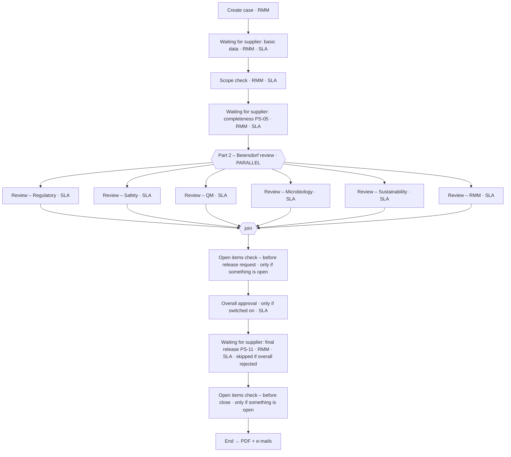

# Requirement for run `ciq-digital-v4`: the real CIQ Digital internal app (backend only)

**Target:** app `CIQ_Digital_A00`, Development sandbox "Beiersdorf kf-dev". The approved test flows named "CIQ ZZ Spike …" already live in this app. Leave them alone: don't reuse, rename or reference them.

**Scope:** the BACKEND of the internal Beiersdorf app.
- In scope: data forms, processes, child tables, lists, roles, step permissions, grants.
- Out of scope: no native pages and no nav (generate with `--no-pages`). The Workbench custom UI is built later.
- The supplier portal (`CIQP *`, app `CIQ_Supplier_Portal_A00`) is a separate container that another session owns. Never model or write portal flows here.

## Precedence (highest first)

1. **PART A** (below): Thomas's rules and the platform rules proven live in the test harness.
2. **PART B**: `docs/kissflow-data-model/app-plan-v4-processes-and-forms.md`, the authoritative data model with **11 flows: 3 Processes and 8 Data Forms**.
3. **PART C**: `kissflow-build/ciq-supplier-portal/portal-spec.mjs`, the as-built portal. These are the exact field names and types the app must map to and from.
4. **PART D**: `docs/kissflow-data-model/app-plan-v3-detailed.md`. This is **superseded on structure**. Use it ONLY for field-level detail that v4 doesn't spell out, and only where it agrees with v4. Wherever v3 and v4 differ, v4 wins. In particular: v3's no-step processes, per-round open-point items, aggregates and the Item Register all give way to v4.

---

# PART A: binding rules

## A1. Thomas's modelling rules (7 Oct 2026)
- A **Process** is used only when the record moves through steps, and those steps carry SLAs, so we use Kissflow's built-in SLA notifications.
- A **Data Form** is used when we only store data. There are no processes without steps.
- **No extra records.** Repeated detail goes in a child table inside the parent where that is safe (see v4 §5).
- Simple, scalable, logical. Use parallel steps where Kissflow supports them.

## A2. Platform rules proven in the test harness (`kissflow-build/ciq-digital/SPIKES.md`)
- **Parallel blocks:** they compile and publish, with branch-scoped Editable/Mandatory, conditions on formula fields, `=` and `!=` conditions, and Mandatory formula fields [verified]. Runtime fork and join are still being tested by Thomas.
- **Child tables:**
  - Step permissions may name the **child table only, never its columns** (column keys are rejected).
  - A child column must not reuse a header field id: give it a prefixed id, for example `Rounds_Round_No`.
- **Aggregates:** **do not author any.** Native aggregates as built are not reliable. Gates and holds use plain **Number count fields** that the acting person's Workbench writes at their own step, read by **formulas**; formulas compute server-side [verified].
  - Examples: `Open_Items_Count`, `Open_CR_Count`, `<D>_Open_Count`, `<D>_RMES_Gaps`.
  - Write formulas blank-safe: a blank count must hold, and must not deadlock.
- **Lists:** author list ids **without** `_A00`, so the display names stay clean.
- **Integrations:**
  - App Builder creates them **incomplete**; they are finished over REST afterwards (the recipe is proven).
  - Model only the intra-app ones in `automations`: Z1 (case completed → PDF + e-mails + notification event), Z2 (case rejected / cancellation → neutral e-mail), and Z3/Z4 (SLA breach → audit event) as in v4 §4.
  - Record the cross-container X1–X6 and Y1/Y3–Y6 as documentation only (the portal session builds them). Never point an automation at a portal flow.
- **Field names:**
  - Never name a field Name, Status, Type, Country, Priority, Category, Currency or Project.
  - Owner-prefix generic words.
  - Every flow and list name starts with "CIQ ".
- **Step names:** exact, with the en-dash "–" where shown:
  - "Waiting for supplier: basic data"
  - "Waiting for supplier: completeness PS-05"
  - "Waiting for supplier: final release PS-11"
  - "Part 2 – Beiersdorf review" (the parallel block)
  - "Review – Regulatory", "Review – Safety", "Review – QM", "Review – Microbiology", "Review – Sustainability", "Review – RMM"
  - "Open items check – before release request"
  - "Overall approval"
  - "Open items check – before close"
  - On CIQ Open Point: "Waiting for supplier"
  - On CIQ Change Request: "Triage", then the parallel block "Assess impact" with branches "Assess – Regulatory" … "Assess – Sustainability"
- **Grants:**
  - Editable on a Process also grants item creation, and App Builder can't express flow Admin; both are fixed over REST after generate.
  - Never add pages: a page auto-grant turns readers into editors.
- **The account key acts as its own user** and can submit a later step only if that user is in the step's role [verified 2026-10-07]. By design, every human step is done by a person, and the sync service's user is in no step-owner role.

## A3. Thomas's decisions
- CIQ Sync Service: YES.
- PDF: option A (renderer in the service).
- Overall approval (when switched on) comes before the PS-11 release request.
- Safety and Regulatory reviewers record their internal RMES decision themselves; there are no separate approver roles.
- No four-eyes on configuration releases.
- The audit trail is "tamper-evident".
- Roles: the 11 custom roles of v4 §1, plus Admin and User.

---

# PART B: app-plan-v4-processes-and-forms.md (verbatim)

# CIQ Digital app: data model v4 (processes, forms, child tables)

> **INTERNAL to Kissflow. Proposal; nothing is built.** Written 2026-10-07, after Thomas's rules of the same day.
>
> **Supersedes** `app-plan-v3-processes-and-forms.md` and `app-plan-v3-detailed.md` (16 flows), and the v1 run (28 flows). The portal and the v3 rules are unchanged:
> - the portal has one `Supplier` role and supplier steps only;
> - every Beiersdorf step is in the app;
> - every portal item has an app twin;
> - the as-built portal (`kissflow-build/ciq-supplier-portal/portal-spec.mjs`) is fixed.
>
> **Reviewed** by 3 independent adversarial reviewers (requirements, Kissflow feasibility with portal fit, rules and simplicity). They raised 45 findings: 2 blockers, 30 major, 13 minor. All are applied below, and §8 lists what changed because of them.
>
> **Tags:**
> - [manual §x]: stated in `~/Downloads/master.md`.
> - [verified]: tested live; evidence in the portal BUILD-LOG.
> - [verified-offline]: compiled by the App Builder dry run only.
> - [unverified, test]: the named test must settle it.

## 0. The rules this model follows

**Thomas's rules (7 Oct)**
1. **Process** = the record moves through **steps**, and those steps carry **SLAs**, so we use Kissflow's built-in SLA notifications.
2. **Data Form** = we only store data. There are no steps and no "processes without steps".
3. **No extra records.** Repeated detail goes in a **child table inside its parent**, or in fields on the parent, wherever that is safe. It saves storage and API calls when the UI loads.

**The platform limits that decide "child table or own record?"** [manual]
- **C1 Integrations can't create, copy or update child-table rows.** They fire per item, never per row, and there is no field-change trigger [§4.8].
- **C2 Two people writing one item at the same time:** the last writer wins. Concurrent child-table writes keep only one write, silently [§6.6, §14 #26].
- **C3 Only the holder of the current step can write a process item,** and only the fields that are editable at that step [§3.6].
- **C4 Form grants are per Form, not per row or per table.** Every member can edit every row [§4.7].
- **C5 Form-triggered integrations are [unverified, K-09f].** The "Kissflow Dataform" connector exists in the account, but its triggers and actions haven't been read.

**The check applied to every entity.** Repeated data goes in a child table only if all four of these hold:
- (a) one writer at a time can write the parent when it's needed;
- (b) no integration must create, read or trigger on its rows;
- (c) the rows are few and bounded;
- (d) no cross-case search needs the rows.

Otherwise the data gets its own record. §5 shows the result for every entity.

## 1. All processes and data forms

**11 flows: 3 Processes and 8 Data Forms.** v3 had 16 and v1 had 28.

| # | Name | Type | What it is | Child tables | Portal twin |
|---|---|---|---|---|---|
| P1 | **CIQ Case** | Process | One CIQ case cycle, from creation to the final PDF:<br>• supplier hand-offs;<br>• scope check;<br>• **parallel** department review;<br>• optional overall approval;<br>• final release.<br>It also holds the RMES header, the contacts (as fields) and the three confirmation types | — | CIQP Request, CIQP Completeness Confirmation, CIQP Final Release |
| P2 | **CIQ Open Point** | Process | One question, document request or additional part to the supplier, **with every back-and-forth round inside the same item**. It also covers the internal kinds: late department review, contact update and co-review | **Rounds** | CIQP Query (one portal item per round) |
| P3 | **CIQ Change Request** | Process | A change the supplier reports or requests: a "change notice" after editing configuration answers, a correction, or an attempt after release. RMM triages it, the affected departments assess it **in parallel**, and the supplier gets the outcome | — | CIQP Change Request (in), CIQP Notice (out) |
| F1 | **CIQ Supplier** | Data Form | One supplier company, with its people | **Contacts** | (supplier code and contact ids go onto every portal item) |
| F2 | **CIQ Config Version** | Data Form | Every configuration version: template, section definitions, rule set, ownership, RMES criteria, limits, texts, settings, plus **Release** rows (the full frozen bundle a case pins) | — | — |
| F3 | **CIQ Section** | Data Form | One released section of a case: what was released, why, and for which department. It is the app twin of the portal section. The K2.1 row carries the component list and the search fields | **Components** (K2.1 only) | CIQP Section |
| F4 | **CIQ Scope Run** | Data Form | One run of the scope rules: initial, extension, change notice, additional part. It records every section's classification, including N.A., with the rule and answer behind it | — | — |
| F5 | **CIQ RMES Safety** | Data Form | Safety's RMES sheet for one case: all criteria and findings in **one row** | **Criteria**, **Findings** | — |
| F6 | **CIQ RMES Regulatory** | Data Form | The same for Regulatory | **Criteria**, **Findings** | — |
| F7 | **CIQ Internal Note** | Data Form | Internal chat, one message per row. Never visible to suppliers | — | — |
| F8 | **CIQ Audit Event** | Data Form | Who did what and when, on which value and which document. It also logs notifications, delegations, change attempts, cancellations and snapshots | — | — |

**Dropped:**
- **CIQ Raw Material** → material fields on the case.
- **CIQ Case Contact** → contact fields on the case.
- **CIQ Supplier Contact** → child table on CIQ Supplier.
- **CIQ Component** → child table on the K2.1 section.
- **CIQ Config Release** → Release rows in CIQ Config Version.
- **Per-round open-point items** → the Rounds table.
- **~40 RMES rows per case** → 2 rows with child tables.

**Lists:** about 20.

**Roles: 11.**
- CIQ RMM;
- the five department Reviewers (Regulatory, Safety, QM, Microbiology, Sustainability);
- CIQ Overall Approver;
- CIQ Business Admin;
- CIQ Reader (Customs, Legal, Auditor and Process Owner, read-only);
- CIQ Case Admin;
- CIQ Integration Service;
- plus the defaults Admin and User.

## 2. Processes and their steps

### P1 CIQ Case

**Who acts:**
- **CIQ RMM:** creates the case, holds every "waiting for supplier" step and the checks.
- **The five department Reviewers:** each one's own Part 2 branch.
- **CIQ Overall Approver:** overall approval, if it's switched on.
- **The supplier:** acts only in the portal. Their actions come back through integrations.



| # | Step | Owner | Condition | What happens | SLA (BDF sets durations) |
|---|---|---|---|---|---|
| 0 | Create case (Start) | CIQ RMM | — | RMM enters:<br>• material: trade name, main INCI, BDF, SAP and IRMA numbers;<br>• supplier (from F1) and the case contacts;<br>• owner and due dates.<br>The pinned Release row is copied in. The BASIC F3 row is created after submit | — |
| 1 | Waiting for supplier: basic data | CIQ RMM; after the K-FA test, `Owner_RMM` | — | X1 creates the CIQP Request. Y1 sets "basic data received" and approves | Supplier due date → escalate to the owner |
| 2 | Scope check | CIQ RMM | — | RMM:<br>1. checks BASIC;<br>2. runs the rules into an F4 Scope Run;<br>3. may extend the scope (with a justification, never reduce it);<br>4. releases one F3 Section per Mandatory or Optional section (→ X2 portal section);<br>5. sets which departments are active | Scope-check time |
| 3 | Waiting for supplier: completeness PS-05 | CIQ RMM | — | X4 asks the supplier to confirm completeness. Y4 records name, e-mail, role and time, sets the RMES header, and approves | Supplier due date |
| 4 | **Part 2 – Beiersdorf review**: **parallel block** | — | — | Six branches start together. A branch whose department isn't active is skipped. The case moves on only when every active branch is done (native join) | — |
| 4.x | Review – Regulatory ∥ Review – Safety ∥ Review – QM ∥ Review – Microbiology ∥ Review – Sustainability ∥ Review – RMM | That department's Reviewer role (RMM for the RMM branch, off by default) | `Dept_<D>_Active = "Yes"` | The department reviews its sections, raises open points, and fills its RMES sheet (Safety and Regulatory, F5/F6). It then signs off **only its own lane fields**: confirm, by, e-mail, time, on-behalf-of. Safety and Regulatory also record their internal RMES decision and reason. The submit is blocked while the department has open points, unassessed change requests, RMES gaps or open findings: by the Workbench, and by a native gate field [unverified, K-20] | Review time, with a reminder and an escalation (REQ-RMES-019) |
| 5 | Open items check – before release request | CIQ RMM | Something is still open (a blank count also holds) | Normally skipped. RMM resolves the leftovers (late department reviews, contact updates), or overrides with a reason, which is audited | Check time |
| 6 | Overall approval | CIQ Overall Approver | `Overall_Approval_Required = "Yes"` (off by default) | Approve only if every required RMES decision is Approved. On a rejection the case ends without a release request, and a neutral closing text goes to the supplier | Approval time |
| 7 | Waiting for supplier: final release PS-11 | CIQ RMM | Not overall-rejected | X5 sends the **single** release request (REQ-PROC-040). Y5 records the release and approves. RMM can complete manually, with a reason (REQ-PROC-045) | Supplier due date |
| 8 | Open items check – before close | CIQ RMM | Something opened during step 7 | Normally skipped, so completion stays automatic | Check time |
| 9 | End | — | — | Z1: PDF, e-mails to the RMM owner and the supplier contacts, notification log | — |

**Key fields** (all scalars, because integrations can read only fields, C1):
- **Identity and material:** case code, cycle, `Trade_Name`, `Main_INCI` and `BDF_Material_No` (plain Text fields that X1 reads; not lookups, because CIQ Raw Material is dropped), SAP and IRMA numbers, supplier code and name.
- **Pinned release:** row id, hash and manifest copy.
- **Contacts:** `Case_Contacts_JSON`, which is the list the UI shows. Also `Portal_Contact_Ids`, `Confirm_Contact_Ids` and `Supplier_Contact_Emails`, Mandatory at Start.
- **Department flags.**
- **Six lanes** (confirm, by, e-mail, time, on-behalf-of; plus the RMES decision for SAF and REG).
- **PS-05 and PS-11 confirmation fields.**
- **RMES header:** `RMES_Key`, plus `RMES_Created_At` from Y4. This is REQ-PROC-021's one RMES record per case.
- **Late completions.**
- **Holds and gates:** blank-safe counts over P2, P3, F5 and F6 [unverified, K-20/K-20F].
- **Outcome:** overall decision, completion trigger, PDF.

**Why the parallel block is safe:**
- Each branch writes only its own 5–7 fields, and no child tables.
- Nobody else writes the case during Part 2: contact changes go through a P2 "Contact update", assignments through F8.
- The engine compiled a Parallel step [verified-offline]. Branch-scoped permissions are [unverified-offline, K-OFF]. Runtime behaviour is [unverified, K-PAR/K-19P].
- Fallback: one review item per department.

**Cancellation:**
1. RMM rejects at its own steps. In Part 2, CIQ Case Admin rejects through the admin route [K-13].
2. An F8 Cancellation event is written.
3. The case's open P2 and P3 items are ended.
4. A **close sweep** (sync service) snapshots and withdraws every open portal item, so no supplier task is left (REQ-PROC-049).

The same sweep runs after an overall rejection or a manual completion.

### P2 CIQ Open Point (one item per point; every round inside)

**Use:** a Beiersdorf department, or RMM, asks the supplier something specific about one place in the questionnaire. It can be:
- a **query**;
- a **document request**;
- an **additional part** (a new section to fill).

It happens mainly in **Part 2** (requirements document PS-08, the clarification loop), and RMM can raise one at Scope check. Every open point blocks its department's sign-off and the release request until it is closed (REQ-PROC-036).

**Internal kinds**, which skip the supplier step:
- **Department review:** late work. Examples: a department activated after the fork, or a re-review after the supplier changed an answer that a completed department relied on.
- **Contact update:** RMM refreshes the contacts.
- **Internal review:** an optional co-review.

**Who acts:**
- **Raise:** any department Reviewer, or RMM.
- **Respond:** the supplier contacts, in the portal (the Supplier role).
- **Review the answer:** only the owning department (REQ-PROC-034).
- **Responsible person and due dates:** required (REQ-ADR-001).

| # | Step | Owner | Condition | What happens | SLA |
|---|---|---|---|---|---|
| 0 | Raise open point (Start) | The raising department or RMM | — | Required:<br>• kind, owner department, to-supplier yes/no;<br>• reference (section, field, row, or document by file name and upload date);<br>• question and supplier-facing justification;<br>• responsible person;<br>• internal and supplier due dates.<br>An additional part also asks RMM (or the sync service) to create its F3 section | — |
| 1 | Waiting for supplier | CIQ RMM at generate; after the K-FA test, `Responsible_User` | `OP_To_Supplier = "Yes"` | X3 creates the portal query **for the current round**. Y3 copies the answer (kind, text, referenced documents), sets `Awaiting_Response = "No"`, and approves | Supplier due date |
| 2–7 | Review – Regulatory / Review – Safety / Review – QM / Review – Microbiology / Review – Sustainability / Review – RMM | The owning department's Reviewer role | `OP_Dept = "<code>"` (exactly one runs) | The department sets one of these outcomes:<br>• **Accepted** (closed; it records which document was accepted);<br>• **Withdrawn** (closed, with a reason);<br>• **Return**: the Workbench appends round n to **Rounds**, writes round n+1's question, justification and due date, clears the answer fields, sets `Awaiting_Response = "Yes"`, and **sends the item back** to step 1. That re-fires X3 [unverified, K-09h]; fallback X3b on ItemSentBack | Internal due date |
| 8 | End | — | — | — | — |

**Fields:**
- The **current round** is kept as plain fields, so X3 can copy them: key, round number, question, justification, due dates, responsible person and department, reference, `Portal_Contact_Ids`, `Thread_Text`.
- **Rounds** (child table) is the full history: question, answer, outcome, reason, document, by and at. Only the owning department writes it, at its own step (one writer).

### P3 CIQ Change Request

**Use:**
- **Change notice.** Under BRM v2 the supplier can change metadata and configuration answers until the final release, and every change must re-derive the scope (REQ-CFG-008, REQ-PROC-007). Kissflow has no field-change trigger, so the supplier UI raises a change notice whenever such an answer changes.
- **Correction.** The supplier asks Beiersdorf to correct a value they can't edit themselves, for example the target markets that RMM sets.
- **Attempt after the final release.** It is refused and logged (REQ-PROC-043).
- **Department information.** The departments whose assessment used the changed data are informed (REQ-PROC-031).

**Who acts:**
- **The supplier** raises it in the portal.
- **CIQ RMM** triages it.
- **The affected department Reviewers** assess it in parallel.
- **The supplier** gets the outcome as a portal notice.

| # | Step | Owner | Condition | What happens | SLA |
|---|---|---|---|---|---|
| 0 | Receive change request (Start) | Created by Y6 from the portal; RMM by hand as the fallback | — | — | — |
| 1 | Triage | CIQ RMM | — | 1. Checks that the requester is a contact of the case.<br>2. **After PS-11:** refuses it and writes an F8 "change attempt" event.<br>3. **Change notice:** writes a new F4 Scope Run (additions only). New sections become F3 rows (→ portal sections), and a Department-review point is raised for each new section's lead department.<br>4. Sets the impact flags per department and the supplier-safe outcome text | Triage time |
| 2 | **Assess impact**: **parallel block** | — | — | Assess – Regulatory ∥ Assess – Safety ∥ Assess – QM ∥ Assess – Microbiology ∥ Assess – Sustainability. Each runs only if `Impact_<D> = "Yes"`, and each writes only its own four fields. A re-assessment goes into that department's RMES sheet | Assessment time |
| 3 | End | — | — | X6 sends the CIQP Notice with the outcome | — |

## 3. Data Forms

| # | Form | Description | Child tables | Who writes |
|---|---|---|---|---|
| F1 | **CIQ Supplier** | Code (`Supplier_Code`, the isolation key on every portal item), legal name, DUNS, kind, country, SAP and Teamcenter ids, active, test. Plus parent mirrors: `Contact_Portal_Ids_Text` (search) and `Pending_Invites` (count) | **Contacts:** name, e-mail, role, may confirm, **portal user id**, active, invite requested and invited. One portal user who serves two suppliers gets a row under each | CIQ RMM. Business Admin is Viewer unless BDF says otherwise. Rows are written one at a time, re-read and merged |
| F2 | **CIQ Config Version** | One row per configuration version and kind: template, section definition, rule set, ownership (lead plus co-reviewers), RMES criteria, limits, texts, reminders, settings, and **Release**. A Release row holds the **full bundle** (`Release_Bundle_JSON` plus hash), so a pinned release never depends on rows that could change. Copy-on-write: publishing never edits a row. Downloadable (REQ-CFG-001/-003) | — | CIQ Business Admin, as member without Delete [K-17]. Each publish writes an F8 event |
| F3 | **CIQ Section** | One row per released section. Fields:<br>• the X2 set 1:1 with the portal: keys, title, applicability, supplier reason, origin, `Definition_JSON` and hash, due date, contacts;<br>• internal fields: lead department, query owner, co-review departments, scope-run key, derivation kind, override justification.<br>The K2.1 and BASIC rows also hold the search mirrors (INCI, CAS, origin types, DUNS) and `Source_Answers_Rev` (REQ-PROC-006) | **Components** (K2.1 only): INCI, CAS, EC, function, additive, origin, min and max concentration. Rebuilt from the portal answers (read via sharing) whenever they change, and once after the final release | CIQ RMM and CIQ Integration Service (sync service) only. Reviewers are Viewers. A department asks for an additional part through its open point |
| F4 | **CIQ Scope Run** | One row per evaluator run (initial, extension, change notice, additional part, reactivation). Fields: trigger, rule-set version, input hash, full result including N.A. with rule and answer, added sections, override justification, by, at. **Additions only** (REQ-PROC-009/-010, REQ-CFG-008/-009) | — | The session that ran it: RMM, or a department for an extension |
| F5 | **CIQ RMES Safety** | **One row per case** (created by the first Safety session after PS-05, keyed by the case's `RMES_Key`, with a Reference to the case). Header counts: open criteria, open blocking findings; these feed the case gate. `Editing_By` / `Editing_Since` lock, so only one Safety user writes at a time | **Criteria:** code, part, title, applicability and basis, source (question, value, answer rev, or document by file name and upload date), prefill, result, comment, by, at, limit check, impact resolution, AI suggestion with source, and who confirmed it. **Findings:** text, criterion, blocking, state, linked open point | Safety only (Reviewer and Approver). Native: Regulatory can read but not edit (REQ-CFG-004) |
| F6 | **CIQ RMES Regulatory** | The same for Regulatory | Criteria, Findings | Regulatory only |
| F7 | **CIQ Internal Note** | One message per row: case, optional link (section, open point, finding), text, author, department, time (REQ-PROC-020) | — | Every internal role. The author edits their own messages, by convention |
| F8 | **CIQ Audit Event** | One row per business event (REQ-CTL-009): who, what, when, old and new value, document by file name and upload date. Categories: notification (REQ-CTL-010), delegation, assignment, section-review mark, scope, configuration, change attempt, cancellation, snapshot, item created | — | **Recommended:** only the CIQ Integration Service (sync service) writes; every person is a Viewer, so the trail is immutable for Beiersdorf roles. **Otherwise:** writers without Delete [K-17], and the claim is "tamper-evident" |

## 4. What the app and the portal share

| Id | Direction | From → to | Fires when | Data |
|---|---|---|---|---|
| X1 | app → portal | CIQ Case → CIQP Request | The case enters "Waiting for supplier: basic data" | Request key, case code, cycle, supplier code and name, trade name, **Main_INCI, BDF_Material_No** (portal fields added 2026-10-07), BDF contact, markets, template label, due date, `Case_Contacts_JSON`, contacts |
| X2 | app → portal | CIQ Section (Form row) → CIQP Section | The row is created [unverified, K-09f; fallback: sync service] | Section keys, title, applicability, supplier reason, origin, definition and hash, due date, app section id, contacts |
| X3 / X3b | app → portal | CIQ Open Point → CIQP Query | The point enters "Waiting for supplier", including after a Return (K-09h), or ItemSentBack (X3b) | Current-round key, round number, question, justification, reference, responsible person and department, due date, previous rounds (`Thread_Text`), app point id, contacts |
| X4 / X5 | app → portal | CIQ Case → Completeness Confirmation / Final Release | The PS-05 or PS-11 waiting step is entered | Declaration text and key, due date, app case id, contacts allowed to confirm |
| X6 | app → portal | CIQ Change Request → CIQP Notice | The change request ends | Notice title and text, related key, contacts |
| Y1 | portal → app | CIQP Request → CIQ Case | Basic data submitted | "Received", portal request id; approve step 1 |
| Y3 | portal → app | CIQP Query → CIQ Open Point | Supplier responded | Response kind, text, document references; approve "Waiting for supplier" (only while `Awaiting_Response = "Yes"`) |
| Y4 / Y5 | portal → app | Confirmations → CIQ Case | Supplier confirmed or released | Name, e-mail, role, time (Y5 adds released revisions and the evidence list); approve the waiting step |
| Y6 | portal → app | CIQP Change Request → CIQ Change Request | Supplier submitted | All change fields, portal item id, raised by |
| — | portal → app, **read** | CIQP Section answers and uploads | Any time | Read through the flow sharing, not copied [unverified until the first app lookup] |
| Z1 / Z2 | inside the app | Case ended / cancelled | — | PDF, e-mails, notification log; neutral cancellation e-mail |

**Connector check (2026-10-07, read-only, `kissflow-build/ciq-digital/spikes/k09f-dataform-connector-result.json`):** [verified: connector metadata; runtime still K-09]
- **The Kissflow Dataform connector exists:**
  - triggers: *item created*, *item updated*, *item deleted*;
  - actions: create, update, fetch one, fetch many, delete.
  - So X2 from a CIQ Section row, Y3 into a Form, and integration-written audit rows all have a real event or action.
- **The Kissflow Process connector also has:**
  - *item sent back* (the X3b trigger);
  - *item about to enter a step*, which fires even for skipped steps;
  - *SLA breached at this step*;
  - *Approve an item*;
  - **Skip and complete**, which ends an item from an integration: a possible native close for portal items on cancellation, tested in K-09;
  - **Create and submit items in bulk** (master.md §4.8 says "no multi-create"; to be tested).

**Never shared with the portal:** department lanes and decisions, RMES, findings, internal notes, internal due dates, the overall decision, the audit trail.

**Integration status.** All integrations are [unverified] until spike K-09. Each one is built once, can't be deleted, and is switched on by a person.
- **The CIQ Sync Service** (a small server-side service with API keys) is the only valid fallback for creating portal items. Beiersdorf users have no portal role.
- It also runs the close sweep, snapshots, the PDF renderer and the component rebuild.
- It is decision 1 in §7.

## 5. The child-table checks (where each piece of data lives, and why)

| Data | Lives in | Why not the other option |
|---|---|---|
| Q&A rounds of an open point | **Child table Rounds** on CIQ Open Point | One writer (the owning department, at its step). No integration touches rows. Bounded. One item per point instead of one per round |
| The open points themselves | Own items (P2) | Not a child table of the case: up to six departments raise them at the same time in Part 2 (C2). Departments can't write the case outside their branch (C3). X3/Y3 need an item per point (C1). They need steps with SLAs (rule 1). The cross-case dashboard needs them (REQ-PROC-036) |
| Supplier contacts | **Child table Contacts** on CIQ Supplier | One writer (RMM). Small. Parent mirror fields cover cross-supplier search |
| Case contacts | **Fields** on CIQ Case (`Case_Contacts_JSON`, plus three id/e-mail fields) | Not a child table: X1–X6 must copy them into the portal's required `Assigned_Contacts` (C1) |
| RMES criteria and findings | **Child tables** on one RMES row per case and department | One department per row (grants, C4), with a lock field. Counts are lifted to header fields for gates and dashboards. Two Forms, because Safety and Regulatory must not edit each other (REQ-CFG-004) and must not write one item at the same time (C2) |
| K2.1 components | **Child table Components** on the K2.1 CIQ Section row | One writer (RMM or sync rebuild). Search mirrors sit on the row, which is a Form, so it is writable at any time. Not on the case, which nobody can write during Part 2 or after End (C3) |
| Released sections | Own Form rows (F3) | Each one creates its own portal item (X2 needs an item event, C1). Rows are added after Scope check, when RMM holds no case step (C3) |
| Scope runs | Own Form rows (F4), 1–4 per case | Runs come from different people at different times: Scope check, change-notice triage, additional parts (C3) |
| Material identity | **Fields** on CIQ Case | No separate master needed for the MVP |
| Department sign-off | **Fields** on CIQ Case (one lane per department) | Not a child table: six branches would write one table at the same time (C2) |
| Chat messages, audit events | Own Form rows | Many people post at any time (C2). One row per message or event is the natural size |

**Rough load cost of one case screen** (20 sections, 8 open points): about 38 API calls, against about 65 in v3, if the case's open points can be listed (test K-14; fallback: list them from F8 "item created" events).

## 6. Hand-offs to the portal session (only after you approve)

- **App step names** that X1, X3, X4 and X5 trigger on:
  - "Waiting for supplier: basic data";
  - "Waiting for supplier: completeness PS-05";
  - "Waiting for supplier: final release PS-11";
  - "Waiting for supplier" on CIQ Open Point.
- **`App_Open_Point_Id` now means the point**, not the round. Each round still gets its own CIQP Query, with `Round_No`.
- **Additive portal fields** on CIQP Final Release: `Released_Revs_JSON` and `Evidence_List_Text`.
- **Supplier UI duties:**
  - block incomplete basic data and incomplete completeness confirmations;
  - raise a "change notice" whenever a configuration or metadata answer changes;
  - submit every section at release.

## 7. Decisions and tests before anything is built

**Thomas decided (2026-10-07, in the CIQ Digital session):**
- **Sync service: YES.** The CIQ Sync Service is in scope. It runs:
  - the close sweep;
  - the snapshots;
  - portal-item creation as the fallback for X2/X3;
  - the single-writer audit;
  - the component rebuild.
- **PDF: option A.** A full PDF, built by the service's renderer.
- **Test flows: approved** in the app. Thomas deletes clutter later from the front end.

**Your decisions** (as originally listed; 1, 2 and 7 are now decided)
1. **CIQ Sync Service: yes or no.** Without it:
   - cancellation leaves open supplier tasks (REQ-PROC-049 fails from the app);
   - X2 and X3 have no fallback;
   - the audit can't be single-writer.
2. **PDF.** Option A: a full PDF built by the service. Option B: a reduced PDF from case fields, disclosed to BDF.
3. **Parallel department sign-off on the case**, kept if K-PAR/K-19P pass.
4. **Overall approval before the supplier's final release**, when it's switched on.
5. **No four-eyes on configuration releases.** BDF doesn't require it; it can be added later as a real approval step with an SLA, which would make it a Process.
6. **Safety and Regulatory reviewers record the RMES decision themselves.** No separate approver roles.
7. **OK to create the throwaway spike flows**, which can't be deleted.

**Tests before generate (a Form can't become a Process later)**
- **K-09f:** can a Form row trigger an integration, and can an integration write to a Form? This decides X2, Y3 into a Form, and the audit actions.
- **K-09h:** does a send-back re-fire X3?
- **K-OFF:** offline compile of:
  - six branches with branch-scoped permissions;
  - formula conditions;
  - child tables with step permissions;
  - blank-safe aggregates.
- **K-PAR / K-19P:** parallel fork, join and concurrent branch submits.
- **K-20 / K-20F:** native gates over Form header counts.
- **K-14:** listing a case's open points as a non-participant.
- **K-17:** a Form member without Delete.
- **K-23:** an SLA that follows a due-date field.
- **Portal blockers:** MT-1, MT-2, MT-3, MT-6.

**Spike results that change the build** (2026-10-07; details in `kissflow-build/ciq-digital/SPIKES.md`):
- **Cross-flow SUM aggregates can't be expressed in App Builder 1.0.0** [verified-live]. It publishes the aggregate pointing at its own flow. So the case holds and lane gates (counts over CIQ Open Point, CIQ Change Request and the RMES rows) need a REST graft after generate. Until a graft is proven, the Workbench gate is the primary guard and the hold steps run unconditionally.
- **Child-table step permissions are table-level only** [verified-offline]. A step can make a whole child table Editable or ReadOnly, not single columns. Rounds, Components, Criteria and Findings are designed table-level, so this fits.
- **Integrations come out of App Builder incomplete** [verified-live]. All X/Y/Z integrations are built in the builder or over REST (the portal session builds the cross-container ones).
  - The REST recipe now works in this account [verified, 2026-10-07]: connection, skeleton, server-resolved fields, mappings, publish. Both test integrations were completed this way.
  - Switching an integration on is builder-only (REST `on` gives 403).
- **Child-table rows are writable over REST** with the front-end shape `"Table::<ChildModelId>": [{_id, _index, _is_created | …fields | _is_deleted}]` [verified, 2026-10-07]:
  - on Forms: create/draft and update;
  - on Processes: at the actor's own step.
  - Integrations still can't write child rows (C1). The sync service and Workbench sessions can, so the Contacts, Components, Rounds, Criteria and Findings child tables stay as designed.
- **Native aggregates are not reliable as built** [verified, 2026-10-07]. App Builder's embedded SUM never computes. Re-pointed at the child table, it summed across all items. The cross-flow SUM stays blank. So gates and holds use **plain Number count fields written by the acting person's Workbench at their own step**; the gate and hold **formulas** read those. Formulas compute server-side [verified]. Native aggregates come back only after a builder-made aggregate is captured and proven.
- **A data-form trigger fires an integration, and an integration creates Form rows** [verified live, 2026-10-07]. X2 from a CIQ Section row is viable.
- **The account key acts as its own user (Thomas)** [verified in the app, 2026-10-07]. It can submit a later step only when that user is a member of the step's role: Spike Point "Spike review" (Role B) submitted fine. The earlier refusal came from an empty Role A plus a reused Start task id. **Design rule unchanged:** every human step is done by a person (Workbench or native), never by the sync service, so the sync service's user must be in no step-owner role.
- **The cross-flow SUM can be fixed after generate:** a one-attribute REST graft re-points it, and a published process accepts the graft [verified]. Runtime recalculation is K-20F.
- **List ids are authored without `_A00`**, so the display names come out clean [verified-live].
- **Proven to compile and publish:** parallel branches with branch-scoped permissions, a condition on a formula field, a `!=` condition, a Mandatory formula field, an embedded SUM on a Form [verified-live publish]. Runtime behaviour is K-PAR/K-19P/K-20, which need a real user.

**After generate (by hand):**
- per-step Send-back and Reject switches:
  - Case: Send-back off on every step; Reject only on RMM steps (cancellation);
  - Open Point: Send-back on only at the review steps (for Return);
  - Change Request: both off;
- flow Admin for Case Admin;
- SLA durations;
- field-assigned owners (after K-FA).

## 8. What the review changed in the first v4 draft

| Finding | Change made |
|---|---|
| Case contacts in a child table would block every portal create (2 reviewers, blocker) | Contact ids and e-mails are fields on the case. Contacts changed during Part 2 go through a "Contact update" point |
| X2 fallback "the RMM session creates it" is impossible: Beiersdorf users have no portal role (blocker) | The fallback is the sync service, and K-09f runs before generate. F3 carries the full X2 field set |
| Late department work had no task (major) | "Department review" open points, counted by the holds |
| Cancellation left open supplier and internal tasks (major) | Cascade plus a close sweep |
| Findings in RMES child tables escaped the gates (major) | Header counts plus a case Reference feed the native gates and the dashboard |
| Search fields on the case go stale, and K2.1 per component was missing (major) | Components child table and mirrors on the K2.1 section row |
| Published configuration could be edited or deleted (major) | Full bundle on the Release row, copy-on-write, no Delete |
| The audit trail was editable by everyone (major) | Single writer through the service, or no Delete plus "tamper-evident" |
| The Open Point return loop broke the Y3 guard and couldn't feed X3 (major) | Current-round fields on the item, an `Awaiting_Response` guard, X3b fallback |
| The RMES row had no single writer or named creator (major) | Lock fields; the first session creates it, keyed by the case's `RMES_Key` |
| Scope runs were scattered (minor/major) | One F4 Scope Run form |
| Smaller fixes | Completion e-mail per lane; outcome "not accepted (closed)" removed; co-review field; blank-safe holds; switch list; supplier contacts merge rule |


---

# PART C: portal-spec.mjs (as-built portal contract, verbatim)

```js
// CIQ Supplier Portal, v3 (2026-10-07): suppliers only. The single source of truth for the build scripts.
// Design: docs/kissflow-data-model/plan-v3-supplier-portal-one-role.md §4 (Thomas's rules):
//  - exactly ONE portal role, "Supplier" (all external users); the platform defaults Admin/User stay, Admin = Kissflow builders only;
//  - every portal process holds SUPPLIER steps only; every Beiersdorf decision happens in the app (CIQ Digital);
//  - every portal item carries Case_Code, Cycle_No, Supplier_Code (the supplier's own id) and the id of its app twin;
//  - BRM v2: sections stay editable until the final release (PS-11); documents additive with file name + upload date.
// The previous (v2, Beiersdorf-steps-in-portal) spec is kept as portal-spec-v2-asbuilt.mjs for the record.

export const PORTAL = "CIQ_Supplier_Portal_A00";

// ── roles: one custom role. The existing role "CIQP Supplier Contact" is renamed (its id is kept). ──
export const ROLES = [
  { name: "Supplier", renameFrom: "CIQP Supplier Contact", desc: "Every external supplier user. Acts only on items assigned to it through Assigned_Contacts; raises change requests." },
];
export const DEFAULT_ROLES = ["Admin", "User"]; // platform defaults; Admin = Kissflow builders only
export const TEST_USER = { _id: "UsEJUfjYLM8Y", Name: "Thomas", Kind: "User" };
export const TEST_USER_ROLES = []; // Thomas is portal Admin (default role) only; no Beiersdorf roles exist in the portal any more

// ── lists ──
export const LISTS = [
  { name: "CIQP Yes No", items: ["Yes", "No"] },
  { name: "CIQP Confirm", items: ["Confirmed"] },
  { name: "CIQP Response Kind", items: ["Answer", "Document", "Additional part completed", "Cannot provide"] },
  { name: "CIQP Doc Kind", items: ["SDS", "CoA", "Specification", "Analysis", "Certificate", "Statement", "Other"] },
  { name: "CIQP Change Kind", items: ["Metadata correction", "Configuration answer change", "Other correction", "Change notice"] },
];
export const LISTS_TO_DELETE = ["CIQP Dept Code"]; // department routing moved to the app

// field helpers
const T = (name, o = {}) => ({ name, type: "Text", ...o });
const TA = (name, o = {}) => ({ name, type: "Textarea", ...o });
const N = (name, o = {}) => ({ name, type: "Number", ...o });
const D = (name, o = {}) => ({ name, type: "Date", ...o });
const DT = (name, o = {}) => ({ name, type: "DateTime", ...o });
const EM = (name, o = {}) => ({ name, type: "Email", ...o });
const SEL = (name, list, o = {}) => ({ name, type: "Select", referredList: list, ...o });
const CONTACTS = { name: "Assigned Contacts", type: "MultiUser", required: true }; // K-04 verified: MultiUser field assignee routes
const HEADER = [T("Case Code", { required: true }), N("Cycle No", { required: true }), T("Supplier Code", { required: true })];
const SUPPLIER = "field:Assigned_Contacts";

// Steps: { name, assignee: "field:<FieldId>" | none (Start/End), field_permissions? }.
// Engine default: every field Editable at Start, ReadOnly at every later step; readOnlyAtStart lists the exceptions.

// ── P1 CIQP Request: the case header for the supplier + the basic-data task (PS-03/PS-04) ──
const P1 = {
  key: "P1", name: "CIQP Request", flowType: "Process",
  description: "One CIQ case cycle as the supplier sees it: case header and the basic-data task. Created from the app case.",
  fields: [
    T("Request Key", { required: true }), ...HEADER, T("App Case Item Id", { required: true }),
    T("Trade Name"), T("Main INCI"), T("BDF Material No"), T("Supplier Display Name"), T("BDF Contact Name", { required: true }), EM("BDF Contact Email", { required: true }),
    T("Markets Label"), T("Template Label"), D("Supplier Due Date", { required: true }), TA("Case Contacts JSON"), CONTACTS,
  ],
  steps: [{ name: "Issue request" }, { name: "Supplier: submit basic data", assignee: SUPPLIER }, { name: "End" }],
};

// ── P2 CIQP Section: one released section; answers and uploads, editable until the final release ──
const P2 = {
  key: "P2", name: "CIQP Section", flowType: "Process",
  description: "One released CIQ section of one case cycle: copied definition, the supplier's answers and uploads. Editable until the final release.",
  fields: [
    T("Section Item Key", { required: true }), ...HEADER, T("App Section Item Id", { required: true }),
    T("Section Key", { required: true }), T("Section Code", { required: true }), T("Section Title", { required: true }), N("Section Sort"),
    T("Applicability Label"), T("Supplier Reason"), T("Added Later"), T("Section Origin", { required: true }),
    TA("Definition JSON", { required: true }), T("Definition Hash", { required: true }),
    TA("Answers JSON"), N("Answers Rev"), DT("Answers Changed At"), T("Answers Changed By Email"), T("Editing By"), DT("Editing Since"),
    T("Supplier Responsible Email"), D("Supplier Due Date"), CONTACTS, SEL("Section Done", "CIQP Yes No"),
    SEL("Section Release Confirm", "CIQP Confirm"), // guard: Mandatory at the supplier step; the supplier UI sets it only at the final release
  ],
  child: {
    name: "CIQP Section Uploads", label: "Uploads",
    fields: [T("Upload Id"), T("Upload Field Key"), T("Upload Row Id"), SEL("Upload Doc Kind", "CIQP Doc Kind"), { name: "Upload File", type: "Attachment" }, T("Upload File Name"), T("Uploaded By Email"), DT("Uploaded At")],
  },
  readOnlyAtStart: ["Answers JSON", "Answers Rev", "Answers Changed At", "Answers Changed By Email", "Editing By", "Editing Since", "Supplier Responsible Email", "Section Done", "Section Release Confirm", "Uploads"],
  steps: [
    { name: "Release section" },
    { name: "Supplier: fill in section", assignee: SUPPLIER, field_permissions: { "Answers JSON": "Editable", "Answers Rev": "Editable", "Answers Changed At": "Editable", "Answers Changed By Email": "Editable", "Editing By": "Editable", "Editing Since": "Editable", "Supplier Responsible Email": "Editable", "Section Done": "Editable", "Section Release Confirm": "Mandatory", "Uploads": "Editable" } },
    { name: "End" },
  ],
};

// ── P3 CIQP Query: one round of one Beiersdorf open point (the review happens in the app; a return = next round) ──
const P3 = {
  key: "P3", name: "CIQP Query", flowType: "Process",
  description: "One round of a Beiersdorf question, document request or additional part. The supplier responds; the review happens in the app.",
  fields: [
    T("Query Key", { required: true }), N("Round No", { required: true }), ...HEADER, T("App Open Point Id", { required: true }),
    T("Kind Label", { required: true }), T("Responsible Department", { required: true }), T("Responsible Name", { required: true }),
    T("Ref Kind", { required: true }), T("Ref Section Key", { required: true }), T("Ref Field Key"), T("Ref Row Id"),
    T("Ref Doc Id"), T("Ref Doc File Name"), DT("Ref Doc Uploaded At"), T("Ref Label", { required: true }),
    TA("Question Text", { required: true }), TA("Supplier Justification", { required: true }), D("Supplier Due Date", { required: true }),
    TA("Previous Rounds JSON"), T("New Section Item Key"), CONTACTS,
    SEL("Response Kind", "CIQP Response Kind"), TA("Response Text"), TA("Response Doc Refs JSON"), T("Supplier Responsible Email"),
  ],
  readOnlyAtStart: ["Response Kind", "Response Text", "Response Doc Refs JSON", "Supplier Responsible Email"],
  steps: [
    { name: "Raise query" },
    { name: "Supplier: respond", assignee: SUPPLIER, field_permissions: { "Response Kind": "Mandatory", "Response Text": "Editable", "Response Doc Refs JSON": "Editable", "Supplier Responsible Email": "Editable" } },
    { name: "End" },
  ],
};

// ── P4a/P4b: the two formal supplier confirmations. Two separate flows (not one flow with a "kind" field), so each
//    completion has its own integration trigger (plan v3 review: one flow would fire both Y4 and Y5). ──
const confirmation = (key, name, description, startName, stepName) => ({
  key, name, flowType: "Process", description,
  fields: [
    T("Confirmation Key", { required: true }), ...HEADER, T("App Case Item Id", { required: true }),
    TA("Declaration Text", { required: true }), T("Declaration Text Key", { required: true }), D("Supplier Due Date"), CONTACTS,
    SEL("Supplier Confirm", "CIQP Confirm"), T("Confirmed By Name"), EM("Confirmed By Email"), T("Confirmed By Role"), DT("Confirmed At"),
  ],
  readOnlyAtStart: ["Supplier Confirm", "Confirmed By Name", "Confirmed By Email", "Confirmed By Role", "Confirmed At"],
  steps: [
    { name: startName },
    { name: stepName, assignee: SUPPLIER, field_permissions: { "Supplier Confirm": "Mandatory", "Confirmed By Name": "Mandatory", "Confirmed By Email": "Mandatory", "Confirmed By Role": "Mandatory", "Confirmed At": "Mandatory" } },
    { name: "End" },
  ],
});
const P4a = confirmation("P4a", "CIQP Completeness Confirmation", "The supplier confirms that the questionnaire is complete (PS-05). This is not the final release: data stays editable. Created from the app case.", "Request completeness confirmation", "Supplier: confirm completeness");
const P4b = confirmation("P4b", "CIQP Final Release", "The supplier's single final release of the questionnaire (PS-11). After it, nothing can be changed. Created from the app case.", "Request final release", "Supplier: release");

// ── P5 CIQP Notice: Beiersdorf → supplier message that needs an acknowledgement (change-request outcome, scope change).
//    NOT used for cancellation or closure: those must leave no open supplier task (REQ-PROC-049), so they go by e-mail from the app. ──
const P5 = {
  key: "P5", name: "CIQP Notice", flowType: "Process",
  description: "A message from Beiersdorf that the supplier acknowledges, e.g. a change-request outcome or a scope change. Not used for cancellation or closure (those go by e-mail, so no supplier task stays open).",
  fields: [
    T("Notice Key", { required: true }), T("Notice Kind", { required: true }), ...HEADER, T("App Notice Item Id", { required: true }),
    T("Notice Title", { required: true }), TA("Notice Text", { required: true }), T("Related Key"), CONTACTS,
  ],
  steps: [{ name: "Send notice" }, { name: "Supplier: acknowledge", assignee: SUPPLIER }, { name: "End" }],
};

// ── P6 CIQP Change Request: raised by the supplier; no portal step (triage and assessment happen in the app) ──
const P6 = {
  key: "P6", name: "CIQP Change Request", flowType: "Process",
  description: "A correction or change notice raised by the supplier. Triage and assessment happen in the app; the outcome comes back as a CIQP Notice.",
  fields: [
    T("CR Key", { required: true }), ...HEADER, SEL("Change Kind", "CIQP Change Kind", { required: true }),
    T("Section Key"), T("Field Key"), T("Row Id"), TA("Current Value Text"), TA("Proposed Value JSON", { required: true }), TA("Change Reason", { required: true }),
  ],
  steps: [{ name: "Submit change request" }, { name: "End" }], // Start → End verified (spike k-no-step, 2026-10-07)
};

// ── P7 CIQP Help Article (Form): supplier-agnostic FAQ ──
const P7 = {
  key: "P7", name: "CIQP Help Article", flowType: "Form",
  description: "Supplier-agnostic FAQ and quick-start guide (CIA #34). Every portal user may read every row by design.",
  fields: [T("Article Title", { required: true }), TA("Article Body", { required: true }), N("Sort Order")],
};

export const FLOWS = [P1, P2, P3, P4a, P4b, P5, P6, P7];

// ── grants. M = Member[] (act on assigned steps only); I = Member[InitiateItems]; I+V = Member[InitiateItems, View];
//    V = form Viewer[]; E = form Member[Delete]. Admin is the platform default role (Kissflow builders only): it raises the
//    items until the cross-container integrations take over, and is the manual fallback. ──
export const GRANTS = {
  "CIQP Request":        { "Supplier": "M", "Admin": "I+V" },
  "CIQP Section":        { "Supplier": "M", "Admin": "I+V" },
  "CIQP Query":          { "Supplier": "M", "Admin": "I+V" },
  "CIQP Completeness Confirmation": { "Supplier": "M", "Admin": "I+V" },
  "CIQP Final Release":  { "Supplier": "M", "Admin": "I+V" },
  "CIQP Notice":         { "Supplier": "M", "Admin": "I+V" },
  "CIQP Change Request": { "Supplier": "I", "Admin": "I+V" },
  "CIQP Help Article":   { "Supplier": "V", "Admin": "E" },
};

```

---

# PART D: app-plan-v3-detailed.md (superseded on structure; field-level reference only, verbatim)

> **SUPERSEDED (2026-10-07) by `app-plan-v4-processes-and-forms.md`.** Thomas set new rules the same day: Process only with steps and SLAs, Data Forms for data, child tables instead of extra records. Kept for its review history; do not build from it.

> **INTERNAL to Kissflow. Proposal, nothing built.** This is the full design behind `app-plan-v3-processes-and-forms.md`: every field, step rule, integration, risk and the 57-finding review ledger. It was written on 2026-10-07 by a multi-agent design run: 5 source readers, 3 rival designs, 2 judges, a synthesis, then 3 adversarial reviewers and a final edit. It applies the v3 rules in `plan-v3-supplier-portal-one-role.md` and fits the as-built portal (`kissflow-build/ciq-supplier-portal/portal-spec.mjs`). Where it differs, it supersedes the app parts of `kissflow-data-model-plan.md` (§3.2, §4, §6, §7) and the v1 App Builder run (`runs/ciq-digital`, not generated).

# CIQ Digital: final app design after review

**What this is.** This is the plan for every process and form in the CIQ Digital app. For each one it gives the use, how it relates to the others, what it shares with the supplier portal, and its workflow steps. Nothing has been built. No repo file was changed and no Kissflow call was made.

**What changed after review.** I processed all 57 reviewer findings. I accepted every one. Twelve of them I accepted with a modified fix, and each modification cites its evidence (§9). The main changes since the recommended design:
- **Typing rule.** Write-once records are Processes with no user step. Scope Run and Audit Event join Section and Config Release in that group.
- **Overall approval** moves before the release request, so completion after the supplier's release stays automatic.
- **Two conditional hold steps** replace one: one before the release request, one before close. The case can no longer deadlock.
- **Late work** uses one mechanism: a "Department review" open point. That covers late sections, re-review after supplier changes, and departments activated late.
- **Native lane gates** back up the Workbench completion gate, as a second line.
- **Cancellation** is recorded as an audit event, and Z2 sends its e-mail from that event. Z2 no longer tries to "Close" portal items.
- **One close sweep** handles every portal item left open. It withdraws items and never deletes sections, and it takes a snapshot first.
- **Configuration.** The full configuration bundle is frozen in the Config Release item.
- **Lists.** Values that the business can configure are stored as Text, not list-backed Selects.

**How to read the references**
- **Lnn** is a line in `context/raw/CIQ_Business_Requirements_Matrix_MVP_v2.md` (BRM v2).
- **ReqDoc Lnn** is a line in `context/sources/01-requirements-document-v2.md`.
- **Dnn** is an entry in `runs/ciq-digital/decisions.md`.
- **RD-n** is a decision of this design (§8).
- Portal evidence is in `kissflow-build/ciq-supplier-portal/`.
- **Tags:**
  - [verified: file] was tested live.
  - [verified-offline: file] was compiled by the engine dry run only.
  - [manual §x] is stated in `~/Downloads/master.md`.
  - [unverified, test] or [unverified-offline, test] is an assumption, and the named test settles it.

## 1. Design in one paragraph

The app has **16 flows: 7 Processes and 9 Forms**, down from 28 in v1. Three typing rules decide every flow's type, because a Form can never become a Process [manual §4.2]:

| Type | Used for | Flows |
|---|---|---|
| Process with user steps | Work that moves between people | Case, Open Point, Change Request |
| Process with no user step | A record that must never change once written. It completes, and so freezes, at submit [verified: k-no-step-result.json for completion; freeze against non-admin edits unverified, K-FREEZE] | Section, Config Release, Scope Run, Audit Event |
| Form | Master data, or a working record that its single writer keeps updating | Supplier, Supplier Contact, Raw Material, Case Contact, Config Version, Component, the two RMES Result Forms, Internal Note |

The rule is **one record, one writer**. Work that people do at the same time gets its own record:
- one open-point item per question round;
- one change-request item per supplier request;
- one RMES row per criterion;
- one note per message;
- one audit item per event.

So the department review on `CIQ Case` shrinks to a short sign-off of 4–6 fields per department. Part 2 is **one native Parallel block** with a conditional branch per department, and its native join replaces v1's Review Track, the I-2 fan-out, the G5 sync, the Case Sync role and the Case Index.

Change requests use a **second Parallel block** for the impact assessment.

Two conditional **"Open items check"** steps stop the release request, and the close, while anything is still open. The optional **overall approval** sits before the release request. Any late department work becomes an Open Point of kind "Department review", which those checks count.

Everything deferred can be added later as a new flow.

## 2. Inventory

| # | Flow | Type | Was | Use |
|---|---|---|---|---|
| P1 | CIQ Case | Process | A9 | One case cycle: supplier hand-offs, scope check, parallel department sign-off, holds, optional overall approval, PS-11, PDF |
| P2 | CIQ Open Point | Process | A17, A21, A22 | One round of a query, document request, additional part, finding, internal review, department review or contact update |
| P3 | CIQ Change Request | Process | new | App twin of a supplier change request: triage, parallel impact assessment, outcome notice |
| P4 | CIQ Section | Process (no user step) | new | Frozen twin of one released section. Completing it creates the portal section |
| P5 | CIQ Config Release | Process (no user step) | A8 | The frozen, full configuration bundle that every case pins |
| P6 | CIQ Scope Run | Process (no user step) | A11 (Form) | One immutable evaluator run: sections, parts and evidence, each with its rule and answer |
| P7 | CIQ Audit Event | Process (no user step) | A25–A28 (Forms) | Append-only event log, including notifications, review marks, assignments, delegations, cancellations and section snapshots |
| F1 | CIQ Supplier | Form | A1 | Supplier company. `Supplier_Code` isolates suppliers on every portal item |
| F2 | CIQ Supplier Contact | Form | A2 | Links a supplier person to their portal user id |
| F3 | CIQ Raw Material | Form | A4 | Material identity across cases and cycles. It carries its supplier |
| F4 | CIQ Case Contact | Form | A5 | The case's contacts and who may confirm |
| F5 | CIQ Config Version | Form | A6, A7 | Workspace for drafting configuration versions, and the export source |
| F6 | CIQ Component | Form | A14 | K2.1 composition, one searchable row per component |
| F7 | CIQ RMES Safety Result | Form | A19, A23 | Safety RMES criterion rows. Only Safety edits them |
| F8 | CIQ RMES Regulatory Result | Form | A20, A23 | Regulatory RMES criterion rows. Only Regulatory edits them |
| F9 | CIQ Internal Note | Form | A24 | Internal chat, one message per row |

**Counts:**
- 7 Processes and 9 Forms.
- 21 lists.
- 11 custom roles, plus the platform defaults Admin and User.
- 15 integrations: X1–X6, Y1, Y3–Y6 and Z1–Z4.
- No Boards: every lifecycle has gates between roles. No Datasets.

**Decided before generate by a test:**
- **K-FREEZE fails:** P6 and P7 become Forms (no freeze benefit) and the claim stays "tamper-evident".
- **K-14 fails:** add **CIQ Item Register** (Form), the listable index of every created item id.

**Deferred.** Each is a new flow, added only if its test fails:
- **CIQ Document** (Form): the sharing test or MT-6 fails.
- **CIQ Final Document** (no-step Process): K-15 fails.
- **CIQ Department Review** (Process): K-PAR or K-19P fails.

## 3. Per flow

### P1 CIQ Case (Process)

**Use**
- One item per case cycle. A reactivation is a new item with `Cycle_No + 1`.
- RMM creates it and holds every step where Beiersdorf waits for the supplier.
- The departments sign off in parallel inside it. The supplier's confirmations land on it.
- It ends after the supplier's final release, or after an overall rejection, and produces the PDF.
- Requirements: REQ-PROC-001 L14, -015 L27, -017/-018 L29–30, -040 L48, -042 L49, -045/-046 L51–52, -049 L53.

**Relations**
- **References:** `Raw_Material` → F3. Supplier fields come by lookup through F3 → F1.
- **Referenced by:** P2 `Point_Case`, P3 `CR_Case`, and F7/F8 `Result_Case`. These feed the native counts.
- **Keys:**
  - `Case_Item_Id` (this item's `_id`) is the hard key on every case-scoped record.
  - `Case_Code` + `Cycle_No` is the human key.
- **Pinned configuration:** `Release_Item_Id` + `Manifest_Hash` → P5, plus a frozen copy of `Release_Manifest_JSON`.
- RMM creates it. Y1, Y4 and Y5 update it.

**Shared with the portal**
- It is the twin of `CIQP Request`, and it feeds `CIQP Completeness Confirmation` and `CIQP Final Release`.
- **Out:** X1, X4, X5. **Back:** Y1, Y4, Y5 (each updates the case, then approves its waiting step).
- **Never mapped** (REQ-CTL-002 L54): department flags, lanes, RMES decisions, holds, overall decision, internal dates.

**Key fields.** →Xn means copied to the portal; ←Yn means written by an integration. Every field an integration copies has the same type as its portal counterpart (Text, Number, Date, DateTime or Email), never a Select.
- **Identity:**
  - `Case_Code` (Text, "CIQ-<year>-<_id of the cycle-1 item>", RD-23);
  - `Cycle_No` (Number);
  - `Case_Title`, `Reactivates_Case_Item`.
- **Parties:**
  - `Raw_Material` (Reference → F3, with lookup and autofill of `Supplier_Code`, `Supplier_Legal_Name` and `Trade_Name` [unverified-offline, K-OFF; fallback: the session writes them as Text]);
  - `Owner_RMM` (User);
  - `Target_Markets_Text` (Text, validated against the pinned Settings);
  - `Origin_Types` (Text, the search mirror for REQ-PROC-006 L17).
- **Portal mirrors →X1:** `Request_Key`, `Supplier_Code` (also →X4/X5), `Supplier_Legal_Name` (→ `Supplier_Display_Name`), `Trade_Name`, `BDF_Contact_Name`, `BDF_Contact_Email` (Email), `Markets_Label`, `Template_Label`, `Supplier_Due_Date` (Date).
- **Contacts** (derived only from F4, D44): `Portal_Contact_Ids`→X1, `Case_Contacts_JSON`→X1, `Confirm_Contact_Ids`→X4/X5, `Supplier_Contact_Emails`→Z1.
- **Pins:**
  - `Release_Item_Id`, `Release_Key`, `Manifest_Hash`, `Release_Manifest_JSON` (frozen after Start);
  - `Rule_Set_Version` (shown on the case, REQ-CFG-003 L11);
  - `Overall_Approval_Required` (Text "Yes"/"No", from Settings);
  - `Case_Test` (`CIQ Yes No`).
- **PS-05:**
  - →X4: `Completeness_Request_Key`, `Completeness_Declaration_Text`, `Completeness_Text_Key`, `Completeness_Due_Date` (Date).
  - ←Y4: `Completeness_Confirm`, `Completeness_By_Name`, `Completeness_By_Email` (Email), `Completeness_By_Role`, `Completeness_At` (DateTime), `RMES_Created_At`.
  - `RMES_Key` is set at Scope check. Together with `RMES_Created_At`, it is the RMES record header: exactly one per case confirmed at PS-05 (REQ-PROC-021 L33).
- **PS-11:**
  - →X5: `Final_Release_Request_Key`, `Final_Release_Declaration_Text`, `Final_Release_Text_Key`, `Final_Release_Due_Date` (Date, optional).
  - ←Y5: `Final_Release_Confirm`, `Final_Release_By_Name`, `Final_Release_By_Email`, `Final_Release_By_Role`, `Final_Release_At`, `Released_Revs_JSON`, `Evidence_List_Text`.
  - `Completion_Trigger` comes from Y5's literal, or from a session for an overall rejection or a manual completion.
- **Guards and twin ids:** `Basic_Data_Received` (←Y1), `Portal_Request_Item_Id` (←Y1 `_id`).
- **Scope:** `Dept_REG_Active`, `Dept_SAF_Active`, `Dept_QM_Active`, `Dept_MIC_Active`, `Dept_SUS_Active`, `Dept_RMM_Active` (all `CIQ Yes No`), and `Initial_Scope_Run_Key`. The current scope is the union of the case's P6 runs.
- **Lanes, for each D in REG, SAF, QM, MIC, SUS, RMM** (34 fields):
  - `<D>_Review_Confirm` (`CIQ Confirm`), `<D>_Completed_By` (User), `<D>_Completed_By_Email` (Email), `<D>_Completed_At` (DateTime), `<D>_On_Behalf_Of`.
  - SAF and REG also have `<D>_RMES_Decision` (`CIQ Decision`, labelled "Internal RMES decision – not a raw-material approval") and `<D>_RMES_Decision_Reason`.
- **Holds** (computed; grafted after P2, P3, F7 and F8 exist, R30):
  - `Open_Points_Open` = SUM of P2 `Open_Num` where `Point_Case` is this item; `Open_CRs_Open` = SUM of P3 `CR_Open_Num` [manual §4.4, shape 2].
  - `Hold_For_Open_Items` = `IF(ISBLANK(Open_Points_Open),"Yes",IF(ISBLANK(Open_CRs_Open),"Yes",IF(Open_Points_Open+Open_CRs_Open=0,"No","Yes")))`. Used as the step condition only: a blank count holds the case.
  - `Open_Items_Gate` = `IF(ISBLANK(Hold_Override_Reason),IF(IF(ISBLANK(Open_Points_Open),0,Open_Points_Open)+IF(ISBLANK(Open_CRs_Open),0,Open_CRs_Open)=0,"OK",""),"OK")`. Here a blank counts as 0, so the gate can never deadlock. Any override is audited.
  - `Hold_Note`, `Hold_Override_Reason`.
- **Lane gates** (computed, second line, K-20). For each D:
  - `<D>_OP_Open` (SUM of P2 `Open_<D>`);
  - `<D>_CR_Pending` (SUM of P3 `Pending_<D>`, not for RMM);
  - `<D>_RMES_Open` (SAF and REG only: SUM of F7/F8 `Gate_Num` [unverified, K-20F]);
  - `<D>_Gate` = "OK" when the blank-safe sum is 0, otherwise "".
- **Outcome:** `Late_Completions_Text`, `Overall_Decision` (`CIQ Decision`), `Overall_Reason`, `Overall_Decided_By` (User), `Supplier_Closing_Text`→Z1, `Final_PDF` (Attachment).

There are about 100 business fields and about 25 computed fields. Dropped from the earlier design: `Case_Supplier`, `Release_Path`, `Cancel_Reason`, `Cancelled_By`, `Cancelled_At`, `Reactivation_Deadline`.

**Workflow steps.** The process ends with an explicit End [manual §4.6].

| # | Step | Owner | Condition | What happens |
|---|---|---|---|---|
| 0 | Create case (Start) | CIQ RMM | — | 1. The session creates the item; one call returns `_id` at Start [manual §3.6]. 2. Through the creator's route it writes `Case_Code`, the keys, the mirrors and the copied manifest [manual §6.6], then submits. Missing Mandatory data blocks creation (REQ-PROC-001 L14). 3. **Only after the submit succeeds**, the same session creates the BASIC P4 (→X2). The BASIC prefill travels in the prefill part of `Definition_JSON`, because portal `Answers_JSON` is ReadOnly at Start (portal-spec P2). 4. It writes a "Case created" event to P7 |
| 1 | Waiting for supplier: basic data | CIQ RMM. E-mail off. After K-FA, assigned from `Owner_RMM` | — | Entry fires X1. Y1 writes `Basic_Data_Received` = "Yes" and `Portal_Request_Item_Id`, then approves. Fallback: RMM checks the portal and submits with a typed guard (plan-v3 §8) |
| 2 | Scope check | CIQ RMM | — | 1. The session validates the BASIC answers through the sharing. If they are incomplete, it raises a P2 Query on BASIC, and the case waits here (REQ-PROC-005 L16). 2. It runs the evaluator and records a P6 run: sections, parts and evidence, each with its rule and answer. 3. RMM may extend the scope with a justification, but never reduce it (REQ-CFG-008 L21). 4. It releases one P4 per Mandatory or Optional section, each carrying its merged definition (X2). 5. It sets the department flags from the lead departments (REQ-CFG-006 L13, REQ-PROC-017 L29). `Dept_RMM_Active` comes from Settings `deptReviewMode` (default "No", plan §13 decision 3) |
| 3 | Waiting for supplier: completeness PS-05 | CIQ RMM. E-mail off | — | Entry fires X4. Y4 writes `Completeness_*` and `RMES_Created_At`, then approves. The scope can still grow in Part 1, so the flags, contacts and X5 fields stay Editable. On the first RMM session after Y4, the Workbench re-validates completeness. If gaps remain, it writes an event and raises a P2 query, and the RMES rows wait (REQ-RMES-001, ReqDoc L362) |
| 4 | **Part 2 – Beiersdorf review** | Parallel | — | Branch Regulatory [Review – Regulatory] ∥ Branch Safety [Review – Safety] ∥ Branch QM [Review – QM] ∥ Branch Microbiology [Review – Microbiology] ∥ Branch Sustainability [Review – Sustainability] ∥ Branch RMM [Review – RMM] → join |
| 4.x | Review – <Dept> | That department's Reviewer role (CIQ RMM for RMM) | `Dept_<D>_Active = "Yes"` | Only the `<D>_*` fields are writable. The Workbench completion gate (below) runs before the submit, and so does a staleness check of every department that has already completed. Step e-mail on: it is the department's notification (REQ-PROC-017 L29) |
| 5 | Open items check – before release request | CIQ RMM | `Hold_For_Open_Items = "Yes"` | Runs only if an open point or a triaged change request is open at the join, or if a count is blank. RMM resolves the items. Through a "Contact update" point RMM refreshes `Confirm_Contact_Ids` and `Supplier_Contact_Emails`, copies late completions into `Late_Completions_Text`, and submits. An override requires `Hold_Override_Reason` plus an audit event |
| 6 | Overall approval | CIQ Overall Approver | `Overall_Approval_Required = "Yes"` | PS-12 in the requirements document (ReqDoc L104: "required subprocess results available"; REQ-RMES-014). Off by default. The decision is a field plus a submit. The UI offers "Approved" only when every required RMES decision is Approved: the active SAF and REG lanes, with any later Department-review decision taking precedence. Otherwise it offers only "Rejected". On "Rejected" the session writes a neutral `Supplier_Closing_Text` and sets `Completion_Trigger` = "Overall rejection" |
| 7 | Waiting for supplier: final release PS-11 | CIQ RMM. E-mail off | `Overall_Decision != "Rejected"` (fail-safe: a blank value runs the step [unverified, K-PC]) | Entry fires X5, the single release notification (REQ-PROC-040 L48, -042 L49). Y5 writes `Final_Release_*`, `Released_Revs_JSON`, `Evidence_List_Text` and `Completion_Trigger` = "Supplier final release", then approves. A manual completion sets "Manual by RMM: <reason>" (REQ-PROC-045 L51) and sends the portal leftovers to the close sweep |
| 8 | Open items check – before close | CIQ RMM | `Hold_For_Open_Items = "Yes"` | Catches work opened during step 7: a change notice that added sections, a contact update, or a late Department review. Same fields as step 5. In the normal path it is skipped, so completion stays automatic |
| 9 | End | — | — | Z1 runs: PDF, e-mails, notification event |

**Step field rules.** Every field not listed is ReadOnly at that step. The lanes, decisions and outcome are ReadOnly at Start [manual §4.6, §14 #53]. K-OFF reads these back from the compiled `Activity::Permission` entries.

| Step | Mandatory | Also Editable |
|---|---|---|
| 0 | `Case_Code`, `Cycle_No`, `Raw_Material`, `Owner_RMM`, `Request_Key`, `Supplier_Code`, `BDF_Contact_Name`, `BDF_Contact_Email`, `Supplier_Due_Date`, `Portal_Contact_Ids`, `Case_Contacts_JSON`, `Release_Item_Id`, `Manifest_Hash`, `Release_Manifest_JSON`, `Overall_Approval_Required` | `Case_Title`, `Reactivates_Case_Item`, `Target_Markets_Text`, the mirrors, labels, `Release_Key`, `Case_Test`, `Confirm_Contact_Ids`, `Supplier_Contact_Emails` |
| 1 | `Basic_Data_Received` | `Portal_Request_Item_Id`, the four contact fields |
| 2 | the six flags, `Initial_Scope_Run_Key`, `Rule_Set_Version`, `RMES_Key`, `Confirm_Contact_Ids`, `Supplier_Contact_Emails`, the four `Completeness_*` request fields, the three `Final_Release_*` request fields, `Supplier_Closing_Text`, `Origin_Types` | `Target_Markets_Text`, `Final_Release_Due_Date`, `Portal_Contact_Ids`, `Case_Contacts_JSON` |
| 3 | `Completeness_At`, `RMES_Created_At` | `Completeness_Confirm`, `Completeness_By_Name`, `Completeness_By_Email`, `Completeness_By_Role`, the six flags, the contact fields, the X5 request fields, `Final_Release_Due_Date`, `Origin_Types` |
| 4.x | `<D>_Review_Confirm`, `<D>_Completed_By`, `<D>_Completed_By_Email`, `<D>_Completed_At`, `<D>_Gate` (once grafted). SAF and REG also: `<D>_RMES_Decision` | `<D>_RMES_Decision_Reason`, `<D>_On_Behalf_Of` |
| 5 | `Hold_Note`, `Open_Items_Gate` | `Hold_Override_Reason`, `Confirm_Contact_Ids`, `Supplier_Contact_Emails`, `Final_Release_Due_Date`, `Late_Completions_Text`, `Origin_Types`, `Supplier_Closing_Text` |
| 6 | `Overall_Decision`, `Overall_Decided_By` | `Overall_Reason`, `Supplier_Closing_Text`, `Completion_Trigger` |
| 7 | `Completion_Trigger` | `Final_Release_Confirm`, `Final_Release_By_Name`, `Final_Release_By_Email`, `Final_Release_By_Role`, `Final_Release_At`, `Released_Revs_JSON`, `Evidence_List_Text` |
| 8 | `Hold_Note`, `Open_Items_Gate` | `Hold_Override_Reason`, `Supplier_Contact_Emails`, `Late_Completions_Text`, `Supplier_Closing_Text` |

**Department completion gate** (REQ-PROC-036 L45, -039 L47; REQ-RMES-006/-007/-009/-013, ReqDoc L367–L374)

*First line: the Workbench.* It refuses the 4.x submit while department D has any of these, and it names each blocker by kind, section, status and responsible person:
1. an open P2 with `OP_Dept = D` or `Raised_By_Dept = D`, other than a Contact update;
2. a P3 item at "Assess – D";
3. for SAF and REG:
   - an applicable criterion without a result;
   - a negative, implausible or N.A. result without a comment;
   - an impacted row that isn't resolved;
   - no decision, or "Rejected" without a reason;
4. a section that D leads without a *current* "Section reviewed" mark. A mark is current while its `Source_Answers_Rev` equals the section's current `Answers_Rev`.

All Workbench writes after Start are [unverified, K-WB].

*Second line: native lane gates.* `<D>_Gate` is Mandatory at Review – <D>. A submit from native My Tasks or from the step e-mail is then refused while points, assessments or RMES blockers are open [unverified, K-20; K-20F for the RMES part].

If K-20 fails: switch the branch step e-mail off by hand, and send the department notification through an integration e-mail that links to the Workbench [unverified].

**Delegation** (REQ-PROC-039 L47): native reassign of the branch task [unverified, K-13], plus `<D>_On_Behalf_Of`, plus a Delegation event in P7.

**Responsible person** (REQ-CTL-003 L55, REQ-CTL-006 L56): the department records who works on its lane as an "Assignment" event in P7, so the case gets no extra writer during the block.

**Why the Parallel block is safe** [manual §6.6, §14 #26]
1. **Disjoint fields.** Each branch step makes only its own `<D>_*` fields writable. The server refuses writes to other fields with `400 PermissionDeniedToUpdate` [manual §6.6]. The engine compiled 2 one-step branches with every field ReadOnly, because no branch permissions were given [verified-offline: parallel-test blob]. Branch-scoped Editable and Mandatory permissions have not been compiled yet [unverified-offline, K-OFF].
2. **No other writer during the block.**
   - RMM holds no case step.
   - Contact changes become P2 points, not case writes.
   - Assignments and cancellations become P7 events.
   - Case Admin only rejects; it writes no fields.
   - Y1 and Y4 run before the block and Y5 after it. A late Y1 or Y4 is stopped by an action condition [unverified, K-09g].
3. **No child tables, and short writes.** A branch writes 4–6 scalar fields in its submit call.
4. **Still open** [unverified, K-19P]: whether two submits seconds apart, or an aggregate recalculation, can overwrite another lane.

**Native Reject and Send-back.** App Builder can't set the per-step switches [verified-offline, D12]. After generate, set by hand (MT-12 learns the shape):
- Send-back off on every P1 step.
- Reject off on 4.x and on 6, if K-13 shows the admin route can still reject there.
- Reject kept on 1, 2, 3, 5, 7 and 8, for cancellation.
- Whether a branch Reject ends the whole case is [unverified, K-PAR-3].
- An ending without a Cancellation event shows on the RMM "Ended without cancellation" tile. Recovery is a reactivation.

**Cancellation** (REQ-PROC-049 L53)
1. The Workbench writes a P7 "Cancellation" event: `Event_Reason`, actor, time, and `Notify_Recipient` = the supplier contact e-mails.
2. The case is then ended by native Reject:
   - by RMM at steps 1, 2, 3, 5, 7 and 8;
   - by CIQ Case Admin through the admin route at steps 4 and 6 [unverified, K-13, K-PAR-3].
3. Z2 e-mails the supplier from the event.
4. Case Admin ends the case's open P2 and P3 items through the admin route. After cancellation the counts no longer matter.
5. The close sweep (§5) snapshots and withdraws the portal items.
6. The case shows as cancelled: `_status` Rejected plus a Cancellation event.

**Reactivation.** A new item with the same `Case_Code`, `Cycle_No + 1` and `Reactivates_Case_Item`, created within the period set in Settings after the Cancellation event (ReqDoc L171: "assumption: 1 year"). New P4 items carry the previous answers as prefill inside `Definition_JSON`, taken from the "Section snapshot" events (RD-19).

**Status** (REQ-CTL-006 L56)
- The case status comes from `_current_step` and `_status` [manual §3.6].
- A department's status comes from its lane, otherwise from its accepted Department-review points (one selector).
- Section status is derived (P4).

### P2 CIQ Open Point (Process)

**Use**
- One item is **one round** of one request. A return creates the next round as a new item, so rounds can't overwrite each other and nothing loops.
- One department owns each point. Every open point blocks that department, the raising department, and the case holds.
- Kinds: Query, Document request, Additional part, Finding, Internal review, **Department review** (a department's review work outside its branch) and **Contact update** (forces the hold step so RMM refreshes contacts).
- Requirements: REQ-PROC-029–036 L36–45, REQ-ADR-001/-002 L38–39, REQ-RMES-010/-011.

**Relations**
- **Reference:** `Point_Case` → P1.
- **Keys:**
  - `Case_Item_Id`, `Case_Code` + `Cycle_No`;
  - `OP_Key` groups the rounds, and `Prev_Round_Item_Id` links to the previous round;
  - `Ref_Section_Key` → P4;
  - `New_Section_Item_Key` → the P4 of an additional part;
  - `Ref_Internal_Key` → an F7/F8 `Result_Key`, a finding's `OP_Key` or a `CR_Key`.

**Shared with the portal**
- It is the twin of one `CIQP Query` round.
- **Out:** X3, only when `OP_To_Supplier = "Yes"`. **Back:** Y3.
- **Never mapped:** `Internal_Justification`, `Ref_Internal_Key`, `Raised_By_Dept`, `Internal_Due_Date`, the outcome fields, and every Finding, Internal review, Department review and Contact update.

**Key fields** (→ means copied by X3)
- **Keys:** `OP_Key`, `Round_No`→ (Number), `Query_Key`→ (`OP_Key|R<n>`), `Prev_Round_Item_Id`, `Case_Code`→, `Cycle_No`→ (Number), `Supplier_Code`→, `Case_Item_Id`, `Point_Case`.
- **Routing.** All are Required Selects, because a blank or unmatched value silently skips the step [verified: k-select-result.json]:
  - `OP_Kind`;
  - `OP_Dept` and `Raised_By_Dept` (`CIQ Review Dept`: six codes, so the CUS and LEG values can't be stored and the submit is refused [manual §3.5]);
  - `OP_To_Supplier` (`CIQ Yes No`).
- **Reference tuple →** (REQ-PROC-029 L36): `Ref_Kind`, `Ref_Section_Key`, `Ref_Field_Key`, `Ref_Row_Id`, `Ref_Doc_Id`, `Ref_Doc_File_Name`, `Ref_Doc_Uploaded_At`, `Ref_Label`. Internal only: `Ref_Internal_Key`.
- **Request:**
  - `Kind_Label`→, `Question_Text`→, `Supplier_Justification`→, `Internal_Justification`;
  - `Responsible_User` (User), with the mirrors `Responsible_Name`→ and `Responsible_Dept_Label`→;
  - `Internal_Due_Date`, `Supplier_Due_Date`→ (Date, REQ-ADR-001 L38);
  - `New_Section_Item_Key`→, `Portal_Contact_Ids`→, `Thread_Text`→.
- **Response** (←Y3): `Response_Kind`, `Response_Text`, `Response_Doc_Refs_JSON`, `Supplier_Responsible_Email`, `Portal_Query_Item_Id` (REQ-PROC-032 L41).
- **Review:**
  - `OP_Progress`, `OP_Outcome` (Accepted / Returned / Withdrawn), `Outcome_Reason`, `Return_Reason`;
  - `Accepted_Doc_File_Name`, `Accepted_Doc_Uploaded_At` (REQ-PROC-034 L43);
  - `Reviewed_By` (User), `Reviewed_By_Email`, `Reviewed_At`, `Reviewed_Answers_Rev` (Number);
  - `Late_Decision` (`CIQ Decision`) and `Late_Decision_Reason`, for a Department review by SAF or REG;
  - `On_Behalf_Of`, `Finding_Origin` (Text).
- **Derived:**
  - `Open_Num` = `IF(OP_Outcome="Accepted",0,IF(OP_Outcome="Withdrawn",0,IF(OP_Outcome="Returned",0,1)))`.
  - `Open_<D>` for the six departments = `IF(OP_Kind="Contact update",0,IF(Open_Num=1,IF(OP_Dept="<D>",1,IF(Raised_By_Dept="<D>",1,0)),0))`.
  - `Start_Gate` = "OK" when `OP_To_Supplier = "No"`. Otherwise it is "OK" only if `Ref_Section_Key`, `Kind_Label`, `Question_Text`, `Supplier_Justification`, `Supplier_Due_Date`, `Responsible_Name` and `Responsible_Dept_Label` are all filled. These are the portal's required fields (portal-spec P3) [unverified, K-20; fallback: make them Required for every kind, with supplier-safe placeholders].

**Workflow steps**

| # | Step | Owner | Condition | What happens |
|---|---|---|---|---|
| 0 | Raise open point (Start) | CIQ RMM nominally. Every role with InitiateItems can create, because the Start actor is ignored [manual §4.6; D34] | — | Mandatory: the keys, routing, `Point_Case`, `Case_Item_Id`, `Responsible_User`, `Internal_Due_Date`, `Internal_Justification`, `Ref_Kind`, `Ref_Label`, `Start_Gate`. Response, review and outcome fields are ReadOnly. Without a reference or a due date the request can't be sent (REQ-PROC-029, REQ-ADR-001) |
| 1 | Waiting for supplier | CIQ RMM, e-mail off. After K-FA, assigned from `Responsible_User` | `OP_To_Supplier = "Yes"` | Entry fires X3. Y3 writes the response, then approves. `Response_Kind` is Mandatory as the guard. **Withdrawal:** the owner writes `Response_Kind` = "Withdrawn by Beiersdorf" and `OP_Outcome` = "Withdrawn", then submits. The count drops at once, and the close sweep closes the portal query. Editable: the Y3 fields, plus `OP_Outcome` and `Outcome_Reason` (the Workbench allows only Withdrawn here) |
| 2–7 | Review – Regulatory / Review – Safety / Review – QM / Review – Microbiology / Review – Sustainability / Review – RMM | That department's Reviewer role (CIQ RMM for RMM) | `OP_Dept = "<code>"` | The department may set "In progress" (an update without submit [unverified, K-WB]), then submits. Mandatory: `OP_Outcome`, `Reviewed_By`, `Reviewed_By_Email`, `Reviewed_At`. Editable: the other review fields. Only the owning role holds the task (REQ-PROC-034 L43) |
| 8 | End | — | — | — |

**Round rules** (REQ-PROC-033/-035 L42/L44)
1. **Return.** The Workbench first creates round n+1. That round carries the same `OP_Key`, `Round_No + 1`, `Prev_Round_Item_Id`, the copied context, the new question and due date, and `Thread_Text` with this round's history appended. Only then does it submit round n as "Returned", so the count never drops to 0 in between.
2. **Traffic light,** taken from the latest round of each `OP_Key`:
   - red: at "Waiting for supplier", or in review while Open;
   - amber: In progress;
   - green: Accepted;
   - grey: Withdrawn.
   Every status change writes a P7 event with the person, time, result and reviewed document.

**Kinds**
- **Additional part** (REQ-ADR-002 L39). The session creates the P4 (origin "Additional", `Added_Later` "Yes"), a P6 run, and this point, routed to the requesting department. The supplier UI shows the point and the section as **one task** (hand-off 4e).
- **Department review.** The session raises one for the lead department of **every section released after PS-05**, but only when that lead department has a review step (any of the six; RMM only when `deptReviewMode` is on). It does the same for a completed department whose review mark or RMES row became stale. Its accepted outcome is that department's completion for that scope (department, person, e-mail, time). RMM copies it into `Late_Completions_Text` at a hold step.
- **Finding.** Raised by a limit breach, a confirmed AI hit, or an AI hit that isn't tied to a criterion. A supplier query raised from a finding is a new point with `Ref_Internal_Key` = the finding's `OP_Key`.
- **Internal review.** One department asks another, for example the K2.2 co-reviewer when `coReviewMode` is on.
- **Contact update.** `OP_Dept` = RMM, raised when F4 changes after PS-05. It is excluded from the lane gates but counted by the holds.

**Why it is safe.** Only one writer acts at a time: the creator, then Y3, then the owning department.

**Switches.** Reject and Send-back go off on steps 1–7 after generate (K-13/MT-12). The Workbench ignores items whose `_status` is Rejected and shows them on a "stray reject" tile. A stray Reject can't hold the case for ever, because of `Hold_Override_Reason`. K-09h checks whether a Send-back re-fires X3.

### P3 CIQ Change Request (Process)

**Use**
- The app twin of each supplier change request: a correction, a "Change notice" (a configuration or metadata answer changed), or an attempt after the final release.
- RMM triages it. The evaluator re-derives the scope automatically when triage opens, adding sections only. The affected departments assess the impact in parallel, and the supplier gets the outcome as a portal notice.
- Requirements: REQ-PROC-007 L18, -031 L40, -043 L50, REQ-CFG-008 L21.

**Relations**
- **Reference:** `CR_Case` → P1, set at triage, because Y6 can't fill a Reference.
- **Keys:** `Case_Code`, `Cycle_No`, `Case_Item_Id`, `Scope_Run_Key`.
- New P4 items record its `CR_Key` in `Created_By_Key`.

**Shared with the portal**
- **In:** Y6 creates it from `CIQP Change Request`.
- **Out:** X6 creates `CIQP Notice`. The change request is the notice's app twin (`App_Notice_Item_Id` = its `_id`).
- **Never mapped:** `Triage_Note` and the assessment fields.

**Key fields**
- **←Y6:** `CR_Key`, `Case_Code`, `Cycle_No` (Number), `Supplier_Code`, `Change_Kind`, `Section_Key`, `Field_Key`, `Row_Id`, `Current_Value_Text`, `Proposed_Value_JSON`, `Change_Reason`, `Portal_CR_Item_Id` ← `_id`, `Raised_By_Portal_User` ← `_created_by` [unverified, K-09a].
- **Triage:**
  - `CR_Case`, `Case_Item_Id`, `Contact_Verified`, `CR_Outcome`, `Triage_Note`, `Scope_Run_Key`;
  - `Impact_REG`, `Impact_SAF`, `Impact_QM`, `Impact_MIC`, `Impact_SUS` (`CIQ Yes No`);
  - →X6: `Notice_Key`, `Notice_Title`, `Supplier_Outcome_Text`, `Portal_Contact_Ids`.
- **Per branch D:** `<D>_Assessment` (`CIQ Impact Resolution`), `<D>_Assess_Note`, `<D>_Assessed_By`, `<D>_Assessed_At`.
- **Derived:**
  - `Pending_<D>` = `IF(Impact_<D>="Yes",IF(ISBLANK(<D>_Assessment),1,0),0)`;
  - `CR_Open_Num` = `IF(ISBLANK(CR_Outcome),1,0)` + the five `Pending_<D>`.

**Workflow steps**

| # | Step | Owner | Condition | What happens |
|---|---|---|---|---|
| 0 | Receive change request (Start) | CIQ RMM nominally. Y6 creates it as CIQ Integration Service; RMM can create it by hand as the fallback | — | Created and submitted by Y6. Triage and assessment fields are ReadOnly |
| 1 | Triage | CIQ RMM | — | 1. **Contact check** (D44). 2. **After the final release:** "Refused – after final release", every impact flag "No", and a "Change attempt" event (REQ-PROC-043). 3. **Change notice:** a P6 run (additions only); new sections → P4 → X2; for each new section, a Department-review point for its lead department; before PS-05, RMM also updates the case flags (Editable at case step 3). 4. RMM sets the impact flags and the supplier-safe outcome. **Mandatory:** `CR_Case`, `Case_Item_Id`, `Contact_Verified`, `CR_Outcome`, the five `Impact_*`, `Supplier_Outcome_Text`, `Notice_Key`, `Notice_Title`, `Portal_Contact_Ids`. Editable: `Triage_Note`, `Scope_Run_Key` |
| 2 | **Assess impact** | Parallel | — | Branch Regulatory [Assess – Regulatory] ∥ Branch Safety ∥ Branch QM ∥ Branch Microbiology ∥ Branch Sustainability → join. Each branch: owner = that department's Reviewer role; condition `Impact_<D> = "Yes"`; Mandatory `<D>_Assessment`, `<D>_Assessed_By`, `<D>_Assessed_At`; Editable `<D>_Assess_Note`. A re-assessment is written into the department's own F7/F8 rows; "Finding raised" means a P2 point exists |
| 3 | End | — | — | ItemCompleted fires X6 |

**Why this block is safe.** Triage fixes the set of branches before the fork. Each branch writes only its own four fields. After Y6 nothing writes the item; X6 only reads it.

**Switches and timing.**
- Reject and Send-back go off on steps 1 and 2.x after generate.
- A change request that isn't triaged by the join isn't counted (R19). The triage SLA and the supplier UI's release refusal cover it.

### P4 CIQ Section (Process, no user step)

**Use**
- One item per released section: BASIC, derived, additional, change-notice or reactivated.
- It is frozen at submit. It records what was released, why, and under which definition, and its completion creates the portal section.
- N.A. sections get no item; they stay in P6 with their rule.
- Requirements: REQ-PROC-009/-010 L19–20, REQ-CFG-001 L9, -008/-009 L21–22.

**Relations**
- Keys: `Case_Item_Id`, `Case_Code`, `Cycle_No`, `Section_Def_Key` (→ the pinned P5 entry), `Scope_Run_Key` (→ P6), `Created_By_Key` (the `OP_Key` or `CR_Key` that caused it).
- Read by P2 and F6.

**Shared with the portal**
- **X2 → CIQP Section, copied 1:1:**
  - `Section_Item_Key`, `Case_Code`, `Cycle_No` (Number), `Supplier_Code`;
  - `Section_Key`, `Section_Code`, `Section_Title`, `Section_Sort` (Number), `Applicability_Label`, `Supplier_Reason`, `Added_Later`, `Section_Origin`;
  - `Definition_JSON`: the run-merged definition, with N.A. parts removed and evidence flagged Mandatory or Optional, plus a prefill part for BASIC or a reactivation;
  - `Definition_Hash`: computed over the definition part only;
  - `Supplier_Due_Date` (Date);
  - `App_Section_Item_Id` ← `_id`; `Assigned_Contacts` ← `Portal_Contact_Ids`.
- `Answers_JSON` is not mapped, because it is ReadOnly at Start in the portal.
- **Back:** no integration. The app reads `Answers_JSON`, `Answers_Rev`, `Answers_Changed_At`, `Answers_Changed_By_Email` and the Uploads rows through the sharing [unverified, sharing test, K-14].

**App-only fields:**
- `Case_Item_Id`;
- `Lead_Dept` (`CIQ Department`, 8 codes);
- `Query_Owner_Dept` (`CIQ Review Dept`): the lead department, or RMM for sections led by CUS or LEG;
- `Co_Review_Depts` (Text);
- `Section_Def_Key`, `Source_Content_Hash` (the pinned unfiltered hash), `Scope_Run_Key`, `Created_By_Key`, `Portal_Contact_Ids`.

The override justification lives only in P6.

**Workflow steps:** Release section (Start; nominal owner CIQ RMM; RMM and reviewers create items) → End.
- A no-step item completes at submit and its creator can still list it [verified: k-no-step-result.json, portal].
- The App Builder compile is [unverified-offline, K-OFF].
- Whether ItemCompleted or DraftItemSubmitted fires for X2 is [unverified, K-09a].

**Section status** (REQ-CTL-006 L56), derived:

| Status | Rule |
|---|---|
| open | `Answers_Rev` = 0 |
| in progress | `Answers_Rev` > 0; flagged "changed after review" when the latest mark is stale |
| with the supplier | a point on the section is at "Waiting for supplier" |
| reviewed | a P7 "Section reviewed" event by the lead department whose `Source_Answers_Rev` equals the current `Answers_Rev` |
| completed | the lead department has completed (its lane or a Department-review point), or the case has been released |

### P5 CIQ Config Release (Process, no user step)

**Use**
- A Business Admin publishes one release: template, section definitions, rule set, ownership (lead, co-reviewers, query owner), RMES criteria, limits, texts, reminders and settings.
- The item stores the **full bundle**, so every published version stays retrievable and restorable even if the F5 workspace changes. This meets "publishes without an IT ticket" and "saved permanently" (REQ-CFG-001 L9, -003 L11).

**Relations**
- Every case pins `Release_Item_Id` + `Manifest_Hash` and copies the manifest.
- Sessions load configuration only from the pinned P5 item and recompute each entry's `Content_Hash`. A mismatch blocks and writes a P7 event.
- If K-14 shows non-creators can't GET P5 by id, sessions read the F5 rows and verify them against the case's manifest copy. The Business Admin, as creator, can always read P5 to restore from it.

**Shared with the portal:** none. Definitions reach the portal only as copies in X2.

**Key fields:**
- `Release_Key`, `Release_Label`;
- `Release_Stage` (`CIQ Release Stage`: Test / Live);
- `Change_Summary`;
- `Release_Manifest_JSON` (config keys and content hashes);
- `Release_Bundle_JSON` (full payloads; size [unverified, K-FREEZE round-trip]; fallback: an attachment uploaded by the admin's session [manual §6.6]);
- `Manifest_Hash`, `Regression_Result_JSON`, `Test_Case_Codes`.

**Workflow steps:** Publish release (Start, CIQ Business Admin; the regression check runs in the UI first) → End.
- A Test release can be pinned only by cases with `Case_Test` = "Yes" whose supplier is flagged `Supplier_Test` (plan §13 decision 11).
- If BDF asks for four-eyes, an approval step is grafted on later [manual §4.9 `add-step`].

### P6 CIQ Scope Run (Process, no user step)

**Use**
- One immutable evaluator run: initial, manual extension, change notice, additional part or reactivation.
- It records the inputs, the rule-set version, and the classification of every **section, part and piece of evidence**, including N.A. ones with the rule and answer behind them. It records additions only (REQ-PROC-009/-010 L19–20, REQ-CFG-003 L11, -008/-009 L21–22).

**Relations**
- Keys: `Case_Item_Id`, `Case_Code`, `Cycle_No`, `Related_Key`.
- Referenced by P1 (`Initial_Scope_Run_Key`), P3 and P4.
- The current scope is the union of the case's runs.

**Shared:** none.

**Fields:** `Run_Key`, `Case_Code`, `Cycle_No`, `Case_Item_Id`, `Run_No`, `Scope_Trigger` (Text), `Related_Key`, `Release_Item_Id`, `Rule_Set_Version`, `Evaluator_Version`, `Input_JSON`, `Input_Hash` (hash of the configuration and metadata answers), `Result_JSON`, `Added_Section_Keys`, `Lead_Departments`, `Override_Justification`, `Run_By`, `Run_At`.

**Workflow steps:** Record scope run (Start; RMM and reviewers create) → End.

**Re-derivation backstop.** Any internal session that sees the BASIC configuration answers' hash differ from the latest run's `Input_Hash` raises an RMM Internal review and a P7 event. This covers a configuration change made without a change request (REQ-CFG-008).

### P7 CIQ Audit Event (Process, no user step)

**Use**
- The append-only record of who did what and when, on which data value and document (REQ-CTL-009 L57, REQ-RMES-016 ReqDoc L377).
- It is immutable for every non-admin role [unverified, K-FREEZE]. Flow Admins are a small, named group, so the claim to BDF is "tamper-evident".
- Its categories include notifications (REQ-CTL-010 L58), section-review marks, assignments, delegations, change attempts, cancellations and **section snapshots**.
- It records events and points to the record that owns the data. It is not a second store for confirmations; the case, P2 and P6 own those.

**Relations:** Text keys and `Object_Item_Id` only.

**Shared:** none. Z2 triggers on it.

**Writers:**
- each internal session for its own actions;
- the X and Z integrations' audit actions;
- supplier-history mirroring, by **one writer only**: the sync service, or otherwise the `Owner_RMM` session, de-duplicated on `Portal_Activity_Ref` with create-then-re-read.
- Order is by `_created_at` and attribution by `_created_by` (system fields that can't be written [manual §2.3]).

**Fields:**
- event: `Event_Key`, `Case_Code` (or CONFIG), `Cycle_No`, `Case_Item_Id`, `Event_At`, `Event_Category`, `Action_Code`;
- actor: `Actor_Side`, `Actor_Name`, `Actor_Email`, `Actor_Dept` (`CIQ Department`), `Actor_Role_Id` (read from the writer's own `kf.user.AppRoles` [manual §6.7]), `On_Behalf_Of`;
- object: `Object_Kind`, `Object_Key`, `Object_Item_Id`, `Object_State`;
- values: `Old_Value_Text`, `New_Value_Text`, `Source_Doc_File_Name`, `Source_Doc_Uploaded_At`, `Source_Answers_Rev` (Number), `Config_Keys`, `Event_Reason`;
- notification and delegation: `Notify_Recipient`, `Notify_Channel`, `Delegation_Valid_From`, `Delegation_Valid_To`;
- `Portal_Activity_Ref`, `Snapshot_JSON` (a section's answers, rev and upload list at release, cancellation or the rejection ending).

**Workflow steps:** Record event (Start; every internal role with InitiateItems creates) → End.

**Supplier change events.** These are derived from the portal fields `Answers_Changed_At`, `Answers_Changed_By_Email` and the Uploads rows. Reading the portal item history from the app is [unverified, K-SHARE-HIST].

### Masters (Forms)

**F1 CIQ Supplier**
- **Use:** one supplier company. `Supplier_Code` is the isolation key on every portal item (plan-v3 §3).
- **Relations:** referenced by F2 and F3.
- **Shared:** only through the case's lookups and X1.
- **Fields:** `Supplier_Code` (unique), `Supplier_Legal_Name`, `DUNS_Number` (search key, REQ-PROC-006 L17), `Supplier_Kind`, `Supplier_Country_Code`, `SAP_Vendor_Id`, `Teamcenter_Supplier_Id`, `Supplier_Active`, `Supplier_Test`.

**F2 CIQ Supplier Contact**
- **Use:** the only bridge from a portal user to a supplier.
- **Relations:** `Contact_Supplier` → F1. Referenced by F4.
- **Shared:** `Portal_User_Id` feeds every `Assigned_Contacts`. It is required before the contact can go on a case, because an empty assignee blocks the portal submit [verified: k04f-result.json M3].
- An empty `Portal_User_Id` with `Invite_Requested_At` set means "invite pending". The invite is done by a portal Admin until a path BDF can run exists (plan-v3 §11-5).
- **Fields:** `Contact_Full_Name`, `Contact_Email`, `Contact_Supplier`, `Portal_User_Id`, `Contact_Role`, `Can_Confirm`, `Contact_Active`, `Invite_Requested_At`, `Invited_At`.

**F3 CIQ Raw Material**
- **Use:** material identity reused across cycles. It carries its supplier, so the case derives the supplier from it.
- **Relations:** `Material_Supplier` → F1, with an autofilled own `Supplier_Code`. Referenced by P1.
- **Fields:** `Material_Code`, `Trade_Name`, `Main_INCI`, `Material_Supplier`, `Supplier_Code`, `BDF_Material_No`, `SAP_Material_No`, `IRMA_Ref`, `TC_Item_Ref`.

**F4 CIQ Case Contact**
- **Use:** the authoritative list of a case's contacts. It is a Form so that RMM can edit it at any case step.
- **Relations:** `Case_Contact_Ref` → F2 (lookups for e-mail, name and portal id); `Case_Item_Id`, `Case_Code`.
- **Shared:**
  - The RMM session derives the case's contact fields and P2/P3/P4 `Portal_Contact_Ids` from it (D44).
  - **A change after PS-05** raises a Contact-update point, which makes a hold step run, where the case fields are refreshed.
  - Open portal items need a reassign [unverified, K-13].
  - `Confirm_Contact_Ids` holds only contacts with `Can_Confirm_On_Case` who are assignees on every open CIQP Section.
- **Fields:** `Case_Contact_Key`, `Case_Code`, `Case_Item_Id`, `Case_Contact_Ref`, `Is_Primary`, `Can_Confirm_On_Case`, `Added_By`, `Added_At`, `Removed_At`.

### Configuration workspace (Form)

**F5 CIQ Config Version**
- **Use:** where Business Admins draft and test configuration versions. Section definitions are one kind among them. Each payload can be downloaded as a file (REQ-CFG-001/-002 L9–10).
- Published content is authoritative only in P5. F5 rows are verified against P5 hashes on load.
- **Relations:** listed by `Config_Key` and `Content_Hash` in P5's manifest. There is no back-link to the release, so many releases can share one row.
- **Shared:** a definition's payload is merged into P4 `Definition_JSON`. `Internal_Annotations_JSON` is never copied.
- **Fields:** `Config_Key`, `Config_Kind`, `Version_Label`, `Config_State`, `Section_Key`, `Section_Rev`, `Payload_JSON`, `Internal_Annotations_JSON`, `Content_Hash`, `Evaluator_Version`, `Change_Note`, `Published_By`, `Published_At`.

### Case records (Forms)

**F6 CIQ Component**
- **Use:** K2.1 composition as typed rows. Cases can be found by INCI, CAS or component origin without opening a document (REQ-PROC-006 L17).
- **Relations:** `Case_Item_Id`, `Case_Code`, `Cycle_No`, `Section_Item_Key`.
- **One writer role: CIQ RMM.** Reviewers only view. The writer is RMM rather than the K2.1 lead department because grants are static and ownership is configurable.
- **Rebuilt at fixed points:**
  - at the first RMM session after PS-05;
  - whenever an RMM session sees K2.1 `Answers_Rev` above the rows' `Source_Answers_Rev`;
  - once after `Final_Release_At` (the sync service, or otherwise the `Owner_RMM` session).
- Duplicate `Component_Key`s: the earliest `_created_at` wins and later rows get `Row_Voided` = "Yes".
- **Shared:** read from CIQP Section through the sharing.
- **Fields:** `Component_Key`, `Case_Code`, `Cycle_No`, `Case_Item_Id`, `Row_Id`, `Row_Position`, `INCI`, `CAS_No`, `EC_No`, `Component_Function`, `Is_Additive`, `Component_Origin` (Text), `Conc_Min`, `Conc_Max`, `Source_Answers_Rev`, `Row_Removed`, `Row_Voided`, `Rebuilt_At`.

### Review records (Forms)

**F7 CIQ RMES Safety Result and F8 CIQ RMES Regulatory Result** (same schema)

**Use**
- The current state of each RMES criterion for one department, including the AI suggestion (REQ-PROC-022/-024 L34–35).
- **Why two flows:** every Form member can edit every row [manual §4.7]. Two flows make "Regulatory reads Safety but can't edit it" a native rule (REQ-CFG-004 L12).
- The RMES header is on the case.

**Relations**
- `Result_Case` (Reference → P1, used only by the native gate), `RMES_Key`, `Case_Code`, `Cycle_No`, `Criterion_Code`.
- The source is a P4 section and field, or a document identified by file name and upload date.
- A finding is a P2 point.

**Shared:** none (REQ-CTL-002 L54).

**Writers**
- The first Safety (or Regulatory) session after PS-05, once completeness is confirmed, creates the rows from the pinned criteria. It re-reads them by `Result_Key`, switches to the earliest set, and enables result entry only after that check.
- Later duplicate rows get `Result_Voided` = "Yes". Any value already entered on a voided row is moved to the winning row, with a P7 event.
- After that, only that department writes the rows, including re-assessments after its branch has completed.

**"Impacted" is derived** (REQ-PROC-031 L40, REQ-RMES-012 ReqDoc L373). A row is impacted when:
- its `Source_Field_Rev` is older than that answer's current per-answer rev in `Answers_JSON`; or
- a newer upload exists on the source question.

If the department is still in its branch, the completion gate refuses. If it has completed, the detecting session raises a Department-review point, which holds the case.

**Fields:**
- keys: `Result_Key`, `RMES_Key`, `Case_Code`, `Cycle_No`, `Result_Case`, `Criterion_Code`, `RMES_Part`, `Criterion_Title`;
- applicability: `Criterion_Applicable` (`CIQ Yes No`), `Applicability_Basis`, `Override_Reason`, `Prefill_Value`;
- source: `Source_Section_Key`, `Source_Field_Key`, `Source_Row_Id`, `Source_Value_Text`, `Source_Doc_File_Name`, `Source_Doc_Uploaded_At`, `Source_Field_Rev`;
- result: `Criterion_Result`, `Result_Comment`, `Recorded_By`, `Recorded_At`;
- limits: `Reported_Value`, `Reported_Unit` (Text), `Limit_Value`, `Limit_Comparator`, `Limit_Set_Version`, `Limit_Pass`;
- impact and AI: `Impact_Resolution`, `AI_Suggestion_Text`, `AI_Source_Quote`, `AI_Source_Doc_File_Name`, `AI_Source_Doc_Uploaded_At`, `AI_State`, `AI_Decided_By`, `AI_Decided_At`;
- `Result_Voided`;
- `Gate_Num` (formula). It is 1 when the row is not voided, is applicable, and either has no result, or has a result other than Available, Plausible or Listed with no comment. Otherwise it is 0.

### Collaboration (Form)

**F9 CIQ Internal Note**
- **Use:** internal chat on a case, one message per row in time order, optionally linked to a section, point or change request. Suppliers never see it (REQ-PROC-020 L32).
- **Relations:** `Case_Code`, `Linked_Kind`, `Linked_Key`.
- **Writer:** the author, by convention. Every member can edit rows [manual §4.7] (R16).
- **Fields:** `Note_Key`, `Case_Code`, `Cycle_No`, `Linked_Kind`, `Linked_Key`, `Note_Text`, `Note_Author` (User), `Note_Dept` (`CIQ Department`), `Note_At`.

## 4. Lists and roles

**Lists (21).** Each is created and populated in the same apply. Values in use can't be removed [ciq-digital BUILD-LOG L156]. Display names compile with an " A00" suffix [verified-offline: ciq-digital BUILD-LOG].

| List | Values |
|---|---|
| CIQ Yes No | Yes, No |
| CIQ Confirm | Confirmed |
| CIQ Department | RMM, REG, SAF, QM, MIC, SUS, CUS, LEG |
| CIQ Review Dept | REG, SAF, QM, MIC, SUS, RMM (routing only: `OP_Dept`, `Raised_By_Dept`, `Query_Owner_Dept`) |
| CIQ Decision | Approved, Rejected |
| CIQ OP Kind | Query, Document request, Additional part, Finding, Internal review, Department review, Contact update |
| CIQ OP Progress | Open, In progress |
| CIQ OP Outcome | Accepted, Returned, Withdrawn |
| CIQ CR Outcome | Accepted, Accepted – scope extended, Refused – after final release, Refused – not valid |
| CIQ Impact Resolution | No impact confirmed, Re-assessed, Finding raised |
| CIQ Config Kind | Template, Section definition, Rule set, Section ownership, RMES criteria, Limit set, Text bundle, Reminders, Settings, Regression set |
| CIQ Config State | Draft, Published, Retired |
| CIQ Release Stage | Test, Live |
| CIQ RMES Part | A, B, C, D |
| CIQ RMES Result | Available, Not available, Plausible, Implausible, Listed, Not listed, Negative, Not applicable |
| CIQ AI State | Proposed, Confirmed, Discarded |
| CIQ Supplier Kind | Manufacturer, Distributor, Trader |
| CIQ Contact Role | Coordinator, Quality, Regulatory, Key account, Other |
| CIQ Country Code | ISO 3166 alpha-2 subset |
| CIQ Event Category | Case, Scope, Section, Section review, Snapshot, Open point, RMES, Change request, Configuration, Notification, Delegation, Assignment, Change attempt, Cancellation, Access |
| CIQ Actor Side | BDF, Supplier, System |

**Removed:** CIQ Market, CIQ Unit and CIQ Origin Type. A list-backed Select silently drops a value it doesn't hold [manual §3.5]. Markets, units and origins change with configuration, so they are Text fields validated against the pinned Settings.

**Text, not lists.** Values copied from portal Selects, and machine-written values, stay Text, fixed in one constants module:
- copied from the portal: `Change_Kind`, `Response_Kind`, `Completeness_Confirm`, `Final_Release_Confirm`;
- machine-written: `Section_Origin`, `Scope_Trigger`, `Finding_Origin`, `Basic_Data_Received`, `Completion_Trigger`, `Overall_Approval_Required`;
- configurable: `Target_Markets_Text`, `Origin_Types`, `Component_Origin`, `Reported_Unit`.

**Roles (11 custom, plus Admin and User):**
- CIQ RMM;
- CIQ Regulatory Reviewer, CIQ Safety Reviewer, CIQ QM Reviewer, CIQ Microbiology Reviewer, CIQ Sustainability Reviewer;
- CIQ Overall Approver;
- CIQ Business Admin;
- CIQ Reader (Customs, Legal, Auditor and Process Owner, all read-only);
- CIQ Case Admin (its members also hold CIQ RMM, D43);
- CIQ Integration Service.

**Changes from the 18 roles of plan §7.1:**
- **Safety Approver and Regulatory Approver removed.** The RMES decision sits on the branch, as in the prototype (`prototype/src/domain/actions.ts:406`) and the default for open decision 19. They come back as "Final decision – <D>" steps if BDF names separate approvers.
- **Config Approver and Case Sync removed.**
- **Four read-only roles merged into CIQ Reader.**

**Grants**

Legend:
- **I** = Process Member [InitiateItems].
- **M** = acts on the steps it owns. The engine lowers M to I [verified-offline, D27].
- **V** = Form Viewer, or Process Member [View] [manual §3.4].
- **E** = Form Member [Delete].
- **A** = flow Admin, set over REST after generate [D29].
- **–** = no grant.

| Flow | RMM | 5 Reviewers | Overall Appr. | Bus. Admin | Reader | Case Admin | Integr. Svc |
|---|---|---|---|---|---|---|---|
| CIQ Case | I | M | M | V | V | A | M¹ |
| CIQ Open Point | I | I | V | V | V | A | M¹ |
| CIQ Change Request | I | M | V | V | V | A | I |
| CIQ Section, CIQ Scope Run | I | I | V | V | V | V | – |
| CIQ Config Release | V | V | V | I | V | V | – |
| CIQ Audit Event | I | I | I | I | V | I | I¹ |
| CIQ Supplier, CIQ Raw Material | E | V | V | E | V | V | – |
| CIQ Supplier Contact, CIQ Case Contact | E | V | V | V | V | V | – |
| CIQ Config Version | V | V | V | E | V | V | – |
| CIQ Component | E | V | V | V | V | V | – |
| CIQ RMES Safety Result | V | E for SAF, V for the others | V | V | V | V | – |
| CIQ RMES Regulatory Result | V | E for REG, V for the others | V | V | V | V | – |
| CIQ Internal Note | E | E | E | V | E | V | – |

¹ Only if K-09b shows that the integration identity needs membership.

**Grant rules**
- With the admin key, [View], [] and [InitiateItems] all allowed creating and submitting [verified: k21-result.json]. So the D41/D45 resets wait for K-06, and the Workbench hides "+ New" either way.
- Generate with `--no-pages`, because a page auto-grant turns read-only roles into editors [verified-offline, D32/D37; manual §3.4].

## 5. Integrations

**Rules for all of them**
- Exactly one trigger and at least one action. A field map copies a field or a literal. No loops, no multi-create, no child rows. An update needs the target `_id` [manual §4.8].
- A human activates each one, and none can be deleted [manual §4.8]. So each is built once, after its K-09 leg passes.
- **Who builds:**
  - X and Y, including the audit action on each X: the portal session (CLAUDE.md "who builds what").
  - Z: the app session, over REST after generate [verified-offline, D23: the engine can't express step triggers or GeneratePDF].
- An API key acts as its user and can submit a step only if that user is in the step's role [verified 2026-10-07; the earlier k04e refusal had no role member]. Integrations and the sync service never act on human steps.
- Every X also creates a P7 Notification event, mapping the twin id and, if K-09 shows an action can use the previous action's output, the new portal item's `_id`.

| Id | Trigger | Action | Field map | Status |
|---|---|---|---|---|
| X1 | CIQ Case enters "Waiting for supplier: basic data" | Portal: create CIQP Request; app: create P7 event | `Request_Key`, `Case_Code`, `Cycle_No`, `Supplier_Code`, `App_Case_Item_Id` ← `_id`, `Trade_Name`, `Supplier_Display_Name` ← `Supplier_Legal_Name`, `BDF_Contact_Name`, `BDF_Contact_Email`, `Markets_Label`, `Template_Label`, `Supplier_Due_Date`, `Case_Contacts_JSON`, `Assigned_Contacts` ← `Portal_Contact_Ids` | [unverified, K-09a/d] |
| X2 | CIQ Section ItemCompleted (or DraftItemSubmitted) | Create CIQP Section; P7 event | The P4 X2 set, 1:1; no `Answers_JSON` | [unverified, K-09a/d] |
| X3 | CIQ Open Point enters "Waiting for supplier" | Create CIQP Query; P7 event | The P2 → fields; `App_Open_Point_Id` ← `_id`; `Previous_Rounds_JSON` ← `Thread_Text`; `Responsible_Department` ← `Responsible_Dept_Label` | [unverified, K-09a/d] |
| X4 / X5 | CIQ Case enters "…completeness PS-05" / "…final release PS-11" | Create CIQP Completeness Confirmation / CIQP Final Release; P7 event | `Confirmation_Key` ← the request key; `Declaration_Text` and `Declaration_Text_Key` ← the matching pair; `Case_Code`, `Cycle_No`, `Supplier_Code`, `App_Case_Item_Id` ← `_id`; `Supplier_Due_Date` ← `Completeness_Due_Date` / `Final_Release_Due_Date` (X5 only if set); `Assigned_Contacts` ← `Confirm_Contact_Ids` | [unverified, K-09a/d]. X5 must not fire when step 7 is skipped |
| X6 | CIQ Change Request ItemCompleted | Create CIQP Notice; P7 event | `Notice_Key`, `Notice_Kind` ← literal "Change request outcome", `Case_Code`, `Cycle_No`, `Supplier_Code`, `App_Notice_Item_Id` ← `_id`, `Notice_Title`, `Notice_Text` ← `Supplier_Outcome_Text`, `Related_Key` ← `CR_Key`, `Assigned_Contacts` ← `Portal_Contact_Ids` | [unverified, K-09a] |
| Y1 | CIQP Request ItemCompleted | Only while `Basic_Data_Received` is blank: update CIQ Case (by `App_Case_Item_Id`), then Approve | `Basic_Data_Received` ← "Yes"; `Portal_Request_Item_Id` ← `_id` | [unverified, K-09b/c/g] |
| Y3 | CIQP Query ItemCompleted | Only while `Response_Kind` is blank: update CIQ Open Point, then Approve | `Response_Kind`, `Response_Text`, `Response_Doc_Refs_JSON`, `Supplier_Responsible_Email`, `Portal_Query_Item_Id` ← `_id` | [unverified, K-09b/c/g] |
| Y4 | CIQP Completeness Confirmation ItemCompleted | Only while `Completeness_At` is blank: update CIQ Case, then Approve | `Completeness_Confirm` ← `Supplier_Confirm`; `Completeness_By_Name`, `_By_Email`, `_By_Role` ← `Confirmed_By_*`; `Completeness_At` and `RMES_Created_At` ← `Confirmed_At` | [unverified, K-09b/c/g] |
| Y5 | CIQP Final Release ItemCompleted | Only while `Completion_Trigger` is blank: update CIQ Case, then Approve | `Final_Release_Confirm` ← `Supplier_Confirm`; `Final_Release_By_*` / `_At` ← `Confirmed_*`; `Released_Revs_JSON`, `Evidence_List_Text`; `Completion_Trigger` ← literal "Supplier final release" | [unverified, K-09b/c/g] |
| Y6 | CIQP Change Request ItemCompleted | CreateAndSubmit CIQ Change Request | 11 fields 1:1; `Portal_CR_Item_Id` ← `_id`; `Raised_By_Portal_User` ← `_created_by` | [unverified, K-09a; the `_created_by` copy is untested] |
| Z1 | CIQ Case ItemCompleted | GeneratePDF, or a webhook to the renderer → Update `Final_PDF` → e-mail `Owner_RMM` → e-mail `Supplier_Contact_Emails` with `Supplier_Closing_Text` → create P7 Notification event | Case fields | GeneratePDF is an action [manual §4.8]. Attaching to a completed case is [unverified, K-15] |
| Z2 | CIQ Audit Event ItemCompleted; action condition `Event_Category = "Cancellation"` | E-mail `Notify_Recipient` (neutral literal) | — | [unverified, K-09a/g]. No audit action, to avoid a loop. Not built if K-09g fails; the sync service sends it instead |
| Z3 / Z4 | CIQ Case / CIQ Open Point SlaBreached | Create P7 Notification event | — | [unverified]. Reminders are native step SLAs, set in the builder after generate (K-23) |

**Dropped:** I-2 and G5 (replaced by the join), Y2, Y8, the Open Point Round, Supplier Notice and Portal Link flows, and the "Close" action.

**CIQ Sync Service** (Thomas decision, plan-v3 §8, §11-3; recommended). A small server-side service with API keys for both containers, triggered by webhook actions on Z1 and on the Cancellation event, or by polling. What it can do:
- admin read [manual §3.6];
- create and submit no-step items at Start [verified: k-no-step-result.json];
- admin delete [verified: plan-v3 §8];
- admin update and withdraw [unverified, MT-14/K-09e].

Its jobs:
1. the close sweep;
2. section snapshots at release;
3. the PDF renderer [manual §6.15];
4. mirroring the supplier history into P7;
5. the F6 rebuild after release;
6. detecting stale reviews and raising Department-review points.

Without it:
- 2, 4, 5 and 6 run in the `Owner_RMM` session the next time it is used;
- 1 needs a portal Admin, which does not meet plan-v3 §6 ("operable from the app") or the REQ-PROC-049 acceptance test;
- 3 becomes a reduced GeneratePDF.

**Closing portal items: one close sweep for every leftover.** It covers cancellation, the overall-rejection ending, manual completion, withdrawn queries, sections still open after release, and orphan twins (a portal item still open after its app twin ended).
1. Snapshot each open CIQP Section into a P7 "Section snapshot" event.
2. Withdraw each open item [unverified, K-09e/MT-14]. Sections are **never deleted**.
3. Write one "Portal item closed" event per item.
4. Verify that no open portal item remains (REQ-PROC-049 L53).

Portal items are found from the X audit events, or through the sharing [unverified, K-14].

**PDF** (REQ-PROC-046 L52; decide before generate)
- **Option A, recommended (with the service).** The renderer builds the PDF from the release snapshots and evidence list, the PS-05, PS-10 and PS-11 confirmations, the late completions and the case id. The internal RMES decisions go in a separate block labelled "not a raw-material approval". The service attaches the PDF [unverified, K-15] and records its hash in P7.
- **Option B.** GeneratePDF from case fields only: ids, the three confirmation types, `Late_Completions_Text`, `Evidence_List_Text` and the released revs, but no answers. This reduced scope must be disclosed to BDF.

**Hand-offs to the portal session.** Per CLAUDE.md, record these in the plan first, then tell the portal session.
1. **Exact step names:**
   - "Waiting for supplier: basic data";
   - "Waiting for supplier: completeness PS-05";
   - "Waiting for supplier: final release PS-11";
   - "Waiting for supplier" on CIQ Open Point.
2. **Twin meanings:** `App_Notice_Item_Id` = the CIQ Change Request; `App_Open_Point_Id` = the round's item.
3. **Definitions:** X2 carries no `Answers_JSON`. BASIC and reactivation prefill travel in the prefill part of `Definition_JSON`, and `Definition_Hash` covers the definition part only. Definitions are run-merged, with N.A. parts removed.
4. **Supplier UI duties:**
   - a. Block "submit basic data" until BASIC is complete, and list every blocking field (REQ-PROC-005 L16).
   - b. Block "confirm completeness" until every Mandatory field and piece of evidence has a value or a justification, and list the blockers (REQ-PROC-012 L24; K5.1 waiver).
   - c. When a configuration or metadata answer changes after basic data, raise a CIQP Change Request "Change notice" automatically (REQ-CFG-008 L21, REQ-PROC-007 L18). The answers stay editable.
   - d. At release:
     - submit every section first, then CIQP Final Release with `Released_Revs_JSON` and `Evidence_List_Text`;
     - refuse to release while one of the supplier's queries is open, while its own change request has no notice, or while a section added after PS-05 has Mandatory gaps.
   - e. Show an additional part's query and section as one task.
   - f. Let the supplier acknowledge notices at any time.
5. **Required additive portal fields** on CIQP Final Release:
   - `Released_Revs_JSON`, Mandatory at "Supplier: release", where it also acts as the guard;
   - `Evidence_List_Text`.
6. **Types.** Portal Selects arrive in the app as Text. App sources are typed Number, Date or Email where the portal field is.
7. **Integration details:**
   - An audit action on every X.
   - Y1, Y3, Y4 and Y5 run only while their guard field is blank (K-09g).
   - Supplier reminders come from portal step SLAs (K-23). An optional Y9 logs them in P7.
8. **Proposed tests:** MT-15 (release through native My Tasks), MT-16 (PS-02 gate) and MT-17 (PS-05 gate with the K5.1 waiver).

## 6. What changed vs v1 (28 flows) and why

| v1 | Now | Requirement still met by |
|---|---|---|
| A1, A2, A4, A5 | Kept as F1–F4. A2 renames `Portal_User_Key` → `Portal_User_Id`. A5 renames `Contact` → `Case_Contact_Ref`. The material carries its supplier | plan-v3 §3; REQ-PROC-001 L14 |
| A3 Supplier Site | Dropped; one site is a BASIC answer | REQ-PROC-006 L17 |
| A6 + A7 | Merged into F5, now only the draft workspace | REQ-CFG-001/-002 L9–10 |
| A8 Config Release | P5, a no-step Process holding the full bundle; four-eyes dropped | REQ-CFG-001/-003 L9/L11 |
| A9 Case | P1: v3 steps, a Parallel Part 2, two holds, overall approval before PS-11; cancellation moved to P7 | REQ-PROC-017/-018/-040/-045/-049 |
| A10 Case Index | Dropped. K-14 decides on CIQ Item Register before generate | REQ-CTL-006 L56 |
| A11 Scope Run | P6, now a no-step Process; parts and evidence classified | REQ-PROC-009/-010, REQ-CFG-003/-008/-009 |
| A12, A13 | Dropped (BRM v2) | REQ-PROC-016 L28 |
| A14 | F6, with one writer role and a void rule | REQ-PROC-006 |
| A15 Document | Dropped; deferred | REQ-PROC-011/-029 L23/L36 |
| A16 Review Track | Replaced by the case branches plus Department-review points | REQ-PROC-017/-019/-038 |
| A17 Open Point | Process, one item per round; absorbs A21/A22; new kinds | REQ-PROC-029–036, REQ-ADR-001/-002 |
| A18 RMES Record | Header fields on the case | REQ-PROC-021 L33 |
| A19/A20 | F7/F8; absorb A23; per-answer revs, void rule, gate number | REQ-CFG-004 L12, REQ-PROC-022/-024/-031 |
| A21/A22 Findings | P2 with kind Finding | REQ-PROC-036, REQ-RMES-009 |
| A23 AI Suggestion | Fields on F7/F8, plus document reference | REQ-PROC-024 L35 |
| A24 | F9 | REQ-PROC-020 L32 |
| A25, A26, A28 | Case fields plus P7 categories (Notification, Delegation, Assignment) | REQ-PROC-015/-039, REQ-CTL-010 |
| A27 | P7, a no-step Process; hash chain dropped | REQ-CTL-009 L57 |
| A29 Final Document | `Final_PDF` on the case; deferred no-step Process | REQ-PROC-046 L52 |
| A30 Portal Link | Dropped: twin ids are required on every portal item [verified: verify-report.json] | plan-v3 §4 |
| New in v3 | P3 Change Request; P4 Section as a no-step Process | REQ-PROC-007/-031/-043, REQ-CFG-008 |

## 7. Risks and tests

**Before generate.** All are on an app throwaway (`CIQ ZZ Spike …`). Throwaways can't be deleted, so each needs Thomas's OK (plan-v3 §11-4). Nothing is written to the portal.
1. **K-OFF** (offline `kf build` of a scratch spec). It must compile:
   - six branches with per-branch Editable and Mandatory permissions;
   - formula and aggregate fields used as step conditions, and a `!=` condition;
   - four no-step Processes;
   - cross-flow aggregates grafted after their sources exist;
   - lookup + autofill on a Process.
   Read back every `Activity::Permission`.
2. **K-PAR-1/-2/-3** and **K-19P**. K-19P includes a variant where RMM saves while an integration-style update lands.
3. **K-20 and K-20F:**
   - a SUM over zero items;
   - recalculation on the child's submit;
   - a Mandatory formula gate that refuses;
   - a Form → Process aggregate.
4. **K-PC:** a formula field as a condition, and how a blank value compares.
5. **K-WB:** a real reviewer updates a field on its own task through the SDK or the assignee route, submits, and also updates without submitting.
6. **K-14:** a non-participant lists through reports, GETs by id, and reads CIQP items through the sharing as a non-admin.
7. **K-FREEZE:** a completed no-step item refuses a non-admin update; the admin can update; the item history shows it; a full-size bundle round-trips.
8. **MT-1, MT-2, MT-3, MT-6** (portal, blocking).

| # | Risk | Tag and test | Fallback |
|---|---|---|---|
| R1 | Parallel at runtime: fork, join, skipped branches | Shape [manual §4.6]. Two one-step branches compiled [verified-offline: parallel-test blob, sha256 84c5eea6…]. Runtime [unverified, K-PAR-1/2] | Add CIQ Department Review (one item per department). This departs from REQ-PROC-040's automatic release, which we disclose |
| R2 | Two branch submits, or a recalculation, lose a lane | [unverified, K-19P] | As R1 |
| R3 | Reject or Send-back in a branch ends or rewinds the case | [unverified, K-PAR-3, K-13/MT-12]. The switches can't be compiled [verified-offline, D12] | Switch them off by hand; "ended without cancellation" tile; reactivation |
| R4 | The engine can't compile per-branch permissions, formula conditions, no-step Processes or autofill | [unverified-offline, K-OFF] | Placeholder step removed by re-PUT [verified: portal BUILD-LOG]; the `parallel` and `step-permission` patch verbs [manual §4.9] |
| R5 | No trigger fires for no-step items (X2, Z2) | [unverified, K-09a] | DraftItemSubmitted; otherwise the sync service |
| R6 | A formula field, or `!=`, as a step condition | Never compiled. The earlier [verified-offline] tag was wrong: `Release_Path` was plain Text [parallel-test spec.json]. [unverified-offline, K-OFF; unverified, K-PC] | Write the formula inline in the condition; step 7 conditions on the `Overall_Decision` Select directly |
| R7 | Aggregate blanks and recalculation | [manual §4.4]; [unverified, K-20] | Blank holds only via the condition; the gate treats blank as 0; `Hold_Override_Reason` |
| R8 | Cross-container create, approve and copy | [unverified, K-09a–h] | RMM advances the waits by hand behind typed guards; the sync service for creates |
| R9 | Text → MultiUser; typed copies | [unverified, K-09d, MT-1]. Types now match the portal | Sync service |
| R10 | Closing portal items | [unverified, K-09e, MT-14] | Close sweep by the service. Admin delete [verified] only for non-section items, after a snapshot |
| R11 | Non-participants can't list or read process items | [unverified, K-14], before generate | CIQ Item Register; reads by id |
| R12 | The app can't read portal answers or uploads; suppliers can delete uploads | [unverified, sharing test, MT-6] | CIQP Section Save / CIQP Document in the portal; CIQ Document in the app |
| R13 | PDF content and attachment | [unverified, K-15] | Renderer (Option A) or disclosed reduced PDF (Option B) |
| R14 | Grants: M widened to I, [View] semantics, Admin can't be expressed, pages | [verified-offline, D27/D29/D32]; [verified: k21-result.json, admin key only]; [unverified, K-06/K-21] | Resets after K-06; `--no-pages`; "+ New" hidden |
| R15 | Native My Tasks bypasses the Workbench | [manual §4.7] | Native lane gates and hold gates (K-20); typed guards; audit verifier |
| R16 | Every Form member can edit every row (F4, F5, F6, F7, F8, F9) | [manual §4.7]; removing Delete is [unverified, K-17] | Write-once records are now Processes; F5 is verified against P5 on load; F6 is rebuilt from revs |
| R17 | RMES rows created twice | Forms have no unique constraint | Create, re-read, void rule |
| R18 | Contacts change during Part 2 | Design limit | Contact-update point → hold step refresh; portal reassign [unverified, K-13] |
| R19 | A change request not triaged by the join isn't counted | `CR_Case` is set at triage | Triage SLA and tile; supplier UI release refusal; the before-close hold if triaged before release |
| R20 | The supplier rejects or sends back a portal item | [unverified, MT-12] | Switch off per portal step; "overdue twin" tile |
| R21 | Field-assigned wait steps in the app (Open Point, and case waits from `Owner_RMM`); an Approve on a field-assigned step | Portal [verified: k04d/k04f-result.json]; app [unverified, K-FA, K-09b] | Keep CIQ RMM as owner |
| R22 | Ordinary supplier edits have no platform event (REQ-PROC-031) | [manual §4.8] | Staleness checks at each branch completion and at the holds; the service. Edits between the release request and the release are caught only by the service or the next session (decision 21) |
| R23 | Workbench writes after Start | [unverified, K-WB; manual §15] | Native My Tasks with native gates; the design keeps native guards on every step |
| R24 | A completed no-step item stays editable | [unverified, K-FREEZE] | P6 and P7 become Forms; the claim stays "tamper-evident" |
| R25 | A late Y update after a manual advance approves the wrong step | [unverified, K-09g] | Action conditions; close sweep first |
| R26 | Native Reject or Withdraw on P2/P3 leaves an item counted as open | [manual §3.6] | Switch-off list; override; "stray reject" tile |
| R27 | Reading portal item history from the app | [unverified, K-SHARE-HIST] | Portal `Answers_Changed_*` fields and Uploads rows |
| R28 | Checking that a review mark's creator holds the lead role | [unverified; manual §6.7: AppRoles = own roles only] | `Actor_Role_Id` written by the writer's own session |
| R29 | Configuration bundle size | [unverified, K-FREEZE] | Attachment uploaded by the admin's session |
| R30 | Adding gate and aggregate fields to the published P1 | [manual §15: adding fields to published Processes is unconfirmed] | `add-field` patch on a hygienic blob [manual §4.9]; the Workbench stays the primary gate |
| R31 | An integration that writes audit events loops | Design | Z2 has no audit action |
| R32 | New supplier contacts need a portal Admin to invite them | plan-v3 §11-5 | "Invite pending" state; named operator |

**After generate (manual steps):**
- per-step switches: P1 Send-back off everywhere, Reject off on 4.x and 6; P2 Reject and Send-back off on 1–7; P3 off on 1–2.x; e-mail off on P1 steps 1, 3, 7 and P2 step 1 (D12, MT-12);
- flow Admin for Case Admin (D29);
- grant resets after K-06 (D41/D45);
- graft the hold and lane-gate fields;
- step SLAs (K-23);
- after K-FA: re-PUT the P2 wait step and the P1 waits to field assignment;
- each integration after its K-09 leg;
- K-13, K-15, K-17, K-SHARE-HIST.

**BDF decisions the plan defaults:**
- SF-11 owner: RMM at creation.
- K5.1 waiver justification: a field in the BASIC definition.
- Department rejection with overall approval off: the supplier still releases (plan §13 decision 2).
- Overall approval, if switched on: placed before the release request. It follows ReqDoc PS-12's precondition and keeps BRM v2's automatic completion.
- Reopen after the join: no native reopen. Late work goes through Department-review points, and points may be raised until PS-11 (decision 21).
- "Automatic re-derivation": the evaluator re-derives on triage; sections are released after RMM triage (plan-v3 §5.3).
- Review tasks (decision 3):
  - RMM-led sections (GEN, K2.3) get no review task unless `deptReviewMode` is on;
  - CUS- and LEG-led sections (K7, K8, K8.1) are read-only, and their query owner is RMM;
  - co-reviewers only read, with an optional Internal review when `coReviewMode` is on.
- Delegation: a recorded fact.
- Test environment: the Development sandbox, plus Test-stage releases (decision 11).
- REQ-RMES-017/-018/-020 are deferred (RMES is "MVP partial scope", L33–35).
- The AI runtime is not chosen.

**Thomas decisions:**
1. The CIQ Sync Service (§11-3), recommended.
2. OK for the app throwaway spikes (§11-4).
3. PDF Option A or B.
4. The register, if K-14 fails.
5. Forms instead of Processes for P6 and P7, if K-FREEZE fails.

## 8. Design decisions

1. **RD-1** Base the design on "one record, one writer".
2. **RD-2** Part 2 is one Parallel block with six conditional branches. The RMM branch is off by default.
3. **RD-3** The SAF and REG RMES decision sits on the branch, labelled internal and printed separately.
4. **RD-4** Two conditional hold steps. The condition holds on a blank count; the gate treats blank as 0 and has an audited override.
5. **RD-5** Native Reject is only for cancellation. Cancellation is a P7 event that drives Z2.
6. **RD-6** One Open Point item per round. Round n+1 is created before round n is submitted.
7. **RD-7** Routing Selects are Required, with a six-code routing list.
8. **RD-8** Typing rule: write-once records are no-step Processes (Section, Config Release, Scope Run, Audit Event).
9. **RD-9** Config Release holds the full bundle, verified on load.
10. **RD-10** The RMES header lives on the case.
11. **RD-11** RMES results are two Forms with split grants.
12. **RD-12** Case Contact stays a Form. Contact changes in Part 2 go through a Contact-update point.
13. **RD-13** Portal Select copies and configurable values are Text.
14. **RD-14** Every wait step has a Mandatory guard, and every Y has a blank-guard action condition.
15. **RD-15** The change request carries the outcome notice.
16. **RD-16** Internal Note and Audit Event are separate flows.
17. **RD-17** Scope Run stays its own record and classifies sections, parts and evidence.
18. **RD-18** The case references only the raw material; the supplier is derived from it.
19. **RD-19** Reactivation prefill comes from the app's section snapshots, through `Definition_JSON`.
20. **RD-20** Wait steps are role-owned at generate and field-assigned after K-FA.
21. **RD-21** 11 roles.
22. **RD-22** Section-review marks are P7 events carrying `Source_Answers_Rev`.
23. **RD-23** `Case_Code` is derived from the cycle-1 `_id`. `Case_Item_Id` is the hard key.
24. **RD-24** All pre-generate spikes run on an app throwaway with Thomas's OK.
25. **RD-25** Each integration is built once, after its K-09 leg.
26. **RD-26** Overall approval comes before the release request.
27. **RD-27** One mechanism, Department-review points, handles all late department work.
28. **RD-28** Two department lists: who exists (8 codes) and who routes (6 codes).
29. **RD-29** Native lane gates are the second line behind the Workbench gate.
30. **RD-30** One sync-service decision covers closing, snapshots, history mirroring, the PDF renderer and rebuilds.
31. **RD-31** The audit has no hash chain. The native freeze, system fields and a single mirror writer replace it.

## 9. Review ledger

Reviewers: Req = requirements, Feas = feasibility-portal, Simp = simplicity.

| # | Reviewer | Severity | Problem | Decision | Reason |
|---|---|---|---|---|---|
| 1 | Req | blocker | The supplier edits configuration answers in BASIC and nothing re-derives | ACCEPTED (modified) | Supplier UI auto-raises a Change notice; P6 `Input_Hash` backstop; "automatic" disclosed (plan-v3 §5.3). Locking the answers rejected: REQ-CFG-008 L21 keeps them editable until PS-11 |
| 2 | Req | major | Department completion is refused only in the Workbench | ACCEPTED | Native `<D>_Gate` lane gates (K-20); fallback: e-mail off plus a Workbench-link e-mail |
| 3 | Req | major | Cancellation leaves open supplier tasks; "Close" is undefined | ACCEPTED (modified) | Named close sweep (withdraw, snapshot, verify) by the sync service. Twin-update trigger rejected: no field-change trigger [manual §4.8] and completed P4 items can't be updated. No portal field needed |
| 4 | Req | major | No PS-02 or PS-05 completeness gate | ACCEPTED | Hand-offs 4a/4b; app checks at Scope check and after Y4; MT-16/17 |
| 5 | Req | major | The freeze depends on the supplier UI | ACCEPTED | `Released_Revs_JSON` required and Mandatory at release; snapshots; change-attempt events; MT-15 |
| 6 | Req | major | The PDF can't carry the required content | ACCEPTED | PDF Option A/B decided before generate; `<D>_Completed_By_Email`; evidence list required |
| 7 | Req | major | Supplier changes after a department completed go unnoticed | ACCEPTED | Marks carry `Answers_Rev`; stale → Department-review point counted by the holds; K-SHARE-HIST |
| 8 | Req | major | Late departments and sections have no PS-10 and block nothing | ACCEPTED | Department-review point for every section released after PS-05; `Late_Completions_Text`; step-7 refusal rule dropped |
| 9 | Req | major | Audit and scope runs are editable Forms | ACCEPTED | P6 and P7 become no-step Processes (K-FREEZE); claim "tamper-evident"; K-17 |
| 10 | Req | major | Published configuration can be edited or deleted | ACCEPTED | Full bundle in P5; verify on load; F5 is the workspace |
| 11 | Req | major | Applicability only at section level | ACCEPTED | P6 classifies parts and evidence; P4 carries the merged definition |
| 12 | Req | major | Notifications aren't logged; reminders have no runtime | ACCEPTED | Audit actions on X and Z1; sessions log step e-mails; native SLAs (K-23); Z3/Z4 |
| 13 | Req | minor | Sections led by RMM, CUS or LEG; co-reviewer | ACCEPTED (modified) | 8-code list, query owner RMM, BDF default listed. Deriving `Dept_RMM_Active` rejected: `prototype/src/domain/selectors.ts` `departmentsForScope` and plan §13 decision 3 give RMM no review track |
| 14 | Req | minor | Overall approval conflicts with automatic completion | ACCEPTED | Moved before PS-11; "all required decisions" |
| 15 | Req | minor | Completion printed next to "Approved" | ACCEPTED | `<D>_RMES_Decision` labelled internal, in a separate PDF block (REQ-PROC-021 L33) |
| 16 | Req | minor | Components editable by all BDF; search gaps | ACCEPTED (modified) | One writer role, fixed rebuilds, `Origin_Types` mirror. Writer is RMM, because grants are static [manual §4.7] and the K2.1 lead is configurable |
| 17 | Req | minor | RMES export, dashboards, register, AI references | ACCEPTED | AI document fields; extra hits as Findings; RMES-017/-018/-020 deferred (L33–35); AI runtime is open |
| 18 | Req | minor | Native Reject or Send-back on P2 review steps | ACCEPTED | P2 steps on the switch-off list; Workbench ignores Rejected; override; tile |
| 19 | Req | minor | Two tasks per additional part; notices after the case ends | ACCEPTED (modified) | Shown as one task; notices acknowledgeable any time. X6 skip rejected: X6 fires only on ItemCompleted, and cancelled-case CRs end by admin Reject |
| 20 | Req | minor | `Case_Code` uniqueness; contact onboarding | ACCEPTED | Code from the cycle-1 `_id`; `Case_Item_Id`; R32 and "invite pending" |
| 21 | Req | minor | No test environment | ACCEPTED | `Release_Stage`, `Case_Test`, `Supplier_Test`; decision 11 |
| 22 | Feas | blocker | A blank aggregate deadlocks step 5 | ACCEPTED | Gate treats blank as 0; condition holds on blank; override; K-20 before generate |
| 23 | Feas | major | Integration and session targets are ReadOnly at later steps | ACCEPTED | Explicit step field rules for P1, P2, P3; checked in K-OFF |
| 24 | Feas | major | Case Admin can't write `Cancel_*` on a branch task | ACCEPTED | Cancellation is a P7 event; Z2 reads it; case fields dropped |
| 25 | Feas | major | Rejected or withdrawn P2/P3 items count as open for ever | ACCEPTED (modified) | Switch-off list, override, Workbench ignores Rejected. The admin-written cascade outcome was not adopted: after cancellation the counts no longer matter |
| 26 | Feas | major | Admin delete destroys answers needed for reactivation and audit | ACCEPTED | Sections never deleted; snapshots first; prefill from snapshots |
| 27 | Feas | major | Z2 "Close" is not an action | ACCEPTED | Z2 is e-mail only; closing moves to the close sweep |
| 28 | Feas | major | Workbench writes after Start are untested | ACCEPTED | Tagged [unverified, K-WB]; K-WB before generate |
| 29 | Feas | major | False [verified-offline] tags | ACCEPTED | Re-tagged (R6, parallel safety); K-OFF extended; fail-safe step 7 condition |
| 30 | Feas | minor | Field-map type mismatches; stale due date | ACCEPTED | Number, Date and Email typing; separate due dates for PS-05 and PS-11 |
| 31 | Feas | minor | X3's required fields enforced only in the Workbench | ACCEPTED | `Start_Gate` (K-20) or Required with placeholders; missing-twin tile |
| 32 | Feas | minor | Two writers at steps 1 and 3 | ACCEPTED | Partial updates; edit refusal; K-19P variant |
| 33 | Feas | minor | BASIC P4 created inside Start | ACCEPTED | Created after the Start submit succeeds |
| 34 | Feas | minor | Overall approval placed after release | ACCEPTED | Moved before PS-11 (as #14) |
| 35 | Feas | minor | Untagged role check and history read | ACCEPTED | Tagged [unverified]; `Actor_Role_Id`; portal change-field fallback |
| 36 | Feas | minor | Citation errors; D-number clash | ACCEPTED | Append-only re-cited to ciq-digital BUILD-LOG L156 (§3.8 says no such thing, checked); decisions renamed RD-n |
| 37 | Feas | minor | Generic field names | ACCEPTED | `Case_Contact_Ref`, `Criterion_Applicable`, `Notify_*`, `Delegation_Valid_*`; record in the plan first |
| 38 | Simp | major | Late departments; completion recorded in two shapes | ACCEPTED | Department-review kind; one status selector; `Late_Completions_Text` |
| 39 | Simp | major | No safe `Case_Code` rule | ACCEPTED | As #20 |
| 40 | Simp | major | Contacts frozen during Part 2 | ACCEPTED (modified) | Contact-update point forces the hold refresh; `Confirm_Contact_Ids` rule; release order. Admin-route refresh rejected as the default: a second case writer during the block breaks RD-1 |
| 41 | Simp | major | Reject or Send-back on P2/P3 stalls the hold | ACCEPTED | Named switch-off steps; `Hold_Override_Reason`; K-09h |
| 42 | Simp | major | Lead departments missing from the list; hard-coded set | ACCEPTED | 8-code and 6-code lists (catalog.ts:106–108 checked); query owner; re-PUT cost noted |
| 43 | Simp | major | Marks never go stale; RMES impact too coarse | ACCEPTED | `Source_Answers_Rev` on marks; per-answer `Source_Field_Rev` |
| 44 | Simp | major | Configurable values in list-backed Selects | ACCEPTED | Market, unit and origin lists removed; Text validated against config |
| 45 | Simp | major | Completion refused only in the Workbench | ACCEPTED | As #2 |
| 46 | Simp | major | F5/P5 scalar link; no verify-on-load | ACCEPTED | Link fields dropped; verify on load; manifest copied to the case |
| 47 | Simp | major | Hash chain forks; multi-writer mirror; duplicated facts | ACCEPTED | Chain dropped; single mirror writer; owners named; tagged |
| 48 | Simp | major | Components have several writers and no void rule | ACCEPTED (modified) | One writer role (RMM, see #16); fixed rebuilds; void rule |
| 49 | Simp | major | K-14 untested; the index fallback can't see integration-driven changes | ACCEPTED | K-14 before generate; register decided then; ids recorded |
| 50 | Simp | major | Withdrawals and manual completion leave portal tasks | ACCEPTED | Withdrawn settable at the wait step; one close sweep; orphan-twin check |
| 51 | Simp | major | Tasks routed to whole roles | ACCEPTED (modified) | K-FA extended to `Owner_RMM` waits. The lane responsible is an Assignment event, not a lane field, so each lane keeps one writer |
| 52 | Simp | minor | Race when RMES rows are created | ACCEPTED | Create, re-read, then enable entry; move values from voided rows |
| 53 | Simp | minor | Duplicate supplier sources on the case | ACCEPTED | `Case_Supplier` dropped; autofill through F3 [unverified-offline] |
| 54 | Simp | minor | BASIC created at Start; case-specific hash | ACCEPTED | Created after Start; hash covers the definition part |
| 55 | Simp | minor | Misleading names | ACCEPTED | `Cycle_No`, `Manifest_Hash`, `Initial_Scope_Run_Key` |
| 56 | Simp | minor | Late Y updates after a manual advance | ACCEPTED | Blank-guard action conditions (K-09g); twin closed by the sweep |
| 57 | Simp | minor | X3's required fields can be skipped natively | ACCEPTED | As #31 |

Sources re-checked for the modified decisions:
- `context/raw/CIQ_Business_Requirements_Matrix_MVP_v2.md` L9–L58
- `context/sources/01-requirements-document-v2.md` L96–L106, L171, L360–L381
- `kissflow-build/ciq-supplier-portal/portal-spec.mjs`
- `kissflow-build/ciq-supplier-portal/spikes/` (`k-no-step-result.json`, `k-select-result.json`, `k04e-result.json`, `k21-result.json`)
- `docs/kissflow-data-model/plan-v3-supplier-portal-one-role.md`
- `docs/kissflow-data-model/kissflow-data-model-plan.md` §13
- `runs/ciq-digital/decisions.md` (D12, D19, D42–D45)
- `prototype/src/domain/catalog.ts`, `selectors.ts`, `actions.ts`
- `/private/tmp/claude-502/-Users-thomas-Documents-Kissflow-Projects-POC-Beiersdorf/c3c123d1-2b7f-40f0-94bd-dca59fbad190/scratchpad/plan-wf/parallel-test/` (`spec.json` and the compiled blob)
- `~/Downloads/master.md` §2.3, §3.5–§3.8, §4.4–§4.9, §6.6, §6.15, §15